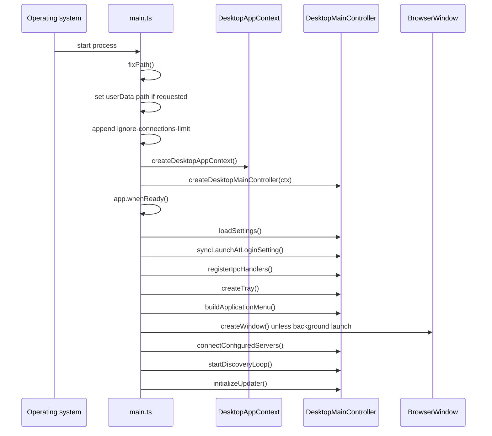
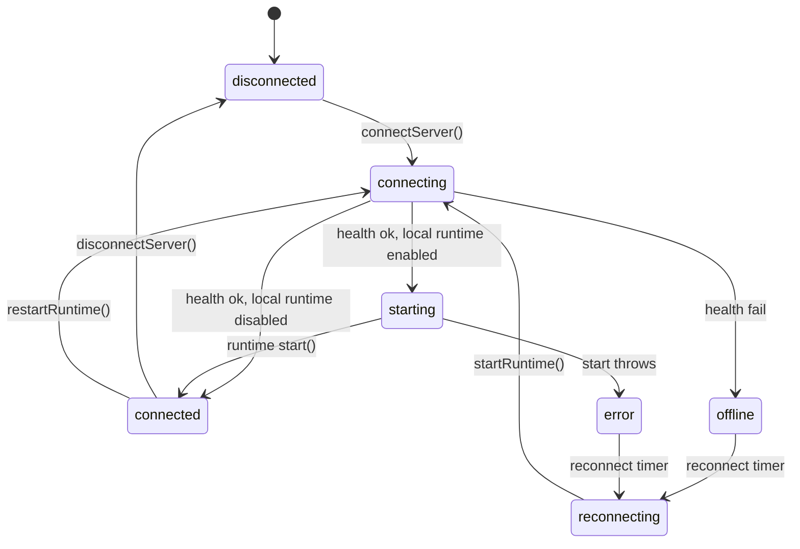

# Main process

The main process is the Node.js side of the desktop application. It owns the application lifetime, the native user interface, the saved state, and the local runtime. This document follows the code from `main.ts` through the controller and the runtime lifecycle.

## Startup sequence

`main.ts` runs three groups of work. The first group runs before Electron is ready. The second group runs inside `main()`. The third group runs after `app.whenReady()` resolves.



Source: `packages/agents-desktop/src/main.ts:22-135`.

### Before ready

Four calls prepare the process:

1. `fixPath()` restores the user shell path. A graphical launch on macOS does not inherit it, and child processes need to find tools such as the GitHub command-line interface (`gh`). Source: `packages/agents-desktop/src/main.ts:20-22`.
2. The optional `ELECTRIC_DESKTOP_USER_DATA_DIR` changes the user data directory. Source: `packages/agents-desktop/src/main.ts:24-26`.
3. `ignore-connections-limit` adds `localhost` and `127.0.0.1`. An entity stream can hold many long-lived Hypertext Transfer Protocol (HTTP) requests open to one local server. Chromium limits connections per host by default. Source: `packages/agents-desktop/src/main.ts:28-39`.
4. The shared context is created. It receives two callbacks that forward cloud state to every window. Source: `packages/agents-desktop/src/main.ts:43-47`.

### Single instance

The application allows one running copy. A second launch sends its arguments to the first copy and exits.

```ts
// packages/agents-desktop/src/main.ts:65
if (!app.requestSingleInstanceLock()) {
  app.quit()
  return
}

app.on(`second-instance`, (_event, argv) => {
  if (LoginItems.shouldOpenWindowForSecondInstance(argv)) {
    desktopController?.showOrCreateWindow()
  }
})
```

The exception is a launch at login. Such a launch carries the `--electric-background-launch` argument. The second instance then stays in the tray and does not open a window. Source: `packages/agents-desktop/src/main.ts:70-74` and `packages/agents-desktop/src/app/login-items.ts:17-29`.

### Window lifetime

`window-all-closed` does nothing. The application stays alive in the tray until the user quits. `activate` reopens or focuses a window. Source: `packages/agents-desktop/src/main.ts:76-82`.

The application intercepts `before-quit` once. The first quit request runs the controlled shutdown. The controlled shutdown stops the discovery loop, stops every runtime, sets `isQuitting`, and calls `app.quit()` again. The second request passes through. Source: `packages/agents-desktop/src/main.ts:91-95` and `packages/agents-desktop/src/app/lifecycle.ts:23-35`.

### After ready

The order matters for four reasons:

- Settings load before any runtime starts, because a runtime reads the working directory and the model choices.
- The login item sync runs before the tray exists, so the menu shows the correct switch state.
- The cloud token cache hydrates before the request header hook installs. A window that opens on a saved cloud server must receive the header on its first request. Source: `packages/agents-desktop/src/main.ts:109-116`.
- Servers with `desiredState: connected` connect after the window and menu exist, so the user sees progress. Source: `packages/agents-desktop/src/app/controller.ts:561-567`.

## The controller

`createDesktopMainController` wires every subsystem. It does not contain the subsystem logic. It creates the dependencies, passes them to small modules, and returns a small public interface.

```ts
// packages/agents-desktop/src/app/controller.ts:470
const desktopIpcDeps: DesktopIpc.RegisterDesktopIpcDeps = {
  settings,
  state,
  runtimeEntries,
  findServer,
  ensureRuntimeEntry,
  saveSettings,
  refreshDesktopState,
  desktopStateForWindow,
  desktopServerFetch: (request) =>
    ServerFetch.desktopServerFetch(cloudAuthHeaderInjectionDeps, request),
  setActiveServer,
  setSelectedServerForWindow,
  selectedServerIdForWindow,
  stopRuntimeEntry,
  restartRuntime,
  connectServer,
  disconnectServer,
  forgetServer,
  stopRuntime,
  runDiscovery: localDiscovery.runDiscovery,
  // ...
}
```

The object is one intersection type. Each inter-process communication (IPC) module declares the dependencies that its handlers need. `registerIpcHandlers` passes the same object to all eight modules. Source: `packages/agents-desktop/src/ipc/register.ts:18-36`.

The controller returns fourteen methods. The important ones are `loadSettings`, `registerIpcHandlers`, `createTray`, `buildApplicationMenu`, `createWindow`, `connectConfiguredServers`, `startDiscoveryLoop`, `initializeUpdater`, and `quitApp`. Source: `packages/agents-desktop/src/app/controller.ts:569-610`.

## Settings

`loadSettings` runs the disk load and seeds default Model Context Protocol (MCP) servers. It applies an optional environment server and the provider keys. It also synchronises the environment for the Codex agent from OpenAI.

```ts
// packages/agents-desktop/src/settings/bootstrap.ts:75
export async function loadSettings(deps: SettingsBootstrapDeps): Promise<void> {
  const shouldSave = await loadDesktopSettings({
    settings: deps.settings,
    apiKeys: deps.apiKeys,
    getSecretStore: deps.getSecretStore,
    ensureRuntimeEntry: deps.ensureRuntimeEntry,
    pullWakeRunnerId: PULL_WAKE_RUNNER_ID,
  })
  const mcpSeeded = seedDefaultMcpServers(deps.settings)
  Object.assign(deps.state, deps.desktopStateForWindow(null))
  await applyInitialServerFromEnv(deps)
  deps.applyApiKeys()
  await deps.syncCodexEnvironment()
  if (shouldSave || mcpSeeded) {
    await deps.saveSettings()
  }
}
```

The loader accepts legacy fields. It reads `activeServer` and `apiKeys` from older files. It writes the new form when it finds them. Source: `packages/agents-desktop/src/settings/store.ts:138-222`.

The `ELECTRIC_DESKTOP_SERVER_URL` environment variable adds a server on first load. The server has `source: manual` and `desiredState: connected`. The application ignores an invalid protocol or an invalid Uniform Resource Locator (URL) with a warning. Source: `packages/agents-desktop/src/settings/bootstrap.ts:26-52`.

## Windows

`createWindow` builds the native shell.

```ts
// packages/agents-desktop/src/windows/manager.ts:19
const win = new BrowserWindow({
  width: 1280,
  height: 900,
  minWidth: 960,
  minHeight: 640,
  title: `Electric Agents`,
  titleBarStyle: isMac ? `hiddenInset` : `hidden`,
  frame: true,
  autoHideMenuBar: !isMac,
  transparent: isMac,
  backgroundColor: isMac ? `#00000000` : undefined,
  vibrancy: isMac ? `sidebar` : undefined,
  visualEffectState: isMac ? `active` : undefined,
  backgroundMaterial: isWindows ? `mica` : undefined,
  titleBarOverlay: isMac
    ? undefined
    : {
        color: isWindows ? `#00000000` : `#f7f7f7`,
        symbolColor: `#1f2328`,
        height: 34,
      },
  webPreferences: {
    preload: PRELOAD_PATH,
    contextIsolation: true,
    nodeIntegration: false,
    sandbox: false,
  },
})
```

Platform differences:

- macOS uses a hidden inset title bar, a transparent background, and sidebar vibrancy.
- Windows uses a hidden title bar with the Mica background material and a title bar overlay 34 pixels high.
- Linux uses the overlay without a special material.

Source: `packages/agents-desktop/src/windows/manager.ts:16-53`.

Each window also installs three behaviours:

1. An editable context menu with spelling suggestions. Source: `packages/agents-desktop/src/windows/context-menu.ts:30-86`.
2. An external link handler. Every `http:`, `https:`, and `mailto:` link opens in the system browser. Source: `packages/agents-desktop/src/windows/context-menu.ts:12-28`.
3. A navigation state bridge. The renderer receives `canGoBack` and `canGoForward` after each navigation. Source: `packages/agents-desktop/src/windows/navigation.ts:24-29`.

The window loads a development server when `ELECTRIC_DESKTOP_DEV_SERVER_URL` is set. Otherwise it loads the packaged `renderer/index.html`. Source: `packages/agents-desktop/src/windows/manager.ts:77-81`.

## Runtime lifecycle

A runtime entry is a state machine. The entry exists as soon as a server is saved. The connection starts only when `desiredState` is `connected`.



`startRuntime` performs these steps in order:

1. Stop the current entry. This increments the generation counter.
2. Set the status to `connecting` or `reconnecting`.
3. Prepare a cloud server, if the source is `electric-cloud`.
4. Check the server health with a 4,000 millisecond timeout.
5. Stop here when the local runtime is disabled.
6. Build and start `BuiltinAgentsServer`.
7. Check the generation counter before it accepts the result.

Source: `packages/agents-desktop/src/runtime/lifecycle.ts:188-392`.

The generation counter prevents a slow start from overwriting a newer state. A stop increments the counter. A start records the value before it awaits. If the value changes, the start stops its own runtime and returns. Source: `packages/agents-desktop/src/runtime/lifecycle.ts:350-355`.

The reconnect schedule is:

```ts
// packages/agents-desktop/src/runtime/lifecycle.ts:70
function reconnectDelayMs(attempt: number): number {
  const base = Math.min(
    RECONNECT_MAX_MS,
    RECONNECT_BASE_MS * Math.max(1, 2 ** Math.min(attempt, 5))
  )
  return Math.round(base * (0.8 + Math.random() * 0.4))
}
```

The constants are 1,000 and 30,000 milliseconds. The exponent is capped at 5, so the base delay reaches its maximum after five attempts. Source: `packages/agents-desktop/src/shared/constants.ts:24-25`.

### Runtime environment

Two environment values are set before the runtime starts:

- `ELECTRIC_AGENTS_LOG_DIR` becomes `<userData>/logs`. A packaged macOS application can start with `/` as the current directory, and `./logs` would then be unwritable. Source: `packages/agents-desktop/src/app/lifecycle.ts:11-17`.
- `ELECTRIC_CODEX_REQUIRE_OPT_IN` becomes `1`. The runtime must not read a Codex token without the user's consent. Source: `packages/agents-desktop/src/app/lifecycle.ts:18-20`.

The runtime also receives the skill directories. The default list includes home and working-directory paths for Claude and Codex skills. The user can add more. Source: `packages/agents-desktop/src/runtime/lifecycle.ts:481-495`.

A file watcher re-reads Markdown skill files. A change restarts every connected runtime after a 300 millisecond debounce. Source: `packages/agents-desktop/src/app/controller.ts:339-391`.

### Power management

When a local runtime is starting or running, the application starts a `powerSaveBlocker` of type `prevent-app-suspension`. The switch in General settings can disable this. The block stops when no runtime needs it. Source: `packages/agents-desktop/src/runtime/lifecycle.ts:85-119`.

## Tray

The tray icon uses two bitmap images: 26 by 22 pixels at normal density and 51 by 44 pixels at double density. On macOS the image is a template image, so the system recolours it for the light or dark menu bar. Source: `packages/agents-desktop/src/ui/tray.ts:15-36`.

The tray menu contains:

- Open Agents and New Window.
- A keep-awake checkbox.
- A read-only count of connected servers.
- A submenu for each saved server with its status, local runtime status, runtime URL, errors, and actions.
- Quit.

Source: `packages/agents-desktop/src/ui/tray.ts:82-199`.

## Application menu

The menu is rebuilt when the focused window changes and when a window title changes. The rebuild moves the check mark in the Window submenu. Source: `packages/agents-desktop/src/main.ts:84-89` and `packages/agents-desktop/src/windows/manager.ts:66-76`.

The menu sends commands to the renderer over `desktop:command`. The commands are a closed union of twelve values. The application menu sends eleven of them. The tray sends the twelfth, `open-servers-settings`. Source: `packages/agents-desktop/src/shared/types.ts:218-230`, `packages/agents-desktop/src/ui/application-menu.ts:41-184`, and `packages/agents-desktop/src/ui/tray.ts:147`.

The target is the focused window. If no window has focus, the target is the first live window. If no live window exists, the command is dropped. Source: `packages/agents-desktop/src/app/controller.ts:188-192`.

| Menu item | Shortcut | Command |
|-----------|----------|---------|
| New Chat | Command or Control + N | `new-chat` |
| New Window | Shift + Command or Control + N | The main process creates a window |
| Settings (macOS application menu; File menu elsewhere) | Command or Control + , | `open-settings` |
| Close Tile | Command or Control + W | `close-tile` |
| Close Window | Shift + Command or Control + W | Electron `close` role |
| Find in Pane | Command or Control + F | `open-find` |
| Find Next | Command or Control + G | `find-next` |
| Find Previous | Shift + Command or Control + G | `find-previous` |
| Toggle Sidebar | Command or Control + B | `toggle-sidebar` |
| Search Sessions | Command or Control + K | `open-search` |
| Split Right | Command or Control + D | `split-right` |
| Split Down | Shift + Command or Control + D | `split-down` |
| Cycle Tile | Command or Control + \ | `cycle-tile` |

Source: `packages/agents-desktop/src/ui/application-menu.ts:41-184`.

The table lists all thirteen items. New Window and Close Window do not send a command: the main process creates the window, and Electron performs the close role.

The renderer can also open a section of the native menu at a position. This gives the custom title bar a native menu without a second menu implementation. Source: `packages/agents-desktop/src/ui/application-menu.ts:260-277`.

## Local discovery

The discovery loop probes a fixed list of ports: 4437, 4438, 4439, 3000, 4000, and 8080. A probe calls `/_electric/health` with a 1,500 millisecond timeout. The loop runs every 30,000 milliseconds. It skips a port that a running local runtime already owns.

```ts
// packages/agents-desktop/src/discovery/local-discovery.ts:54
const results = await Promise.all(
  DISCOVERY_PORTS.map(async (port) => {
    if (skipPorts.has(String(port))) return null
    const url = localDiscoveryUrl(port)
    const ok = await probeAgentsServer(url)
    return ok ? { url, port, lastSeen: Date.now() } : null
  })
)
```

Source: `packages/agents-desktop/src/discovery/local-discovery.ts:37-79` and `packages/agents-desktop/src/shared/constants.ts:77-81`.

A new result broadcasts a state change. An identical result does not. This avoids a state push every 30 seconds. Source: `packages/agents-desktop/src/discovery/local-discovery.ts:67-72`.

## Launch at login

The implementation differs by platform:

- **macOS.** The application writes a LaunchAgent property list (plist) at `~/Library/LaunchAgents/com.electric-sql.agents.launch-at-login.plist`. The agent starts the application with `--electric-background-launch`. Source: `packages/agents-desktop/src/app/login-items.ts:31-93`.
- **Windows.** The application calls `app.setLoginItemSettings({ openAtLogin, args: [--electric-background-launch] })`. Source: `packages/agents-desktop/src/app/login-items.ts:95-116`.
- **Linux.** The status is `supported: false`. Source: `packages/agents-desktop/src/app/login-items.ts:138-142`.

```xml
<!-- packages/agents-desktop/src/app/login-items.ts:59 -->
<plist version="1.0">
<dict>
  <key>Label</key>
  <string>com.electric-sql.agents.launch-at-login</string>
  <key>ProgramArguments</key>
  <array>
${args}
  </array>
  <key>RunAtLoad</key>
  <true/>
</dict>
</plist>
```

## Updates

The updater checks 10,000 milliseconds after startup and when the user selects Check for Updates. It does not download without consent: `autoDownload` is `false`. Source: `packages/agents-desktop/src/app/updater.ts:49-56` and `packages/agents-desktop/src/app/updater.ts:259-261`.

macOS is notifier-only in this version. The code sets `MAC_AUTO_INSTALL_SUPPORTED = false` because automatic installation needs a Developer ID signature. A manual check opens the releases page. An automatic check stays silent. Source: `packages/agents-desktop/src/app/updater.ts:7-12` and `packages/agents-desktop/src/app/updater.ts:156-165`.

Windows and Linux download the update and offer a restart. Concurrent checks share one in-flight promise. Source: `packages/agents-desktop/src/app/updater.ts:226-303`.

## Shutdown and reset

`quitApp` stops the discovery loop, stops every runtime entry, and calls `app.quit()`. Source: `packages/agents-desktop/src/app/lifecycle.ts:23-35`.

`clearAllLocalDataAndRelaunch` does more:

1. Sign out of Electric Cloud.
2. Stop the cloud agent server streams.
3. Clear the default session storage and cache.
4. Delete `settings.json` and `secrets.json`.
5. Drop the secret store instance.
6. Relaunch the application.

Source: `packages/agents-desktop/src/app/lifecycle.ts:37-52`.

## Aha: every server is supervised, and every start is cancellable

**Aha:** The main process treats each saved server as an independent supervised entry. A disconnect does not delete the entry. A reconnect does not create a second runtime. Two mechanisms make this safe: a `RuntimeEntry` map keyed by server identifier, and a generation counter incremented on every stop. The generation check is why a slow start cannot revive a runtime that the user already stopped.

## Related documents

- [Overview](00-overview.md) explains the process model and the state projection.
- [Renderer and IPC](02-renderer-and-ipc.md) lists every channel that reaches these controllers.
- [Packaging and release](03-packaging-and-release.md) explains how this code becomes an installer.
- [agents-runtime overview](../agents-runtime/00-overview.md) explains the agent loop that the embedded runtime runs.
