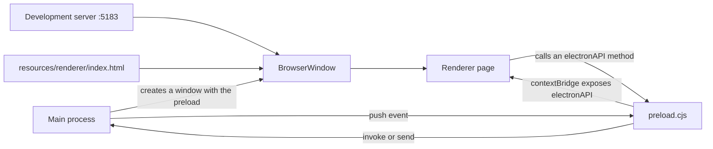
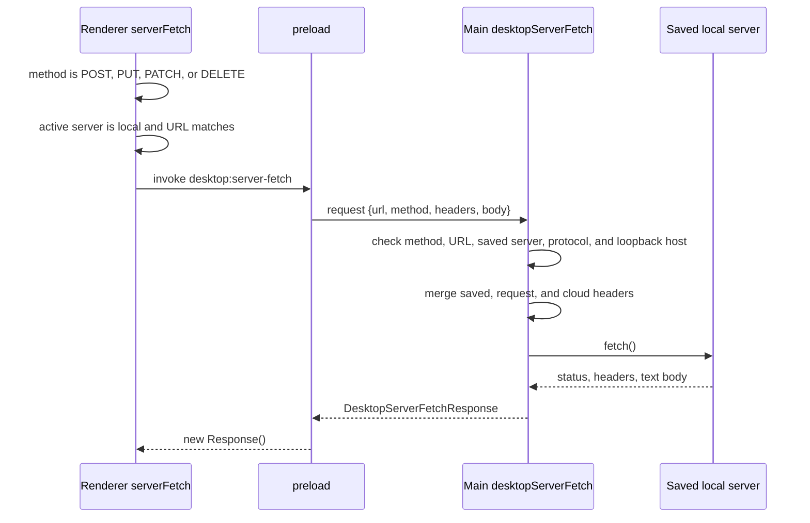

# Renderer and IPC

The desktop application has two JavaScript contexts. The **main process** is the Node.js program that owns the window, the saved state, and every operating-system call. The **renderer** is the Chromium page that shows `agents-server-ui`. The page cannot call Node.js, because Node.js integration is off and the two contexts are isolated. A preload script is the only bridge. This document explains how the renderer loads, what the bridge exposes, and which messages cross it.

## Loading the renderer

The main process chooses one of three sources:

1. A development server at `http://localhost:5183` by default. The address comes from `ELECTRIC_DESKTOP_DEV_SERVER_URL`.
2. A packaged file at `<resources>/renderer/index.html`.
3. In an unpackaged run with no development server, the build output of `agents-server-ui` at `../agents-server-ui/dist-desktop/index.html`.

```ts
// packages/agents-desktop/src/windows/manager.ts:93-97
if (DEV_SERVER_URL) {
  void win.loadURL(DEV_SERVER_URL)
} else {
  void win.loadFile(RENDERER_INDEX)
}
```

In development, the Vite plugin `vite-plugin-electron` starts Electron and sets the address variable. Source: `packages/agents-desktop/vite.config.ts:111-118`.

The packaged path is defined in `paths.ts`. `MODULE_DIR` is the directory of the compiled module. `PACKAGE_DIR` is the package directory, one level above it.

```ts
// packages/agents-desktop/src/shared/paths.ts:5-10
export const MODULE_DIR = path.dirname(fileURLToPath(import.meta.url))
export const PACKAGE_DIR = path.resolve(MODULE_DIR, `..`)
export const RESOURCE_DIR = app.isPackaged ? process.resourcesPath : PACKAGE_DIR
export const RENDERER_INDEX = app.isPackaged
  ? path.join(RESOURCE_DIR, `renderer`, `index.html`)
  : path.resolve(PACKAGE_DIR, `../agents-server-ui/dist-desktop/index.html`)
```

The unpackaged fallback uses the built user interface package. The packaged path uses the copy in the application resources. Source: `packages/agents-desktop/src/shared/paths.ts:5-10`.



## The preload script

The preload script runs before the page scripts. It does three jobs:

1. It confirms the runtime attributes on the document.
2. It installs a selection context menu.
3. It exposes one object on `window.electronAPI`.

The packaged index already has `data-electric-desktop="true"`. The preload confirms it and adds the platform value. The marking is inside a `try` block. A Document Object Model (DOM) failure must not block the bridge. Source: `packages/agents-desktop/src/preload.ts:29-62`.

```ts
// packages/agents-desktop/src/preload.ts:42
if (typeof document !== `undefined` && document.documentElement) {
  document.documentElement.dataset.electricDesktop = `true`
  document.documentElement.dataset.electricPlatform = process.platform
  applyFullscreenState(false)
}
```

The fullscreen attribute changes when the main process sends `desktop:fullscreen-state-changed`. `applyFullscreenState` writes `data-electric-fullscreen` with the value `true` or `false`. The renderer can style a custom title bar from the attribute. It does not need a second state store for the flag. Source: `packages/agents-desktop/src/preload.ts:36-59`.

The script also installs a selection context menu. A right-click on non-editable text inside `[data-desktop-selection-context]` sends `{ kind: 'selection', selectionText }` to the main process over `desktop:show-context-menu`. The main process shows a native Copy item. Source: `packages/agents-desktop/src/preload.ts:92-118` and `packages/agents-desktop/src/ipc/chrome.ts:34-43`.

The preload script attaches the application programming interface (API) once:

```ts
// packages/agents-desktop/src/preload.ts:344
contextBridge.exposeInMainWorld(`electronAPI`, api)
```

The type for the optional object is in `agents-server-ui/src/lib/server-connection.ts`. The type marks `getServers` and `saveServers` as required. All other methods are optional, because the same renderer also runs in a browser with no preload. The type lives in the web package because that package owns the renderer code. Source: `packages/agents-server-ui/src/lib/server-connection.ts:340-478`.

## Channel catalog

The bridge uses three directions. **Invoke** sends a request and waits for one response. **Send** sends a message and does not wait. **Push** sends an event from the main process to the renderer. The preload wraps each push channel in a subscribe helper, such as `onDesktopStateChanged`. The helper registers a listener and returns a removal function.

| Group | Channels | Kind |
|-------|----------|------|
| Servers | `desktop:get-servers`, `desktop:save-servers` | Invoke |
| State | `desktop:get-state` | Invoke |
| State push | `desktop:state-changed` | Push |
| Request bridge | `desktop:server-fetch` | Invoke |
| Server control | `desktop:set-active-server`, `desktop:set-selected-server`, `desktop:connect-server`, `desktop:disconnect-server`, `desktop:forget-server` | Invoke |
| Runtime control | `desktop:restart-runtime`, `desktop:stop-runtime`, `desktop:rescan-servers` | Invoke |
| Credentials | `desktop:get-api-keys-status`, `desktop:save-api-keys`, `desktop:save-enabled-models`, `desktop:codex-sign-in`, `desktop:codex-enable-source`, `desktop:codex-disable`, `desktop:restart-local-runtimes` | Invoke |
| Command line | `desktop:get-cli-status`, `desktop:install-cli`, `desktop:uninstall-cli` | Invoke |
| Preferences | `desktop:get-launch-at-login`, `desktop:set-launch-at-login`, `desktop:get-prevent-app-suspension`, `desktop:set-prevent-app-suspension`, `desktop:get-skill-directories`, `desktop:save-skill-directories` | Invoke |
| Files | `desktop:get-working-directory`, `desktop:choose-working-directory`, `desktop:pick-directory` | Invoke |
| Windows | `desktop:set-native-appearance`, `desktop:get-navigation-state`, `desktop:navigate-history`, `desktop:show-menu-section`, `desktop:show-app-menu` | Invoke |
| Window events | `desktop:show-context-menu` | Send |
| Window pushes | `desktop:navigation-state-changed`, `desktop:fullscreen-state-changed`, `desktop:command` | Push |
| Model Context Protocol (MCP) | `desktop:mcp-snapshot`, `desktop:mcp-authorize`, `desktop:mcp-reconnect`, `desktop:mcp-disable`, `desktop:mcp-enable`, `desktop:mcp-upsert`, `desktop:mcp-remove` | Invoke |
| MCP push | `desktop:mcp-state` | Push |
| Cloud authentication | `desktop:cloud-auth-state`, `desktop:cloud-auth-sign-in`, `desktop:cloud-auth-sign-out`, `desktop:cloud-auth-open-dashboard`, `desktop:cloud-auth-open-create-agents-server` | Invoke |
| Cloud authentication push | `desktop:cloud-auth-state-changed` | Push |
| Cloud servers | `desktop:cloud-agent-servers-state`, `desktop:cloud-agent-server-prepare-connection` | Invoke |
| Cloud servers push | `desktop:cloud-agent-servers-state-changed` | Push |
| System | `desktop:clear-all-local-data`, `desktop:get-onboarding-state`, `desktop:set-onboarding-dismissed` | Invoke |

Two names differ from the channel name. `desktop:get-state` is the method `getDesktopState`. `desktop:mcp-state` is a push channel only: `mcp.onState` subscribes to it. The snapshot read uses a separate invoke channel, `desktop:mcp-snapshot`, through `mcp.getSnapshot`. The renderer side is `packages/agents-desktop/src/preload.ts:124-342`. The main side is split across `packages/agents-desktop/src/ipc/servers.ts`, `runtime.ts`, `credentials.ts`, `cli.ts`, `preferences.ts`, `chrome.ts`, `mcp.ts`, and `cloud.ts`.

## State push

The renderer asks once for the current state, then subscribes to changes:

```ts
// packages/agents-desktop/src/preload.ts:129
getDesktopState: (): Promise<DesktopState> =>
  ipcRenderer.invoke(`desktop:get-state`),

// packages/agents-desktop/src/preload.ts:226
onDesktopStateChanged: (
  callback: (state: DesktopState) => void
): (() => void) => {
  const listener = (_event: Electron.IpcRendererEvent, state: DesktopState) =>
    callback(state)
  ipcRenderer.on(`desktop:state-changed`, listener)
  return () => ipcRenderer.removeListener(`desktop:state-changed`, listener)
},
```

`DesktopState` is the per-window projection described in [Overview](00-overview.md). The main fields are `servers`, `selectedServerId`, `connections`, `runtimeStatus`, `runtimeUrl`, `activeServer`, and `error`.

The main process computes the state for each window, not once for all windows. Each window has its own entry in `windowSelections`, so the selected server can differ between two windows. Source: `packages/agents-desktop/src/state/desktop-state.ts:27-54`.

`broadcastState` sends the value to every live window. `setState` applies a patch and then calls `broadcastState`. Source: `packages/agents-desktop/src/state/desktop-state.ts:56-72`.

## Commands from the native menu

A native menu item cannot call a renderer function. It sends a command instead.

```ts
// packages/agents-desktop/src/app/controller.ts:186
const sendCommand = (command: DesktopCommand): void => {
  const focused = BrowserWindow.getFocusedWindow()
  const target =
    focused ?? [...windows].find((win) => !win.isDestroyed()) ?? null
  target?.webContents.send(`desktop:command`, command)
}
```

The renderer subscribes with `onDesktopCommand`. The command union has twelve values. [Main process](01-main-process.md) lists all twelve. If no focused window and no live window exists, the target is null, so the main process drops the command. Source: `packages/agents-desktop/src/shared/types.ts:218-230` and `packages/agents-desktop/src/app/controller.ts:188-192`.

The renderer also reports its own capability flags. It passes them as the third argument to `desktop:show-menu-section`, together with the section name and the page coordinates. The flags are `hasActiveTile`, `canCloseTile`, `canSplitTile`, and `canCycleTile`. The main process disables items that the renderer cannot perform. Source: `packages/agents-desktop/src/ipc/chrome.ts:44-56` and `packages/agents-desktop/src/ui/application-menu.ts:300-324`.

## The request bridge

The renderer normally uses the browser `fetch`. For a mutating request to a saved local server, it uses the main process instead. A saved local server is a server in `settings.json` whose Uniform Resource Locator (URL) is a loopback address. A loopback address is `localhost`, `127.0.0.1`, `0.0.0.0`, `[::1]`, or `::1`.



The main process reads the response body as text, so it buffers the body fully before the response returns to the renderer. Source: `packages/agents-desktop/src/cloud/server-fetch.ts:90-97`.

The renderer decides to use the bridge in `shouldUseDesktopServerFetch`:

```ts
// packages/agents-server-ui/src/lib/auth-fetch.ts:126
function shouldUseDesktopServerFetch(
  input: RequestInfo | URL,
  init: RequestInit
): boolean {
  const method = requestMethod(input, init)
  return (
    DESKTOP_SERVER_FETCH_METHODS.has(method) &&
    activeServerIsLocal() &&
    matchesActiveServer(input) &&
    Boolean(desktopServerFetchApi())
  )
}
```

The accepted methods are `POST`, `PUT`, `PATCH`, and `DELETE`. Source: `packages/agents-server-ui/src/lib/auth-fetch.ts:18` and `packages/agents-server-ui/src/lib/auth-fetch.ts:126-137`.

The main process validates again. It rejects a request when:

- The URL, method, or header object is missing.
- The body is neither null nor a string.
- The method is not one of the four mutating methods.
- The URL does not match a saved server.
- The protocol is not `http:`.
- The host is not a loopback address.

The first two checks are before the cited block. Source: `packages/agents-desktop/src/cloud/server-fetch.ts:24-40`.

```ts
// packages/agents-desktop/src/cloud/server-fetch.ts:41-62
const url = raw.url.trim()
const method = raw.method.trim().toUpperCase()
if (![`POST`, `PUT`, `PATCH`, `DELETE`].includes(method)) {
  throw new Error(`Desktop server fetch only supports mutating requests`)
}
const server = findSavedServerForUrl(deps.getServers(), url)
if (!server) {
  throw new Error(
    `Desktop server fetch is only available for saved local servers`
  )
}
let parsed: URL
try {
  parsed = new URL(url)
} catch {
  throw new Error(`Invalid desktop server fetch URL`)
}
if (
  parsed.protocol !== `http:` ||
  !isLocalLoopbackHostname(parsed.hostname)
) {
  throw new Error(`Desktop server fetch only supports local HTTP servers`)
}
```

Source: `packages/agents-desktop/src/cloud/server-fetch.ts:20-71`.

The main process merges three header sources in this order: saved server headers, request headers, and cloud authentication headers. A later source replaces a header from an earlier source. As a result, a request header replaces a saved header with the same name, and a cloud authentication header replaces both. Source: `packages/agents-desktop/src/cloud/server-fetch.ts:77-89` and `packages/agents-desktop/src/shared/headers.ts:10-22`.

A `FormData` body cannot cross the bridge as a string. The renderer then sends a normal browser request. In that path it adds the configured saved-server headers itself, but it does not add cloud authentication headers, because only the main process builds those. Source: `packages/agents-server-ui/src/lib/auth-fetch.ts:254-260`.

## Window bridges

| Bridge | Purpose | Source |
|--------|---------|--------|
| Native appearance | Set the Electron theme source to light, dark, or system | `packages/agents-desktop/src/ipc/chrome.ts:28-33` |
| Navigation state | The main process reports `canGoBack` and `canGoForward` to the renderer after each navigation | `packages/agents-desktop/src/windows/navigation.ts:24-29` |
| History | Go back or forward in the window history | `packages/agents-desktop/src/windows/navigation.ts:31-41` |
| Fullscreen | Push the fullscreen flag from the main process to the preload | `packages/agents-desktop/src/windows/navigation.ts:19-22` |
| Context menu | Show a native Copy item for selected text | `packages/agents-desktop/src/windows/context-menu.ts:103-117` |
| Menu popup | Show one native menu section at page coordinates | `packages/agents-desktop/src/ui/application-menu.ts:260-277` |

The fullscreen bridge is a push, not an invoke. The preload stores the result in a document attribute. Source: `packages/agents-desktop/src/preload.ts:36-59`.

## Model Context Protocol and cloud surfaces

The MCP surface is a push-based view of the embedded runtime's registry. The registry is the runtime's list of MCP servers and their tools. `mcp.getSnapshot` returns the last value. `mcp.onState` receives each new value. Source: `packages/agents-desktop/src/preload.ts:246-288`.

The main process adds provenance to each registry row:

- `settings` means the server comes from `settings.json`.
- `workspace` means the server comes from the project `mcp.json`.
- `extras` means another embedder, which is the program that starts the runtime, provided it.

A workspace entry wins when its name matches a settings entry. The settings entry receives a separate row with status `shadowed`. The row stays so the user can see that a saved entry exists but has no effect. Source: `packages/agents-desktop/src/runtime/mcp.ts:52-104`.

The cloud authentication surface opens a child window for the Open Authorization (OAuth) flow. The renderer observes state and calls methods such as `signIn`, `signOut`, `openDashboard`, and `openCreateAgentsServer`. The comment in the preload states this split. Source: `packages/agents-desktop/src/preload.ts:291-315`.

The cloud agent server surface reports tenants and prepares a connection. A tenant is one cloud service record, identified by `stream_services.id`. `prepareConnection` returns `{ url, tenantId }`: the tenant-scoped server URL and the tenant identifier. It stores the bearer token in `SecretStore` and in an in-memory cache, and `main.ts` attaches it to outbound requests. The token itself never crosses the IPC boundary. Source: `packages/agents-desktop/src/cloud/cloud-agent-servers.ts:246-273`.

## Security boundary

Inter-process communication (IPC) is the message channel between the renderer and the main process. The bridge is an allowlist. The renderer can call only the exposed methods. It cannot name an arbitrary channel, pass a function, or receive a raw `ipcRenderer` object.

Three properties keep the boundary narrow:

1. `contextIsolation: true` keeps the preload and page JavaScript contexts apart.
2. `nodeIntegration: false` removes Node.js from the page.
3. The request bridge limits methods, protocols, hosts, and saved servers.

**Important:** The IPC handlers do not compare `event.senderFrame.url` with the application URL. The application does not need such a check here. The window loads only the packaged renderer or the development server. External links open in the system browser. The trust boundary is the preload allowlist and the loaded page. A compromised renderer can call every exposed method. Each handler still applies its own checks. For example, the request bridge checks the method, the saved server, the protocol, and the host. Source: `packages/agents-desktop/src/cloud/server-fetch.ts:20-71` and `packages/agents-desktop/src/windows/context-menu.ts:12-28`.

## Aha: the bridge is a small typed operating-system API

**Aha:** The renderer does not receive a general remote procedure call channel. It receives 44 flat methods and three namespaced groups, each entry with one purpose and one return type. The web package declares the optional type for the same surface in `server-connection.ts`. That is why the web build can set every method to optional and run unchanged in a browser. The bridge is not a transport. It is a typed operating-system API for one application. Source: `packages/agents-desktop/src/preload.ts:124-344` and `packages/agents-server-ui/src/lib/server-connection.ts:340-478`.

## Related documents

- [Main process](01-main-process.md) explains the handlers and controllers behind these channels.
- [Overview](00-overview.md) explains the two-process model.
- [Packaging and release](03-packaging-and-release.md) explains how the preload and renderer bundles are built.
- [Data and streams](../agents-server-ui/02-data-and-streams.md) explains how the renderer uses the request bridge.
