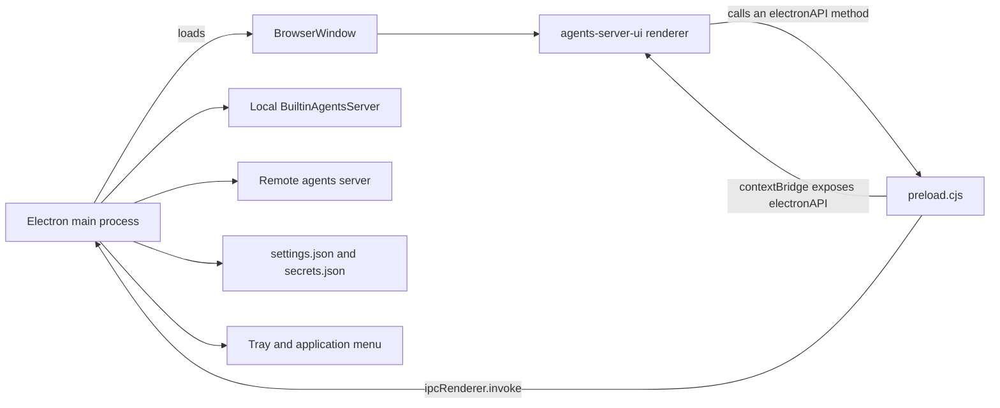
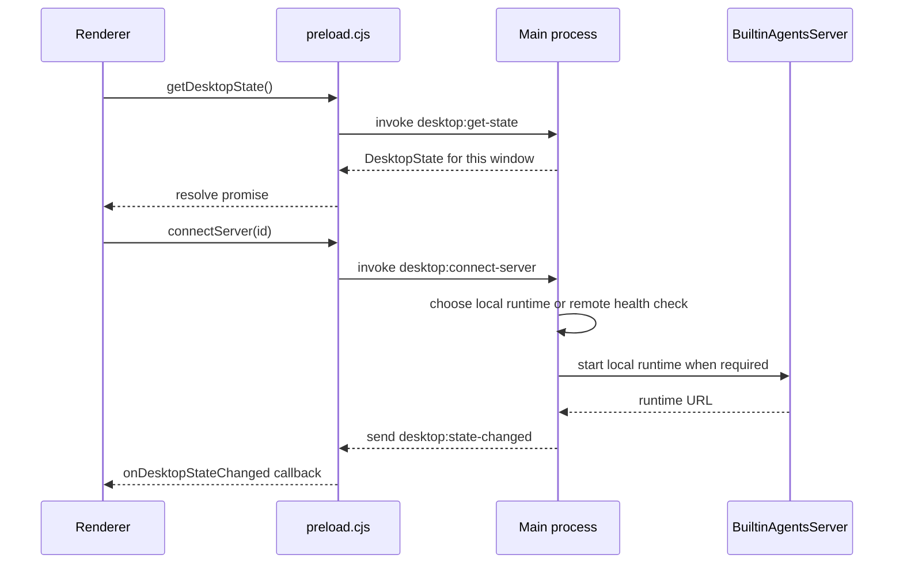

# agents-desktop

This directory studies `packages/agents-desktop`, the Electron desktop application for Electric Agents. The package name is `@electric-ax/agents-desktop`. Its version is `0.6.1`.

Electron is a runtime that puts a web page inside a native window. The application has two processes:

1. The **main process** is a Node.js program. It owns the window, the tray icon, the application menu, the saved settings, the local agent runtime, and every operating-system call. The local runtime is the `BuiltinAgentsServer`. It runs the agent engine inside the desktop process.
2. The **renderer** is the `agents-server-ui` web application. It runs in a Chromium web view and cannot call the operating system directly. `agents-server-ui` is the shared package for the web interface. The web, desktop, and mobile clients use it.

A preload script connects the two processes. A preload script runs in the renderer before the page loads and exposes a limited application programming interface (API) on `window.electronAPI`.



The most important design fact is that the renderer does not send every request directly. The main process owns saved servers, credentials, the local runtime, and connection state. It sends a `DesktopState` object to each window and reads commands back over named inter-process communication (IPC) channels.

## Documents

| Order | Document | What it explains |
|-------|----------|------------------|
| 1 | [00-overview.md](00-overview.md) | Purpose, process model, runtime modes, state model, and package boundaries |
| 2 | [01-main-process.md](01-main-process.md) | Startup sequence, application context, settings, tray, menu, runtime lifecycle, discovery, updater |
| 3 | [02-renderer-and-ipc.md](02-renderer-and-ipc.md) | Renderer loading, preload bridge, channel catalog, state push, request bridge, window security |
| 4 | [03-packaging-and-release.md](03-packaging-and-release.md) | Two Vite bundles, build chain, electron-builder, resources, asar, release targets, update policy |

## Quick facts

| Fact | Value | Source |
|------|-------|--------|
| Package name | `@electric-ax/agents-desktop` | `packages/agents-desktop/package.json:2` |
| Version | `0.6.1` | `packages/agents-desktop/package.json:5` |
| Main entry | `./dist/main.cjs` | `packages/agents-desktop/package.json:10` |
| Electron | `^41.5.0` | `packages/agents-desktop/package.json:49` |
| Packaging tool | `electron-builder` `^26.8.1` | `packages/agents-desktop/package.json:51` |
| Build tool | Vite `^7.1.7` | `packages/agents-desktop/package.json:54` |
| Electron plugin | `vite-plugin-electron` `^0.29.1` | `packages/agents-desktop/package.json:55` |
| Embedded database | `better-sqlite3` `^12.9.0` | `packages/agents-desktop/package.json:32` |
| Application identifier | `com.electric-sql.agents` | `packages/agents-desktop/electron-builder.yml:1` |
| Window size | 1280 by 900 pixels | `packages/agents-desktop/src/windows/manager.ts:20-21` |

## Build and run commands

```bash
# Start the user interface server and the Electron process
pnpm --filter @electric-ax/agents-desktop dev

# Build the embedded agents, the command-line interface,
# the desktop user interface, and the Electron main and preload bundles
pnpm --filter @electric-ax/agents-desktop build

# Build an unpacked application for the current platform
pnpm --filter @electric-ax/agents-desktop dist

# Type check
pnpm --filter @electric-ax/agents-desktop typecheck
```

The scripts come from `packages/agents-desktop/package.json:12-27`.

## How state reaches a window



After the first `getDesktopState` call, the push channel is the normal way that the renderer learns about a connection change. The renderer does not poll. Source: `packages/agents-desktop/src/state/desktop-state.ts:56-65` and `packages/agents-desktop/src/preload.ts:226-233`.

## Aha: the desktop shell is a supervisor, not a second server

**Aha:** The application is not only a window around a web page. It is a supervisor for one or more agents servers. For each saved server it keeps a `RuntimeEntry` with a connection status, a local runtime status, a reconnect counter, and an optional `BuiltinAgentsServer` instance. The renderer sees a flat `DesktopState` projection of those entries. The renderer uses the same state fields when it connects to a remote server and when it starts the bundled runtime.

The server list comes from the main process:

```ts
// packages/agents-desktop/src/ipc/servers.ts:30
ipcMain.handle(`desktop:get-servers`, () => deps.settings.servers)
```

The window-specific state projection merges settings and live entries:

```ts
// packages/agents-desktop/src/state/desktop-state.ts:31
const selectedServerId = deps.selectedServerIdForWindow(win)
const activeServer = deps.findServer(selectedServerId)
const entry = activeServer ? deps.ensureRuntimeEntry(activeServer) : null
return {
  servers: deps.settings.servers,
  selectedServerId,
  connections: deps.settings.servers.map((server) =>
    createConnectionState(deps.ensureRuntimeEntry(server))
  ),
  runtimeStatus: runtimeStatusForConnection(entry),
  runtimeUrl: entry?.runtimeUrl ?? null,
  // ...
}
```

```ts
// packages/agents-desktop/src/ipc/servers.ts:68
ipcMain.handle(`desktop:get-state`, (event) => {
  const win = BrowserWindow.fromWebContents(event.sender)
  return deps.desktopStateForWindow(win)
})
```

## A note about Electric Cloud

The package README says: "Electric Cloud has been shut down. The Electric Cloud sign-in and server discovery in this app no longer work. Connect to a self-hosted agents server instead." Source: `packages/agents-desktop/README.md:3-6`. The code still contains the cloud sign-in window, the cloud token store, and the preparation path for the cloud server. This exploration documents what the code does. It marks the cloud path as historical where the shutdown matters.

## Related documents

- [Electric and Durable Streams](../README.md) is the top-level index.
- [agents-server-ui](../agents-server-ui/README.md) is the renderer that this package loads.
- [agents-mobile](../agents-mobile/README.md) is the third client of the same runtime.
- [How the runtime sets up a stream](../04-how-the-runtime-sets-up-a-stream.md) explains the stream that the embedded runtime serves.
