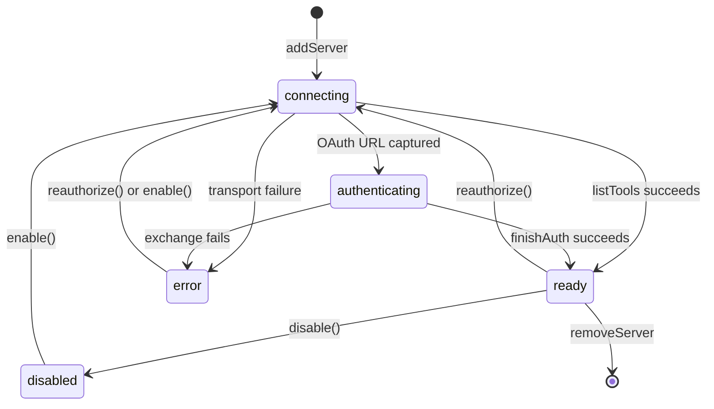
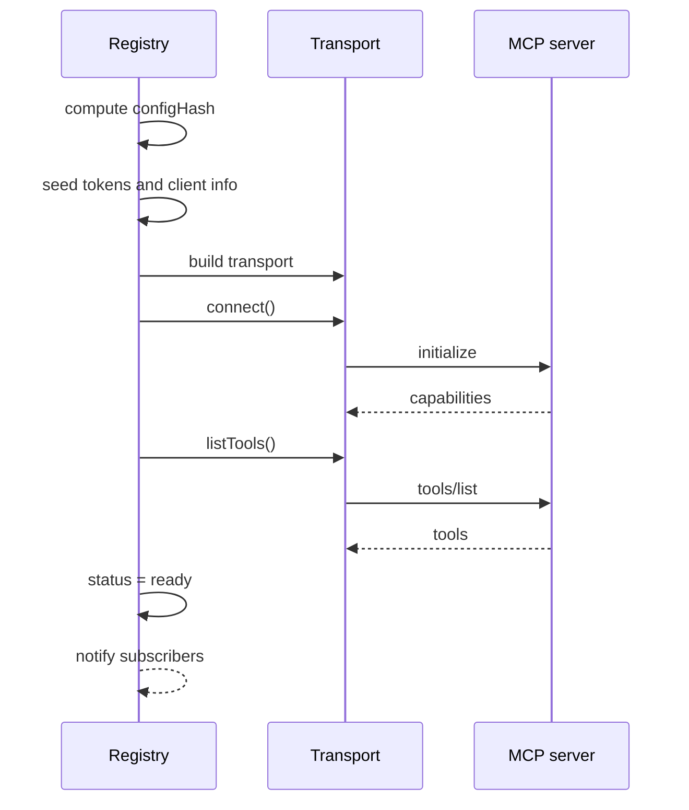

# The Model Context Protocol registry

The registry is the stateful center of the package. It holds one entry per configured Model Context Protocol (MCP) server, owns the transport for that server, and broadcasts a snapshot on every change.

The implementation is `packages/agents-mcp/src/registry.ts`, 577 lines.

A transport is the connection layer to one server. A snapshot is the full server list plus a sequence number. Open Authorization (OAuth) is the delegated login protocol. Dynamic Client Registration (DCR) is the method that registers a client with an OAuth server. `stdio` means standard input and output. The consent page address is a Uniform Resource Locator (URL).

## The registry interface

```ts
export interface Registry {
  addServer(cfg: McpServerConfig): Promise<AddServerResult>
  applyConfig(cfg: McpConfig): Promise<AddServerResult[]>
  removeServer(name: string): Promise<void>
  list(): ReadonlyArray<ListedEntry>
  get(name: string): Entry | undefined
  finishAuth(serverName: string, code: string, state?: string): Promise<AddServerResult>
  disable(name: string): Promise<void>
  enable(name: string): Promise<AddServerResult>
  reauthorize(name: string): Promise<void>
  subscribe(handler: RegistrySubscriber): () => void
  close(): Promise<void>
}
```

Source: `packages/agents-mcp/src/registry.ts:88-130`.

`AddServerResult` is the result of one add or enable call. It carries a state, the server name, and either a tool count or an authorization address. `ListedEntry` is the serializable view that `list()` returns. `RegistrySubscriber` is a function that receives a snapshot. `RegistrySnapshot` is an object with a sequence number and the server list.

## The entry

Each server has one entry object.

```ts
interface Entry {
  config: McpServerConfig
  configHash: string
  status: McpServerStatus
  error?: McpToolError
  authUrl?: string
  transport?: McpTransport
  tools: Array<{ name: string; description?: string; inputSchema: unknown }>
  capabilities?: unknown
  provider?: SdkOAuthProvider
}
```

Source: `packages/agents-mcp/src/registry.ts:18-28`.

The `configHash` lets the registry skip a reconnect when nothing relevant changed.

## The state machine



Five states are visible to subscribers. The methods `addServer`, `finishAuth`, `disable`, `enable`, `reauthorize`, and `removeServer` drive all the transitions.

## Adding a server

`addServer` has a short-circuit for an unchanged ready server.

```ts
const existing = entries.get(cfg.name)
const hash = hashConfig(cfg)
if (
  existing &&
  existing.configHash === hash &&
  existing.status === `ready`
) {
  return { state: `ready`, id: cfg.name, toolCount: existing.tools.length }
}
```

Source: `packages/agents-mcp/src/registry.ts:386-398`.

The hash covers the fields that change the connection.

```ts
function hashConfig(c: McpServerConfig): string {
  const parts = [
    c.name,
    c.transport,
    (c as any).url ?? ``,
    c.auth?.mode ?? `none`,
    String(c.timeoutMs ?? ``),
  ]
  if (
    c.auth &&
    (c.auth.mode === `authorizationCode` || c.auth.mode === `clientCredentials`)
  ) {
    parts.push((c.auth.scopes ?? []).slice().sort().join(`,`))
  }
  if (c.transport === `stdio`) {
    parts.push(c.command, (c.args ?? []).join(` `))
  }
  return parts.join(`|`)
}
```

Source: `packages/agents-mcp/src/registry.ts:132-150`.

The hash sorts scopes. Two configurations with the same scopes in a different order therefore hash the same.

The hash does not include the Application Programming Interface (API) key or the client identifier. It also does not include the client secret, the header name, the header prefix, or the stdio environment map. A rotation of one of those values does not trigger a reconnect. `reauthorize` is not a general remedy: it returns immediately unless the entry uses the `authorizationCode` mode (`packages/agents-mcp/src/registry.ts:522-526`). For an API-key entry, only a restart applies a rotated value.

The method then seeds OAuth state when needed, builds the transport, and inserts the entry.

```ts
if (cfg.auth?.mode === `authorizationCode`) {
  if (cfg.auth.tokens) authStore.seedTokens(cfg.name, cfg.auth.tokens)
  if (cfg.auth.client) authStore.seedClient(cfg.name, cfg.auth.client)
  authStore.registerHooks(cfg.name, {
    onTokensChanged: cfg.auth.onTokensChanged,
    onClientRegistered: cfg.auth.onClientRegistered,
  })
}
```

Source: `packages/agents-mcp/src/registry.ts:406-413`.

Seeded tokens skip the interactive flow. The hooks persist refreshed tokens after the flow completes.

## Connecting and listing tools

`connectAndList` performs the connection and reads the tool list.

```ts
await entry.transport.connect()
const out = await entry.transport.client.listTools()
entry.tools = out.tools.map((t) => ({
  name: t.name,
  description: t.description,
  inputSchema: t.inputSchema,
}))
entry.capabilities = (
  entry.transport.client as { getServerCapabilities?: () => unknown }
).getServerCapabilities?.()
entry.status = `ready`
```

Source: `packages/agents-mcp/src/registry.ts:302-312`.

The capability object decides whether the registry records resource and prompt support. The built-in runtime reads that object and adds the tools. The bridge module builds them.

## Connection errors and the authentication path

A connection can fail for two reasons. The first is a real failure. The second is a need for user consent.

```ts
const authUrl = provider?.peekAuthUrl()
if (authUrl) {
  entry.status = `authenticating`
  entry.authUrl = authUrl
  entry.provider = provider
  notify()
  try {
    opts.openAuthorizeUrl?.(authUrl, entry.config.name)
  } catch {
    // Operator-provided callback must not break the flow.
  }
  return { state: `authenticating`, id: entry.config.name, authUrl }
}
entry.status = `error`
const e = makeError(`transport_error`, (err as Error).message)
```

Source: `packages/agents-mcp/src/registry.ts:321-335`.

`provider` is the auth provider that the transport builder created for this entry. It is optional. A `none` or `apiKey` server has no provider.

The registry does not guess. The OAuth provider either captured a redirect URL or it did not. If it captured a URL, the server needs consent. If it did not, the connection failed.

Key insight: this check turns an ambiguous client error into a clear user action. A failed connect can mean "start the login flow" or "the server is down". The provider's captured URL is the discriminator.

## The snapshot protocol



Subscribers receive the full server list on every change.

```ts
let seq = 0
const subscribers = new Set<RegistrySubscriber>()
const snapshot = (): RegistrySnapshot => ({
  seq: ++seq,
  servers: registry.list(),
})
const notify = (): void => {
  if (subscribers.size === 0) return
  const snap = snapshot()
  for (const h of subscribers) {
    try {
      h(snap)
    } catch {
      // A buggy subscriber must not break the registry.
    }
  }
}
```

Source: `packages/agents-mcp/src/registry.ts:348-364`.

The registry delivers the first snapshot with `seq: 0` synchronously during `subscribe`. Later snapshots start at 1 and increase.

```ts
handler({ seq: 0, servers: registry.list() })
```

Source: `packages/agents-mcp/src/registry.ts:376`.

This sentinel has a practical use. A renderer can drop any event whose sequence number is not greater than the last seen number. The initial snapshot does not collide with that rule in one of two cases. The renderer starts with a last-seen value below 0, or the renderer treats `seq: 0` as a special case.

## Applying a whole configuration

`applyConfig` adds every server in the file and removes every server that is absent.

```ts
async applyConfig(cfg) {
  const seen = new Set(cfg.servers.map((s) => s.name))
  const results: AddServerResult[] = []
  for (const s of cfg.servers) results.push(await registry.addServer(s))
  for (const name of [...entries.keys()]) {
    if (!seen.has(name)) await registry.removeServer(name)
  }
  return results
}
```

Source: `packages/agents-mcp/src/registry.ts:445-453`.

The real method calls the registry through the object that owns it. The snippet uses the exported name. The order matters. New servers connect before old servers disconnect. A configuration that renames a server therefore produces a short period where both names exist, not a period where neither exists.

## Reauthorization

`reauthorize` forces a fresh login without removing the row.

```ts
await Promise.resolve(e.transport?.close()).catch(() => {})
// Drop only tokens + DCR client cache; hooks stay registered.
authStore.clearCredentials(name)
e.status = `connecting`
e.tools = []
e.capabilities = undefined
```

Source: `packages/agents-mcp/src/registry.ts:527-534`.

The user interface therefore does not see the server disappear and reappear. The subscription hooks stay registered, so a new token writes to the same persistence layer.

## Aha: entries are replaced in place to keep ordering stable

The registry uses a `Map` keyed by server name. When a server reconnects, the code calls `entries.set` with the same key. A `Map` keeps the original insertion position for an existing key.

Key insight: this is why the server list does not jump around in the user interface during a reconnect. The comment at `packages/agents-mcp/src/registry.ts:399-401` states this intent directly.

## Related documents

- [00-overview.md](00-overview.md) for the configuration types.
- [02-transports.md](02-transports.md) for how the registry builds a transport.
- [03-oauth-bridges.md](03-oauth-bridges.md) for the authentication providers.
- [04-tools-and-resources.md](04-tools-and-resources.md) for the tool list this registry produces.
