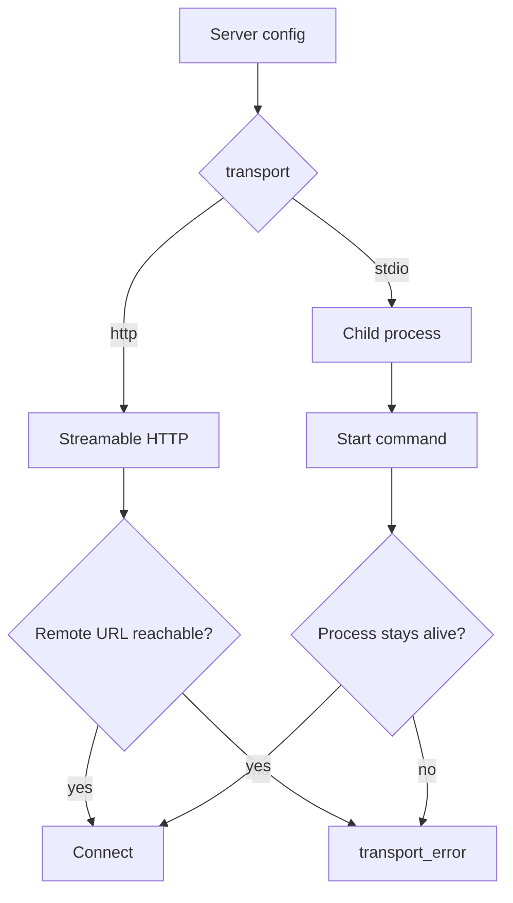
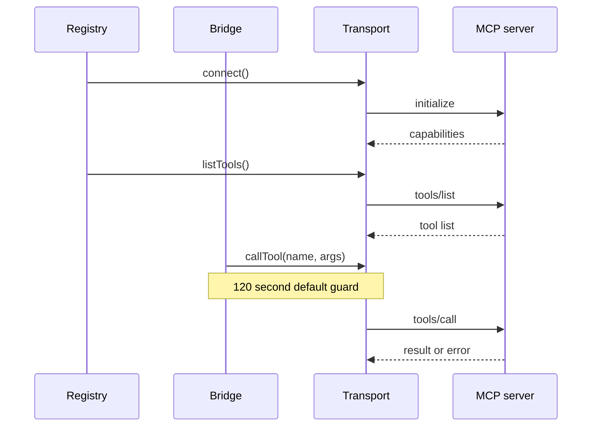

# Transports

A transport opens one connection to one Model Context Protocol (MCP) server. The package supports two transports: streamable Hypertext Transfer Protocol (HTTP) and standard input and output (stdio). The server address is a Uniform Resource Locator (URL).

The interface is small.

```ts
export interface McpTransport {
  client: Client
  connect(): Promise<void>
  close(): Promise<void>
}
```

Source: `packages/agents-mcp/src/transports/types.ts:3-7`.

Every transport returns a Software Development Kit (SDK) client with the same shape. The registry does not know which transport it holds. It calls `connect`, then `client.listTools()`, then `transport.close()`. The registry closes the transport, and the transport closes its client.

## Which transport to use



| Property | HTTP | Stdio |
|----------|------|-------|
| Address | URL | Executable plus arguments |
| Process | Remote or local server | Child process of the runtime |
| Authentication | Application Programming Interface (API) key, client credentials, Open Authorization (OAuth) | Usually `none` |
| Network | Required | Not required |
| Lifetime | Independent | Ends with the child |

## The HTTP transport

The configuration value `transport: 'http'` selects the MCP streamable HTTP transport. Streamable HTTP is the MCP transport kind that runs over request and response or server-sent events.

```ts
export function createHttpTransport(opts: HttpTransportOpts): McpTransport {
  const fetchImpl = opts.fetchImpl ?? fetch
  const transport = new StreamableHTTPClientTransport(new URL(opts.url), {
    authProvider: opts.authProvider,
    fetch: opts.headerProvider
      ? async (url, init) => {
          const headers = new Headers(init?.headers)
          const h = await opts.headerProvider!()
          if (h) headers.set(h.name, h.value)
          return fetchImpl(url, { ...init, headers })
        }
      : fetchImpl,
  })
```

Source: `packages/agents-mcp/src/transports/http.ts:17-30`.

Three parts deserve attention.

1. **The URL object.** The constructor receives `new URL(opts.url)`, not a string. An invalid URL fails early.
2. **The auth provider.** The SDK transport uses this provider for the OAuth handshake and the token refresh. It also uses it for the retry after a `401` response.
3. **The fetch wrapper.** When a header provider exists, the wrapper adds one header to every request. This is how the `apiKey` mode works without a custom transport. `fetchImpl` is the fetch function that the wrapper calls; it defaults to the global `fetch`.

The header provider is asynchronous. It can read a token from a store at request time. The wrapper creates a new `Headers` object, so it does not change the caller's object.

### The client identity

```ts
const client = new Client(
  { name: `@electric-ax/agents-mcp`, version: `0.1.0` },
  { capabilities: {} }
)
```

Source: `packages/agents-mcp/src/transports/http.ts:30-33`.

The client announces its name and version during initialization. The version is `0.1.0`, the same value as the package `VERSION` constant. It differs from the manifest version `0.6.0`; [00-overview.md](00-overview.md) records that inconsistency. The capability object is empty, which means the client does not offer sampling, roots, or elicitation to the server. Sampling lets a server ask the client to run a model call. Roots tell a server which filesystem roots the client exposes. Elicitation lets a server ask the user for input.

The same identity appears in the stdio transport at `packages/agents-mcp/src/transports/stdio.ts:18-21`.

## The stdio transport

```ts
export function createStdioTransport(opts: StdioTransportOpts): McpTransport {
  const transport = new StdioClientTransport({
    command: opts.command,
    args: opts.args ?? [],
    env: opts.env,
  })
```

Source: `packages/agents-mcp/src/transports/stdio.ts:12-17`.

The stdio transport starts a child process. The child speaks MCP over its standard input and standard output. The transport ends when the child exits or when the caller calls `close()`.

The transport passes an `env` map to the SDK unchanged. Whether the SDK merges this map with the parent environment is not visible in this package. This is an open question for a stdio server that needs `PATH` or other inherited variables.

## Timeouts

The bridge wraps every tool call in a timeout. The wrapper is `withTimeout`, and the bridge applies it when it invokes the tool.

```ts
export const DEFAULT_TIMEOUT_MS = 120_000
export const MAX_TIMEOUT_MS = 600_000

export function normalizeTimeoutMs(ms: number | undefined): number {
  if (typeof ms !== `number` || !Number.isFinite(ms)) {
    return DEFAULT_TIMEOUT_MS
  }
  return Math.min(Math.max(Math.trunc(ms), 1), MAX_TIMEOUT_MS)
}
```

Source: `packages/agents-mcp/src/transports/timeout.ts:3-11`.

The default is two minutes. The maximum is ten minutes. A value below 1 becomes 1. A value above the maximum becomes the maximum. A non-finite value becomes the default.

The timer rejects with a typed error.

```ts
class TimeoutError extends Error implements McpToolError {
  kind = `timeout` as const
  constructor(ms: number) {
    super(`MCP tool call timed out after ${ms}ms`)
  }
}
```

Source: `packages/agents-mcp/src/transports/timeout.ts:13-18`.

The `kind` field lets the bridge classify the error without parsing the message.



## Aha: the timeout guard does not cancel the server call

`withTimeout` races the call promise against a timer. When the timer wins, the caller receives a timeout error. The underlying request can still be running on the transport.

Key insight: a timeout is a caller-side promise. It is not a cancellation message to the server. The bridge passes an `AbortSignal` when the caller provides one, but the timeout guard alone does not abort the request. A caller that needs cancellation must supply its own signal and abort it.

## Connection failure mapping

A connect or list failure produces `transport_error`.

```ts
entry.status = `error`
const e = makeError(`transport_error`, (err as Error).message)
```

Source: `packages/agents-mcp/src/registry.ts:334-336`.

An OAuth redirect produces `authenticating` instead. The next document explains that path.

## Related documents

- [01-mcp-registry.md](01-mcp-registry.md) for the caller of these transports.
- [03-oauth-bridges.md](03-oauth-bridges.md) for the auth providers passed to the HTTP transport.
- [04-tools-and-resources.md](04-tools-and-resources.md) for the calls that run over these transports.
- [00-overview.md](00-overview.md) for the configuration that selects a transport.
