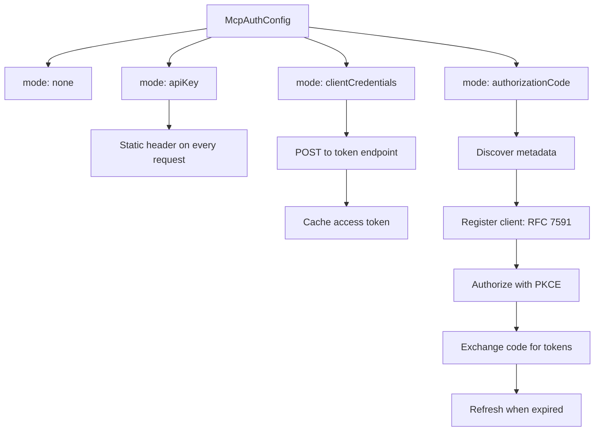
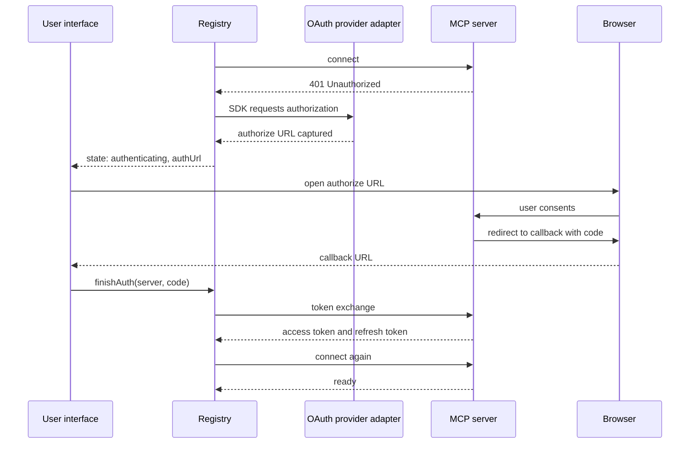

# Authentication and OAuth bridges

A Model Context Protocol (MCP) server can require one of four authentication modes. This document describes each mode, the flow it uses, and the token storage options.

Open Authorization (OAuth) is the delegated login protocol. Proof Key for Code Exchange (PKCE) is the OAuth extension that binds the authorization request to the token request. Dynamic Client Registration (DCR) is the method that registers a client with an OAuth server. Request for Comments (RFC) 7591 defines DCR, and RFC 9728 defines OAuth 2.0 Protected Resource Metadata.

## Mode overview



| Mode | Interactive | Credential source | Storage |
|------|-------------|-------------------|---------|
| `none` | No | None | None |
| `apiKey` | No | Inline secret | Configuration lifetime |
| `clientCredentials` | No | Client identifier and secret | Process memory |
| `authorizationCode` | Yes | User consent | Process memory, or a persistence helper |

## Mode none

The registry passes no auth provider to the Hypertext Transfer Protocol (HTTP) transport.

```ts
if (cfg.auth.mode === `none`) {
  if (opts.transportFactoryOverride) {
    return { transport: opts.transportFactoryOverride(cfg) }
  }
  return {
    transport: createHttpTransport({ name: cfg.name, url: cfg.url }),
  }
}
```

Source: `packages/agents-mcp/src/registry.ts:190-197`.

The snippet shows the HTTP path. A standard input and output (stdio) server with mode `none` uses the stdio transport. `transportFactoryOverride` is a test hook that replaces the transport for this server.

## Mode apiKey

The Application Programming Interface (API) key mode builds one header and returns it from a header provider. The mode fields are `key`, `headerName`, and `valuePrefix`. `key` is the secret, `headerName` selects the header, and `valuePrefix` is a value prefix such as `Bearer `.

```ts
const header = buildApiKeyHeader(cfg.auth.key, {
  headerName: cfg.auth.headerName,
  valuePrefix: cfg.auth.valuePrefix,
})
const headerProvider: HeaderProvider = async () => header
```

Source: `packages/agents-mcp/src/registry.ts:211-215`.

The default header name is `Authorization`. The default prefix is empty. A common configuration sets the prefix to `Bearer `.

```ts
return {
  name: opts.headerName ?? `Authorization`,
  value: (opts.valuePrefix ?? ``) + apiKey,
}
```

Source: `packages/agents-mcp/src/auth/api-key.ts:10-13`.

The registry rejects an empty key with an `auth_unavailable` error. The error message states that the secret must be inline.

## Mode clientCredentials

The client credentials mode implements a small OAuth client provider. It fetches a token on demand.

```ts
async tokens() {
  const now = Math.floor(Date.now() / 1000)
  if (cached && cached.expiresAt - 30 > now) {
    return {
      access_token: cached.access_token,
      token_type: `Bearer`,
    } as any
  }
  const body = new URLSearchParams({
    grant_type: `client_credentials`,
    client_id: opts.clientId,
    client_secret: opts.clientSecret,
  })
```

Source: `packages/agents-mcp/src/auth/client-credentials.ts:35-47`.

The cache rule is a 30 second safety margin. The provider treats a token that expires within 30 seconds as expired. The refresh happens before the request, so the request does not fail on an expired token.

The request is a form post. The provider optionally adds `scope`, `audience`, and `resource`. The auth configuration supplies those values. The default lifetime is 300 seconds when the response omits `expires_in`.

```ts
cached = {
  access_token: json.access_token,
  expiresAt: now + (json.expires_in ?? 300),
}
```

Source: `packages/agents-mcp/src/auth/client-credentials.ts:62-65`.

The provider implements the Software Development Kit (SDK) interface, but most methods are empty. The SDK reads three things during the flow: the client metadata getter, the redirect target property, and `clientInformation()`. The adapter also supplies `tokens()`, `saveTokens()`, and the PKCE verifier methods. The adapter does not implement the protocol steps themselves.

## Mode authorizationCode

This is the full OAuth flow. The package does not implement the protocol details. The MCP SDK does. The package supplies an adapter that reads and writes tokens.

### The adapter

```ts
export function createSdkOAuthProvider(
  opts: CreateSdkOAuthProviderOpts
): SdkOAuthProvider {
  const redirect =
    opts.redirectUri ??
    `${opts.publicUrl.replace(/\/$/, ``)}/oauth/callback/${opts.server}`
  let codeVerifier: string | undefined
  let lastAuthUrl: string | undefined
```

Source: `packages/agents-mcp/src/auth/sdk-provider.ts:41-48`.

The redirect address defaults to `<publicUrl>/oauth/callback/<server>`, where the public address is a Uniform Resource Locator (URL). The adapter removes a trailing slash on the public URL first. The server name is part of the path, so several servers can share one callback host. When `publicUrl` is absent, the caller must supply `redirectUri`. The source does not show a default for that case.

### What the SDK handles

The source comment names the protocol steps.

```ts
/**
 * Adapter that implements the MCP SDK's `OAuthClientProvider` and reads/writes
 * the registry's internal `AuthStore`. The SDK handles PKCE, DCR (RFC 7591),
 * discovery (RFC 9728), token exchange, refresh, and 401-retry; this adapter
 * just plumbs reads and writes. Cross-process persistence (if any) happens
 * via the `onTokensChanged` / `onClientRegistered` hooks the registry wires
 * into the store from the per-server auth config.
 */
```

Source: `packages/agents-mcp/src/auth/sdk-provider.ts:22-29`.

The abbreviations are:

- **PKCE**: Proof Key for Code Exchange.
- **DCR**: Dynamic Client Registration.
- **RFC 7591**: the Request for Comments document that defines Dynamic Client Registration.
- **RFC 9728**: the Request for Comments document that defines OAuth 2.0 Protected Resource Metadata.
- **401-retry**: the retry after an HTTP Unauthorized response.

### The client metadata

```ts
get clientMetadata(): OAuthClientMetadata {
  return {
    client_name: `@electric-ax/agents-mcp`,
    redirect_uris: [redirect],
    grant_types: [`authorization_code`, `refresh_token`],
    response_types: [`code`],
    token_endpoint_auth_method: `client_secret_post`,
    scope: opts.scopes?.join(` `),
  } as OAuthClientMetadata
}
```

Source: `packages/agents-mcp/src/auth/sdk-provider.ts:91-100`.

The metadata declares two grant types: authorization code and refresh token. The response type is `code`. The token endpoint authentication method is `client_secret_post`, which sends the client secret in the request body.

### Capturing the authorize URL

The SDK calls `redirectToAuthorization` when it needs the user to visit a consent page.

```ts
redirectToAuthorization(url: URL) {
  lastAuthUrl = url.toString()
},
```

Source: `packages/agents-mcp/src/auth/sdk-provider.ts:123-125`.

The registry reads this URL later through `peekAuthUrl()`. That is the signal that the connection needs consent rather than a transport repair.

### The code verifier

The PKCE verifier lives in memory.

```ts
saveCodeVerifier(v: string) {
  codeVerifier = v
},
async codeVerifier() {
  if (!codeVerifier)
    throw new Error(`No PKCE codeVerifier set for "${opts.server}"`)
  return codeVerifier
},
```

Source: `packages/agents-mcp/src/auth/sdk-provider.ts:127-134`.

The verifier does not survive a process restart. If the process stops between the authorize request and the callback, the user must start the flow again. This is a boundary of the design, not a defect.

### Completing the flow

`finishAuth` imports the SDK `auth` function and exchanges the code.

```ts
async finishAuth(serverName, code, _state) {
  // ...
  const { auth } = await import(`@modelcontextprotocol/sdk/client/auth.js`)
  await auth(provider, { serverUrl, authorizationCode: code })
  provider.clearAuthUrl()
  return await registry.addServer(e.config)
}
```

Source: `packages/agents-mcp/src/registry.ts:482-500`.

The registry accepts the `state` parameter but does not use it. The registry relies on the SDK flow and the stored PKCE verifier instead of matching a state value. The registry reloads the server configuration after the exchange, so the new tokens take effect through the normal connection path.

## The full interactive flow



The `openAuthorizeUrl` hook is optional. A headless embedder reads the URL from the `authenticating` result instead. The desktop application uses the hook to open a sandboxed browser window and intercept the callback navigation.

## Token storage

The registry stores tokens in an in-process map. This map disappears at process exit.

For OAuth servers, two helpers add persistence. Each helper returns the auth configuration slice the registry expects. The embedding application passes that slice to `addServer`. The hooks in the auth store then write each new token through the helper.

### File persistence

```ts
const tmp = `${file}.tmp`
await fs.writeFile(tmp, JSON.stringify(data, null, 2), { mode: 0o600 })
await fs.rename(tmp, file)
```

Source: `packages/agents-mcp/src/persistence/file.ts:28-30`.

Two safety rules apply.

1. The read path requires mode `0600`. Any other mode is an error. It checks the mode before it parses the file.
2. Writes use a temporary file and a rename. A crash does not leave a partial file.

### Keychain persistence

The keychain helper shells out to the operating system tool.

| Platform | Tool | Status |
|----------|------|--------|
| macOS | `/usr/bin/security` | Implemented |
| Linux | `secret-tool` | Implemented |
| Windows | None | Not implemented |

Source: `packages/agents-mcp/src/persistence/keychain.ts:4-8`.

The service name defaults to `electric-agents`. The account names are `tokens:<server>` and `client:<server>`.

The macOS implementation has a known limitation. The secret appears in the process argument list for a short time. The source comment states that the system binary does not accept the secret on standard input.

## Aha: the registry never implements OAuth

The package delegates the protocol to the SDK and implements only an adapter. The adapter has two real jobs: convert between SDK token shapes and local token shapes, and capture the authorize URL.

Key insight: this is why the package has only 577 lines in the registry and about 150 lines in the provider. Those line counts are small next to the SDK. The hard parts of OAuth, including discovery, dynamic registration, PKCE, and refresh, are in the SDK. The package adds the policy: where tokens live, when a server is `authenticating`, and what the user interface sees.

## Related documents

- [01-mcp-registry.md](01-mcp-registry.md) for the state machine that uses these flows.
- [02-transports.md](02-transports.md) for the transport that receives the auth provider.
- [00-overview.md](00-overview.md) for the auth configuration types.
- [04-tools-and-resources.md](04-tools-and-resources.md) for the calls that use the resulting tokens.
