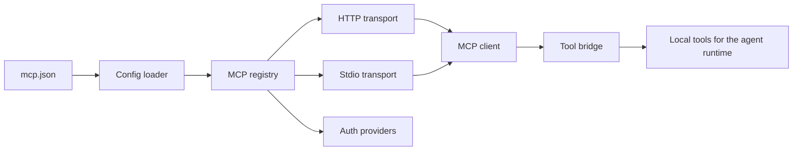
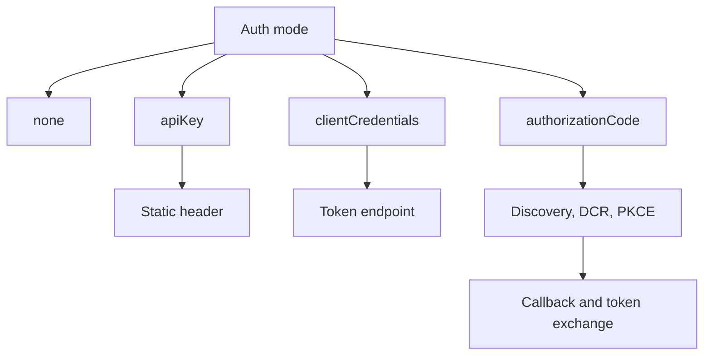

# The agents-mcp package

The `agents-mcp` package connects Electric Agents to external Model Context Protocol (MCP) servers. Electric Agents is the durable agent runtime in the Electric project. It manages server configuration, opens transports, runs Open Authorization (OAuth) flows, and converts remote tools into local tools that the model can call.

Package location: `packages/agents-mcp`. Version: `0.6.0`. Single runtime dependency: `@modelcontextprotocol/sdk`.

## What the package does

The package has four jobs.

1. Read a configuration file and validate it.
2. Connect to each configured server over Hypertext Transfer Protocol (HTTP) or standard input and output (stdio).
3. Complete the authentication flow for each server.
4. Expose each remote tool, resource, and prompt as a local tool.



## Reading order

| Order | Document | What you learn |
|-------|----------|----------------|
| 1 | [00-overview.md](00-overview.md) | Exports, data types, and the configuration schema |
| 2 | [01-mcp-registry.md](01-mcp-registry.md) | Server lifecycle, state changes, and error handling |
| 3 | [02-transports.md](02-transports.md) | HTTP and stdio transports, timeouts, and process limits |
| 4 | [03-oauth-bridges.md](03-oauth-bridges.md) | Application Programming Interface (API) key, client credentials, and authorization code flows |
| 5 | [04-tools-and-resources.md](04-tools-and-resources.md) | Tool, resource, and prompt bridging |

## The four authentication modes

`DCR` means Dynamic Client Registration. `PKCE` means Proof Key for Code Exchange.



| Mode | Use case | Token lifetime |
|------|----------|----------------|
| `none` | Public server, or stdio server | Not applicable |
| `apiKey` | Server with a static secret | Until the key rotates |
| `clientCredentials` | Machine-to-machine OAuth | Cached until 30 seconds before expiry |
| `authorizationCode` | User-delegated OAuth | Access token plus refresh token |

The `clientCredentials` cache rule means the provider stops using a token when less than 30 seconds remain before expiry. It fetches a new token at that point.

## The core type

Every server configuration is a discriminated union on `transport`. This document shows the HTTP member here. The stdio member has `transport: 'stdio'`, a `command`, an optional `args` array, and an optional `env` map instead of a `url`.

```ts
export interface McpHttpServerConfig {
  name: string
  transport: `http`
  url: string
  auth: McpAuthConfig
  /** Per-server timeout override in ms. Default 120000, maximum 600000. */
  timeoutMs?: number
}
```

Source: `packages/agents-mcp/src/types.ts:83-90`.

An agent declares MCP tools with a sentinel, not a fixed list. A sentinel is a marker value that the runtime replaces with the live tools at wake time. The optional allowlist names servers, not tools. An absent allowlist means every server.

```ts
export const mcp = {
  tools(allowlist?: string[]): McpToolsSentinel[] {
    return [{ [MCP_TOOLS_SENTINEL]: true, allowlist }]
  },
}
```

Source: `packages/agents-mcp/src/tools.ts:19-29`.

The status of a server has five values.

```ts
export type McpServerStatus =
  | `connecting`
  | `authenticating`
  | `ready`
  | `error`
  | `disabled`
```

Source: `packages/agents-mcp/src/types.ts:105-110`.

## Aha: the registry is the stateful center

The registry holds the map from server name to entry, and it emits a state snapshot whenever that map changes. The other modules either return data or wrap one client. Two supporting stores also hold state: the in-process token map and the configuration watcher. Both serve the registry.

The `apiKey` key is inline on the auth config. The connection hash does not include the key, so a key rotation needs a restart. `reauthorize` does not help an API-key entry: it returns unless the entry uses the `authorizationCode` mode. This is an open question in the source.

Key insight: this design makes the user interface simple. The interface subscribes once and receives the full server list on every change. It does not need to poll. It does not need to track individual events.

## Related documents

- [00-overview.md](00-overview.md) for the configuration schema and export list.
- [01-mcp-registry.md](01-mcp-registry.md) for the state machine.
- [../agents/04-tools-and-sandboxes.md](../agents/04-tools-and-sandboxes.md) for how the built-in runtime registers the MCP tool provider.
- [../README.md](../README.md) for the full exploration index.
