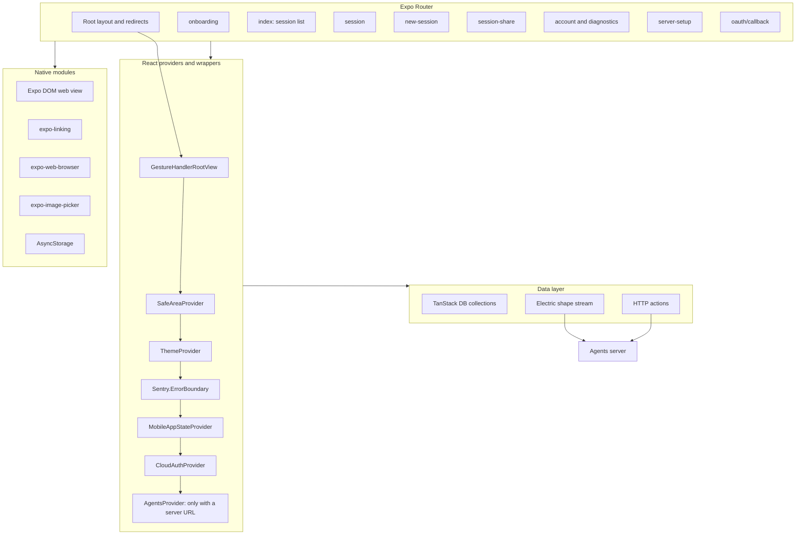
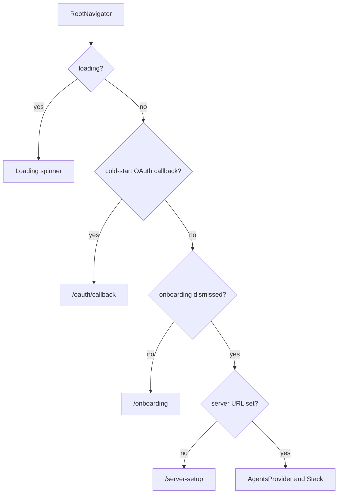

# Overview of agents-mobile

`@electric-ax/agents-mobile` is an Expo application for Android and iOS. It connects to one agents server at a time through one base Uniform Resource Locator (URL). It shows the sessions on that server and lets the user start, watch, steer, fork, and share them.

The application does not run an agent runtime on the device. The server owns the durable state and the working processes. The phone is a client. The chat transcript is an Expo DOM (Document Object Model) component inside the native application.

Five terms carry the rest of this directory:

- An **entity** is one record on the agents server. The record holds the session type, status, parent, creator, and spawn arguments.
- A **session** is the user-facing name for an entity.
- A **wake** is a request to run an entity handler.
- A **runner** is a process or host that claims a wake and runs the handler.
- A **shape** is a read-only, filtered subset of one server table, served over Hypertext Transfer Protocol (HTTP). A shape stream follows a shape and delivers change messages.

To **steer** a session is to send an inbox message that changes the current run. To **fork** a session is to create a new entity from a point in the source entity stream.

This document explains the layers, the technology choices, the data path, the saved state, and the package boundaries.

## The layers of the system



The provider order is fixed. The gesture root is outermost, then the safe-area provider, then the theme provider. The error boundary is next. The application state provider is next. The cloud authentication provider is next. The agents provider is conditional on a saved server URL. Source: `packages/agents-mobile/app/_layout.tsx:28-50` and `packages/agents-mobile/app/_layout.tsx:135-139`.

## Technology choices

| Area | Choice | Why it matters |
|------|--------|----------------|
| Framework | Expo 54 on React Native 0.81 | One code base for Android and iOS. Expo configures the native projects and supplies the native modules. |
| Navigation | Expo Router 6 | File paths under `app/` become routes |
| Data | TanStack DB with an Electric collection adapter | The adapter follows a shape stream and keeps a live local collection |
| Rich content | Expo DOM components | The chat transcript reuses `agents-server-ui` code inside a web view |
| Local storage | AsyncStorage | Small key-value records for the active server and user preferences |
| Crash reporting | Sentry, a hosted crash-reporting service | Startup and render errors reach a dashboard |
| Styling | A local token system | One set of colour, spacing, and type tokens produces light and dark values |

Source: `packages/agents-mobile/package.json:19-61`.

## The data path

`AgentsProvider` creates five TanStack DB collections when a server URL exists:

1. Entities. The sessions. Each row holds the type, status, parent, creator, and spawn arguments.
2. Entity types. The available agent types and the schema for their spawn arguments.
3. Runners. The processes that can claim wakes and run entity handlers.
4. Users. The people who can receive access grants.
5. Entity effective permissions. The computed permissions for the current user. One row answers one question: can this principal perform this action on this entity?

The collections read shapes. User actions use HTTP requests.

```ts
// packages/agents-mobile/src/lib/AgentsProvider.tsx:47-59
const value = useMemo<AgentsContextValue>(() => {
  return {
    serverUrl,
    entitiesCollection: createEntitiesCollection(serverUrl),
    entityTypesCollection: createEntityTypesCollection(serverUrl),
    runnersCollection: createRunnersCollection(serverUrl),
    usersCollection: createUsersCollection(serverUrl),
    entityEffectivePermissionsCollection:
      createEntityEffectivePermissionsCollection(serverUrl),
    signalEntity: (input) => signalEntity({ baseUrl: serverUrl, ...input }),
    forkEntity: (input) => forkEntity({ baseUrl: serverUrl, ...input }),
  }
}, [serverUrl])
```

`AgentsContextValue` is the context type. It exposes the five collections and two actions. `signalEntity` sends a Portable Operating System Interface (POSIX)-style signal to an entity, such as `SIGINT` to stop the current run. `forkEntity` creates a new entity from a point in the source stream.

Each collection reads one table from the Electric shape endpoint. The entity collection is the largest:

```ts
// packages/agents-mobile/src/lib/agentsClient.ts:194-228
export function createEntitiesCollection(baseUrl: string) {
  return createCollection(
    electricCollectionOptions({
      id: `mobile-entities:${baseUrl}`,
      schema: entitySchema,
      shapeOptions: {
        url: appendPathToUrl(baseUrl, `/_electric/electric/v1/shape`),
        fetchClient: serverFetch,
        params: {
          table: `entities`,
          columns: [
            `url`,
            `type`,
            `status`,
            `tags`,
            `spawn_args`,
            `sandbox`,
            `dispatch_policy`,
            `parent`,
            `created_by`,
            `type_revision`,
            `inbox_schemas`,
            `state_schemas`,
            `created_at`,
            `updated_at`,
          ],
        },
        parser: {
          int8: (v: string) => Number(v),
        },
      },
      getKey: (item) => item.url,
    })
  )
}
```

The column list shows the entity model. `url` is the entity identity and the collection key. `type` names the agent handler. `status` is the lifecycle state. `parent` links a child session to its parent. `created_by` is the creator principal. `spawn_args` is the validated creation input. `sandbox` and `dispatch_policy` select the execution environment and the wake routing. `inbox_schemas` and `state_schemas` declare extra stream collections. `type_revision` records the entity type version. PostgreSQL `bigint` values arrive as strings, so the `int8` parser converts them to JavaScript numbers.

The shape request uses `serverFetch` from the web package. That function injects the headers that the mobile application registered for the active server. Source: `packages/agents-mobile/src/lib/agentsClient.ts:200-203` and `packages/agents-mobile/src/lib/serverHeaders.ts:20-56`.

The embedded web view runs in a separate JavaScript context. It has its own copy of the `auth-fetch` module, so it cannot see the native registration. The session route therefore passes a snapshot of the headers as a property, and the embed registers that snapshot before its collections start. Source: `packages/agents-mobile/app/session.tsx:110-117` and `packages/agents-server-ui/src/embed/EmbedApp.tsx:53-57`.

A screen reads a collection with `useLiveQuery`. The query runs again when the collection changes. No polling loop is necessary for session data. Source: `packages/agents-mobile/src/screens/SessionListScreen.tsx:110-117`.

## Saved state

The application keeps a small number of local records. None of them are session content.

| Storage key | Contents | Owner |
|-------------|----------|-------|
| `electric-agents-mobile.server-url` | The active server URL | `MobileAppState` |
| `electric-agents-mobile.onboarding-dismissed` | Whether the first-launch wizard is complete | `MobileAppState` |
| `electric-agents-mobile.servers` | Every server the user connected to | `savedServers` |
| `electric-agents-mobile.pinned-entities` | Pinned session URLs | `pinnedEntities` |
| `electric-agents-mobile.sidebar-prefs` | Grouping choice (date, type, or status) and hidden filters | `sidebarPrefs` |
| `electric-agents-mobile.theme-preference` | System, light, or dark | `themePref` |
| `electric-agents-mobile.cloud-auth` | Cloud sign-in token, email, expiry, and provider | `cloudAuth` |
| `electric-agents-mobile.cloud-auth.pending` | In-progress sign-in state and provider | `cloudAuth` |

Source: `packages/agents-mobile/src/lib/MobileAppState.tsx:22-23`, `packages/agents-mobile/src/lib/savedServers.ts:32`, `packages/agents-mobile/src/lib/pinnedEntities.ts:12`, `packages/agents-mobile/src/lib/sidebarPrefs.ts:42`, `packages/agents-mobile/src/lib/themePref.ts:26`, and `packages/agents-mobile/src/lib/cloudAuth.ts:55-60`, with the keys at `packages/agents-mobile/src/lib/cloudAuth.ts:75-76`.

Four modules use a module-level store with subscribers: `savedServers`, `pinnedEntities`, `sidebarPrefs`, and `themePref`. Each has a module variable, a listener set, and a hook that subscribes. The store is not a React provider. Non-React code, such as sign-out cleanup, can read and change the same data. Source: `packages/agents-mobile/src/lib/savedServers.ts:6-19` and `packages/agents-mobile/src/lib/themePref.ts:26-56`.

The server URL has a second job. It selects the headers:

```ts
// packages/agents-mobile/src/lib/serverHeaders.ts:28-48
const serviceId = getCloudServiceIdFromServerUrl(serverUrl)
if (!serviceId) {
  registerActiveBaseUrl(serverUrl)
  registerActiveServerHeaders(null)
  return
}
const token = await cloudAuth.getAgentsToken(serviceId)
registerActiveBaseUrl(serverUrl)
if (token) {
  const headers: Record<string, string> = {
    authorization: `Bearer ${token}`,
  }
  const userId = cloudAuth.getState().userId
  if (userId) headers[`electric-principal`] = `user:${userId}`
  registerActiveServerHeaders({ url: serverUrl, headers })
}
```

`getCloudServiceIdFromServerUrl` reads the service identifier from a cloud URL of the form `/t/<service-id>/v1`. A self-hosted URL has no such path segment, so the function returns null. A self-hosted server therefore receives the base URL and no authentication header from this function.

A cloud URL with an agents token receives `Authorization: Bearer <token>`. A known user identifier adds `electric-principal: user:<id>`. Without a token, the function keeps the base URL and clears the headers, so requests fail with status 401 instead of using a stale token. Source: `packages/agents-mobile/src/lib/serverHeaders.ts:20-56` and `packages/agents-mobile/src/lib/cloudAgentUrls.ts:28-50`.

## Navigation guard

After the loading check, the root layout applies three redirect rules in order:

1. A cold-start authentication callback goes to `/oauth/callback`. A cold-start callback is a launch URL that is an Open Authorization (OAuth) callback. The operating system delivers it when the application was not running.
2. A user who has not finished onboarding goes to `/onboarding`.
3. A user without a server URL goes to `/server-setup`.



Source: `packages/agents-mobile/app/_layout.tsx:77-140`.

The root layout mounts `AgentsProvider` only when a server URL exists. Five route files call `useAgentsRouteGuard` because their screens call `useAgents()`: `index`, `new-session`, `session`, `session-share`, and `diagnostics`. The guard returns null while the application loads. It returns a redirect when onboarding is incomplete or when no server URL is set. Without the guard, a protected screen could render during a redirect chain. The screen could call `useAgents()` outside its provider, which throws `useAgents must be used inside AgentsProvider`. Expo Router can mount the destination route for a render or two before the root layout redirect catches up. Source: `packages/agents-mobile/src/lib/useAgentsRouteGuard.tsx:1-34`, `packages/agents-mobile/app/index.tsx:7`, and `packages/agents-mobile/app/session.tsx:77`.

## What this package does not own

- **The agent runtime.** The device does not run wakes. The server dispatches them to a runner. A runner can be the desktop runtime on a computer. It can also be a remote worker. A remote worker is a process on a server host that claims wakes over the network.
- **The durable state.** Entities, streams, inbox rows, and grants live on the server.
- **The chat transcript.** The chat log and state explorer are `agents-server-ui` code inside an Expo DOM component.
- **The web application.** The package embeds two components from the web package. It does not embed the full single-page application.
- **A model provider.** A model provider is the service that runs the language model. The device runs no model, so onboarding has no model-provider step. The desktop wizard has that step because its runtime can call a local model. Source: `packages/agents-mobile/src/screens/OnboardingScreen.tsx:31-35`.

## Aha: one active server, many remembered servers

**Aha:** The mobile application has one active server URL but a remembered list of servers. `MobileAppState` stores the active URL in one key. `savedServers` stores every server that the user connected to. The server picker merges the saved list with the cloud list from `useCloudAgentServers`. That cloud list is live only while Electric Cloud answers. After the shutdown, it supplies no usable server, and the saved list alone fills the picker. A server switch changes one value, and `AgentsProvider` rebuilds the five collections for the new URL. This is simpler than the desktop model, where each window can show a different server. Source: `packages/agents-mobile/src/lib/MobileAppState.tsx:22-23`, `packages/agents-mobile/src/lib/savedServers.ts:4-19`, `packages/agents-mobile/src/lib/availableServers.ts:36-86`, and `packages/agents-mobile/src/lib/useAvailableServers.ts:15-29`.

The code keys the collections by the URL, so a switch creates new collection identities:

```ts
// packages/agents-mobile/src/lib/agentsClient.ts:197
id: `mobile-entities:${baseUrl}`,
```

`AgentsProvider` uses `useMemo` with `serverUrl` as its only dependency. A new URL therefore creates a new context value and five new collections. The provider has no effect that closes the old collections. They stay in memory with no screen reading them. Source: `packages/agents-mobile/src/lib/AgentsProvider.tsx:47-59`.

## A note about Electric Cloud

The package README states that Electric Cloud has shut down. Source: `packages/agents-mobile/README.md:3-6`. The sign-in flow and the cloud server picker remain in the code. This exploration describes them as present code. It does not present them as working services.

## Related documents

- [Application structure](01-app-structure.md) maps every route and configuration file.
- [Screens and navigation](02-screens-and-navigation.md) explains each screen and its controls.
- [Native bridges](03-native-bridges.md) explains the Expo DOM boundary and the native modules.
- [agents-server-ui overview](../agents-server-ui/00-overview.md) explains the web code that the embed runs.
- [How the runtime sets up a stream](../04-how-the-runtime-sets-up-a-stream.md) is the top-level document 04. It explains the stream format behind the shape collections. It is not this directory's `04-build-and-release.md`.
