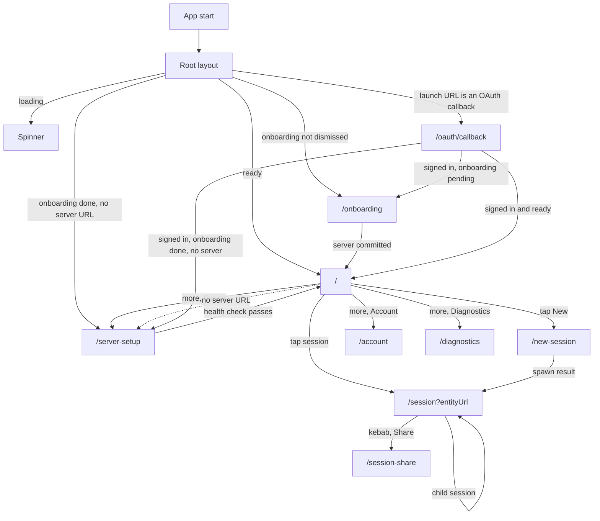
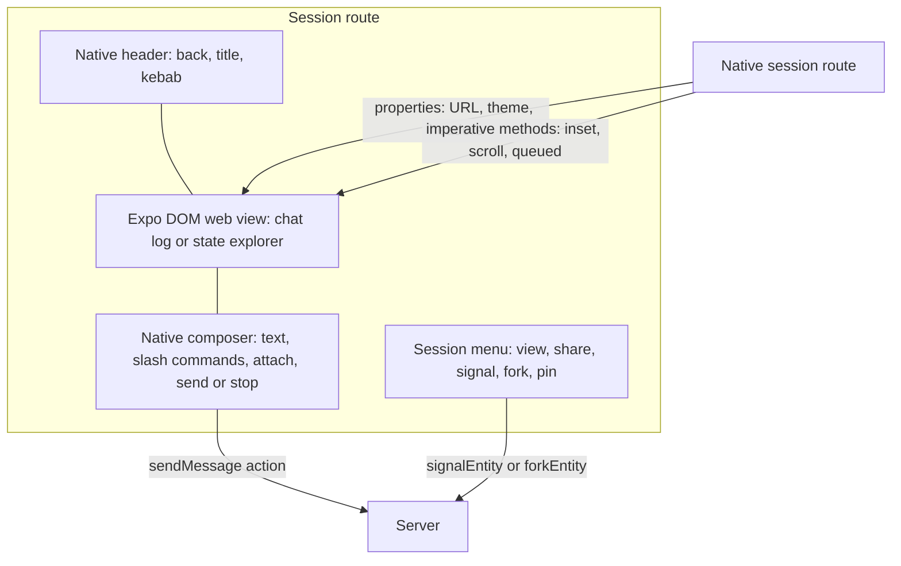

# Screens and navigation

The application has nine route files and one root layout. Each route file has one screen. This document follows the user path from onboarding to a shared session. It covers the Open Authorization (OAuth) callback and the server Uniform Resource Locator (URL) setup. It also explains the controls on each screen.

## Route graph

The graph shows reachability, not one decision. The root layout tests the conditions in the next section one after another. A first launch with no server URL therefore matches two conditions, and the first match wins.



The dashed edge from the list to setup is a redirect edge, not a user action. The onboarding route replaces itself with `/`. If the user stored no server URL, the root layout then sends that user to `/server-setup`.

Source: `packages/agents-mobile/app/index.tsx:10-22`, `packages/agents-mobile/app/session.tsx:161-178`, `packages/agents-mobile/src/screens/SessionListScreen.tsx:258-411`, and `packages/agents-mobile/src/components/SessionMenu.tsx:398-460`.

## Redirect order

The root layout applies the redirects in a fixed order:

1. If the application is still loading, show a spinner.
2. If the launch URL is an OAuth callback and the current path is not the callback route, redirect to `/oauth/callback`.
3. If onboarding is not dismissed, redirect to `/onboarding`, except from the callback route.
4. If the server URL is empty, redirect to `/server-setup`, except from onboarding and the callback route.

Source: `packages/agents-mobile/app/_layout.tsx:84-119`.

The order prevents two problems. First, a cold-start callback is not lost behind the onboarding redirect. Second, a user who finishes onboarding without a server still reaches the setup screen.

Each protected route also calls `useAgentsRouteGuard`. `useAgents` is the hook that reads the agents context. The context holds the five collections and the two actions. The hook throws an error when it runs outside its provider. The protected routes are `/`, `/new-session`, `/session`, `/session-share`, and `/diagnostics`. The guard returns `null` while loading, then a redirect while onboarding is incomplete, then a redirect while no server is set. The route returns the guard before it calls `useAgents`. This order matters because Expo Router can mount a destination route for a render or two before the root layout redirect takes effect. Source: `packages/agents-mobile/src/lib/useAgentsRouteGuard.tsx:28-33`.

## Onboarding

The onboarding wizard has two steps:

1. **Cloud.** Sign in with GitHub or Google. The step is optional. A footer button labelled `Continue without Cloud` moves to the server step without a sign-in. After a successful sign-in the same button reads `Continue`.
2. **Server.** Choose a cloud server or enter a custom URL.

The step indicator shows the current step. A successful sign-in advances from the cloud step to the server step one time. A manual Back stays on the cloud step after that advance. The code uses a reference to record that the automatic advance already happened. Source: `packages/agents-mobile/src/screens/OnboardingScreen.tsx:61-74` and `packages/agents-mobile/src/screens/OnboardingScreen.tsx:168-180`.

The server step commits only after a health check:

```ts
// packages/agents-mobile/src/screens/OnboardingScreen.tsx:76-90
const commit = async (url: string): Promise<string | null> => {
  setSubmitting(true)
  try {
    await prepareServerHeaders(url)
    await checkServerHealth(url)
    await onComplete({ serverUrl: url })
    return null
  } catch (err) {
    return err instanceof Error ? err.message : String(err)
  } finally {
    setSubmitting(false)
  }
}
```

The header registration comes before the health probe. A cloud server rejects an unauthenticated request with status 401. The probe would fail if the headers were not ready. Source: `packages/agents-mobile/src/screens/OnboardingScreen.tsx:76-90` and `packages/agents-mobile/src/lib/agentsClient.ts:182-192`.

The health check calls `/_electric/health` with a 5,000 millisecond timeout. Source: `packages/agents-mobile/src/lib/agentsClient.ts:182-192`.

The onboarding route saves the URL, marks onboarding as dismissed, and replaces the route with `/`. Source: `packages/agents-mobile/app/onboarding.tsx:23-27`.

## Server setup

The setup screen is the same server step without the wizard. A user reaches it from the home menu or from the root redirect.

The screen commits in three steps:

1. Prepare the request headers for the URL.
2. Check the server health.
3. Add the server to the saved list and save it as the active URL.

The saved entry has `source: electric-cloud` when the URL contains a cloud tenant prefix. Otherwise it has `source: manual`. A cloud tenant prefix is the path `/t/<service-id>/v1` in a cloud server URL. The `getCloudServiceIdFromServerUrl` function reads the path segments and returns the service identifier. A self-hosted URL has no such segments, so the function returns null. Source: `packages/agents-mobile/src/screens/ServerSetupScreen.tsx:52-79` and `packages/agents-mobile/src/lib/cloudAgentUrls.ts:24-55`.

The screen can show a Back control only when the user already has a server. A first-time user has no previous screen to return to, so the route passes no `onCancel`. Source: `packages/agents-mobile/app/server-setup.tsx:10-24`.

## Session list

An **entity** is one record on the agents server. A **session** is the user-facing name for an entity. A **collection** is a local, live copy of server rows. The mobile application uses five collections, and the entity collection holds the sessions. A **shape** is a read-only, filtered subset of one server table. A collection follows a shape and updates when the shape changes. A **principal** is an authenticated identity. The server stores a principal entity for each identity, and the list hides those rows.

The home screen lists every entity except the `principal` type. The query orders by `updated_at` in descending order. `useLiveQuery` runs the query again when the collection changes. `eq` and `not` are query operators.

```ts
// packages/agents-mobile/src/screens/SessionListScreen.tsx:110-117
const { data: entities = [] } = useLiveQuery(
  (q) =>
    q
      .from({ entity: entitiesCollection })
      .where(({ entity }) => not(eq(entity.type, `principal`)))
      .orderBy(({ entity }) => entity.updated_at, `desc`),
  [entitiesCollection]
)
```

The list has six features:

| Feature | Behaviour |
|---------|-----------|
| Filters | Hide entity types, statuses, or creators. A hidden parent does not hide a visible child; the child becomes a root row. |
| Grouping | Group by date, type, or status. Date grouping uses Today, Yesterday, Previous 7 days, Previous 30 days, month buckets, and Older. |
| Tree | Each root row expands to show child sessions. |
| Pins | Pinned sessions appear in a Pinned section and are removed from the groups. |
| Search | A non-empty query replaces the tree with a flat result list. |
| Health dot | A probe runs every 10,000 milliseconds. A pull-to-refresh also runs it. |

Source: `packages/agents-mobile/src/screens/SessionListScreen.tsx:124-201`, `packages/agents-mobile/src/lib/sessionBuckets.ts:120-164`, and `packages/agents-mobile/src/lib/sidebarPrefs.ts:14-40`.

The health probe uses a cancellation flag, so a result from an old server cannot overwrite the state for a new server:

```ts
// packages/agents-mobile/src/screens/SessionListScreen.tsx:230-239
useEffect(() => {
  const signal = { cancelled: false }
  setServerStatus(`unset`)
  void probeOnce(signal)
  const interval = setInterval(() => void probeOnce(signal), 10_000)
  return () => {
    signal.cancelled = true
    clearInterval(interval)
  }
}, [serverUrl, probeOnce])
```

A pull-to-refresh keeps the spinner visible for at least 600 milliseconds. This avoids a flash when the server answers quickly. A probe counter prevents an older refresh from clearing a newer spinner. Source: `packages/agents-mobile/src/screens/SessionListScreen.tsx:241-251`.

The screen header has Search and More buttons. A floating action button opens the new-session screen. The More button opens `HomeMenu`, which contains Server, Group, Show, Theme, Account, and Diagnostics. Source: `packages/agents-mobile/src/screens/SessionListScreen.tsx:258-400` and `packages/agents-mobile/src/components/HomeMenu.tsx:170-210`.

## New session

A **runner** is a process or host that claims a wake and runs the entity handler. The new-session screen builds a spawn request. It reads three collections:

- Entity types, ordered by name. The `worker` type is filtered out. The source gives no reason in a comment.
- Runners, filtered to `admin_status: enabled` and ordered by label.
- Entities, used to derive recent working directories for the selected runner.

The recent list is derived, not stored. For the selected runner, the code collects `spawn_args.workingDirectory` from every entity that the runner handled. It keeps the newest value for each path, sorts by `updated_at`, and keeps ten entries. Source: `packages/agents-mobile/src/screens/NewSessionScreen.tsx:97-112`, `packages/agents-mobile/src/screens/NewSessionScreen.tsx:182-192`, and `packages/agents-server-ui/src/lib/recentWorkingDirectories.ts:5-52`.

The default type is `horton` when the server offers it. `horton` is the default agent type name, and only its creation schema is known to accept `workingDirectory`. When the server offers one runner, the screen selects it automatically. Source: `packages/agents-mobile/src/screens/NewSessionScreen.tsx:60-64` and `packages/agents-mobile/src/screens/NewSessionScreen.tsx:114-130`.

The screen holds the working-directory value in its own state. The request includes `workingDirectory` only when the value exists, the type accepts it, a sandbox profile exists, and that profile is not remote. A remote profile runs off-host in a provider virtual machine, so a host working directory does not apply. The gate is at `packages/agents-mobile/src/screens/NewSessionScreen.tsx:276-281`; the `remote` field itself is at `packages/agents-mobile/src/lib/agentsClient.ts:106-113`.

The start function validates the runner, serializes the composer input, and calls `spawnEntity`:

```ts
// packages/agents-mobile/src/screens/NewSessionScreen.tsx:243-303
const start = async () => {
  if (!activeTypeName || loading) return
  if (!activeRunnerId) {
    setError(
      enabledRunners.length === 0
        ? `No runners are online for this server.`
        : `Pick a runner to handle this session.`
    )
    return
  }
  setLoading(true)
  setError(null)
  try {
    const trimmed = message.trim()
    const schemaArgs = finalizeSpawnArgs(creationSchema, args)
    const hasAttachments = showAttach && attach.drafts.length > 0
    const composerPayload = trimmed
      ? serializeComposerInput(trimmed, slashCommands)
      : null
    const entityUrl = await spawnEntity({
      baseUrl: serverUrl,
      type: activeTypeName,
      args: schemaArgs,
      ...(composerPayload && !hasAttachments
        ? {
            initialMessage: composerPayload,
            initialMessageType: COMPOSER_INPUT_MESSAGE_TYPE,
          }
        : {}),
      runnerId: activeRunnerId,
      ...(sandboxProfile ? { sandboxProfile } : {}),
      ...(workingDirectory &&
      workingDirSupported &&
      sandboxProfile &&
      !profileIsRemote
        ? { workingDirectory }
        : {}),
    })
    if (hasAttachments) {
      await sendEntityMessage({
        baseUrl: serverUrl,
        entityUrl,
        ...(composerPayload
          ? {
              payload: composerPayload,
              type: COMPOSER_INPUT_MESSAGE_TYPE,
            }
          : {}),
        mode: `immediate`,
        attachments: attach.drafts,
      })
    }
    onOpenSession(entityUrl)
  } catch (err) {
    setError(err instanceof Error ? err.message : String(err))
  } finally {
    setLoading(false)
  }
}
```

A **wake** is a request to run an entity handler. Three rules are visible in this function:

- The runner is mandatory. Without a runner, the function shows an error and starts nothing. The source comment explains why. The server would fall back to the entity type's default dispatch policy. That policy is typically a webhook to a local endpoint that a cloud server cannot reach.
- The sandbox profile is optional. A **sandbox profile** selects the execution environment, such as a local process or a container. When the profile uses the default entity scope, the runtime uses the entity URL as the sandbox key, so the workspace persists across wakes. Source: `packages/agents-runtime/src/sandbox/identity.ts:64-72`.
- With image attachments, the first message is sent after spawn, because the upload needs the new entity URL.

`finalizeSpawnArgs` validates the edited arguments against the type's creation schema and fills the defaults. `showAttach` says whether the selected type offers image input. `slashCommands` is the command list that the composer parses. `profileIsRemote` says whether the selected sandbox profile runs on another machine. Source: `packages/agents-mobile/src/screens/NewSessionScreen.tsx:243-303` and `packages/agents-mobile/src/lib/agentsClient.ts:313-393`.

## Session screen

The session screen has two layers. An Expo DOM (Document Object Model) web view fills the frame below the header. The native layer draws the header, the composer, and the menus above it. The native layer also pushes values into the web view through an imperative handle. An imperative handle is a set of methods that a parent calls on a child reference.



The route reads two parameters: `entityUrl` and `view`. The view is `chat` or `state-explorer`. An unknown value becomes `chat`. Source: `packages/agents-mobile/app/session.tsx:71-108`.

The screen renders the chat embed only in chat view. The state inspector embed replaces it in state view. Both embeds receive the server URL, the entity URL, the theme, the request headers, and a callback for opening another entity. Source: `packages/agents-mobile/app/session.tsx:184-218`.

The native composer is in `SessionScreen.tsx`. It has four controls:

- Send. Creates a queued inbox message through `createSendComposerInputAction`.
- Stop. Sends `SIGINT` while a generation is active. This is the gentle stop in the composer.
- Steer or edit. Updates an existing inbox message.
- Attach. Adds an image through the native picker.

The session menu offers two other stop behaviours: `SIGINT` from the menu, and the immediate stop described below. Source: `packages/agents-mobile/src/screens/SessionScreen.tsx:599-630` and `packages/agents-mobile/src/screens/SessionScreen.tsx:850-870`.

The session menu offers three destructive controls. It sends a signal, stops immediately, or forks the root subtree:

```ts
// packages/agents-mobile/src/screens/SessionScreen.tsx:359-384
const stopGeneration = useCallback((): void => {
  if (!canSignal || !generationActive || stopPending) return
  void sendSignal(`SIGINT`, `Stopped from mobile chat UI`, {
    stopPending: true,
  })
}, [canSignal, generationActive, sendSignal, stopPending])

const stopImmediately = useCallback(async (): Promise<void> => {
  if (!entity) return
  if (!canSignal) return
  setSignalError(null)
  try {
    await signalEntity({
      entityUrl,
      signal: `SIGSTOP`,
      reason: `Stopped immediately from mobile session menu`,
    })
    await signalEntity({
      entityUrl,
      signal: `SIGINT`,
      reason: `Interrupted current run for immediate stop`,
    })
  } catch (err) {
    setSignalError(err instanceof Error ? err.message : String(err))
  }
}, [canSignal, entity, entityUrl, signalEntity])
```

An immediate stop sends `SIGSTOP` first, then `SIGINT`. The pause stops the process from starting new work, and the interrupt ends the current run. Source: `packages/agents-mobile/src/screens/SessionScreen.tsx:366-384`.

The signal menu also offers `SIGHUP`, `SIGCONT`, `SIGUSR`, `SIGTERM`, and `SIGKILL`. `SIGUSR` is one project signal name, not the two standard POSIX names `SIGUSR1` and `SIGUSR2`. The runtime delivers `SIGHUP`, `SIGTERM`, and `SIGUSR` to the handler while a wake is active. Source: `packages/agents-mobile/src/components/SessionMenu.tsx:36-110` and `packages/agents-runtime/README.md:277`.

The fork control is root-only. A child entity has a `parent` value, and the fork operation clones the whole subtree under one root. A child therefore has no subtree of its own to clone. A stopped or killed entity also cannot fork. A synchronous reference latch prevents a double tap from sending two fork requests. The latch is a React `useRef` value (`const forkInFlightRef = useRef(false)`, `packages/agents-mobile/src/screens/SessionScreen.tsx:193`). The function checks it and sets it before its first `await`. A second call sees the set value and returns at once. Source: `packages/agents-mobile/src/screens/SessionScreen.tsx:396-416`.

The screen checks three permissions before it enables these controls: `write`, `signal`, and `fork`. The share screen expresses grants as three roles. The mapping is: View gives `read` and `fork`; Chat gives `read`, `write`, `signal`, `fork`, `schedule`, and `spawn`; Manage gives `manage` and `delete`. A `manage` grant also satisfies every permission in the permission hook. The permission hook reads the effective permission rows for the entity. A user receives every permission when the user is the creator or a built-in system principal. Source: `packages/agents-mobile/src/lib/useEntityPermissions.ts:61-81` and `packages/agents-server-ui/src/lib/sharePermissions.ts:21-25`.

## Share screen

The share screen has three sections:

1. **Link.** Copy the web link or open the system share sheet.
2. **People with access.** The owner row, per-user roles, and a General access row for all users.
3. **Add people.** A searchable list of users who have no grant.

The roles are View, Chat, and Manage. Source: `packages/agents-mobile/src/screens/ShareSessionScreen.tsx:60-86`.

The grant list comes from the representational state transfer (REST) endpoint, not from the shape collections. A shape stream is a continuous feed of table changes. It has no grant rows, and a grant change needs an immediate answer from the server. The screen therefore reads the list directly:

```ts
// packages/agents-mobile/src/screens/ShareSessionScreen.tsx:145-165
const loadGrants = useCallback(async () => {
  try {
    const loaded = await listEntityGrants({ baseUrl: serverUrl, entityUrl })
    setGrants(loaded)
    setAccessDenied(false)
  } catch (err) {
    if (
      err instanceof GrantsRequestError &&
      (err.status === 401 || err.status === 403)
    ) {
      setAccessDenied(true)
      setError(null)
    } else {
      setError(err instanceof Error ? err.message : String(err))
    }
  } finally {
    setLoadedOnce(true)
  }
}, [serverUrl, entityUrl])
```

A status 401 or 403 is not an error message. It is the expected state after the user loses manage permission. The screen hides the grant controls and keeps the link controls. It treats both codes the same way, so it does not separate an expired token from a missing grant. Source: `packages/agents-mobile/src/screens/ShareSessionScreen.tsx:145-165`.

A role change is a grant diff. The screen deletes grants that the new role does not need and creates the missing grants. It then reloads the list, because the server is the source of truth for grant identifiers. Source: `packages/agents-mobile/src/lib/entityGrants.ts:156-198` and `packages/agents-mobile/src/screens/ShareSessionScreen.tsx:253-280`.

The share link points at the server's bundled web user interface. It targets `/__agent_ui/` directly, so a cloud tenant prefix survives. The server root returns a 302 redirect with an absolute path. That absolute path drops the prefix `/t/<service-id>/v1`. The direct path keeps the prefix that the code copied from the server URL. Source: `packages/agents-mobile/src/lib/sessionLinks.ts:10-25`.

## Account and diagnostics

The account screen shows one of two states:

- **Signed out.** GitHub and Google sign-in buttons.
- **Signed in.** Name, email, principal, workspaces, a dashboard link, sign out, and a delete-account link.

Source: `packages/agents-mobile/src/screens/AccountScreen.tsx:54-180`.

The diagnostics screen has a Server section, a System section, and a development-only section:

- The Server section shows the active server URL and a health probe with latency. A Re-check button runs the probe again.
- The System section shows the application version, Expo software development kit (SDK), platform, and resolved theme.
- The development-only section has a button that clears all local data and reloads.

Source: `packages/agents-mobile/src/screens/DiagnosticsScreen.tsx:119-193`.

## OAuth callback

The callback route receives four parameters from the cloud dashboard: `token`, `state`, `email`, and `expiresAt`. It rebuilds the `electric-agents://oauth/callback` URL and gives it to the authentication singleton.

Three delivery paths can feed the same callback:

1. The sign-in function returns the URL from `openAuthSessionAsync`.
2. The provider-level link listener receives a warm-start URL.
3. The provider-level initial-URL read receives a cold-start URL.

The route is also a defensive fourth caller. It reads the launch URL again, builds a URL from its own parameters, and listens for a URL event while it is mounted. The singleton removes duplicates through a `completingUrl` guard, so at most one caller consumes the pending request. The singleton stores the token, email, expiry time, and provider in the cloud authentication record. Source: `packages/agents-mobile/app/oauth/callback.tsx:16-45`, `packages/agents-mobile/app/oauth/callback.tsx:91-122`, and `packages/agents-mobile/src/lib/cloudAuth.ts:490-505`.

The route shows a spinner while it works. After 10,000 milliseconds it shows a "Back to sign-in" button, so a lost callback cannot trap the user. Source: `packages/agents-mobile/app/oauth/callback.tsx:72-77`.

## Aha: the session route is a native frame around a web body

**Aha:** The session screen does not choose between a fully native screen and a fully web screen. It stacks them. The web view occupies the body and renders the transcript. The native layer renders the header, the composer, and the menus. The two layers share only a small interface. The native side reads entity records from its own collections; entity metadata does not cross from the web view. The native side sends scroll and inset values down through the imperative handle. This is why the mobile session can reuse the desktop transcript and still have a native keyboard, native action sheet, and native navigation.

The native frame sets the geometry:

```ts
// packages/agents-mobile/app/session.tsx:118-131
const embedTop = insets.top + HEADER_HEIGHT
const composerInset =
  view === `chat`
    ? Math.max(0, chatComposerHeight + keyboardInset - CHAT_COMPOSER_OVERLAP)
    : 0
const embedFrame = useMemo(
  () => ({
    top: embedTop,
    width: windowDimensions.width,
    height: Math.max(0, windowDimensions.height - embedTop),
  }),
  [embedTop, windowDimensions.height, windowDimensions.width]
)
```

The web view occupies the full frame. The native composer floats over the lower part. The `composerInset` value is not part of the frame. The route pushes it into the transcript with `usePushToEmbed`. The transcript then sets the Cascading Style Sheets custom property `--mobile-chat-bottom-inset`, and the scroll area reserves that space. `CHAT_COMPOSER_OVERLAP` is the small distance by which the composer overlaps the transcript. Source: `packages/agents-mobile/app/session.tsx:118-150`.

## Related documents

- [Application structure](01-app-structure.md) maps the route files to these screens.
- [Native bridges](03-native-bridges.md) explains the web view properties and handles.
- [Chat and timeline](../agents-server-ui/03-chat-and-timeline.md) explains the transcript that the session screen embeds.
- [Entity management](../agents-server-ui/04-entity-management.md) explains the entity controls that mobile mirrors.
- [Settings and permissions](../agents-server-ui/05-settings-and-permissions.md) explains the grant model behind the share screen.
