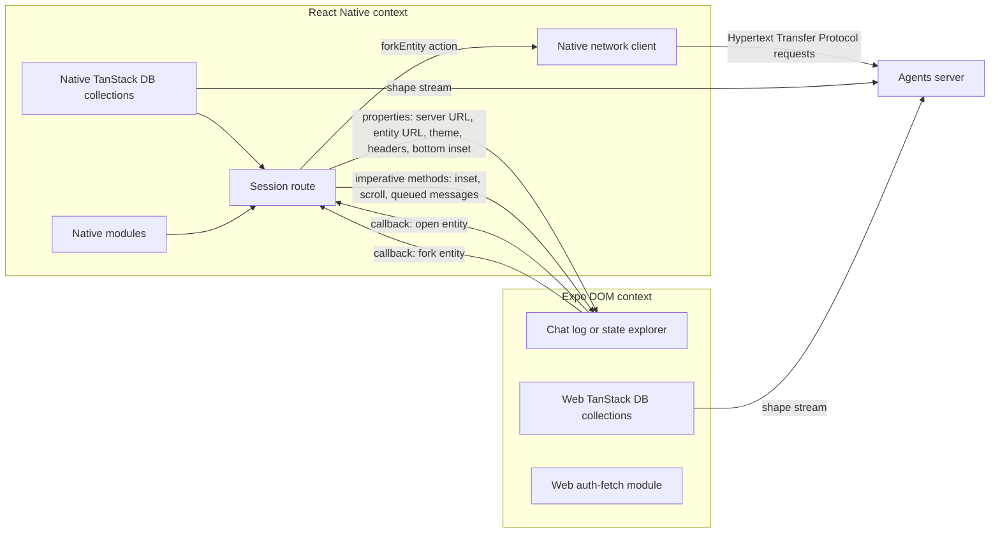
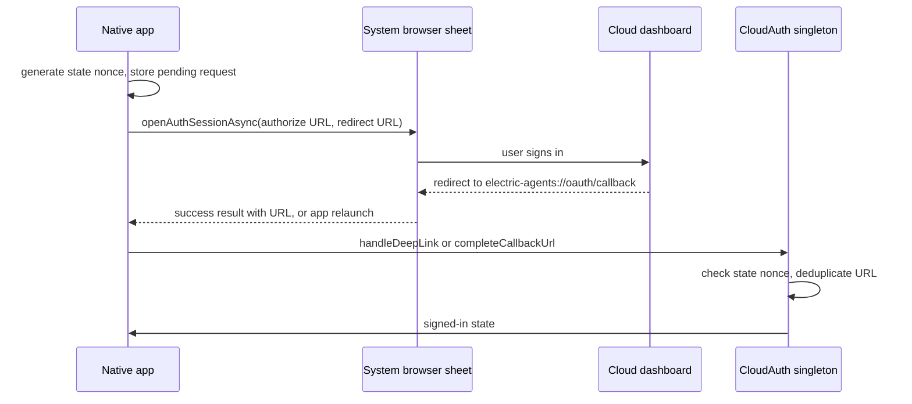

# Native bridges

The mobile application has two JavaScript contexts. The native context runs React Native. The web context runs the shared web code from `agents-server-ui` inside an Expo DOM (Document Object Model) component. This document explains what crosses the boundary, in which direction, and why.

## The two contexts



TanStack DB is the local store that holds query results. A collection is one store for one server table. A **shape** is a read-only, filtered subset of one PostgreSQL table. A **shape stream** follows a shape over Hypertext Transfer Protocol and delivers change messages. Each context has its own collections and its own shape streams. The native collections feed the session list, the permissions, and the menus. The web collections feed the transcript.

The boundary is not a security sandbox. The web view is a full browser runtime with its own network access, and it opens its own shape stream to the server. The boundary is a runtime boundary, not a permission boundary. The native side gives the web side prepared request headers and a fork function, because the web side cannot read the native authentication state. The web side uses them through the shared web package.

## What crosses the boundary

| Property | Direction | Purpose |
|----------|-----------|---------|
| `serverUrl` | Native to web | Selects the collections and the stream base Uniform Resource Locator (URL) |
| `entityUrl` | Native to web | Selects the session |
| `theme` | Native to web | Sets `light` or `dark` tokens |
| `serverHeaders` | Native to web | Supplies the authorization header and the principal header |
| `bottomInset` | Native to web | Seeds the initial composer clearance on the first paint |
| `onRequestOpenEntity` | Web to native | Opens a child session in the native stack |
| `onRequestForkEntity` | Web to native | Runs a fork through native networking |
| `dom` | Native to web | Supplies web view options and the background colour |
| `ref` | Native to web reference | Receives the imperative handle from the web component |
| `style`, `matchContents` | Native to web | Set the frame size and the content mode |

Source: `packages/agents-mobile/app/session.tsx:42-58` and `packages/agents-mobile/app/session.tsx:194-218`.

The web component types are declared in the shared web package. The native package maps those module paths to one local type file with the TypeScript `paths` setting. This is a compile-time mapping only; Metro still bundles the real web module. The native build therefore does not depend on the Expo types that the web package cannot use. Source: `packages/agents-mobile/tsconfig.json:7-18`.

## Properties are cold, handles are hot

Every property that crosses the Expo DOM bridge re-posts the web view. A prop change or a re-render makes the embed re-post, and the web view flashes. The source states that re-post and flicker effect; it does not state that Expo reloads the document or runs the bundle again. The native route therefore treats the embed as a memoised component:

```ts
// packages/agents-mobile/app/session.tsx:63-69
const SessionChatLogDomEmbed = memo(
  SessionChatLogDomEmbedModule as ComponentType<SessionDomEmbedProps>
)
const SessionStateInspectorDomEmbed = memo(
  SessionStateInspectorDomEmbedModule as ComponentType<SessionDomEmbedProps>
)
```

`memo` stops a parent re-render from re-rendering the embed. It does not make a value stable. The route also builds each property with `useMemo` or `useCallback`, so a re-render of the route does not produce a new reference. The serialized header snapshot is one example. Source: `packages/agents-mobile/app/session.tsx:63-69` and `packages/agents-mobile/app/session.tsx:110-117`.

Values that change often do not cross as properties. The native side pushes them through an imperative handle. The handle has three methods:

```ts
// packages/agents-server-ui/src/embed/SessionChatLogDomEmbed.tsx:38-69
useDOMImperativeHandle<SessionChatLogDomRef>(
  ref ?? null,
  () => ({
    setBottomInset(px: unknown) {
      if (typeof document === `undefined`) return
      const value = typeof px === `number` ? px : Number(px) || 0
      document.documentElement.style.setProperty(
        `--mobile-chat-bottom-inset`,
        `${Math.max(0, value)}px`
      )
    },
    scrollToBottom() {
      if (typeof document === `undefined`) return
      requestAnimationFrame(() => {
        const viewport = document.querySelector(
          `.mobile-chat-scroll-viewport`
        )
        if (viewport instanceof HTMLElement) {
          viewport.scrollTop = viewport.scrollHeight
        }
      })
    },
    setInlineQueuedMessages(messages: unknown) {
      setInlineQueued(
        Array.isArray(messages)
          ? (messages as Array<OptimisticInboxMessage>)
          : []
      )
    },
  }),
  []
)
```

The handle contract is a plain TypeScript interface in a separate file. It is not a named export from the embed. The embed module begins with the `'use dom'` directive, which tells Expo to run that module in the web view. A module with that directive cannot supply a named type export to the native bundle, because the native bundle only receives a component proxy. Source: `packages/agents-server-ui/src/embed/sessionChatLogDomRef.ts:1-16` and `packages/agents-server-ui/src/embed/SessionChatLogDomEmbed.tsx:1-10`.

The arguments arrive as serialized JavaScript Object Notation (JSON). The handle converts each value and checks the type before it uses the value. Source: `packages/agents-server-ui/src/embed/sessionChatLogDomRef.ts:4-6` and `packages/agents-server-ui/src/embed/SessionChatLogDomEmbed.tsx:41-47`.

## The handle appears late

The reference becomes non-null before the methods exist. Expo sets the reference when the native component mounts. The methods arrive later, after the web bundle boots and `useDOMImperativeHandle` marshals them across the bridge. A native call must therefore test the method, not the reference. The route retries on animation frames until the method appears:

```ts
// packages/agents-mobile/app/session.tsx:275-296
function usePushToEmbed(
  ref: { current: SessionChatLogDomRef | null },
  method: `setBottomInset` | `setInlineQueuedMessages`,
  value: unknown
): void {
  useEffect(() => {
    let frame = 0
    let attempts = 0
    const apply = (): void => {
      const fn = ref.current?.[method]
      if (typeof fn === `function`) {
        fn(value)
        return
      }
      if (attempts++ < 120) frame = requestAnimationFrame(apply)
    }
    apply()
    return () => {
      if (frame) cancelAnimationFrame(frame)
    }
  }, [ref, method, value])
}
```

The limit is 120 animation frames, or about two seconds at 60 frames per second. A value that changes during that window cancels the old retry loop and starts a new one.

The first inset is also passed as a property. This makes the first paint correct before the handle exists. Source: `packages/agents-mobile/app/session.tsx:145-149` and `packages/agents-mobile/app/session.tsx:201`.

## Web-to-native navigation

The web router sends a path to the embed. The embed maps one path shape to the native callback:

```ts
// packages/agents-server-ui/src/embed/SessionChatLogDomEmbed.tsx:72-79
const handleNavigatePathname = useCallback(
  (pathname: string) => {
    const match = /^\/entity(\/.+)$/.exec(pathname)
    const target = match?.[1]
    if (target) return onRequestOpenEntity(target)
  },
  [onRequestOpenEntity]
)
```

A path that starts with `/entity/` opens that entity. The shared web application uses a hash router, which stores the route after the `#` in the URL. In the embed, the native stack owns navigation, so the router must not push a route of its own. Every other path is ignored for that reason. The callback identity is stable, because a new identity would remount the timeline. Source: `packages/agents-server-ui/src/embed/SessionChatLogDomEmbed.tsx:70-84`.

The state explorer uses the same mapping inline. It does not receive the fork callback. Source: `packages/agents-server-ui/src/embed/SessionStateInspectorDomEmbed.tsx:17-27`.

## Request headers across contexts

The native context registers the active server and its headers in the `auth-fetch` module. A cloud server needs a bearer token. The native code obtains the token for the cloud service and registers two headers:

```ts
// packages/agents-mobile/src/lib/serverHeaders.ts:28-42
const serviceId = getCloudServiceIdFromServerUrl(serverUrl)
if (!serviceId) {
  registerActiveBaseUrl(serverUrl)
  registerActiveServerHeaders(null)
  return
}
const token = await cloudAuth.getAgentsToken(serviceId)
registerActiveBaseUrl(serverUrl)
if (token) {
  const headers: Record<string, string> = {
    authorization: `Bearer ${token}`,
  }
  const userId = cloudAuth.getState().userId
  if (userId) headers[`electric-principal`] = `user:${userId}`
  registerActiveServerHeaders({ url: serverUrl, headers })
}
```

The `electric-principal` header is necessary. The shared message code runs in the web context, and it reads the sender identity from the active headers in that context. The web context cannot read the native authentication state. Without the header, `getActivePrincipal` falls back to `system:dev-local`, which is the built-in development principal. The cloud server then receives a bearer token for one user and a sender field for another, and it responds with status 400 because the two do not match. Source: `packages/agents-mobile/src/lib/serverHeaders.ts:28-48` and `packages/agents-server-ui/src/lib/auth-fetch.ts:17` and `packages/agents-server-ui/src/lib/auth-fetch.ts:200-208`.

The web context has its own copy of the `auth-fetch` module. It cannot see the registration in the native context. The native route therefore takes a snapshot and passes it as a property:

```ts
// packages/agents-mobile/app/session.tsx:112-117
const serverHeadersSnapshot = getActiveServerHeadersSnapshot()
const serverHeadersKey = serverHeadersSnapshot
  ? JSON.stringify(serverHeadersSnapshot)
  : ``
const serverHeaders = useMemo(() => serverHeadersSnapshot, [serverHeadersKey])
```

The memo depends on the serialized value, so a new object with the same content does not re-post the embed. Source: `packages/agents-mobile/app/session.tsx:110-117`.

The embed registers the snapshot in its own module before its collections start:

```ts
// packages/agents-server-ui/src/embed/EmbedApp.tsx:53-57
if (state.serverHeaders) {
  registerActiveServerHeaders(state.serverHeaders)
} else {
  registerActiveServerHeaders(null)
}
```

This registration is in the render body, not in an effect. The collections fetch on their first render, so a later registration would race the first request and produce a status 401 response. Source: `packages/agents-server-ui/src/embed/EmbedApp.tsx:48-58`.

The shared `serverFetch` then applies the registered headers to each request, unless the desktop preload injects headers. A preload script is the script that Electron runs in a desktop window before the page loads. The desktop build uses it to attach headers to every request through the `electronAPI` object. A mobile web view has no preload and no `electronAPI`, so `serverFetch` applies the registered headers itself. Source: `packages/agents-server-ui/src/lib/auth-fetch.ts:211-245`.

## Forking over native networking

The fork control can run in two places. In a desktop window, the web code uses the desktop network bridge: the preload `electronAPI` sends the request from the main process. In the mobile web view, there is no preload, so the web code calls the native callback instead.

The native route passes a stable wrapper around the provider's `forkEntity`:

```ts
// packages/agents-mobile/app/session.tsx:155-161
const handleForkEntity = useCallback(
  (targetUrl: string, opts?: { pointer?: ForkPointer }) =>
    forkEntity({ entityUrl: targetUrl, pointer: opts?.pointer }),
  [forkEntity]
)
```

`ForkPointer` is `{ offset: string | null; subOffset: number }`. It names a point in the source entity stream. A fork with no pointer clones the whole subtree; a fork with a pointer clones from that point. Source: `packages/agents-mobile/src/lib/agentsClient.ts:430-447`.

The shared provider stores the callback in a reference. It builds one stable implementation when the callback is present. `EmbedApp` gives that implementation to `ElectricAgentsProvider` as `forkEntityImpl`. The provider passes it to `createForkEntity`, which uses it as a transport override. In that case the provider does not call `serverFetch`; the native wrapper does, in the React Native context. The shared provider owns the error toast (`ElectricAgentsProvider.tsx:799-806`), and the mobile client owns the response check (`agentsClient.ts:454-460`), so both paths behave the same. Source: `packages/agents-server-ui/src/embed/EmbedApp.tsx:60-68` and `packages/agents-server-ui/src/lib/ElectricAgentsProvider.tsx:783-810`.

## Layout and keyboard bridge

The web view fills the area below the native header. The native composer floats over the lower part of that area. The route computes the frame and pushes the composer clearance into the embed.

The keyboard inset uses different events on each platform. iOS listens for `keyboardWillChangeFrame` and `keyboardWillHide`. Android listens for `keyboardDidShow` and `keyboardDidHide`. This gives a smooth animation on iOS and a correct final value on Android. Source: `packages/agents-mobile/app/session.tsx:298-334`.

The web view options disable scrolling and content inset adjustment, so the native frame owns the geometry. The options also set the same background colour through `backgroundColor`, `style`, `containerStyle`, and `webViewStyle`. The native web view paints its own default background while the web bundle starts, and a single themed colour on every layer prevents a white flash. Source: `packages/agents-mobile/app/session.tsx:246-272`.

## The missing random function

A mobile web view can supply `crypto.getRandomValues` without `crypto.randomUUID`. The source comment states this limitation but does not name a cause. The TanStack DB transaction code uses `randomUUID` when it creates a transaction. The embed installs the missing function at module load:

```ts
// packages/agents-server-ui/src/embed/mobileDomRuntime.ts:28-43
export function installMobileCryptoPolyfill(): void {
  if (typeof globalThis === `undefined`) return

  if (!globalThis.crypto) {
    Object.defineProperty(globalThis, `crypto`, {
      configurable: true,
      value: {},
    })
  }

  if (!globalThis.crypto.randomUUID) {
    Object.defineProperty(globalThis.crypto, `randomUUID`, {
      configurable: true,
      value: createRandomUUID,
    })
  }
}
```

The fallback uses `getRandomValues` when it exists. Otherwise it fills the bytes with `Math.random`. The `Math.random` path is not cryptographically secure, so the fallback is weaker than the standard function. It then sets the version and variant bits and formats the result as a universally unique identifier (UUID). Source: `packages/agents-server-ui/src/embed/mobileDomRuntime.ts:1-43`.

The embed also sets `data-electric-mobile-dom` on the document element. The web styles use this attribute to apply mobile layout rules. Source: `packages/agents-server-ui/src/embed/SessionChatLogDomEmbed.tsx:12-18`.

## Deep links and Open Authorization (OAuth)

The application uses the custom scheme `electric-agents`. The OAuth redirect URL is `electric-agents://oauth/callback`. Source: `packages/agents-mobile/src/lib/cloudAuth.ts:94-95`.



The sign-in function opens a system browser sheet and waits for the result. A success result gives the callback URL directly. A dismiss result is not always a failure on Android, because the operating system can kill the JavaScript context while the browser sheet is open. The application recovers through the three delivery paths below. When the context restarts, the provider reads the launch URL, and the callback route also reads it. The pending request survives in AsyncStorage, so the restarted context can still match the state nonce. Source: `packages/agents-mobile/src/lib/cloudAuth.ts:341-384`.

Three delivery paths can feed the same callback:

1. The sign-in function receives it from `openAuthSessionAsync`.
2. The provider-level `Linking.addEventListener` receives a warm-start URL.
3. The provider-level `Linking.getInitialURL` reads the launch URL on a cold start.

The callback route runs the same initial-URL read again as a safety net, builds a URL from its own parameters, and listens for a URL event while it is mounted. Source: `packages/agents-mobile/src/lib/CloudAuthContext.tsx:51-75` and `packages/agents-mobile/app/oauth/callback.tsx:91-122`.

The singleton removes duplicates with the `completingUrl` field. The first caller sets the field and processes the URL. A second caller with the same URL returns a boolean: true when the state is already signed in, otherwise false. Source: `packages/agents-mobile/src/lib/cloudAuth.ts:457-467`.

A callback with no pending request is not an error when the user is already signed in. The singleton returns success. Source: `packages/agents-mobile/src/lib/cloudAuth.ts:471-477`.

The state nonce must match the stored pending request. A mismatch produces an error and clears the pending request. Source: `packages/agents-mobile/src/lib/cloudAuth.ts:490-499`.

## The Android new-intent plugin

The default Expo Android template does not override `onNewIntent`. After the browser sheet closes, Android can deliver the redirect as a new intent. The activity then keeps the original launch intent, and the linking module never sees the redirect.

A configuration plugin injects the override into the generated Kotlin main activity. The plugin uses the `withMainActivity` helper from Expo, which gives it the generated `MainActivity.kt` source. It inserts these four lines into that file:

```js
// packages/agents-mobile/plugins/with-android-on-new-intent.js:83-86
`  override fun onNewIntent(intent: Intent) {`,
`    super.onNewIntent(intent)`,
`    setIntent(intent)`,
`  }`,
```

The plugin has three safety rules:

- It runs only when the main activity is Kotlin.
- It adds the `android.content.Intent` import when the import is missing.
- It does not add a second override when the file already has one.

Source: `packages/agents-mobile/plugins/with-android-on-new-intent.js:44-94`.

The plugin imports `expo/config-plugins`, not `@expo/config-plugins`. The package manager does not hoist the `@expo/config-plugins` name into this package, so a `require` of that name fails during the Expo Application Services (EAS) Build configuration step. The `expo` package is a direct dependency, and it re-exports the plugin helpers. Source: `packages/agents-mobile/plugins/with-android-on-new-intent.js:1-7`.

## Image attachments

The composer supports images only. The native picker produces an image asset. The attachment library then transcodes the asset to JPEG (Joint Photographic Experts Group):

```ts
// packages/agents-mobile/src/lib/attachments.ts:29-43
async function toJpegDescriptor(
  asset: ImagePicker.ImagePickerAsset
): Promise<NativeFileDescriptor> {
  // Transcode to JPEG so iOS HEIC (and any other source format) becomes
  // something the agent's vision model accepts; also compresses for the cap.
  const result = await manipulateAsync(asset.uri, [], {
    compress: IMAGE_QUALITY,
    format: SaveFormat.JPEG,
  })
  const base = (
    asset.fileName ?? `image-${asset.assetId ?? Date.now()}`
  ).replace(/\.[^./]+$/, ``)
  return { uri: result.uri, name: `${base}.jpg`, type: `image/jpeg` }
}
```

The quality value is 0.7. The comment gives the reasons: the vision model accepts JPEG, and the result stays below the server cap of 25 megabytes. The source format can be High Efficiency Image Coding (HEIC). Source: `packages/agents-mobile/src/lib/attachments.ts:13-15` and `packages/agents-mobile/src/lib/attachments.ts:29-43`.

The library picker does not ask for media-library permission. The system photo pickers do not need it, and a request would block a user who denied permission earlier. The camera picker does request permission. When the operating system can no longer ask, the application opens Settings. Source: `packages/agents-mobile/src/lib/attachments.ts:44-59` and `packages/agents-mobile/src/lib/attachments.ts:73-93`.

The attach button uses a native interface that differs by platform. iOS shows an action sheet. Android shows a bottom sheet. The keyboard closes before either sheet opens, so the two surfaces do not fight for the bottom of the screen. Source: `packages/agents-mobile/src/components/NativeComposer.tsx:232-302`.

The picker module is not available on the web build. The `useAttachmentDrafts` hook reports `supported: false` when `Platform.OS` is `web`, and the composer hides the attach control. Source: `packages/agents-mobile/src/lib/attachments.ts:61-108`.

## Other native modules

| Module | Use | Source |
|--------|-----|--------|
| `expo-linking` | Warm-start and cold-start callback URLs, Settings link, dashboard link | `packages/agents-mobile/src/lib/CloudAuthContext.tsx:56-75` |
| `expo-web-browser` | OAuth sheet, terms page, privacy page | `packages/agents-mobile/src/lib/cloudAuth.ts:341-346` and `packages/agents-mobile/src/screens/OnboardingScreen.tsx:265-283` |
| `expo-clipboard` | Copy a link, then show a check icon for 1,200 milliseconds | `packages/agents-mobile/src/components/useCopyFeedback.ts:18-27` |
| React Native `Share` | Open the system share sheet for a session link | `packages/agents-mobile/src/screens/ShareSessionScreen.tsx:238-251` |
| `expo-image-picker` | Photo library and camera input | `packages/agents-mobile/src/lib/attachments.ts:73-93` |
| `expo-image-manipulator` | JPEG transcode and compression | `packages/agents-mobile/src/lib/attachments.ts:29-43` |
| AsyncStorage | Active server, saved servers, pins, preferences, cloud session | `packages/agents-mobile/src/lib/MobileAppState.tsx:22-23` |
| Sentry | Startup and render error capture | `packages/agents-mobile/app/_layout.tsx:35-45` |

The system share call differs by platform. iOS reads the `url` field. Android reads the `message` field. Source: `packages/agents-mobile/src/screens/ShareSessionScreen.tsx:238-251`.

## Aha: the bridge is asymmetric on purpose

**Aha:** The bridge carries two kinds of data in two different ways. Slow data crosses as a property. Fast data crosses as a method call. The set of properties is small and stable: server, entity, theme, headers. The set of methods is small and direct: inset, scroll, queued messages. This asymmetry is the reason the mobile transcript does not flicker. A new message can arrive many times per second. If each message were a property, each one would re-post the web view. Instead, the transcript reads its own stream, and the native side pushes only the values that the transcript cannot compute.

The same rule applies in the other direction. The web side does not receive a general-purpose bridge. It receives two named callbacks: open an entity, and fork an entity. A capability that the native side does not name cannot cross the boundary.

## Related documents

- [Application structure](01-app-structure.md) explains the Metro aliases that connect the two contexts.
- [Screens and navigation](02-screens-and-navigation.md) explains where the callbacks lead.
- [Chat and timeline](../agents-server-ui/03-chat-and-timeline.md) explains the transcript inside the embed.
- [Build and release](04-build-and-release.md) explains the configuration plugins and the build profiles.
- [agents-desktop renderer and IPC](../agents-desktop/02-renderer-and-ipc.md) is the desktop version of the same boundary.
