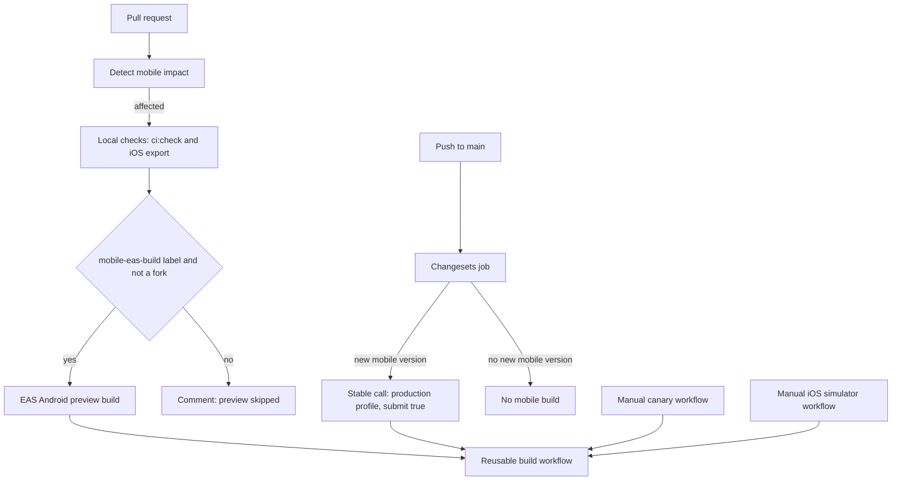
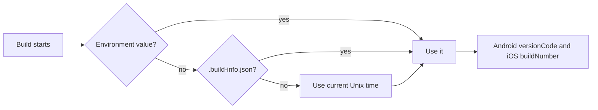

# Build and release

The mobile package has one build path and several entry points. A pull request (PR), a manual run, and a stable release all call the same reusable workflow. This document explains the scripts, the Expo configuration, the Expo Application Services (EAS) profiles, the continuous integration (CI) workflows, and the stable release.

## The pipeline



The stable node names the inputs to the reusable workflow; it does not start a second build. The reusable workflow runs `ci:check` again. A pull request with the preview label therefore runs the checks twice. It runs them once in the pull request job and once inside the build job. Source: `.github/workflows/agents_mobile_pr.yml:1-133`, `.github/workflows/agents_mobile_build.yml:24-267`, `.github/workflows/agents_mobile_canary.yml:1-44`, `.github/workflows/agents_mobile_ios_simulator.yml:1-33`, and `.github/workflows/changesets_release.yml:169-191`.

## Scripts

| Script | Command | Purpose |
|--------|---------|---------|
| `start` | `expo start` | Start the Metro development server |
| `android` | `expo start --android` | Start and open an Android target |
| `ios` | `expo start --ios` | Start and open an iOS target |
| `web` | `expo start --web` | Start the web target |
| `typecheck` | `tsc --noEmit` | Type check without output files |
| `test` | `vitest run --passWithNoTests` | Run the unit tests |
| `coverage` | `vitest run --coverage --passWithNoTests` | Run the tests with coverage |
| `doctor` | `expo-doctor` | Check the Expo project configuration |
| `export:android` | `expo export --platform android --output-dir dist/android` | Bundle the Android JavaScript without a native build |
| `export:ios` | `expo export --platform ios --output-dir dist/ios` | Bundle the iOS JavaScript without a native build |
| `ci:check` | typecheck, doctor, and `export:android` | The standard CI gate |

Source: `packages/agents-mobile/package.json:6-18`.

`export:android` is the strongest check that does not need a native toolchain. It runs Metro, the JavaScript bundler, over the full application. Metro follows every import from the entry point, so a broken import fails the check. A missing module alias also fails, because Metro cannot resolve the imported name. Source: `packages/agents-mobile/package.json:15-17`.

The package has version `0.6.5` and `private: true`. It does not publish to the Node Package Manager (npm) registry. Source: `packages/agents-mobile/package.json:2-4`.

## Application identity

`app.config.ts` is a function, not a static file. It reads the package version and computes the platform build numbers.

| Setting | Value | Source |
|---------|-------|--------|
| Name | `Electric Agents` | `packages/agents-mobile/app.config.ts:19` |
| Slug | `agents-mobile` | `packages/agents-mobile/app.config.ts:20` |
| Owner | `electric-ax` | `packages/agents-mobile/app.config.ts:21` |
| Scheme | `electric-agents` | `packages/agents-mobile/app.config.ts:22` |
| Version | From `package.json` | `packages/agents-mobile/app.config.ts:24` |
| Runtime version | From `package.json` | `packages/agents-mobile/app.config.ts:25` |
| Orientation | `portrait` | `packages/agents-mobile/app.config.ts:26` |
| New architecture | `true` | `packages/agents-mobile/app.config.ts:29` |
| EAS project identifier | `11a024df-c681-4374-867a-5c5905be9133` | `packages/agents-mobile/app.config.ts:7` and `packages/agents-mobile/app.config.ts:150-156` |

The runtime version equals the package version. A runtime version groups builds that can load the same over-the-air JavaScript update; a build accepts only an update with a matching runtime version. A new package version therefore marks a new runtime, and an older installed build does not receive the new update.

## Configuration plugins

Six plugins change the generated native projects:

| Plugin | Effect |
|--------|--------|
| `expo-router` | Enables file-based routing |
| `expo-web-browser` | Adds the system browser module |
| `expo-splash-screen` | Sets a dark splash screen with the logo, in light and dark modes |
| `expo-build-properties` | Sets the iOS deployment target to 16.4 |
| `./plugins/with-android-on-new-intent.js` | Adds the Android new-intent override |
| `expo-image-picker` | Adds photo-library and camera permission text, and removes the microphone permission |

Source: `packages/agents-mobile/app.config.ts:30-71`.

The iOS deployment target is 16.4 because the embedded chat code contains regular expressions with lookbehind. The iOS JavaScript engine is JavaScriptCore. JavaScriptCore parses lookbehind only on iOS 16.4 and later. On an older version the whole web bundle fails to parse, and the chat renders blank. A higher deployment target prevents installation on those older versions. Source: `packages/agents-mobile/app.config.ts:47-51`.

The image-picker plugin sets `microphonePermission: false`. The application never records audio, so the plugin does not add the microphone usage text or the Android record-audio permission. Source: `packages/agents-mobile/app.config.ts:56-70`.

## iOS configuration

The iOS block sets the bundle identifier to the application identifier and the build number to the computed version code. It sets `ITSAppUsesNonExemptEncryption` to false, which declares that the application uses no non-exempt encryption. It also enables tablet support. Source: `packages/agents-mobile/app.config.ts:72-81`.

The privacy manifest declares three facts:

1. The application does not track users.
2. It collects crash data and performance data for application functionality, without linking the data to the user and without tracking.
3. It uses four required-reason application programming interfaces (APIs). They cover user defaults, file timestamps, system boot time, and disk space. A required-reason API is an Apple API. An application must declare it in its privacy manifest before Apple accepts the upload. The manifest entries are `NSPrivacyAccessedAPICategoryUserDefaults`, `NSPrivacyAccessedAPICategoryFileTimestamp`, `NSPrivacyAccessedAPICategorySystemBootTime`, and `NSPrivacyAccessedAPICategoryDiskSpace`.

Source: `packages/agents-mobile/app.config.ts:82-126`.

The comment gives the reason. Apple rejects uploads that call required-reason APIs without a declaration. Apple does not reliably read the manifests of statically linked pods. A pod is a native library packaged by CocoaPods, the dependency manager for iOS native code. The application therefore declares the APIs at application level instead of relying on each library. Source: `packages/agents-mobile/app.config.ts:82-86`.

## Android configuration

The Android block sets the package name, the computed version code, and edge-to-edge layout. It blocks two permissions that the image picker would otherwise add:

- `android.permission.RECORD_AUDIO`, because the application records no audio.
- `android.permission.READ_EXTERNAL_STORAGE`, because the application uses the system photo picker and content identifiers.

It keeps `WRITE_EXTERNAL_STORAGE`. The comment gives the reason: the image picker camera path on Android versions before 10 requires it. Source: `packages/agents-mobile/app.config.ts:127-149`.

The adaptive icon has a foreground image and a monochrome image for themed icons on Android 13 and later. The `backgroundColor` value `#101217` fills the background layer of the adaptive icon. The launcher, not the application, tints the monochrome silhouette to match the user's wallpaper. Source: `packages/agents-mobile/app.config.ts:141-147`.

## Sentry

The configuration wraps the Expo config with `withSentry`. The Sentry data source name (DSN) host is in the European Union, so the upload target is `https://de.sentry.io/`. The organisation is `electricsql-04` and the project is `agents-mobile`. The upload secret comes from the EAS environment variable `SENTRY_AUTH_TOKEN`. Source: `packages/agents-mobile/app.config.ts:11-13` and `packages/agents-mobile/app.config.ts:159-165`.

The application also wraps the root layout with `Sentry.wrap` and puts a `Sentry.ErrorBoundary` inside the provider tree. Source: `packages/agents-mobile/app/_layout.tsx:35-45` and `packages/agents-mobile/app/_layout.tsx:75`.

## The version code

The version code must increase with every store upload. Canary and production builds come from different workflows, so a simple counter in one workflow is not enough.

The application computes the value in a fixed order:

```ts
// packages/agents-mobile/app.config.ts:174-189
function resolveVersionCode(): number {
  const fromEnv = process.env.ELECTRIC_AGENTS_MOBILE_VERSION_CODE
  if (fromEnv) {
    const parsed = Number.parseInt(fromEnv, 10)
    if (Number.isFinite(parsed) && parsed > 0) return parsed
  }
  try {
    const info = require(`./.build-info.json`) as { versionCode?: number }
    if (typeof info.versionCode === `number` && info.versionCode > 0) {
      return info.versionCode
    }
  } catch {
    // No build-info file — fall through to dev fallback.
  }
  return Math.floor(Date.now() / 1000)
}
```

The order is:

1. The `ELECTRIC_AGENTS_MOBILE_VERSION_CODE` environment variable.
2. The `.build-info.json` file.
3. The current time in seconds.

The CI workflow writes the file before it starts the build:

```yaml
# .github/workflows/agents_mobile_build.yml:154-160
- name: Write build info
  working-directory: packages/agents-mobile
  run: |
    set -euo pipefail
    version_code=$(date -u +%s)
    printf '{"versionCode": %s}\n' "$version_code" > .build-info.json
    echo "Generated .build-info.json with versionCode=$version_code"
```

The file is part of the project archive that the workflow sends to EAS. The configuration function therefore reads the same value on the GitHub runner and on the EAS build server. Source: `packages/agents-mobile/app.config.ts:167-172` and `.github/workflows/agents_mobile_build.yml:154-160`.



## EAS profiles

`eas.json` sets `appVersionSource` to `local`, so the repository owns the version and build numbers. The other setting is `remote`, where EAS stores and increments the values on its own servers. Every profile uses Node.js 24.11.1. Source: `packages/agents-mobile/eas.json:1-5`.

| Profile | Distribution | Platform change | Environment |
|---------|--------------|-----------------|-------------|
| `development` | Internal | Development client | `development` |
| `preview` | Internal | Android Package Kit (APK) | `preview` |
| `preview-ios-simulator` | Internal | iOS simulator binary | `preview` |
| `canary` | Internal | APK | `preview` |
| `canary-store` | Store | None | `production` |
| `production` | Store | None | `production` |

A development client is an application build that loads the JavaScript from the local Metro server and includes the native development modules. Source: `packages/agents-mobile/eas.json:6-47`.

Two profiles have submit configuration. `canary-store` sends to the Google Play internal track. `production` sends to the production track, which is the track that serves ordinary Play Store users. Both read `./google-service-account.json`. Both submit blocks configure only Android, so a release does not submit to App Store Connect. Source: `packages/agents-mobile/eas.json:48-61`.

The `canary` profile is for a direct install. The `canary-store` profile produces a store bundle and can submit. This is why the manual canary workflow sets `submit` only for `canary-store`. Source: `.github/workflows/agents_mobile_canary.yml:33-44`.

## The reusable build workflow

`agents_mobile_build.yml` is a reusable workflow. It accepts a channel, version string, git reference, platform, profile, submit flag, and optional release tag and name. The inputs are at `.github/workflows/agents_mobile_build.yml:3-35`; `release_tag` and `release_name` are at `:26-33`.

The build job runs these steps in order:

1. Check out the requested reference with full history.
2. Install pnpm and Node.js from `.tool-versions`.
3. Install the mobile package and its workspace dependencies with the frozen lock file.
4. Build the workspace dependencies of the mobile package.
5. Run `ci:check`.
6. Run the iOS export check when the platform is iOS or all.
7. Install EAS and authenticate with `EXPO_TOKEN`.
8. For a pull request build, create or update one marked comment.
9. When submit is true, write the Google Play service account key.
10. Write `.build-info.json`.
11. Run the EAS build with `--non-interactive --wait --json`.
12. Read the build identifier and build page Uniform Resource Locator (URL) from the JavaScript Object Notation (JSON) result.
13. Update the pull request comment with the result.
14. Fail the job when the EAS build failed.

Source: `.github/workflows/agents_mobile_build.yml:24-267`.

The EAS command adds `--auto-submit` only when the submit input is true:

```bash
# .github/workflows/agents_mobile_build.yml:162-182
args=(
  build
  --platform "${{ inputs.platform }}"
  --profile "${{ inputs.profile }}"
  --non-interactive
  --wait
  --json
)

if [[ "${{ inputs.submit }}" == "true" ]]; then
  args+=(--auto-submit)
fi

eas "${args[@]}" > eas-build.json
```

The workflow uses `continue-on-error` on the EAS step. This lets it capture the result and update the comment before it fails the job. A final step fails the job when the outcome is not success. Source: `.github/workflows/agents_mobile_build.yml:162-267`.

The result steps use two tools. The capture step reads `eas-build.json` with a small Node.js program and writes the `build_id` and `build_url` outputs. The two comment steps use a fixed marker string, `<!-- electric-agents-mobile-pr-build -->`. Each step lists the pull request comments, finds the one that contains the marker, and updates it. If no comment contains the marker, the step creates one. Source: `.github/workflows/agents_mobile_build.yml:82-131` and `.github/workflows/agents_mobile_build.yml:185-264`.

The service account key step validates the JSON before it writes the file. It then sets the file mode to `600`. Source: `.github/workflows/agents_mobile_build.yml:132-152`.

## Pull request workflow

The pull request workflow watches the mobile package, the two shared packages (`agents-server-ui` and `agents-runtime`), the mobile workflows, and the root build inputs. It runs on open, synchronize, reopen, and label events. Source: `.github/workflows/agents_mobile_pr.yml:1-25`.

The detect job runs `scripts/ci/mobile-affected.mjs`. The script computes the dependency closure of `@electric-ax/agents-mobile` and compares it with the packages that changed since the base commit. Source: `.github/workflows/agents_mobile_pr.yml:36-62` and `scripts/ci/mobile-affected.mjs:25-34`.

```js
// scripts/ci/mobile-affected.mjs:25-34
const changedFiles = getChangedFiles(baseRef)
const globalChange = shouldRunForGlobalChange(baseRef, changedFiles)
const mobileClosure = listWorkspaces([`${mobilePackage}...`])
const changedClosure = globalChange ? [] : listWorkspaces([`...[${baseRef}]`])
const mobileClosureNames = new Set(
  mobileClosure.map((workspace) => workspace.name)
)
const affectedWorkspaces = globalChange
  ? mobileClosure
  : changedClosure.filter((workspace) => mobileClosureNames.has(workspace.name))
```

A change to a root file such as `pnpm-lock.yaml`, `package.json`, `.tool-versions`, or a file under `patches/` counts as a global change. A patch is a local replacement for a dependency file, which pnpm applies from the `patches/` directory. A global change always builds. If the pnpm filter command fails, the script falls back to "build", which is the safe choice. Source: `scripts/ci/mobile-affected.mjs:13-21` and `scripts/ci/mobile-affected.mjs:62-77`.

The two pnpm filters use the dependency graph. `@electric-ax/agents-mobile...` selects the mobile package and every package it depends on. `...[<baseRef>]` selects the packages that changed since the base commit. The script keeps only the changed packages that are also in the mobile closure. Source: `scripts/ci/mobile-affected.mjs:24-34` and `scripts/ci/mobile-affected.mjs:54-84`.

The local-checks job runs `ci:check` and the iOS export. It runs only when the detect job reports an affected package. Source: `.github/workflows/agents_mobile_pr.yml:64-95`.

The EAS preview job has two conditions. The pull request must come from this repository, not a fork, and it must have the `mobile-eas-build` label. A fork has no access to the repository secrets. A pull request without the label gets a comment that explains the skip. Source: `.github/workflows/agents_mobile_pr.yml:97-133`.

The workflow has a concurrency group. A new push cancels an old run. A label event does not cancel a run, because the label usually arrives while checks are in progress. Source: `.github/workflows/agents_mobile_pr.yml:27-31`.

## Manual workflows

The canary workflow accepts three profiles: `canary`, `canary-store`, and `preview`. It always builds Android. Source: `.github/workflows/agents_mobile_canary.yml:1-20`.

The iOS simulator workflow builds the `preview-ios-simulator` profile on the iOS platform, with submit false. Source: `.github/workflows/agents_mobile_ios_simulator.yml:24-33`.

Both workflows declare the issue and pull request write permissions. The reusable workflow declares them, and GitHub checks the permissions before it evaluates the steps. The comment steps do not run for these channels. Source: `.github/workflows/agents_mobile_canary.yml:23-31` and `.github/workflows/agents_mobile_ios_simulator.yml:15-22`.

## Stable release

The Changesets workflow runs on a push to `main`. The changesets action reports the packages that received a new version in its `publishedPackages` output. The workflow reads that output and looks for `@electric-ax/agents-mobile`. When it finds the package, it sets a version and a tag. Source: `.github/workflows/changesets_release.yml:3-8` and `.github/workflows/changesets_release.yml:81-90`.

The release job then calls the reusable build workflow with:

- channel `stable`
- the new version
- the new tag as the git reference
- platform `android`
- profile `production`
- submit `true`
- a release name of `Electric Agents Mobile v<version>`

Source: `.github/workflows/changesets_release.yml:169-191`.

The package is private, so a release does not put the package on the npm registry. The Changesets configuration sets `privatePackages.version` and `privatePackages.tag` to true, so it can bump the version and create a tag. The tag then identifies the exact commit for the store build. Source: `.changeset/config.json:11` and `packages/agents-mobile/package.json:2-4`.

## Aha: the store version and the package version move on different clocks

**Aha:** The package version `0.6.5` answers "what changed for the user". The version code answers "which upload is newer for the store". The package version changes only when a changeset says so. The version code changes on every build, because the workflow writes the current Unix time into `.build-info.json`. The value follows the build start time, not the commit time. A canary build from an older commit therefore gets a higher code than a production build that started earlier. This split lets both workflows upload, in build order, and still satisfy the monotonic rule of Google Play and App Store Connect. It also means a failed build consumes a version code. The next build uses a larger time value, so a gap is harmless.

## Related documents

- [Application structure](01-app-structure.md) explains the Metro and Babel configuration that the export step uses.
- [Screens and navigation](02-screens-and-navigation.md) explains the application that these builds ship.
- [Native bridges](03-native-bridges.md) explains the configuration plugins in more detail.
- [agents-desktop packaging and release](../agents-desktop/03-packaging-and-release.md) is the desktop release path.
- [agents-server-ui build and testing](../agents-server-ui/06-build-and-testing.md) explains the web package that the mobile bundle compiles.
