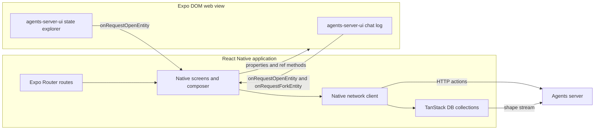
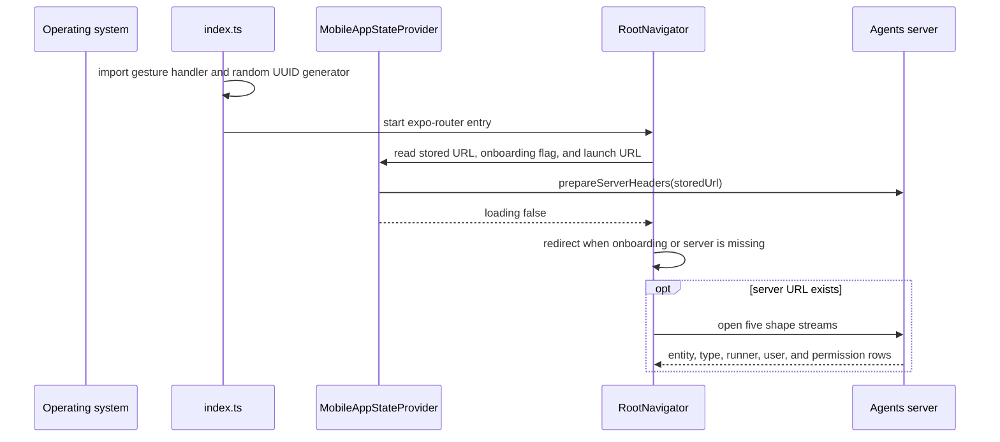

# agents-mobile

This directory studies `packages/agents-mobile`, the mobile client for Electric Agents. The package name is `@electric-ax/agents-mobile`. Its version is `0.6.5`. The package sets `private: true`, so it does not publish to the Node Package Manager (npm) registry. The private flag stops an accidental publish. Source: `packages/agents-mobile/package.json:2-5`.

The application has two rendering surfaces:

1. **The native shell.** React Native screens provide onboarding, the session list, the session header, the message composer, sharing, diagnostics, and account settings.
2. **The embedded web surface.** The chat timeline and the state explorer are `agents-server-ui` components. They run inside an Expo DOM (Document Object Model) component. Expo DOM renders web code inside a web view.

The native shell owns navigation, input, and network requests. The embedded web surface owns the rich transcript. Native code registers the active server headers for its own requests. It also passes a snapshot of those headers to the web surface as a property. The web surface registers that snapshot in its own JavaScript context before it loads data.

```ts
// packages/agents-mobile/src/lib/serverHeaders.ts:28-36
const serviceId = getCloudServiceIdFromServerUrl(serverUrl)
if (!serviceId) {
  registerActiveBaseUrl(serverUrl)
  registerActiveServerHeaders(null)
  return
}
```

For a self-hosted server the function registers the base Uniform Resource Locator (URL) and no headers. The server needs no cloud token.

A **session** is the user-facing name for an entity. An entity is one record on the agents server. A **fork** creates a new entity from a point in the existing entity stream.



A **shape** is a read-only, filtered subset of one server table, served over Hypertext Transfer Protocol (HTTP). A **shape stream** follows a shape and delivers change messages. The TanStack collection stays current from that stream.

The most important design fact is that the mobile application is not a smaller copy of the desktop application. It is a native client for the same server application programming interface (API). Session state arrives through Electric shapes. User actions use plain HTTP requests. The application reuses the chat transcript from the web package instead of rewriting it in React Native.

## Documents

| Order | Document | What it explains |
|-------|----------|------------------|
| 1 | [00-overview.md](00-overview.md) | Purpose, technology stack, layers, data flow, and package boundaries |
| 2 | [01-app-structure.md](01-app-structure.md) | Entry point, Expo Router file routes, providers, Metro and Babel configuration, directory map |
| 3 | [02-screens-and-navigation.md](02-screens-and-navigation.md) | Every route and screen, redirect rules, session list, new session, sharing, onboarding |
| 4 | [03-native-bridges.md](03-native-bridges.md) | Expo DOM properties and handles, request headers, deep links, image attachments, native modules |
| 5 | [04-build-and-release.md](04-build-and-release.md) | Scripts, Expo Application Services (EAS) profiles, configuration plugins, continuous integration, release |

## Quick facts

| Fact | Value | Source |
|------|-------|--------|
| Package name | `@electric-ax/agents-mobile` | `packages/agents-mobile/package.json:2` |
| Version | `0.6.5` | `packages/agents-mobile/package.json:4` |
| Entry point | `index.ts` | `packages/agents-mobile/package.json:5` |
| Expo | `54.0.35` | `packages/agents-mobile/package.json:28` |
| React Native | `0.81.5` | `packages/agents-mobile/package.json:42` |
| React | `19.1.0` | `packages/agents-mobile/package.json:40` |
| Router | `expo-router` `~6.0.24` | `packages/agents-mobile/package.json:35` |
| Web view | `react-native-webview` `13.15.0` | `packages/agents-mobile/package.json:49` |
| URL scheme | `electric-agents` | `packages/agents-mobile/app.config.ts:22` |
| Application identifier | `com.electricsql.agents.mobile` | `packages/agents-mobile/app.config.ts:8` |

## Commands

```bash
# Start the Metro development server
pnpm --filter @electric-ax/agents-mobile start

# Start on an Android device or emulator
pnpm --filter @electric-ax/agents-mobile android

# Start on an iOS device or simulator
pnpm --filter @electric-ax/agents-mobile ios

# Type check
pnpm --filter @electric-ax/agents-mobile typecheck

# Run the unit tests
pnpm --filter @electric-ax/agents-mobile test

# Run the continuous integration checks
pnpm --filter @electric-ax/agents-mobile ci:check
```

Source: `packages/agents-mobile/package.json:6-18`.

## How the application starts



The boot sequence reads two values from `AsyncStorage`: the active server URL and the onboarding flag. It reads the launch URL from `Linking.getInitialURL`. It registers request headers before it clears the loading flag. Source: `packages/agents-mobile/src/lib/MobileAppState.tsx:61-98`.

The entry point has two imports before `expo-router/entry`:

```ts
// packages/agents-mobile/index.ts:1-11
import 'react-native-gesture-handler'

import 'react-native-random-uuid'

import 'expo-router/entry'
```

The order is necessary. The gesture handler installs native functions before any screen uses a gesture component. The random universally unique identifier (UUID) generator installs `crypto.randomUUID` before the application code runs. The sign-in flow uses that function for its state value. Source: `packages/agents-mobile/index.ts:1-11` and `packages/agents-mobile/src/lib/cloudAuth.ts:729-743`.

## Aha: one server model, two rendering technologies

**Aha:** The mobile application does not reimplement the transcript. It mounts the same `agents-server-ui` chat log that the web and desktop clients show. The boundary between the two is a fixed set of properties and three imperative methods. The chat embed receives `serverUrl`, `entityUrl`, `theme`, `bottomInset`, `serverHeaders`, `onRequestOpenEntity`, and `onRequestForkEntity`. The methods are `setBottomInset`, `scrollToBottom`, and `setInlineQueuedMessages`. Native code keeps the network, authentication, and fork behaviour. The web view keeps the message rendering, Markdown, code blocks, and timeline layout. This is why a fix to the transcript appears on all three clients. It is also why the mobile package depends on the web package as a workspace dependency. Source: `packages/agents-mobile/app/session.tsx:194-218`, `packages/agents-server-ui/src/embed/sessionChatLogDomRef.ts:11-16`, and `packages/agents-mobile/package.json:20-21`.

The route wraps the embed in `memo`, so a parent re-render with equal properties does not send the properties across the bridge again. A changed property value still crosses. The imperative methods carry values that change often, such as the composer inset, without a property update. The wrapper is here:

```ts
// packages/agents-mobile/app/session.tsx:64-69
const SessionChatLogDomEmbed = memo(
  SessionChatLogDomEmbedModule as ComponentType<SessionDomEmbedProps>
)
const SessionStateInspectorDomEmbed = memo(
  SessionStateInspectorDomEmbedModule as ComponentType<SessionDomEmbedProps>
)
```

## A note about Electric Cloud

Electric Cloud is the hosted Electric service. The package README states that it has shut down. Source: `packages/agents-mobile/README.md:3-6`. The code still contains the cloud sign-in flow, the exchange of a cloud sign-in for an agents token, and the cloud server picker. This exploration describes these paths as present code with a historical purpose. A reader should connect to a self-hosted agents server. A self-hosted server receives no cloud token, so the application uses the server URL as given.

## Related documents

- [Electric and Durable Streams](../README.md) is the top-level index for this exploration.
- [agents-server-ui](../agents-server-ui/README.md) is the web application that supplies the embedded chat log and state explorer.
- [agents-desktop](../agents-desktop/README.md) is the second application client of the same server API.
- [How the runtime sets up a stream](../04-how-the-runtime-sets-up-a-stream.md) is the top-level document 04. It explains the stream that the mobile collections read. It is not this directory's `04-build-and-release.md`.
