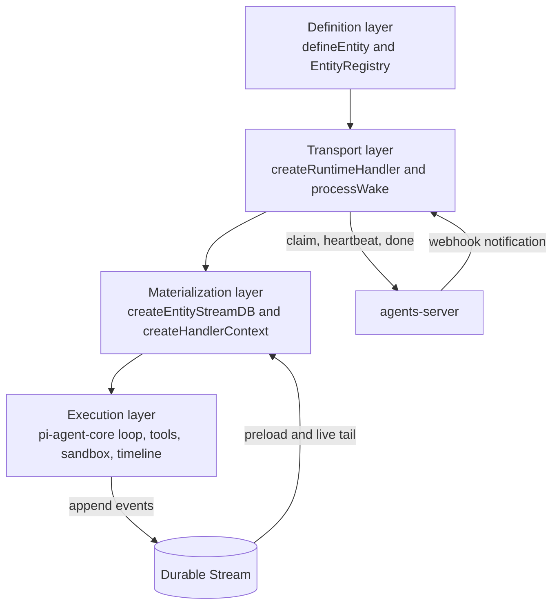
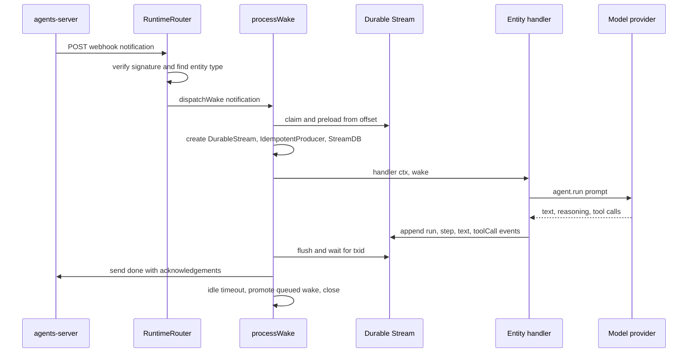

# Overview

`@electric-ax/agents-runtime` is the behavioral stack for Electric agent entities. An entity is an identified worker. It has an entity type, an instance identifier, and one append-only durable stream at a path such as `/agent/<id>`. The runtime turns that stream into a typed database. It runs the entity handler when new work arrives. It appends the result of the handler to the same stream.

The package does not store the stream. It uses the Durable Streams client. The package also does not choose when a wake fires. The agents-server control plane chooses. A wake fires when an inbox message arrives, a cron schedule fires, a signal arrives, or a child entity changes state. The runtime claims a wake, runs it, and acknowledges it. A claim is a request to the control plane for exclusive ownership of the stream for this wake. This is the wake claim. Document [03-wake-processing.md](03-wake-processing.md) also describes a separate producer claim against the stream store.

## Package facts

| Fact | Value |
|------|-------|
| Package name | `@electric-ax/agents-runtime` |
| Version | `0.6.3` |
| License | Apache-2.0 |
| Module type | ECMAScript module (ESM) |
| Build tool | `tsdown` |
| Test runner | `vitest` |
| Main peer dependencies | `@tanstack/react-db`, `dockerode`, `e2b`, `react` |
| Main runtime dependencies | `@durable-streams/client`, `@durable-streams/state`, `@mariozechner/pi-agent-core`, `@mariozechner/pi-ai`, `@tanstack/db`, `xstate`, `zod` |

The two build outputs explain the `main` and `module` fields. `main` points to the CommonJS file. `module` points to the ECMAScript module file. The `e2b` peer dependency is the remote sandbox provider. The `xstate` dependency drives the pull-wake runner state machine. The pull-wake runner is an alternative transport. It pulls wakes from a runner stream instead of receiving webhook notifications. The `@mariozechner/pi-ai` dependency supplies `streamSimple` and `getModel` to the agent adapter. `streamSimple` is the streaming model call. `getModel` looks up a model by its provider and identifier.

The package metadata is in `packages/agents-runtime/package.json:1-150`; the license is at line 150 and the peer dependencies are at lines 89-108. The snippet below shows an abbreviated form and omits the `exports` map:

```json
{
  "name": "@electric-ax/agents-runtime",
  "version": "0.6.3",
  "description": "Electric agent runtime — behavioral stack for agent entities over durable streams",
  "type": "module",
  "main": "./dist/index.cjs",
  "module": "./dist/index.js",
  "types": "./dist/index.d.ts"
}
```

## The four layers



The definition layer holds declarative data plus handler and action callbacks. The transport layer owns the network boundary. The layer names give the main responsibility. `processWake` crosses layers because it also builds the database and runs the handler.

A heartbeat is a periodic request that keeps the claim alive. The done callback is the final request that releases the claim and reports acknowledged offsets. A live tail is a subscription that delivers new stream events while the wake is active.

The most important property is the loop on the right. The execution layer writes events into the same stream that it reads. The next wake reads those events. The stream is therefore the database, the message bus, and the audit log.

## The public surface

`src/index.ts` exports the main entry points:

```ts
export { processWake } from './process-wake'
export { createRuntimeHandler, createRuntimeRouter } from './create-handler'
export { createEntityStreamDB } from './entity-stream-db'
export { createHandlerContext } from './context-factory'
export { defineEntity, EntityRegistry } from './define-entity'
export { DEFAULT_STATE_SCHEMAS } from './default-state-schemas'
```

The citation is `packages/agents-runtime/src/index.ts:124-452`.

The surface has these groups:

1. **Entity definition.** `defineEntity`, `EntityRegistry`, `getEntityType`, `listEntityTypes`.
2. **Runtime hosting.** `createRuntimeHandler`, `createRuntimeRouter`, `createPullWakeRunner`, `processWake`.
3. **Stream state.** `createEntityStreamDB`, `entityStateSchema`, `builtInCollections`, `DEFAULT_STATE_SCHEMAS`.
4. **Context and timeline.** `createHandlerContext`, `timelineMessages`, `assembleContext`, `createEntityTimelineQuery`.
5. **Model support.** `createOutboundBridge`, token accounting, model error classification, Moonshot models.
6. **Tools.** Tool factories and tool providers.
7. **Sandbox.** `unrestrictedSandbox`, `remoteSandbox`, Docker subpath exports.
8. **Control-plane client.** `createRuntimeServerClient`.
9. **Observations.** Cron, PostgreSQL sync, webhook sources, entity membership.
10. **Skills.** A Markdown skill registry and skill tools.
11. **Browser helpers.** Composer input parsing, the comments collection, and the browser agents client.

The sample above shows one export from each group. The citation range covers all exports. Groups 1 through 8 have a dedicated document in this directory. [09-server-client-signals-and-testing.md](09-server-client-signals-and-testing.md) covers group 9 for the client part. This document summarizes group 10 only. This document lists group 11 only.

## What happens on one wake



Some steps need a short definition:

- **Preload from offset.** The notification names the streams and offsets that caused the wake. The runtime finds the offset of the entry in `notification.streams` whose path equals the entity stream path. If no entry matches, the offset is `-1`. The runtime reads the stream from that offset to build the initial database.
- **IdempotentProducer.** The writer that appends events without duplicate writes after a retry.
- **StreamDB.** The short name for the database that `createEntityStreamDB` builds.
- **txid.** A transaction identifier that the runtime writes with each batch. The runtime waits for the identifier to return from the stream, which proves that the local projection saw the write.
- **done with acknowledgements.** The final claim callback. It releases the claim and reports each stream offset that the runtime consumed.

The sequence is the subject of [03-wake-processing.md](03-wake-processing.md). The handler context is the subject of [05-handler-context.md](05-handler-context.md).

## Key insight

**Key insight:** the runtime has no separate database. Every state change is an event. TanStack DB collections are projections that the runtime rebuilds from the event log. This design makes a wake replayable. It also makes the stream the only source of truth for both the handler and the user interface.

The runtime still needs an ordering rule. It uses a timeline order token derived from the stream offset and the position inside the batch. A batch is one group of events that the stream client reads together. Document [04-entity-stream-db.md](04-entity-stream-db.md) explains that rule.

## Why the package is split into subpaths

The main export loads the full runtime. The `./sandbox/docker` subpath loads `dockerode` only when a caller uses the Docker provider. The `./react` and `./client` subpaths serve browser code. The `./tools` subpath serves code that needs tool definitions but not the runtime host.

This split matters for desktop renderers. A renderer that uses only the unrestricted provider must not bundle native Docker modules. The comment in `packages/agents-runtime/src/sandbox-docker.ts:1-8` states this reason.

## Limits of this document

This overview names the layers. It does not prove the details. Each later document proves its own claims with source references. Start with [01-entity-model.md](01-entity-model.md) for the data model.
