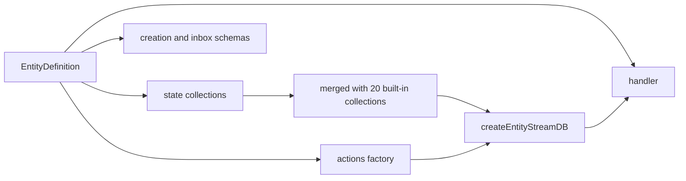
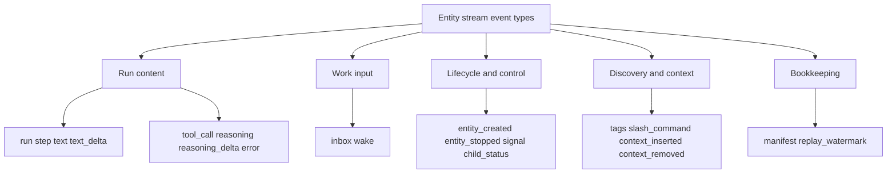

# Entity Model

An entity type is a name and a definition. The definition contains a handler. It also contains optional state collections, actions, schemas, permission grants, and slash commands. The runtime stores the definition in a registry. The registry is a `Map` from name to entry.

This document explains the definition shape, the registry, the 20 built-in event schemas, and the collection model.

## The definition call

```ts
export function defineEntity(
  name: string,
  definition: EntityDefinition
): void {
  defaultRegistry.define(name, definition)
}
```

The citation is `packages/agents-runtime/src/define-entity.ts:55-64`. This snippet is simplified. The real function is generic over the creation schema, the state, and the actions.

`defineEntity` writes to a module-level registry. A process that needs isolated registries uses `createEntityRegistry()` instead. `resolveDefine(registry)` returns the correct `define` function for a given registry.

The registry rejects a duplicate name:

```ts
define(name: string, definition: EntityDefinition): void {
  if (this.entries.has(name)) {
    throw new Error(`Entity type "${name}" is already registered`)
  }
  this.entries.set(name, { name, definition })
}
```

The citation is `packages/agents-runtime/src/define-entity.ts:13-28`.

This rule is strict on purpose. A duplicate name usually means two modules define the same entity type. The runtime fails at startup, not at the first wake.

## The `EntityDefinition` shape

| Field | Meaning |
|-------|---------|
| `description` | Human-readable text for the registration body |
| `state` | Custom state collections |
| `actions` | Custom TanStack DB action definitions |
| `creationSchema` | Validator for `spawn` arguments |
| `inboxSchemas` | Validators for inbox message types |
| `stateSchemas` | Additional collection schemas |
| `permissionGrants` | Permission definitions sent to the server |
| `slashCommands` | Static slash commands |
| `handler` | Function called once per wake-loop iteration |

The type is in `packages/agents-runtime/src/types.ts`. The handler signature is `(ctx, wake) => Promise<void> | void`. The runtime calls the handler in a loop. The first call handles the wake that opened the session. The loop calls the handler again when new inbox work arrives during the same wake session. A wake session is the time from the wake claim to the wake acknowledgement. Document [03-wake-processing.md](03-wake-processing.md) shows the loop.

`spawn` creates a child entity. The caller supplies the entity type, the instance identifier, and optional creation arguments. The `creationSchema` validates those arguments.

A principal is an authenticated caller identity. It can be a user or a system actor. A permission grant gives a principal the right to perform an action on the entity.

## Custom state collections

A state collection is a `CollectionDefinition`. It has these fields:

- `schema`: a Standard Schema validator, usually Zod.
- `type`: the stream event type. The default is `state:${name}`.
- `primaryKey`: the row key field. The default is `key`.
- `externallyWritable`: permits writes from clients with a principal.
- `contract`: an optional contract identifier.
- `operations`: an optional list of allowed operations.

When the runtime builds the stream database, it copies these definitions into the stream state map. Document [04-entity-stream-db.md](04-entity-stream-db.md) explains the merge and the generated actions.



The stream database merges the two maps with the built-in map first and the custom map second. A custom collection that uses a built-in name replaces that entry. This is the spread rule at `packages/agents-runtime/src/entity-stream-db.ts:203-206`.

That override is narrow. The replacement entry keeps the custom definition. Its event type defaults to `state:<name>` unless the definition sets `type`, so it does not silently take over the built-in event type.

The registration body has a different merge. It merges schemas into the registration body in JavaScript Object Notation (JSON). An explicit `stateSchemas` entry replaces a built-in schema with the same key. Document [02-runtime-handler-and-registration.md](02-runtime-handler-and-registration.md) shows that merge. Do not confuse the two sites.

## The 20 built-in event schemas

Every entity stream contains the same 20 built-in event types. The code fixes the list in `BUILT_IN_EVENT_SCHEMAS`:

```ts
export const BUILT_IN_EVENT_SCHEMAS = {
  run: createRunSchema(),
  step: createStepSchema(),
  text: createTextSchema(),
  text_delta: createTextDeltaSchema(),
  tool_call: createToolCallSchema(),
  reasoning: createReasoningSchema(),
  reasoning_delta: createReasoningDeltaSchema(),
  error: createErrorEventSchema(),
  inbox: createMessageReceivedSchema(),
  wake: createWakeSchema(),
  entity_created: createEntityCreatedSchema(),
  entity_stopped: createEntityStoppedSchema(),
  signal: createSignalSchema(),
  child_status: createChildStatusSchema(),
  tags: createTagEntrySchema(),
  slash_command: createSlashCommandSchema(),
  context_inserted: createContextInsertedSchema(),
  context_removed: createContextRemovedSchema(),
  manifest: createManifestSchema(),
  replay_watermark: createReplayWatermarkSchema(),
}
```

The citation is `packages/agents-runtime/src/entity-schema.ts:1050-1082`. The displayed code removes the type casts for readability. The source casts each value to `BuiltInEntitySchema<T>`.

The 20 types fall into five groups:

1. **Run content.** `run`, `step`, `text`, `text_delta`, `tool_call`, `reasoning`, `reasoning_delta`, `error`.
2. **Work input.** `inbox`, `wake`.
3. **Lifecycle and control.** `entity_created`, `entity_stopped`, `signal`, `child_status`.
4. **Discovery and context.** `tags`, `slash_command`, `context_inserted`, `context_removed`.
5. **Bookkeeping.** `manifest`, `replay_watermark`.



## The 20 built-in collections

Each event type maps to one collection. The collection name is not always the event type. For example, event `text_delta` maps to collection `textDeltas`, and event `run` maps to collection `runs`.

```ts
export const builtInCollections = {
  runs: {
    schema: BUILT_IN_EVENT_SCHEMAS.run,
    type: `run`,
    primaryKey: `key`,
  },
  steps: {
    schema: BUILT_IN_EVENT_SCHEMAS.step,
    type: `step`,
    primaryKey: `key`,
  },
  // ...18 more collections
}
```

The citation is `packages/agents-runtime/src/entity-schema.ts:1118-1227`. The displayed code removes the Standard Schema casts.

The full mapping is:

| Collection | Event type |
|------------|------------|
| `runs` | `run` |
| `steps` | `step` |
| `texts` | `text` |
| `textDeltas` | `text_delta` |
| `toolCalls` | `tool_call` |
| `reasoning` | `reasoning` |
| `reasoningDeltas` | `reasoning_delta` |
| `errors` | `error` |
| `inbox` | `inbox` |
| `wakes` | `wake` |
| `entityCreated` | `entity_created` |
| `entityStopped` | `entity_stopped` |
| `signals` | `signal` |
| `childStatus` | `child_status` |
| `tags` | `tags` |
| `slashCommands` | `slash_command` |
| `manifests` | `manifest` |
| `contextInserted` | `context_inserted` |
| `contextRemoved` | `context_removed` |
| `replayWatermarks` | `replay_watermark` |

`ENTITY_COLLECTIONS` gives the collection names as constants. The citation is `packages/agents-runtime/src/entity-schema.ts:1027-1048`.

## Primary keys and row keys

Every built-in collection uses `key` as the primary key. The runtime generates composite keys for many events:

- A run uses `run-N`.
- A step uses `step-N`.
- A text message uses `msg-N`.
- A text delta uses `msg-N:seq`.
- A reasoning block uses `reasoning-N`.
- A reasoning delta uses `reasoning-N:seq`. The `seq` value is a counter for that parent text or reasoning row. The outbound bridge increases it for each delta.
- A tool call uses `tc-N`.
- An error uses `run-N:error-<uuid>`.

The outbound bridge allocates these keys. The bridge is the writer that maps model events to stream events. It keeps the counters in a process-local cache. A new bridge seeds the counters from the existing run, step, text, and tool rows, and raises them to the cached value. A later wake in the same process continues the sequence. A later wake in a new process seeds the counters from the rows again. Document [06-agent-loop-and-tools.md](06-agent-loop-and-tools.md) shows the allocation.

A generated action is a TanStack DB write action that `createEntityStreamDB` builds for a custom collection. It persists a local insert, update, or delete as a stream event.

A custom collection can choose a different primary key. The runtime passes the key to the stream state schema. It also uses the key in generated actions.

## Management events

Some event types do not carry agent content. The runtime classifies them as management events:

```ts
const MANAGEMENT_TYPES = new Set<string>([
  `entity_created`,
  `signal`,
  `manifest`,
  `replay_watermark`,
  `ack`,
])

export function isManagementEvent(event: ChangeEvent): boolean {
  return MANAGEMENT_TYPES.has(event.type)
}
```

The citation is `packages/agents-runtime/src/entity-schema.ts:1241-1254`.

`ack` is a control event. It is not one of the 20 schema types, and the runtime does not define a schema for it. The state layer emits it to confirm a write. The guards let consumers ignore management traffic when they build a chat view.

The other bookkeeping and context event types have these jobs:

- `manifest`: records a keyed entry in the live entity view. Context entries and goals use it.
- `context_inserted`: records the history of one durable context insert.
- `context_removed`: records the removal of one durable context entry.
- `replay_watermark`: records how far a replayed fork has progressed.
- `child_status`: records the lifecycle state of a child entity.
- `slash_command`: records a slash command input.
- `tags`: records a tag change.

## Signals and child status

The signal schema accepts seven values:

- `SIGINT`: abort the active run.
- `SIGHUP`: close the wake after the current checkpoint.
- `SIGTERM`: close the wake after cleanup and mark the entity stopped.
- `SIGKILL`: abort the run, terminate the entity, and close the wake.
- `SIGSTOP`: pause after the current checkpoint.
- `SIGCONT`: resume queued work.
- `SIGUSR`: deliver a custom signal to the handler.

The citation is `packages/agents-runtime/src/entity-schema.ts:58-65` and `:443-456`.

A signal is a control message for one entity. A caller sends it through the control plane, and the wake loop delivers it. The handler receives `SIGHUP`, `SIGTERM`, and `SIGUSR` through `ctx.onSignal`. The runtime handles the other signals itself. "After the current checkpoint" means after the active handler iteration finishes its current durable write.

Child status accepts `spawning`, `running`, `idle`, `paused`, `stopping`, `stopped`, and `killed`. The citation is `packages/agents-runtime/src/entity-schema.ts:431-442`. A child entity is an entity that another entity created with `ctx.spawn`. The parent can observe the child status.

## Key insight

**Key insight:** the built-in event set is a fixed contract, not a suggestion. Every entity starts with the same 20 collections even when it never uses most of them. A custom collection that reuses a built-in name replaces that entry. The built-in collection is then no longer addressable under its old name in that entity. The base set costs little at rest because the collections are projections. It gives every consumer, from the user interface to a replay tool, one stable vocabulary.

The custom state layer is additive. A custom collection gets the default type `state:<name>` and the default primary key `key`. The runtime wraps the custom schema with virtual columns for timeline order and, when the collection is externally writable, the writing principal. The writing principal is the identity that sent the write. Document [04-entity-stream-db.md](04-entity-stream-db.md) explains those columns.

## Open question

The built-in schema list includes `replay_watermark`, but this package only defines and exports it. The replay consumer is in the agents-server fork path. The fork path is the server code that copies an entity stream to a new entity. It uses the watermark to record progress. The package does not document the replay algorithm in this directory. The cross-package use is outside this package study.

## Next

Read [02-runtime-handler-and-registration.md](02-runtime-handler-and-registration.md) to see how a definition becomes a registered entity type.
