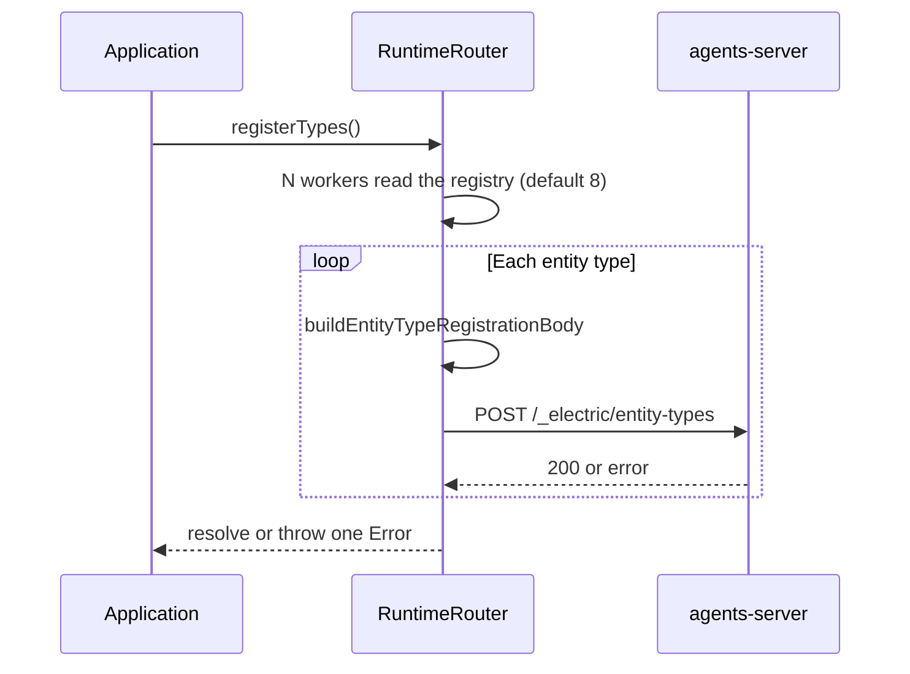
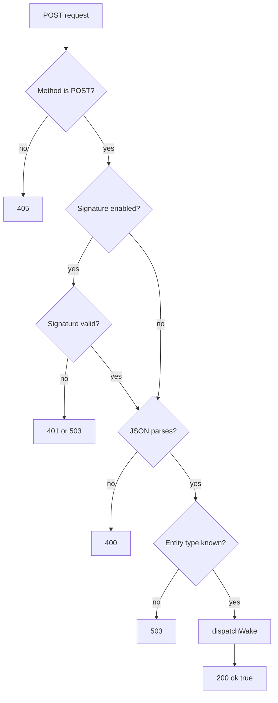

# Runtime Handler and Registration

The runtime host has two jobs. First, it accepts webhook notifications from the agents-server control plane. The control plane is the server that owns entity lifecycle. Second, it registers each entity type with that control plane. `createRuntimeHandler` builds this host. `createRuntimeRouter` builds the same router without the Node.js request adapter.

Registration is explicit. `createRuntimeHandler` returns `registerTypes()`, but it does not call that method. The application calls it after the server starts listening. The method reads the entity registry and sends one registration request per type.

A notification has this minimum shape:

```json
{
  "consumerId": "consumer-1",
  "epoch": 1,
  "wakeId": "wake-123",
  "streamPath": "/agent/abc/main",
  "streams": [{ "path": "/agent/abc/main", "offset": "-1" }],
  "callback": "http://server/_electric/wake/callback",
  "claimToken": "...",
  "entity": { "type": "agent", "url": "/agent/abc" }
}
```

Document [03-wake-processing.md](03-wake-processing.md) lists the fields. The TypeScript type is `WebhookNotification` at `packages/agents-runtime/src/types.ts:698-734`.

This document explains the configuration, the registration body, signature verification, wake dispatch, drain, and error handling.

## The two constructors

| Constructor | Returns | Use case |
|-------------|---------|----------|
| `createRuntimeRouter` | `RuntimeRouter` | Tests and custom hosts |
| `createRuntimeHandler` | `RuntimeHandler` | Node.js Hypertext Transfer Protocol (HTTP) server |

`createRuntimeHandler` calls `createRuntimeRouter`. It adds `onEnter`, a Node.js adapter that converts an `IncomingMessage` into a Fetch `Request`, calls the router, and writes the `Response` back to the `ServerResponse`.

```ts
export function createRuntimeHandler(
  config: RuntimeHandlerConfig
): RuntimeHandler {
  const router = createRuntimeRouter(config)
  const onEnter = async (req, res) => {
    const request = await toFetchRequest(req)
    const response = await router.handleWebhookRequest(request)
    await sendNodeResponse(res, response)
  }
  return { onEnter, ...router }
}
```

The citation is `packages/agents-runtime/src/create-handler.ts:655-702`.

## Configuration

`RuntimeRouterConfig` has these main fields:

| Field | Default | Purpose |
|-------|---------|---------|
| `baseUrl` | Required | agents-server base Uniform Resource Locator (URL) |
| `serveEndpoint` | None | Public runtime URL sent in registration |
| `handlerUrl` | None | Alias for `serveEndpoint` |
| `webhookPath` | Path of `serveEndpoint`, else `/electric-agents` | Matched webhook path |
| `registry` | Module registry | Entity definitions to serve |
| `subscriptionPathForType` | None | Override the wake subscription path |
| `defaultDispatchPolicyForType` | None | Override the dispatch policy |
| `serverHeaders` | None | Headers for control-plane calls |
| `webhookSignature` | Enabled | Signature settings or `false` |
| `idleTimeout` | `20_000` milliseconds | Wake idle window |
| `heartbeatInterval` | `10_000` milliseconds | Claim heartbeat interval |
| `createElectricTools` | None | Tool factory per wake |
| `onWakeError` | None | Background error observer |
| `registrationConcurrency` | `8` | Parallel registration limit |
| `sandboxProfiles` | Empty | Advertised sandbox profiles |
| `publicUrl` | None | An entry in the public runtime URL list |
| `name` | `default` | Runtime instance name |

The citation is `packages/agents-runtime/src/create-handler.ts:35-130`.

`normalizeConfig` derives the webhook path and the signature settings. The default signature keys come from `${baseUrl}/__ds/jwks.json`:

```ts
const webhookSignature =
  config.webhookSignature === false
    ? false
    : {
        jwksUrl:
          config.webhookSignature?.jwksUrl ??
          appendPathToUrl(config.baseUrl, `/__ds/jwks.json`),
        toleranceSeconds: config.webhookSignature?.toleranceSeconds,
        cacheTtlMs: config.webhookSignature?.cacheTtlMs,
      }
```

The citation is `packages/agents-runtime/src/create-handler.ts:722-734`.

Signature verification is on by default. A test that uses an in-process handler can set `webhookSignature: false`. The comment warns that this setting is for trusted tests only.

## The registration body

`buildEntityTypeRegistrationBody` converts a definition into the JavaScript Object Notation (JSON) body that the control plane accepts:

```ts
export function buildEntityTypeRegistrationBody(
  name: string,
  definition: AnyEntityDefinition
): Record<string, unknown> {
  const body = {
    name,
    description: definition.description ?? `${name} entity`,
    state_schemas: {
      ...DEFAULT_STATE_SCHEMAS,
      ...customStateSchemas,
      ...definition.stateSchemas,
    },
  }
  // creation_schema, inbox_schemas, slash_commands,
  // externally_writable_collections, permission_grants
  return body
}
```

The citation is `packages/agents-runtime/src/create-handler.ts:275-326`.

The merge order matters. The built-in schemas come first. Schemas derived from `definition.state` come next. Explicit `definition.stateSchemas` come last. A definition cannot remove a built-in schema, but it can provide a replacement with the same key.

This is the registration-body merge. It is different from the stream-database merge in [01-entity-model.md](01-entity-model.md). Here the key is the event type. A custom collection uses its `def.type` or the default `state:<collectionName>` as the key. A type that equals a built-in name replaces the built-in schema in the registration body.

`DEFAULT_STATE_SCHEMAS` is a JSON Schema 7 form of the 20 built-in event schemas:

```ts
export const DEFAULT_STATE_SCHEMAS = Object.fromEntries(
  Object.entries(BUILT_IN_EVENT_SCHEMAS).map(([eventType, schema]) => [
    eventType,
    toStateSchema(schema),
  ])
)
```

The citation is `packages/agents-runtime/src/default-state-schemas.ts:18-26`. `toStateSchema` removes the `$schema` field so that the control plane sees a plain schema object.

## Registration flow



The registration request goes to `/_electric/entity-types`. The router sets `serve_endpoint` to the serve endpoint when one exists. It also adds `default_dispatch_policy` when a serve endpoint exists:

```ts
body.default_dispatch_policy = {
  targets: [{
    type: `webhook`,
    url: serveEndpoint,
    subscription_id: runtimeWebhookSubscriptionId(name),
  }],
}
```

The citation is `packages/agents-runtime/src/create-handler.ts:556-568`.

`runtimeWebhookSubscriptionId` replaces unsafe characters with `_` and returns `webhook:<name>`:

```ts
function runtimeWebhookSubscriptionId(typeName: string): string {
  const safeTypeName = typeName.replace(/[^A-Za-z0-9_.-]/g, `_`)
  return `webhook:${safeTypeName || `runtime`}`
}
```

The citation is `packages/agents-runtime/src/create-handler.ts:753-756`.

## Registration concurrency

```ts
const effectiveConcurrency = Math.max(1, registrationConcurrency ?? 8)
await forEachWithConcurrency(types, effectiveConcurrency, async (entry) => {
  // build and POST one registration
})
```

The citation is `packages/agents-runtime/src/create-handler.ts:542-545`.

The default is 8. The router clamps a value below 1 to 1. The router collects failed names and throws one error after all workers finish:

```
[agent-runtime] N/M entity types registered (X failed: ...)
```

This behavior is fail-loud. A partial registration is visible to the operator. Successful registrations stay in place. The router does not retry. The caller must start the process again to retry the failed types, or call `registerTypes()` again.

## Webhook request handling



`handleWebhookRequest` applies these checks in order:

1. Method must be `POST`. Otherwise return 405.
2. Read the raw body as bytes.
3. Verify the signature when enabled.
4. Parse the body as JSON. A parse failure returns 400.
5. Read `notification.entity.type`.
6. Reject an unknown type with 503.
7. Call `dispatchWake`.
8. Return `{ ok: true }` with status 200.

```ts
const body = new Uint8Array(await request.arrayBuffer())
if (webhookSignature) {
  const verification = await verifyWebhookSignature(
    body,
    request.headers.get(`webhook-signature`),
    webhookSignature
  )
  if (!verification.ok) {
    return json({ error: verification.error }, verification.status)
  }
}
```

The citation is `packages/agents-runtime/src/create-handler.ts:487-502`.

## Signature verification

`verifyWebhookSignature` accepts a body, a `webhook-signature` header, and a configuration. The header is a comma-separated list of three required parts:

- `t`: the Unix timestamp in seconds.
- `kid`: the key identifier.
- `ed25519`: the base64url signature.

An example header is `t=1700000000,kid=key-1,ed25519=<base64url>`. The `__ds` path prefix is the Durable Streams route that the agents-server serves.

```ts
const timestampText = values.get(`t`)
const kid = values.get(`kid`)
const signature = values.get(`ed25519`)
if (!timestampText || !kid || !signature) return null
if (!/^\d+$/.test(timestampText)) return null
if (!/^[A-Za-z0-9_-]+$/.test(signature)) return null
```

The citation is `packages/agents-runtime/src/webhook-signature.ts:93-122`.

The verifier checks the timestamp against a 300-second tolerance. It fetches the JSON Web Key Set (JWKS) from the configured URL. It caches the key set for 300 seconds by default, or for the `cache-control` max-age when present. It accepts only Ed25519 keys.

| Failure | Status |
|---------|--------|
| Missing signature | 401 |
| Invalid header | 401 |
| Expired timestamp | 401 |
| JWKS fetch failure | 503 |
| Unknown key identifier | 401 |
| Bad signature | 401 |

## Wake dispatch

`dispatchWake` starts `processWake` in the background. It stores the promise, a label, and an abort controller.

```ts
const dispatchWake = (notification, options): void => {
  const controller = new AbortController()
  const wake = Promise.resolve(
    processWake(notification, {
      ...wakeConfig,
      ...options,
      shutdownSignal: controller.signal,
    })
  ).catch((err) => {
    const handled = config.onWakeError?.(err) === true
    if (!handled) wakeErrors.push(err)
  }).finally(() => {
    pendingWakes.delete(wake)
  })
  pendingWakes.add(wake)
  pendingWakeControllers.set(wake, controller)
}
```

The citation is `packages/agents-runtime/src/create-handler.ts:408-442`.

The method returns immediately. The webhook can respond before the handler finishes. This is the correct behavior for a wake: the control plane gets a fast acknowledgement, and the runtime owns the long task.

`isWakeActive(streamPath)` checks the pending labels. The label records the stream path for each pending wake. The pull-wake runner uses this check to avoid a second claim for the same stream. The pull-wake runner is an alternative to webhook delivery. It reads wake notifications from a runner wake stream and calls `dispatchWake` itself instead of waiting for an HTTP request.

## Drain and error behavior

`drainWakes` waits until the pending set is empty. It then throws the stored errors, if any exist:

```ts
while (pendingWakes.size > 0) {
  await Promise.all([...pendingWakes])
}
if (wakeErrors.length === 0) return
const errors = [...wakeErrors]
wakeErrors.length = 0
if (errors.length === 1) throw errors[0]
throw new AggregateError(errors, `[agent-runtime] Background wake failed`)
```

The citation is `packages/agents-runtime/src/create-handler.ts:455-473`.

`onWakeError` can suppress an error. The callback returns `true` to mark the error as handled. Any other return value keeps the error.

`waitForSettled` is an alias for `drainWakes`. `abortWakes` aborts every controller. The pull-wake runner calls both during shutdown.

## Key insight

**Key insight:** the handler separates fast acceptance from slow execution. The webhook response says only that the notification was valid and dispatched. It does not say that the handler succeeded. `processWake` records success in the stream, and the control plane learns of it through the done callback and the ack offsets.

This split has a cost. A process crash after the 200 response but before the handler writes its result loses the in-memory work. The stream claim and the epoch protect against double execution. An epoch is a stream ownership generation number. A producer with an old epoch cannot append. Document [03-wake-processing.md](03-wake-processing.md) explains the claim protocol, the done callback, and the acknowledgement offsets.

## Next

Read [03-wake-processing.md](03-wake-processing.md) for the full wake lifecycle.
