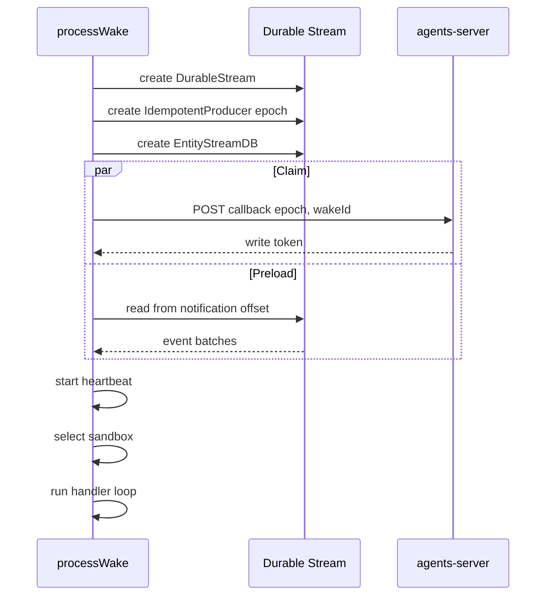
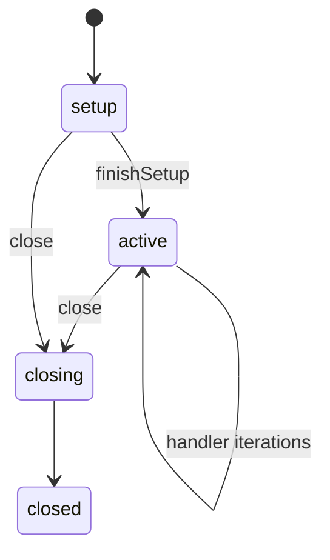

# Wake Processing

A wake is one unit of work. The agents-server sends a webhook notification. The runtime claims the wake and preloads the stream in parallel. It runs the entity handler. It writes the results. It acknowledges the consumed offset. Then it waits for more work until the idle timeout expires.

`processWake` owns this lifecycle. The function is in `packages/agents-runtime/src/process-wake.ts`. It is the largest function in the package source, and it owns the wake lifecycle.

## The entry point

```ts
export async function processWake(
  notification: WebhookNotification,
  config: ProcessWakeConfig
): Promise<WakeResult | null> {
  const {
    baseUrl,
    registry,
    shutdownSignal,
    idleTimeout = DEFAULT_IDLE_TIMEOUT,
    heartbeatInterval = DEFAULT_HEARTBEAT_INTERVAL,
  } = config
  const { callback, claimToken, epoch, wakeId } = notification
  const entityUrl = notification.entity?.url ?? notification.streamPath
  const typeName = notification.entity?.type
  const streamPath = notification.streamPath
}
```

The citation is `packages/agents-runtime/src/process-wake.ts:434-450`.

`typeName` selects the entity definition from the registry. The lookup is `registry.get(typeName)` or `getEntityType(typeName)`. `streamPath` is the entity main stream. `entityUrl` is the entity identity, which is often a shorter path. The notification offset is the offset of the entry in `notification.streams` whose path equals `streamPath`. If no entry matches, the offset is `-1`.

The defaults are:

- Idle timeout: `20_000` milliseconds.
- Heartbeat interval: `10_000` milliseconds.

The citations are `packages/agents-runtime/src/process-wake.ts:85-86`.

## The notification

The notification is a `WebhookNotification`:

| Field | Meaning |
|-------|---------|
| `consumerId` | The consumer that received the stream event |
| `epoch` | The ownership epoch of the stream |
| `wakeId` | The unique wake identifier |
| `streamPath` | The entity stream path |
| `streams` | Streams and offsets that caused the wake |
| `callback` | The claim and done callback Uniform Resource Locator (URL) |
| `claimToken` | The initial claim token |
| `triggeredBy` | Optional triggering sources |
| `triggerEvent` | Optional trigger event name |
| `wakeEvent` | Optional wake payload |
| `entity` | Entity type, status, URL, main stream, tags, spawn arguments, sandbox, creator |
| `principal` | Optional writing principal |

The type is in `packages/agents-runtime/src/types.ts:698-734`.

The entity sandbox block has `profile`, `key`, `scope`, `persistent`, and `owner`. The runtime uses that block to choose and configure the sandbox. Document [08-sandbox.md](08-sandbox.md) explains the resolution.

An epoch is a stream ownership generation number. The stream store creates a new epoch when a new producer claims ownership. A producer with an old epoch cannot append. This rule stops two workers from writing as the owner at the same time.

## Early exit

If the entity type is missing or unknown, `processWake` returns `null` without a claim and without an acknowledgement. The webhook handler normally rejects an unknown type with status 503 before dispatch. The status is retryable by design: another runner may have the type registered. This second guard protects direct callers.

## Setup

The runtime builds three objects before any handler work:

1. A `DurableStream` for the entity main path.
2. An `IdempotentProducer` for that stream.
3. An entity stream database that reads and writes through both.

The producer must exist before the database. The database actions write through the producer.

```ts
const stream = new DurableStream({
  url: streamUrl,
  headers: serverHeaders,
  contentType: `application/json`,
})

// Create producer BEFORE the StreamDB so state actions can write through it.
const producer = new IdempotentProducer(stream, `entity-${entityUrl}`, {
  epoch,
  autoClaim: true,
  fetch: (input, init) => {
    const headers = new Headers(init?.headers)
    if (writeToken) {
      applyClaimTokenHeader(headers, config.claimTokenHeader ?? `authorization`, writeToken)
    }
    return globalThis.fetch(input, { ...init, headers })
  },
  onError: (error) => failBackgroundWake(error, `WRITE_FAILED`),
})
```

The citation is `packages/agents-runtime/src/process-wake.ts:529-553`.

`writeToken` is a mutable variable. It starts as an empty string. The claim callback assigns it after a successful claim. The producer `fetch` closure reads the current value at request time, so writes made after the claim carry the token.

The producer identifier is `entity-${entityUrl}`. The `epoch` binds the producer to the current stream ownership. The custom `fetch` adds the write token to every request. The producer claims stream write ownership automatically. This is not the same claim as the wake claim callback. The wake claim asks the control plane for the right to run this wake. The producer claim asks the stream store for the right to append under the epoch. Both are required.

The runtime creates the database next:

```ts
const db = createEntityStreamDB(
  streamUrl,
  entry.definition.state,
  entry.definition.actions,
  {
    stream,
    actorFrom: entityUrl,
    onEvent: (event) => {
      if (preloaded) handleRuntimeSideEffectEvent(event)
    },
    onBatch: handleLiveBatch,
    writeEvent,
    flushWrites: () => producer.flush(),
  }
)
```

The citation is `packages/agents-runtime/src/process-wake.ts:558-574`. `entry` is the registry entry for `typeName`. `serverHeaders` are the control-plane request headers from the runtime configuration. `streamUrl` is `baseUrl` plus `streamPath`.

`writeEvent` appends one JavaScript Object Notation (JSON) event to the producer. `flushWrites` flushes the producer. The database therefore shares one write path with the handler. Document [04-entity-stream-db.md](04-entity-stream-db.md) explains the inside of this call.

## Claim and preload run in parallel

```ts
const preloadPromise = db.preload().then(() => {
  preloadMs = +(performance.now() - preloadT0).toFixed(2)
})
const [claimed] = await Promise.all([claimPromise, preloadPromise])
preloaded = true
```

The citation is `packages/agents-runtime/src/process-wake.ts:1206-1211`.

The claim callback and the stream preload do not depend on each other. Running them in parallel shortens the critical path. The claim callback posts `{ epoch, wakeId }` to the callback URL. A successful claim can return a claim token, a write token, or both. `claimPromise` is the POST request. The claim counts as accepted when the body has an explicit `ok: true`. It also counts as accepted when the body has no `ok` field, the request is successful, and the body carries no error. All other results are rejected claims. A network failure is different: it rejects the promise and the error reaches the caller.

If the claim response is rejected, the function returns `null`. The runtime does not run the handler and does not acknowledge. If the claim request itself fails, the function throws.

The preload reads the stream from the notification offset. It builds the typed collections. It gives the runtime the history that the handler needs.



## Heartbeat

After the claim succeeds, the runtime starts an interval timer. Each tick posts `{ epoch }` to the callback URL with the active claim token. The default interval is 10 seconds.

The claim callback can return a claim token and a write token. The claim token authorizes the claim callback and the heartbeat. The write token authorizes appends to the stream. A deployment can return the same value for both. The runtime still stores them in separate variables. It uses each one for its own request type. "Active" means the claim token for the current claim. A later claim or heartbeat can replace it, and the old token stops working.

The interval stays active while the handler runs and while the wake is idle. It stops in the cleanup block.

## Wake selection

The runtime must choose which wake event to pass to the handler. It reads the events that arrived at or after the notification offset. It classifies fresh work with `getFreshKind`:

- `inbox`: a new inbox message.
- `wake`: a wake event whose trigger condition matched.

The kind `wake` is the stream event kind. The handler-facing shape is `OtherHandlerWake`, whose type is `other`. Document [05-handler-context.md](05-handler-context.md) describes the two handler wake shapes.

A `wake` event can carry a `wake_batch` payload with several changes. `combineWakeEvents` merges them into one wake. The merged wake keeps the source and payload of the batch and reports the combined event count.

An inbox cancellation event removes a message from consideration. A message with status `cancelled`, or a delete event, does not wake the handler.

## The handler loop

The main loop is a `for (;;)` loop. Each iteration:

1. Builds a `HandlerContext` with `createHandlerContext`.
2. Calls `definition.handler(handlerCtx, currentWakeEvent)`.
3. Waits for signal handlers and shared-state wiring.
4. Drains database writes.
5. Commits manifest entries.
6. Flushes the producer.
7. Enters idle and waits for fresh work.

If a new inbox message arrives during the idle window, the loop continues in the same process. If no work arrives before the idle timeout, the loop breaks and the wake closes. The runtime waits on the live stream subscription from the stream database and on an idle timer. It does not poll.

A manifest is a keyed entry in the live entity view. It records durable handler state that is not agent content, such as a context entry or a goal. "Commits manifest entries" means the runtime flushes those entries to the stream before the iteration ends.

The loop also reacts to signals. The signal table is:

| Signal | Effect |
|--------|--------|
| `SIGINT` | Abort the active run and request shutdown |
| `SIGKILL` | Abort the run, mark the entity terminated, and shut down |
| `SIGHUP` | Request shutdown and call the signal handler |
| `SIGTERM` | Mark the entity terminated and shut down after cleanup |
| `SIGSTOP` | Pause after the current checkpoint |
| `SIGCONT` | Resume queued work |
| `SIGUSR` | Deliver a custom signal to the handler |

The citation is `packages/agents-runtime/src/process-wake.ts:859-966`.

These signal names are entity control signals, not host operating-system signals. The control plane sends them as stream events. The runtime reads them in the wake loop. This is why `SIGKILL` and `SIGSTOP` work even though a process cannot catch those operating-system signals.

The runtime records the outcome in the `signals` collection. It marks the signal handled with `markSignalHandled`.

## Queued inbox messages

The inbox supports four modes: `immediate`, `queued`, `paused`, and `steer`.

- `immediate` produces a fresh wake as soon as the message arrives. It is the default.
- `queued` waits in the inbox collection until the current handler finishes.
- `paused` also waits, but it blocks the queue behind it.
- `steer` produces a fresh wake as soon as it arrives, even when it has no payload.

The `queued` and `paused` messages wait in the inbox collection. When the current handler finishes, `promoteNextPendingInboxMessage` selects the next message:

```ts
rows.sort((left, right) => {
  const leftPosition = left.position
  const rightPosition = right.position
  if (leftPosition && rightPosition && leftPosition !== rightPosition) {
    return leftPosition < rightPosition ? -1 : 1
  }
  if (leftPosition && !rightPosition) return -1
  if (!leftPosition && rightPosition) return 1
  const leftSeq = left._seq ?? Number.MAX_SAFE_INTEGER
  const rightSeq = right._seq ?? Number.MAX_SAFE_INTEGER
  if (leftSeq !== rightSeq) return leftSeq - rightSeq
  return String(left.key).localeCompare(String(right.key))
})
```

The citation is `packages/agents-runtime/src/process-wake.ts:1983-1995`.

The sort order is: explicit `position`, then stream sequence, then key. A `paused` message is never promoted. If the head message is `paused`, the runtime sets a paused flag and closes the wake. It does not skip the paused message.

A promoted message changes status to `processed`. The runtime writes an inbox update event with the processed time.

## Acknowledgement offsets

The runtime tracks a safe acknowledgement offset. It starts at the notification offset:

```ts
let safeAckOffset = notificationOffset
```

The citation is near `packages/agents-runtime/src/process-wake.ts:520`.

The offset advances only after the runtime consumes a batch. `setSafeAckOffset` never moves the offset backward:

```ts
const setSafeAckOffset = (offset: string): void => {
  if (compareOffsets(offset, safeAckOffset) > 0) {
    safeAckOffset = offset
  }
}
```

The citation is `packages/agents-runtime/src/process-wake.ts:647-650`.

On a handler failure, the runtime sets `ackCurrentWakeOnFailure` at `packages/agents-runtime/src/process-wake.ts:2381`. The cleanup path then acknowledges the current wake at `packages/agents-runtime/src/process-wake.ts:2549-2551`, unless the cleanup also reports an error. The acknowledgement keeps a poison message from blocking the stream. A cleanup error leaves the offset unacknowledged, and the control plane sends the wake again. The runtime does not retry inside the same process.

## Failure handling

A handler error creates an `error` event. The error code is either the error code from the model provider or `HANDLER_FAILED`. The runtime also:

1. Rolls back the manifest entries that the handler added.
2. Sets `ackCurrentWakeOnFailure`.
3. Unregisters spawned child wakes.
4. Rethrows the error after cleanup.

The handler-error path does not call `failBackgroundWake`. That helper serves the write, signal, heartbeat, and shared-state failure paths.

A write failure is different. The producer `onError` handler calls `failBackgroundWake(error, 'WRITE_FAILED')`. The runtime cannot safely continue when it cannot persist events. `failBackgroundWake` records the error for the wake result and marks the background wake as failed. The wake then ends through the cleanup path, and the error reaches the caller or `drainWakes`.

A model-provider error code is the code that the model adapter classified, for example an authentication or rate-limit code. The adapter uses `HANDLER_FAILED` when the failure is not a model-provider failure.

## Cleanup and done

The `finally` block runs on success and on failure. It performs these steps:

1. Stop the heartbeat.
2. Drain database writes.
3. Flush the producer.
4. Close the wake session.
5. Flush, detach, and close secondary databases. A secondary database is a database that a handler created with `ctx.mkdb` or `ctx.observe`. It has its own stream.
6. Close the main database.
7. Dispose the sandbox with `{ reclaim: entityTerminated }`. The `reclaim` flag wipes the sandbox instead of preserving it. `entityTerminated` is true when the entity reached a terminal status during this wake.
8. Send the done callback when the wake was claimed.

```ts
await sendDone(
  callback,
  activeClaimToken,
  claimHeaderConfig,
  epoch,
  streamPath,
  doneOffset === `-1` ? null : doneOffset
)
```

The citation is `packages/agents-runtime/src/process-wake.ts:2607-2615`.

The done body is:

```json
{
  "epoch": 1,
  "acks": [{ "path": "/agent/abc/main", "offset": "..." }],
  "done": true
}
```

The citation is `packages/agents-runtime/src/process-wake.ts:2660-2664`. When no offset was consumed, `acks` is an empty array. The sentinel is `-1`. The notification offset is `-1` when the notification names no stream offset, and `safeAckOffset` stays at `-1` if no batch advances it. The cleanup passes `null` to `sendDone` in that case, and `sendDone` emits the empty array.

A non-successful done response throws. The cleanup collects that error with any other cleanup error. The final error is either the single error or an `AggregateError`.

## The wake session phases



The wake session has four phases: `setup`, `active`, `closing`, and `closed`. The session allows manifest writes in `setup` and `active`. A send is a request to append or to send a message. The session rejects a send after `closing` begins because the session is draining its writes and a new send could arrive after the done callback. The phase logic is in `packages/agents-runtime/src/wake-session.ts:41-196`.

## Key insight

**Key insight:** the wake is not one handler call. It is a bounded ownership window over a stream. The runtime claims the stream, keeps a heartbeat, runs the handler as often as fresh work arrives, and then releases the stream with an acknowledgement. The idle timeout is the boundary between "keep the process warm" and "let another worker take over".

This design reduces cold starts. It also means one wake can produce several handler calls. A handler must therefore treat the wake as a long-lived session, not as a single request.

## Open question

The acknowledgement rule for partial batches depends on `compareOffsets` and the state layer's offset format. A partial batch is a batch that the runtime read but did not fully hand to the handler. The runtime uses string comparison through the Durable Streams helper. This document does not prove the total order for every possible offset string. The Durable Streams study at `../durable-streams/` covers the offset grammar.

## Next

Read [04-entity-stream-db.md](04-entity-stream-db.md) to see how the stream becomes typed rows, or [05-handler-context.md](05-handler-context.md) to see what the handler receives.
