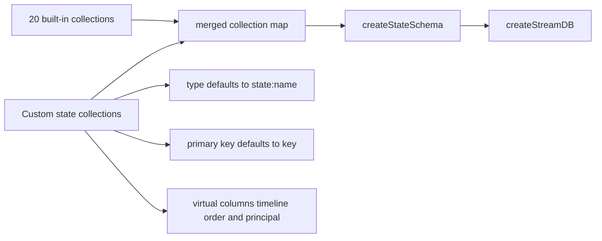
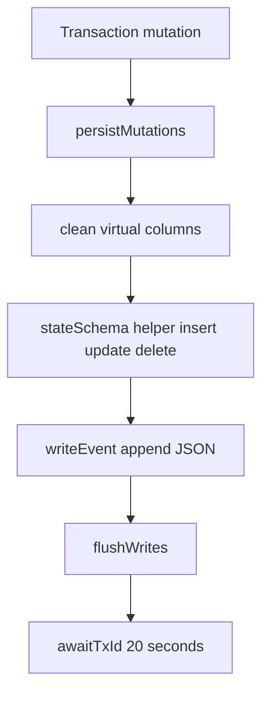

# Entity Stream Database

`createEntityStreamDB` turns a durable stream into typed TanStack DB collections. A TanStack DB collection is an in-memory reactive table. It validates each row against a schema and notifies readers when a row changes. It is the bridge between append-only events and the row model that the handler, the timeline, and the user interface read.

The 20 built-in collections are listed in [01-entity-model.md](01-entity-model.md).

The function is in `packages/agents-runtime/src/entity-stream-db.ts`. It has four jobs:

1. Merge the 20 built-in collections with the entity's custom state.
2. Stamp each row with a stable timeline order and, when relevant, the writing principal.
3. Generate write actions for every custom collection.
4. Persist local mutations as stream events and wait for the transaction identifier to return.

## The signature

```ts
export function createEntityStreamDB(
  streamUrl: string,
  customState?: EntityDefinition[`state`],
  actionsFactory?: EntityDefinition[`actions`],
  opts?: EntityStreamDBOptions
): EntityStreamDBWithActions
```

The citation is `packages/agents-runtime/src/entity-stream-db.ts:167-172`.

The options include:

- `stream`: an already-created stream handle.
- `streamOptions`: options for a new stream handle.
- `actorFrom`: the entity Uniform Resource Locator (URL) used as the writer identity.
- `onEvent`: a callback for each event.
- `onBatch`: a callback for each live batch.
- `writeEvent`: the append function.
- `flushWrites`: the producer flush function.
- `onBeforeBatch`: an optional pre-processing hook.

## Merging collections

The built-in collections come first. Custom collections come second:

```ts
const mergedCollections: EntityCollectionsDefinition = {
  ...builtInCollections,
  ...streamCustomState,
}
```

The citation is `packages/agents-runtime/src/entity-stream-db.ts:203-206`.

A custom collection with a built-in name replaces that built-in entry. The replacement keeps the custom definition. Its event type defaults to `state:<name>`, so it does not take over the built-in event type unless the definition sets `type`. The built-in collection is no longer addressable under its old name in that entity.

A custom collection definition gets these defaults:

- `type`: `state:${name}`. The type is the stream event name. The router and the registration body use it to route writes.
- `primaryKey`: `key`.

The code wraps a custom schema to preserve two virtual columns:

```ts
const baseSchema = def.schema ?? passthrough()
const virtualColumns = [
  `_timeline_order`,
  ...(def.externallyWritable ? [PRINCIPAL_COLUMN] : []),
]
const schema = def.schema
  ? wrapSchemaWithVirtualColumns(baseSchema, virtualColumns)
  : baseSchema
```

The citation is `packages/agents-runtime/src/entity-stream-db.ts:184-193`.

The wrap matters because TanStack DB validates rows against the schema. Without the wrap, a virtual column would be removed or rejected. A collection without a schema uses `passthrough()`, which accepts every column, so it needs no wrap.



## Two virtual columns

`PRINCIPAL_COLUMN` is `_principal`. The citation is `packages/agents-runtime/src/entity-stream-db.ts:114`.

The runtime adds `_principal` only for externally writable collections. The value comes from the event header `principal`. It records which principal wrote the row. The server uses it for access control and for attribution. It does not reject a concurrent write. Order is last-write-wins.

Local writes send `from: actorFrom`. The server authenticates the request, adds the `principal` header to the accepted event, and the database reads that header into `_principal`.

`_timeline_order` is a string token. The runtime computes it from an `EventPointer`:

```ts
const pointer: EventPointer = {
  offset: priorEntryOffset,
  subOffset: positionInEntry,
}
rowOffsetsByCollection.get(collectionName)?.set(item.key, pointer)
```

The citation is `packages/agents-runtime/src/entity-stream-db.ts:404-413`.

The token format is:

```
stream:<zero-padded-offset>:<zero-padded-sub-offset>
```

`formatPointerOrderToken` pads the offset to 24 characters and the sub-offset to 8 characters. The citation is `packages/agents-runtime/src/event-pointer.ts:54-87`.

String sort on this token matches stream order. The offsets are fixed-width digit strings, so lexicographic order equals numeric order. The runtime relies on that property in the timeline. A local fallback token, described below, uses a `local:` prefix and is not a stream token. Do not compare the two token families as if they were one sequence.

## The batch anchor

The stream protocol gives each item an `offset` header. That header is the end offset of the log entry that produced the item. It does not give a sub-offset for each item. The runtime computes the sub-offset locally.

The runtime groups the items in a batch by their shared `offset` header. Each contiguous group is one log entry, and the group gets sub-offsets 1 to K. The anchor for a group is the end offset of the preceding log entry. For the first group in a batch, that anchor is `previousBatchOffset`, which is the previous batch's end offset:

```ts
previousBatchOffset = batch.offset
```

`batch.offset` is the cursor that the next batch uses as its start. The anchor starts as `null` at stream start. A resumed read has no earlier batch in memory, so the anchor for its first group is `null`. A `reset` control event clears the anchor and the stored pointers. The code states the rule: `Stream-Fork-Sub-Offset` addresses items within a single log entry, not items globally past the anchor. The citations are `packages/agents-runtime/src/entity-stream-db.ts:222-226`, `:358-402`, and `:433`.

## Generated actions

When a write path exists, the runtime generates three actions per custom collection:

- `<name>_insert`
- `<name>_update`
- `<name>_delete`

The update action is an upsert:

```ts
actions[`${name}_update`] = {
  onMutate: ({ key, updater }) => {
    if (collection.has(key)) {
      collection.update(key, updater)
      return
    }
    const row = { [primaryKey]: key }
    updater(row)
    collection.insert(row)
  },
  mutationFn: sharedMutationFn,
}
```

The citation is `packages/agents-runtime/src/entity-stream-db.ts:470-500`.

`sharedMutationFn` is the generated action's write path. It calls `persistMutations`, which calls `persistMutationsNow` and then waits for the transaction identifier (txid).

An update for a missing key does not fail. It creates the row. This rule makes client retries safer. It also means a caller can upsert without a separate existence check.

The runtime also generates `manifests_insert`, `manifests_update`, and `manifests_delete` when `writeEvent` exists. The `manifests` collection holds keyed durable entries such as context entries and goals. It gets generated actions because handlers write it directly. The runtime adds custom actions from the entity definition last.



## Persisting a mutation

`persistMutationsNow` performs the write path:

1. Reject the call when no `writeEvent` exists.
2. Generate one transaction identifier per batch.
3. Map each collection identifier back to its schema key.
4. Remove `_seq`, `_timeline_order`, and `_principal`. `_seq` is a local stream sequence number. It orders rows that have no stream offset yet. It must not be persisted because the stream assigns the real order.
5. Write an insert, update, or delete event with the txid and writer.
6. Flush the producer.
7. Wait for the txid to return through StreamDB.

```ts
const modified = cleanRow(mutation.modified)
const headers = { txid, ...(actorFrom ? { from: actorFrom } : {}) }

if (mutation.type === `insert`) {
  opts.writeEvent(helpers.insert({ value: modified, headers }))
  continue
}
```

The citation is `packages/agents-runtime/src/entity-stream-db.ts:290-330`.

The wait timeout is `WRITE_TXID_TIMEOUT_MS = 20_000`. The citation is `packages/agents-runtime/src/entity-stream-db.ts:107`.

The txid wait is important. A successful append does not prove that the local projection saw the row. Waiting for the txid makes the write visible before the action resolves.

The return path is a later stream batch. The state layer sees the event with the same txid and resolves the wait. If the batch does not arrive before the timeout, the action rejects with a timeout error. The event may still be in the stream, so the caller must treat the outcome as unknown, not as a failed write.

## Write serialization

The runtime serializes writes through a promise queue:

```ts
const next = persistQueue.then(() =>
  persistMutationsNow(mutations, awaitTxId)
)
persistQueue = next.catch(() => undefined)
await next
```

The citation is `packages/agents-runtime/src/entity-stream-db.ts:337-341`.

One failed write does not block the queue. The error still reaches the caller. The next queued write proceeds.

## The `utils` helpers

The returned database has utility functions:

| Helper | Purpose |
|--------|---------|
| `createWriteTransaction` | Create a local write transaction |
| `applyEvent` | Apply a single event to the collections |
| `awaitWritesSettled` | Wait for all pending write persistences |
| `drainPendingWrites` | Wait for queued writes |
| `awaitTxId` | Wait for one txid |

`applyEvent` handles four stream operations: `insert`, `update`, `upsert`, and `delete`. A `delete` removes the row. An `insert` inserts the row. An `upsert` updates an existing row or inserts a missing one. An `update` updates an existing row and, when the row is missing, inserts it. The generated `_update` action follows the same missing-row rule.

For an event without a stream offset, `applyEvent` synthesizes a local token:

```ts
const offset =
  event.headers.offset ??
  `local:${Date.now().toString().padStart(13, `0`)}`
const pointer: EventPointer = { offset, subOffset: 1 }
```

The citation is `packages/agents-runtime/src/entity-stream-db.ts:790-805`.

This fallback keeps local events in invocation order at millisecond resolution. Two events in the same millisecond get the same token, so their order is not strict. It is not a replacement for a real stream offset.

## Collection metadata

Each collection carries metadata for the timeline and for cross-database linking:

- `__electricSourceDb`: the source database.
- `__electricSourceId`: the source stream identifier.
- `__electricRowOffsets`: the pointer for each row key.
- `__electricTimelineOrders`: the order token for each row key.

The timeline is the ordered view of all rows. It reads these fields. That is why a row can be ordered correctly without an explicit offset column in the user schema. Document [07-context-timeline-and-compaction.md](07-context-timeline-and-compaction.md) explains the timeline.

## Externally writable collections

A collection with `externallyWritable: true` accepts writes through the agents-server Hypertext Transfer Protocol (HTTP) router. The router is the server-side route layer. The server route is `POST /:type/:instanceId/collections/:name`. The registration body from [02-runtime-handler-and-registration.md](02-runtime-handler-and-registration.md) forwards the collection type, contract, and operation allowlist.

The default operation set is `insert` only. Open update and delete would let one principal overwrite or remove another principal's rows by key. The stream order handles an insert with an existing key, so the later write wins. The citation is `packages/agents-runtime/src/types.ts:678-685`.

The `_principal` column is the control that makes shared writes auditable. A later read can tell which principal owns a row.

## Key insight

**Key insight:** the runtime treats an update to a missing row as an insert. This single rule removes a large class of race conditions. Two writers can both send an update for a new key, and both resolve without a "not found" error. The stream order then decides the final value, and the last write wins.

The rule has a cost. A typo in a key creates a row instead of reporting a missing target. The runtime accepts this cost because stream state is a log, not a relational store.

No conflict check rejects a write. The `_principal` column records the writer for audit and access control. The stream order is the only conflict resolver.

## Next

Read [05-handler-context.md](05-handler-context.md) to see how the handler uses these collections and actions. Read [03-wake-processing.md](03-wake-processing.md) for the wake path that creates the database and flushes its writes.
