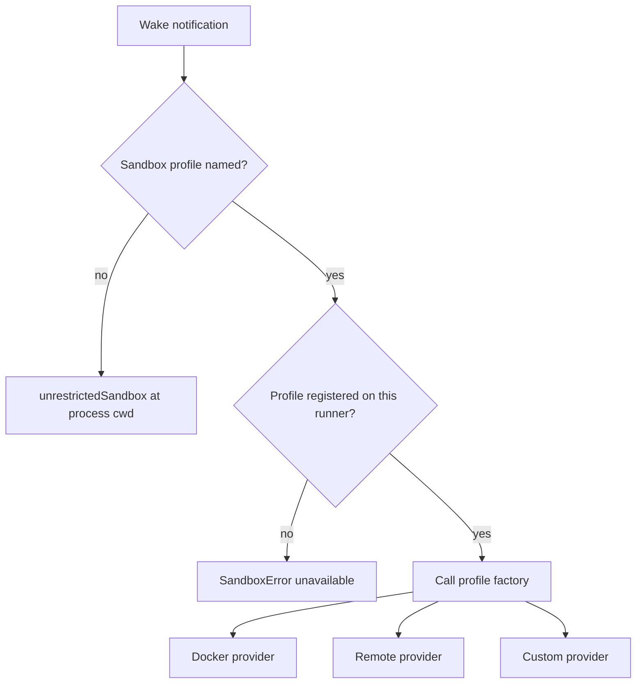
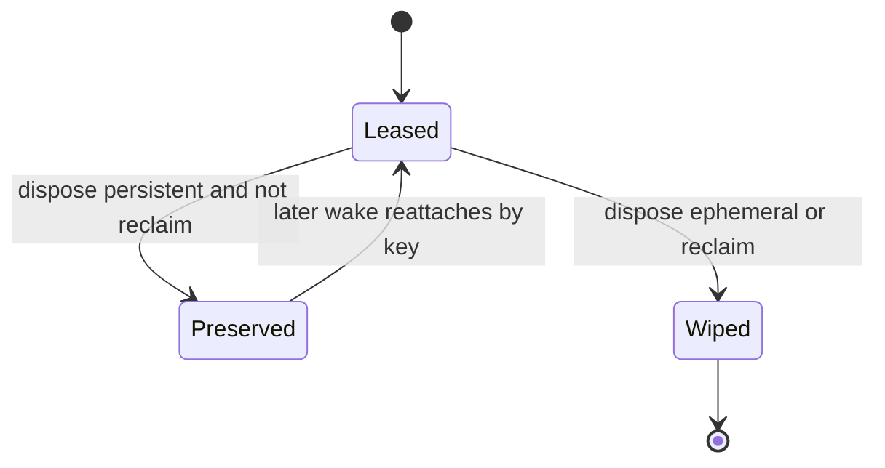

# Sandbox

A sandbox is the environment for shell and file tools. The runtime gives the handler one sandbox handle per wake session. The handle can point to a fresh workspace, or to a workspace that an earlier wake created. The handler passes that handle to tools such as `bash`, `read`, `write`, and `edit`.

Three terms from the rest of the study are needed here:

- An **entity** is an identified worker. It owns one durable stream. Its address is the entity URL, for example `/agent/abc`.
- A **wake** is one unit of work for an entity. A **wake session** is the time from the wake claim to the wake acknowledgement.
- The **control plane** is the agents-server. A **runner** is one runtime process that the control plane sends wakes to.

Document [03-wake-processing.md](03-wake-processing.md) explains the wake life cycle.

The sandbox interface hides three very different providers behind one contract. The providers are unrestricted host access, a Docker container, and a remote micro virtual machine. A micro virtual machine is a small isolated virtual machine that a cloud service starts on demand. The supported remote service is E2B. E2B is a cloud service that starts and keeps those virtual machines.

A **sandbox profile** is a named factory in the runtime configuration. The application registers profiles on the runner with `config.sandboxProfiles`. The profile holds a name, a display label, an optional description, a `remote` flag, and the provider factory. It does not hold the identity options. The wake selection supplies the profile name and the identity options: `scope`, `key`, `persistent`, and `owner`.

The `remote` flag marks a profile whose workspace is reachable from any runner. The control plane uses it to relax the rule that collaborators must share one runner.

The runner advertises its profile names, and the control plane checks the name at spawn time. A missing profile at wake time is therefore usually a re-registration race, not a configuration error.

## The interface

```ts
export interface Sandbox {
  readonly name: string
  readonly workingDirectory: string
  exec(opts: SandboxExecOpts): Promise<SandboxExecResult>
  readFile(path: string): Promise<Buffer>
  writeFile(path: string, content: Buffer | string): Promise<void>
  mkdir(path: string, opts?: { recursive?: boolean }): Promise<void>
  readdir(path: string): Promise<ReadonlyArray<DirEntry>>
  exists(path: string): Promise<boolean>
  remove(path: string, opts?: { recursive?: boolean }): Promise<void>
  stat(path: string): Promise<FileStat>
  fetch(input: string | URL, init?: RequestInit): Promise<Response>
  dispose(opts?: { reclaim?: boolean }): Promise<void>
}
```

The citation is `packages/agents-runtime/src/sandbox/types.ts:15-104`.

`exec` returns an exit code, a signal, standard output, standard error, timeout and abort flags, and an output truncation flag.

The three known adapters are:

```ts
export const KNOWN_ADAPTERS = [`unrestricted`, `remote`, `docker`]
```

The citation is `packages/agents-runtime/src/sandbox/types.ts:12`.

The list names the built-in adapters only. A profile can supply a custom factory, which appears as "Custom provider" in the flow below. A custom factory does not have to be in `KNOWN_ADAPTERS`.

## Provider selection



The runtime reads `notification.entity.sandbox.profile`. There are two branches:

1. **No profile named.** The runtime creates an unrestricted sandbox at the host's current working directory.
2. **A profile is named.** The runtime looks up the profile in `config.sandboxProfiles`. If the profile is missing, it throws `SandboxError` with kind `unavailable`.

```ts
if (requestedProfileName) {
  const profile = config.sandboxProfiles?.get(requestedProfileName)
  if (!profile) {
    throw new SandboxError(`unavailable`, `... is not currently registered ...`)
  }
  sandbox = await profile.factory({ ... })
} else {
  sandbox = await unrestrictedSandbox({ workingDirectory: process.cwd() })
}
```

The citation is `packages/agents-runtime/src/process-wake.ts:1278-1319`.

The wake is rejected before the done callback, so the server can redrive it on a runner that has the profile. The acknowledgement is the done callback: the HTTP request that the runtime sends when the wake finishes. The control plane reclaims a wake without a done callback after a timeout and sends it to another runner. Document [03-wake-processing.md](03-wake-processing.md) explains the callback.

The runtime logs the requested profile, the resolved sandbox name, and the working directory. The comment calls the isolation boundary security-relevant, so the log records it on every wake.

## Identity, persistence, and ownership

Three facts are resolved before the provider is called:

- **Identity**: the `sandboxKey`.
- **Durability**: `persistent`.
- **Ownership**: `owner`.

```ts
export function resolveSandboxIdentity(
  config: SandboxSelectionConfig,
  wake: { entityUrl: string; wakeId: string }
): ResolvedSandboxIdentity {
  const scope = config.scope ?? `entity`
  const sandboxKey =
    config.key ??
    (scope === `wake` ? `${wake.entityUrl}#${wake.wakeId}` : wake.entityUrl)
  const defaultPersistent = config.key !== undefined ? true : scope !== `wake`
  const persistent = config.persistent ?? defaultPersistent
  const owner = config.owner ?? true
  return { sandboxKey, persistent, owner }
}
```

The citation is `packages/agents-runtime/src/sandbox/identity.ts:62-78`.

The rules are:

1. An explicit `key` always wins. It is a cross-entity rendezvous handle: two entities that pass the same explicit key attach to the same sandbox and share one workspace.
2. Without a key, `scope: "wake"` gives `${entityUrl}#${wakeId}`.
3. Without a key, the default `scope: "entity"` gives `entityUrl`.
4. An explicit `persistent` wins.
5. Without `persistent`, an explicit key or an entity scope is persistent, and a wake scope is not.
6. `owner` defaults to true. An inheriting child sets it to false. An inheriting child is a spawned entity that receives the parent's sandbox selection but does not own the sandbox.

The code recognizes one special scope value: the literal string `wake`. Any other value, including a misspelled one, takes the entity branch. The code does not validate the scope string.

The teardown rule is separate:

```ts
export function sandboxWipesOnDispose(
  reclaim: boolean,
  persistent: boolean
): boolean {
  return reclaim || !persistent
}
```

The citation is `packages/agents-runtime/src/sandbox/identity.ts:94-99`.

A terminal entity sets `reclaim: true`, so the sandbox is wiped. A terminal entity is an entity that reached `stopped` or `killed` during the wake. The wake loop sets the reclaim flag at cleanup:

```ts
await sandbox.dispose({ reclaim: entityTerminated })
```

The citation is `packages/agents-runtime/src/process-wake.ts:2589-2592`. `entityTerminated` becomes true when a `SIGTERM` or `SIGKILL` signal is handled. An ephemeral sandbox is wiped on dispose. A persistent sandbox is preserved.

An attacher lease ignores `reclaim`. Only the owner wipes the workspace, because a child must not destroy the parent's environment.



An owner can create a sandbox. An attacher can only connect to an existing sandbox. The attacher gets the key from its own selection: an explicit shared key, or the key that it inherited from the parent wake. If no sandbox exists for the key, the attacher gets `SandboxError("unavailable")`. It never creates an empty workspace.

## The unrestricted provider

The unrestricted provider shares the host file system and the host process. It is the default. It is **not** a containment boundary against hostile code.

Its one strong control is path containment for file operations. `resolveWithin` canonicalizes the deepest existing ancestor and checks that it stays inside the working directory:

```ts
const cwdReal = await realpath(this.workingDirectory)
let probe = resolve(this.workingDirectory, userPath)
let suffix = ``
for (;;) {
  try {
    const real = await realpath(probe)
    const rel = relative(cwdReal, real)
    if (rel.startsWith(`..`) || rel === `..`) throw this.denied(userPath)
    return suffix.length === 0 ? real : resolve(real, suffix)
  } catch (err) {
    if (err instanceof SandboxError) throw err
    if ((err as NodeJS.ErrnoException).code !== `ENOENT`) throw err
    const parent = dirname(probe)
    if (parent === probe) throw this.denied(userPath)
    suffix = suffix.length === 0
      ? probe.slice(parent.length + 1)
      : `${probe.slice(parent.length + 1)}/${suffix}`
    probe = parent
  }
}
```

The loop walks up the path until it finds a part that exists. It records the missing part in `suffix`. It canonicalizes the existing ancestor, checks that the ancestor is inside the workspace, and then joins the missing part back on.

The citation is `packages/agents-runtime/src/sandbox/unrestricted.ts:269-307`.

This walk follows symbolic links. It defends against a path that looks clean but has a component that points outside the workspace. The code comment names the class of bypass: CVE-2025-53109 and CVE-2025-53110. Those identifiers refer to symbolic-link path containment bypasses.

The defense has a time window. The check and the write are separate operations. The walk checks the path at check time. A time-of-check time-of-use race is the gap between those two moments. For a path that does not yet exist, the walk checks the deepest existing ancestor. Before the caller writes, an attacker can replace an intermediate component with a symbolic link. The write then follows the link outside the workspace.

The comment says the provider is safe for a single-tenant trusted-code contract. A multi-tenant use would need a write that cannot follow a link in its final component. For example, it would need a descriptor opened with `O_NOFOLLOW` or a realpath containment check of the resolved target after the file operation. The source comment names the post-operation check, not a check just before the operation. Each option closes only part of the window; none makes the provider a containment boundary.

Path containment applies to file operations only. `exec` runs `sh -c` as a child process with host access, so a shell command can read or write outside the workspace. The provider assumes trusted code.

`exec` runs `sh -c` in a new process group. A timeout sends `SIGTERM` to the group and escalates to `SIGKILL` after 500 milliseconds. The citation is `packages/agents-runtime/src/sandbox/unrestricted.ts:107-123`.

`fetch` calls the global `fetch`. The request uses the host network, not a sandbox policy.

`dispose` has no teardown. It only flips a disposed flag so later calls throw a `runtime` error.

## The Docker provider

The Docker provider runs a container. Its defaults are:

| Setting | Default |
|---------|---------|
| Working directory | `/work` |
| Image | `node:20-alpine` pinned by digest |
| Runtime | `runc` (option `runsc` for gVisor) |
| Idle grace | 120 seconds |
| Name prefix | `electric-sbx` |
| Compose project | `electric-sandboxes` |

The citations are `packages/agents-runtime/src/sandbox/docker.ts:35-190`.

The image digest is fixed in the source. A caller can supply another image, but a floating tag is rejected unless `allowFloatingTag` is set. This keeps images reproducible.

The provider uses several labels to track identity and ownership:

- `com.electric.sandbox`
- `com.electric.sandbox.key`
- `com.electric.sandbox.entity-type`
- `com.electric.sandbox.entity`
- `com.electric.sandbox.persistent`
- `com.electric.sandbox.owner-pid`

The container name is derived from the sandbox key, so a later wake finds the container by name and reattaches. The identity labels confirm the match. A sibling container is another container for the same sandbox key.

The owner process identifier lets a boot sweep tell a live sibling container from a crash leftover. A boot sweep is a scan that a new runner process does over the labelled containers on its host. Docker labels are immutable, so the creation-time owner process identifier goes stale when another process adopts the container. The in-container marker at `/tmp/.electric-sbx-owner-pid` records the process identifier of the most recent adopter. The boot sweep reads the marker before it reclaims a running container whose labelled owner is dead. That check stops a new runner from removing a container that another live runner still uses.

A persistent container is stopped on idle. Its writable layer survives, so a later wake restarts it with the file system intact. An ephemeral container is removed on idle. The two idle actions are set by the owner at creation.

The process-local registry counts leases. A lease is one `DockerSandbox` wrapper held by a wake. Each acquire increments `refs`, and each dispose decrements it. The container is not torn down while a sibling lease still uses it.

The last dispose starts a timer for the idle grace of 120 seconds. If another lease arrives inside that window, the acquire cancels the timer. If no lease arrives, the timer applies the idle action: stop for a persistent container, remove for an ephemeral one. A reclaim from a terminal owner overrides the idle action and removes the container once the last lease drains.

The order is therefore: idle first decides stop or remove after the grace, and an owner reclaim turns the decision into remove.

Network policy is applied at container creation:

- `allow-all`
- `deny-all`
- `allowlist` with a host list

The docker provider also blocks private and link-local addresses for its `fetch` tool. This is a server-side request forgery defense: the tool must not reach the host network or cloud metadata endpoints. The check happens on the host before the request is dispatched. A literal private, loopback, link-local, or cloud-metadata address is refused even when the mode is `allow-all`. The citation is `packages/agents-runtime/src/sandbox/docker/net-policy.ts:120-143`.

The file operations and `fetch` obey this policy. `exec` does not. Code that runs through `exec` has direct bridge network access unless the mode is `deny-all`, which creates the container with `NetworkMode=none`. The host-side `fetch` check cannot see traffic from `exec`. The citation is `packages/agents-runtime/src/sandbox/docker.ts:1348-1365`.

The private-address guard also catches encoded forms such as integer, hexadecimal, octal, and `127.1` IPv4. It does not resolve a host name and check the result, and it does not inspect redirect targets. A domain that resolves to a private address is a known gap.

## The remote provider

The remote provider uses a software-as-a-service workspace. The only supported provider is E2B. The default working directory inside the workspace is `/work`.

The adapter reconnects by the sandbox key. It asks the provider client for a live workspace that has that key. An owner creates the workspace when none exists. An attacher gets `SandboxError("unavailable")` when none exists. The citations are `packages/agents-runtime/src/sandbox/remote.ts:45-52` for the ownership rule and `packages/agents-runtime/src/sandbox/remote/e2b.ts:261-278` for the reconnect and unavailable path.

```ts
const initialPolicy: NetworkPolicy =
  opts.initialNetworkPolicy ??
  (opts.allowedHosts && opts.allowedHosts.length > 0
    ? { mode: `allowlist`, allow: [...opts.allowedHosts] }
    : { mode: `deny-all` })
```

The citation is `packages/agents-runtime/src/sandbox/remote.ts:97-101`.

The default network policy is `deny-all`. Egress runs from inside the virtual machine, not from the host process. The request therefore obeys the policy that the provider applied when it created the workspace. The runtime sets the policy at creation and does not change it later in the session.

The remote provider allows reads outside the working directory. Reads of system binaries and language libraries are normal in a virtual machine. Writes are restricted to the working directory by a string-level containment check. The citation is `packages/agents-runtime/src/sandbox/remote.ts:270-284`.

The helper `path-containment.ts` supplies the write check. Its comment explains why the check is string-level: the container or virtual machine boundary provides the real isolation. The threat model is containment inside the virtual machine, not protection of the host.

The security boundary is the virtual machine, not the `/work` directory. A write to a path outside `/work` inside the same virtual machine is prevented by the check. A symbolic link inside `/work` that points outside is a possible bypass, but the target is still inside the virtual machine. The workspace rule stops an accidental write to system files. It does not add host protection. The unrestricted provider uses the stricter realpath walk because it shares the host.

Disposal depends on ownership and persistence:

```ts
const wipe =
  this.owner &&
  sandboxWipesOnDispose(opts?.reclaim === true, this.persistent)
if (!wipe && this.client.suspend) {
  await this.client.suspend()
} else {
  await this.client.kill()
}
```

The citation is `packages/agents-runtime/src/sandbox/remote.ts:256-263`.

A non-owner attacher never kills the owner's workspace when the client can suspend. It stops its own heartbeat, and the provider preserves the workspace for reattach.

The code has a fallback. If the client has no `suspend` function, the `else` branch calls `kill` even for a non-owner. The comment states this fallback. A supported E2B client supplies `suspend`, so the normal path preserves the workspace.

## Sandbox fetch

For Docker and remote providers, `sandbox.fetch` runs inside the sandbox. The helper `fetchInSandbox` runs a shell script through `exec`. The script uses an available HTTP client inside the image.

The defaults are:

- Timeout: 10,000 milliseconds.
- Maximum body: 5,000,000 bytes.
- User agent: `Mozilla/5.0 (compatible; DurableStreamsAgent/1.0)`.

The citation is `packages/agents-runtime/src/sandbox/exec-fetch.ts:6-10`.

The call timeout is the request timeout plus 5,000 milliseconds. This is a backstop for a wedged client.

The helper transfers the command output across the exec boundary as base64. Base64 makes the text larger, so the output cap is set above the raw body cap:

```ts
maxOutputBytes: Math.ceil(maxBodyBytes * (4 / 3)) + 4_096,
```

The citation is `packages/agents-runtime/src/sandbox/exec-fetch.ts:87-88`. With the default body cap of 5,000,000 bytes, the exec output cap is 6,670,763 bytes.

If the image has no HTTP client, the helper throws a `runtime` error with the message `no HTTP client (curl/node/wget) found`.

## Lazy materialization

A profile factory can return a lazy sandbox. `lazySandbox` defers provider work until the first operation. It uses a single-flight promise so two concurrent calls materialize one sandbox.

The materialize symbol is:

```ts
const MATERIALIZE = Symbol.for(`electric.sandbox.lazy.materialize`)
```

A `dispose({ reclaim: true })` before first use runs the provider reclaim callback without materializing. The callback receives the sandbox key, so it can remove a sandbox that an earlier wake created with the same key. A later use after dispose throws a `runtime` error.

The citation is `packages/agents-runtime/src/sandbox/lazy.ts:1-195`.

## Error kinds

`SandboxError` has three kinds:

| Kind | Meaning |
|------|---------|
| `policy` | The operation violates a path or network rule |
| `runtime` | The provider or host failed |
| `unavailable` | The requested sandbox does not exist or is not registered |

A `policy` error is a denial. A `runtime` error is a failure. An `unavailable` error is a missing resource and is often retryable on another runner.

## The default is not a boundary

`chooseDefaultSandbox` always returns the unrestricted provider:

```ts
export function chooseDefaultSandbox(
  workingDirectory: string
): Promise<Sandbox> {
  return unrestrictedSandbox({ workingDirectory })
}
```

The citation is `packages/agents-runtime/src/sandbox/default.ts:1-21`.

The source comment says this default is not a containment boundary. The reason is simple: the provider shares the host process and the host file system. A handler that runs hostile code must use Docker or the remote provider. The citation is `packages/agents-runtime/src/sandbox/default.ts:4-21`.

## Key insight

**Key insight:** identity is resolved before the provider sees anything. Every provider receives the same three identity values: a key, a persistent flag, and an owner flag. The provider also receives its own profile options. The key selects the workspace. The provider supplies the isolation.

A caller that wants a fresh workspace for every wake sets `scope: "wake"`, and the key becomes the entity URL plus the wake identifier. The default `scope: "entity"` shares one workspace across all wakes of the entity. Both choices use the same resolver. `wake` is a special scope value inside it.

This design keeps provider implementations simple. It also makes the key rules testable without a container. The identity function is pure, so a unit test can exercise the six rules without starting Docker or calling a cloud service.

## Next

Read [06-agent-loop-and-tools.md](06-agent-loop-and-tools.md) to see which tools call the sandbox. Read [09-server-client-signals-and-testing.md](09-server-client-signals-and-testing.md) for the control-plane client and the test harness.
