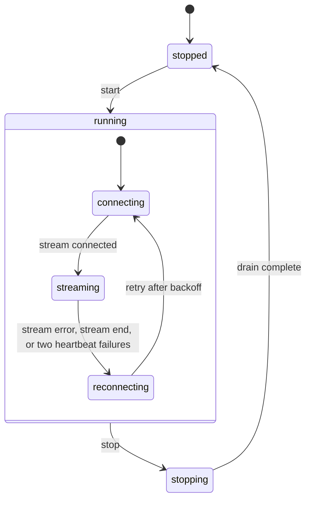
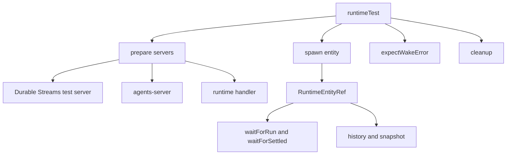

# Server Client, Signals, and Testing

The runtime does not only read streams. It also calls the agents-server control plane. It spawns children, sends messages, creates schedules, reads webhook sources, and sets tags. `createRuntimeServerClient` wraps that Hypertext Transfer Protocol (HTTP) interface.

This document covers the client, the signal model, attachments, shared state, cron schedules, tags, the pull-wake runner, and the test utilities.

Five terms are needed here:

- An **entity** is an identified worker. It owns one append-only durable stream. Its address is the entity Uniform Resource Locator (URL).
- A **wake** is one unit of work for an entity. A wake notification tells the runtime that new work exists.
- **Durable Streams** is the stream protocol and server. A **write token** is the token that permits an append to a stream or a control-plane request. The wake claim can return this token together with a claim token.
- **TanStack DB** is an in-memory reactive table store. The runtime projects stream events into it.
- An **Electric shape** is a filtered, live subscription to a table on the Electric sync service.

Document [03-wake-processing.md](03-wake-processing.md) explains the wake path. Document [04-entity-stream-db.md](04-entity-stream-db.md) explains the stream database.

## The server client

A caller creates the client with a base URL, optional headers, an optional fetch function, a write-token header mode, and an optional principal key.

```ts
export interface RuntimeServerClientConfig {
  baseUrl: string
  fetch?: typeof globalThis.fetch
  headers?: HeadersProvider
  writeTokenHeader?: ClaimTokenHeader
  track?: <T>(promise: Promise<T>) => Promise<T>
  principalKey?: string
}
```

The citation is `packages/agents-runtime/src/runtime-server-client.ts:24-31`.

The fields are:

| Field | Meaning |
|-------|---------|
| `baseUrl` | The agents-server origin. The client appends each path to it. |
| `fetch` | An optional fetch replacement, used by tests and by callers with a custom transport. |
| `headers` | Static headers or a function that returns headers. The function can be asynchronous. |
| `writeTokenHeader` | Where to put the Durable Streams write token. The values are `authorization`, `electric-claim-token`, and `both`. |
| `track` | A wrapper around each request promise. A caller uses it for tracing, metrics, or a test gate. |
| `principalKey` | The principal identifier that the client asserts on every call. |

`writeTokenHeader` exists because the write token travels in different headers in different deployments. The `authorization` value sends `Bearer <token>`. The `electric-claim-token` value sends the raw token. The `both` value sends `authorization` only when the request does not already have one, and always sends `electric-claim-token`. The default is `authorization` at each point of use. The citation is `packages/agents-runtime/src/runtime-server-client.ts:278-291`.

`track` defaults to the identity function:

```ts
const track = <T>(promise: Promise<T>): Promise<T> => {
  return config.track ? config.track(promise) : promise
}
```

The citation is `packages/agents-runtime/src/runtime-server-client.ts:294-296`.

Every request goes through one helper. The helper resolves the base headers. It adds the principal header when configured. It appends the path to the base URL. It passes the request to the tracked fetch.

The principal header is `electric-principal`. The citation is `packages/agents-runtime/src/runtime-server-client.ts:22`.

A principal is the identity that performs an action. The `principalKey` is an assertion, not a credential. The server authenticates the transport and then reads this header as the principal for the request.

A typical construction is:

```ts
const client = createRuntimeServerClient({
  baseUrl: `http://localhost:3000`,
  principalKey: `system:my-runtime`,
  writeTokenHeader: `both`,
})
```

The factory is declared at `packages/agents-runtime/src/runtime-server-client.ts:261-263`. The client does not store the write token. The method that needs one takes it as an argument, and the caller gets it from the wake claim.

## Every client method

| Method | HTTP path | Purpose |
|--------|-----------|---------|
| `sendEntityMessage` | `POST /_electric/entities/<url>/send` | Send a message to an entity |
| `createAttachment` | `POST /_electric/entities/<url>/attachments` | Upload an attachment |
| `readAttachment` | `GET /_electric/entities/<url>/attachments/<id>` | Read attachment bytes |
| `spawnEntity` | `PUT /_electric/entities/<type>/<id>` | Create an entity |
| `forkEntity` | `POST /_electric/entities/<url>/fork` | Fork at the latest completed run |
| `getEntity` | `GET /_electric/entities/<url>` | Read entity information |
| `ensureSharedStateStream` | `PUT /_electric/shared-state/<id>` | Create a shared-state stream |
| `signalEntity` | `POST /_electric/entities/<url>/signal` | Send a signal |
| `ensureStream` | `PUT <path>` | Create any stream |
| `deleteEntity` | `POST /_electric/entities/<url>/signal` (wrapper) | Terminate an entity by sending `SIGKILL` |
| `unregisterWake` | `POST /_electric/wake/unregister` | Remove a wake subscription |
| `getSharedStateStreamPath` | None | Build the shared-state path |
| `registerWake` | `POST /_electric/wake` | Add a wake subscription |
| `ensureCronStream` | `POST /_electric/observations/cron/ensure-stream` | Create a cron stream |
| `ensureEntitiesMembershipStream` | `POST /_electric/observations/entities/ensure-stream` | Create an entity membership stream |
| `registerPgSyncSource` | `POST /_electric/pg-sync/register` | Register a PostgreSQL sync source |
| `listWebhookSources` | `GET /_electric/webhook-sources` | List webhook sources |
| `subscribeToWebhookSource` | `PUT /_electric/entities/<url>/webhook-source-subscriptions/<id>` | Subscribe |
| `unsubscribeFromWebhookSource` | `DELETE` the same path | Unsubscribe |
| `removePgSyncObservation` | `DELETE /_electric/entities/<url>/pg-sync-observations/<ref>` | Remove a sync observation |
| `upsertCronSchedule` | `PUT /_electric/entities/<url>/schedules/<id>` | Create or update a cron schedule |
| `upsertFutureSendSchedule` | `PUT` the same path | Create a future send |
| `deleteSchedule` | `DELETE` the same path | Delete a schedule |
| `setTag` | `POST /_electric/entities/<url>/tags/<key>` | Set a tag |
| `deleteTag` | `DELETE` the same path | Delete a tag |

The citation is `packages/agents-runtime/src/runtime-server-client.ts:121-235`.

```mermaid
flowchart LR
    R[Runtime] --> C[RuntimeServerClient]
    C --> E[/_electric/entities]
    C --> W[/_electric/wake]
    C --> O[/_electric/observations]
    C --> P[/_electric/pg-sync]
    C --> S[/_electric/shared-state]
    C --> T[tags, schedules, attachments]
    E --> S1[agents-server]
    W --> S1
    O --> S1
    P --> S1
    S --> S1
    T --> S1
```

## Spawn and fork

`spawnEntity` sends a `PUT` to `/_electric/entities/<type>/<id>`. The body can include arguments, parent, initial message, tags, sandbox selection, dispatch policy, and a wake subscription.

A dispatch policy tells the server where to send the wakes for an entity. The two shapes are a runner target and a webhook target:

```ts
export type DispatchPolicy = RunnerDispatchPolicy | WebhookDispatchPolicy
```

The citation is `packages/agents-runtime/src/runtime-server-client.ts:39-47`. A runner target names a `runnerId`. A webhook target names a URL. The server records the policy with the entity and uses it to choose the wake destination.

A `409` response is not a failure. The client reads the entity from the conflict response, or calls `getEntity` when the conflict body has no entity. This makes spawn idempotent on retry.

```ts
if (response.status === 409) {
  const conflict = await response.json()
  entityInfo = conflict.error?.details?.entity
    ? requireEntityInfo(conflict.error.details.entity, `...`)
    : await getEntity(`/${type}/${id}`)
}
```

The citation is `packages/agents-runtime/src/runtime-server-client.ts:508-533`.

`forkEntity` sends `POST .../fork` with `anchor: "latest_completed_run"`. A fork is a new entity that copies the source history up to that anchor. It can set an instance identifier, a parent, a wake subscription, an initial message, and tags. The response contains the new root entity. The root entity is the entity that the fork created. It is the top of the new lineage, not the source entity.

The comment states that fork plus initial message is not atomic. A partial failure can leave an idle fork. The entity exists with the copied history, but the initial message never arrives, so no wake starts its work.

## Send and delete

`sendEntityMessage` posts these fields:

| Field | Meaning |
|-------|---------|
| `payload` | The message body |
| `type` | The message type; the wake classification uses it |
| `afterMs` | A delay in milliseconds before delivery |
| `mode` | The inbox mode, which decides how the server adds the message |
| `position` | The place in the inbox for that mode |
| `from_principal` | The principal that sent the message, when it differs from the caller |
| `from_agent` | The sending entity URL, when an agent sends the message |

It adds the write token through the configured header mode. The citation is `packages/agents-runtime/src/runtime-server-client.ts:353-390`.

Document [03-wake-processing.md](03-wake-processing.md) explains the inbox modes.

`deleteEntity` sends `SIGKILL` with the reason `Runtime child cleanup`. "Delete" here means terminate the entity. The stream and its events remain. A later reader can still see the full history. A `404` means the entity is already gone, so the method returns without an error.

```ts
try {
  await signalEntity({ entityUrl, signal: `SIGKILL`, reason: `Runtime child cleanup` })
} catch (err) {
  if (err instanceof Error && /\(404\)/.test(err.message)) return
  throw err
}
```

The citation is `packages/agents-runtime/src/runtime-server-client.ts:638-651`.

## Signals

`signalEntity` posts a signal name, an optional reason, and an optional payload. It returns a transaction identifier.

The client accepts the seven entity signals: `SIGINT`, `SIGHUP`, `SIGTERM`, `SIGKILL`, `SIGSTOP`, `SIGCONT`, and `SIGUSR`.

`processWake` handles the signals as follows:

| Signal | Runtime action | Recorded outcome |
|--------|----------------|------------------|
| `SIGINT` | Abort the active run and request shutdown | `aborted`; `ignored` when no run is active and the entity is not `running` |
| `SIGHUP` | Request shutdown and call the handler signal hook | `shutdown_requested` |
| `SIGTERM` | Mark the entity terminated and shut down after cleanup | `shutdown_requested`, or `failed` when the hook throws |
| `SIGKILL` | Abort, mark terminated, request shutdown | `shutdown_requested`, with new state `killed` |
| `SIGSTOP` | Clear the idle timer, abort the idle wait, set pause | `transitioned`, with new state `paused` |
| `SIGCONT` | Clear the idle timer, abort the idle wait, set resume | `transitioned`, with new state `idle` |
| `SIGUSR` | Call the handler signal hook | `delivered`, or `failed` when the hook throws |

The citation is `packages/agents-runtime/src/process-wake.ts:859-966`.

`SIGINT` has one subtle case. The signal can arrive in the small window before the handler invocation controller exists. The runtime carries the abort forward only when the entity status is `running`. An idle `SIGINT` is a no-op, so it does not abort the next invocation.

`ctx.onSignal` receives only `SIGHUP`, `SIGTERM`, and `SIGUSR`. The other signals are runtime-controlled. Document [05-handler-context.md](05-handler-context.md) states the same rule from the handler side.

The runtime writes a `signals` row with the outcome. The outcomes that the runtime writes are `transitioned`, `ignored`, `delivered`, `aborted`, `shutdown_requested`, and `failed`. The schema also allows `invalid_for_state`, but no runtime code path writes it. Each row also records the previous state, the new state when one exists, the handling time, and the handling entity URL.

An `ignored` outcome means the signal was a valid signal that had no effect in the current state. The schema defines an `invalid_for_state` outcome for a signal that is not allowed in the current state, but the runtime does not emit it. A `transitioned` outcome means the entity state changed. A `delivered` outcome means the handler hook ran without an error.

## The pull-wake runner

A runtime can receive wakes by webhook. It can also pull wakes from a runner wake stream. `createPullWakeRunner` implements the pull model.

The runner uses an xstate machine for its lifecycle. xstate is a state-machine library: the machine declares the states and the legal transitions, and the action code runs only inside a state. The top-level states are `stopped`, `running`, and `stopping`. The `running` state has nested `connecting`, `streaming`, and `reconnecting` states. The `PullWakeRunnerStatus` type also has a `starting` value, but the machine does not enter a `starting` state.

The pull model has three actors:

1. The **runner** owns the wake stream and the heartbeat.
2. The **claim actor** is a short-lived task that claims one wake and dispatches it.
3. The **runtime** processes the wake and calls the done callback.

The claim actor exists so a slow wake does not stop the stream reader. On shutdown, the runner gives the active claim actors up to 1,000 milliseconds to settle before it stops them.

Its default paths are:

- Wake stream: `/runners/<runnerId>/wake`.
- Heartbeat: `/_electric/runners/<runnerId>/heartbeat`.
- Claim: `/_electric/runners/<runnerId>/claim`.

The citation is `packages/agents-runtime/src/pull-wake-runner.ts:137-155`.

The runner has a small control surface:

```ts
export interface PullWakeRunner {
  start: () => void
  stop: () => Promise<void>
  waitForStopped: () => Promise<void>
  readonly running: boolean
  readonly offset: string | undefined
  getHealth: () => PullWakeRunnerHealth
}
```

The citation is `packages/agents-runtime/src/pull-wake-runner.ts:58-65`. The required configuration fields are `baseUrl`, `runnerId`, and `runtime`. `runtime` supplies `dispatchWake`, `drainWakes`, and `abortWakes`.

The defaults are:

| Setting | Value |
|---------|-------|
| Heartbeat interval | 30,000 milliseconds |
| Event heartbeat throttle | 2,000 milliseconds |
| Lease | Heartbeat interval × 3 |
| Deferred wake retry | 25 milliseconds |
| Claim actor stop grace | 1,000 milliseconds |

The citations are `packages/agents-runtime/src/pull-wake-runner.ts:96-99`, `packages/agents-runtime/src/pull-wake-runner.ts:147` (lease derivation), and `packages/agents-runtime/src/constants.ts:1`.

A **lease** is the time that the server reserves a wake for this runner. The runner sends the lease in each heartbeat. The lease is three heartbeat intervals, so the server keeps the wake for 90,000 milliseconds after the last heartbeat. A crashed runner stops heartbeating, the lease expires, and the server can give the wake to another runner.

A claim response can have status 204, status 409 with `ALREADY_CLAIMED`, status 409 with `NO_PENDING_WORK`, or a body with `done: true`. All of them mean this runner does not process a wake now. The two 409 reasons differ: `ALREADY_CLAIMED` means another runner holds the wake, and `NO_PENDING_WORK` means the wake is not in the queue. A successful claim returns a `WakeNotification`, and the runner calls `runtime.dispatchWake`. The citation is `packages/agents-runtime/src/pull-wake-runner.ts:407-430`.

A successful heartbeat sets the consecutive failure count to zero:

```ts
lastHeartbeatOk = true
consecutiveHeartbeatFailures = 0
```

The citation is `packages/agents-runtime/src/pull-wake-runner.ts:271-272`. The count is consecutive, not total.

A **deferred wake** is a wake event for a stream that already has a claim in flight. The runner cannot claim the same stream twice at the same time. It stores the deferred event and retries the claim after 25 milliseconds. The retry repeats until the first claim finishes or the runner stops. The citation is `packages/agents-runtime/src/pull-wake-runner.ts:361-388`.

Two heartbeat failures in a row reset the stream:

```ts
if (consecutiveHeartbeatFailures >= HEARTBEAT_FAILURE_STREAM_RESET_THRESHOLD) {
  actor.send({ type: `STREAM_RESET`, error })
}
```

The citation is `packages/agents-runtime/src/pull-wake-runner.ts:278-286`.

"Reset the stream" means cancel the current stream response and reconnect. It does not delete the stream, and it does not change the offset. The machine moves to `reconnecting`, waits for the backoff, and connects again from the last offset. The citation is `packages/agents-runtime/src/pull-wake-machine.ts:167-191`.



The backoff is a delay that grows after each failed reconnect attempt. The citation is `packages/agents-runtime/src/pull-wake-machine.ts:198-207`.

## Attachments

`createAttachment` sends a multipart form with these fields:

- `file`: the bytes.
- `mimeType`: optional media type.
- `filename`: optional name. The client sends it both as the multipart file name and as a separate `filename` field.
- `subject`: the object that the attachment belongs to, as JavaScript Object Notation (JSON). The subject tells a reader which message, run, or other record the bytes are for. The server stores it on the attachment manifest entry.
- `role`: the part that the attachment plays. The default is `input`, which marks bytes that the user or a tool supplied to the agent. The server stores it on the manifest entry.
- `meta`: optional JSON metadata. The client sends it only when it is present.

```ts
form.set(`file`, bytes, filename || `attachment`)
if (attachment.mimeType) form.set(`mimeType`, attachment.mimeType)
form.set(`subject`, JSON.stringify(attachment.subject))
form.set(`role`, attachment.role ?? `input`)
```

This snippet is shortened. The same function also sets the `filename` and `meta` fields. The citation is `packages/agents-runtime/src/runtime-server-client.ts:401-427`.

`readAttachment` returns `Uint8Array` bytes. A missing or failed read throws with the status and response text.

The handler gets the same operations through `ctx.attachments`. The `read` and `create` functions are optional. If the runtime did not configure them, the call throws a clear error. The citation is `packages/agents-runtime/src/context-factory.ts:563-582`.

## Shared state

A shared-state stream path is `/_electric/shared-state/<id>`. The helper `getSharedStateStreamPath` builds it. `ensureSharedStateStream` creates it with an optional owner entity.

Shared state is a stream that several entities read and write. The owner entity is optional. When the caller names one, the client sends an `electric-owner-entity` header at creation. Ownership records which entity created the stream. It does not stop other entities from writing.

A handler uses `ctx.mkdb(id, schema)` to create a handle, or `ctx.observe(db(id, schema))` to connect to an existing one. A **deferred backing database** is a database handle whose stream connection is not open yet.

The two modes differ before the connection exists:

- **Create mode.** `mkdb` stages the writes in local TanStack DB collections. The insert, update, and delete calls resolve at once, with no server round trip. When the stream connects, `wireDb` replays the queued mutations through the real generated actions. It then swaps in the backing database.
- **Connect mode.** `observe(db(...))` cannot stage writes. A read or a write before the wiring finishes throws. The runtime wires registered handles asynchronously. A handler that needs the data must retry or defer the work to a later wake.

A create-mode write therefore returns before the server sees it. The replay happens later, in order.

A handler that joins shared state from another entity gets the schema from the caller. The runtime does not discover the schema from the stream. `observe` with a `db` source therefore requires the schema argument. The runtime caches the handle per shared-state identifier. The citation is `packages/agents-runtime/src/setup-context.ts:838-871`.

## Cron schedules

Cron helpers build a deterministic stream path from an expression and a timezone:

```ts
export const CRON_STREAM_PREFIX = `/_cron/`

function encodeCronScheduleSpec(spec: CronScheduleSpec): string {
  return Buffer.from(JSON.stringify(spec)).toString(`base64url`)
}
```

The citation is `packages/agents-runtime/src/cron-utils.ts:8-67`.

The path is the prefix plus the encoded specification:

```ts
export function getCronStreamPathFromSpec(spec: CronScheduleSpec): string {
  return `${CRON_STREAM_PREFIX}${encodeCronScheduleSpec(spec)}`
}
```

The citation is `packages/agents-runtime/src/cron-utils.ts:65-67`.

The specification has two fields:

```ts
export interface CronScheduleSpec {
  expression: string
  timezone: string
}
```

The citation is `packages/agents-runtime/src/cron-utils.ts:3-6`.

The encoding is base64url because the result becomes part of a stream path. Base64url uses `-` and `_` in place of `+` and `/`, and it omits the `=` padding. The encoded text is therefore safe in a URL path segment, and two runners that receive the same schedule compute the same path.

The timezone defaults to Coordinated Universal Time (UTC) when the caller does not give one. The helper canonicalizes the timezone through `Intl.DateTimeFormat`. An invalid timezone throws `Invalid cron timezone`. An invalid expression throws `Invalid cron expression`.

`ensureCronStream` creates the stream on the server. `ctx` and the schedule tools create or update a schedule at `/_electric/entities/<url>/schedules/<id>`. The schedule type is `cron`. A future send uses the same path with type `future_send` and a `fireAt` timestamp.

`getNextCronFireAt` parses the expression with `cron-parser` and returns the next fire time.

## Tags

Tags are string key-value pairs. The runtime validates them with `assertTags`. It sorts them with `normalizeTags`.

The index format is a wire contract:

```ts
export function buildTagsIndex(tags: EntityTags): Array<string> {
  return Object.entries(tags)
    .map(([key, value]) => JSON.stringify([key, value]))
    .sort()
}
```

The citation is `packages/agents-runtime/src/tags.ts:44-48`.

The server stores this as a `text[]` column. A PostgreSQL `text[]` column holds an array of strings. The Electric shape filters use the contains operator. The contains operator tests whether an array holds a given element. A subscription can therefore ask for every entity whose index holds the exact string for one tag pair. A change to the encoding is a cross-package break.

The membership stream path uses a 64-bit Fowler-Noll-Vo (FNV-1a) hash of the normalized tag JSON:

```ts
export function hashString(value: string): string {
  let hash = 0xcbf29ce484222325n
  const prime = 0x100000001b3n
  const mask = 0xffffffffffffffffn
  for (let index = 0; index < value.length; index++) {
    hash ^= BigInt(value.charCodeAt(index))
    hash = (hash * prime) & mask
  }
  return hash.toString(16).padStart(16, `0`)
}
```

The citation is `packages/agents-runtime/src/tags.ts:53-62`.

The result is a 16-character hexadecimal string. The runtime helper `getEntitiesStreamPathForTags` builds `/_entities/<hash>`. The agents-server does not stop there: before it creates the membership stream, it scopes the reference to the requesting principal. The final source reference is `<hash>-<principal-hash>`, where the second hash is the FNV-1a hash of the principal kind and URL. The runtime takes the final `sourceRef` and `streamUrl` from the ensure-stream response and writes them into the manifest entry. The comment states that the hash is part of the stream path and the primary key of the entity bridge. A change therefore needs a migration.

The loop reads `value.charCodeAt(index)`, which returns a Unicode Transformation Format 16 (UTF-16) code unit. The hash is therefore defined over UTF-16 code units, not over Unicode code points or bytes. Two strings that look the same but use different code-unit sequences, such as a precomposed accent and a combining accent, hash differently. A change to the loop would change every membership path.

The membership stream is the observation source for a tag set. An entity that observes the membership stream for tags `{role: "worker"}` wakes when a matching entity joins, changes status, or leaves. One membership stream exists per tag set and per principal. The path is the hash of the normalized tag JSON plus the principal scope. Two observers with the same tag set and the same principal share one stream.

`setTag` and `deleteTag` require a write token. Their signatures are:

```ts
setTag: (entityUrl: string, key: string, value: string, writeToken: string) =>
  Promise<{ txid?: string }>
deleteTag: (entityUrl: string, key: string, writeToken: string) =>
  Promise<{ txid?: string }>
```

The citation is `packages/agents-runtime/src/runtime-server-client.ts:224-234`. Both return an optional transaction identifier. Tag values must be strings. `assertTags` rejects other types.

## Testing utilities

The package has a runtime test domain-specific language. `runtimeTest()` returns a builder that starts a Durable Streams test server, an agents-server instance, and a runtime handler.

```ts
export interface RuntimeTestBuilder {
  define: (name: string, definition: EntityDefinition) => RuntimeTestBuilder
  prepare: () => Promise<void>
  spawn: (typeName: string, instanceId: string, args?, opts?) => Promise<RuntimeEntityRef>
  entity: (entityUrl: string) => RuntimeEntityRef
  sharedState: (sharedStateId: string) => RuntimeSharedStateRef
  send: (entityUrl: string, payload, opts?) => Promise<void>
  waitForRun: (entityUrl: string, timeoutMs?: number) => Promise<void>
  waitForSettled: (timeoutMs?: number) => Promise<void>
  waitForEvent: (
    entityUrl: string,
    predicate: (event: Record<string, unknown>) => boolean,
    timeoutMs?: number
  ) => Promise<Array<Record<string, unknown>>>
  readStream: (entityUrl: string) => Promise<Array<Record<string, unknown>>>
  readSharedState: (
    sharedStateId: string
  ) => Promise<Array<Record<string, unknown>>>
  expectWakeError: (matcher: string | RegExp | ((error: Error) => boolean)) => void
  cleanup: () => Promise<void>
  getServerUrl: () => Promise<string>
}
```

The citation is `packages/agents-runtime/test/runtime-dsl.ts:190-222`. `define` takes the same definition object as `defineEntity`. It registers the type with the test server instead of the process registry.

The entity reference adds two readers and six wait helpers:

- `history()` reads the whole stream as a `StreamHistory`. A `StreamHistory` holds the events and helper methods such as `count`, `indexOf`, and `completedRunCount`.
- `snapshot()` returns one summary entry per event. A summary entry is a small projection of an event for assertions. The snapshot is not a separate server read. It maps the history that `history()` returned.
- `waitFor(predicate, timeoutMs)`.
- `waitForTypeCount(type, count, opts)`.
- `waitForOperation(type, operation, opts)`.
- `waitForRun(timeoutMs)`.
- `waitForRunCount(count, timeoutMs)`.
- `waitForSettled(timeoutMs)`.

The builder also has `waitForRun(entityUrl, timeoutMs)` and `waitForSettled(timeoutMs)`. The builder form names the entity. The entity-reference form uses the entity that the reference already holds.

`waitForOperation` reads the `operation` header of each event. It waits until the count of events with that type and that operation reaches the requested number. `insert`, `update`, `upsert`, and `delete` are the operations. A test uses it to prove that a write was an update and not a second insert.

`waitForRun` waits for one more completed run than the test has already seen. Its count is per entity reference, not global.

`expectWakeError` records an expected background error. A background error is an error that the handler does not throw to the wake loop. An example is a failure in a detached task or a stream write. The runtime reports it with `failBackgroundWake`. The test declares the expectation before the action that can cause the error, because `cleanup` checks the recorded list at the end. `cleanup` drains the runtime and checks that the expected errors occurred. An unexpected error fails the test. A missing expected error also fails the test.

The test server uses these fixed principals:

| Principal | Used for |
|-----------|----------|
| `system:runtime-dsl-test` | Normal test calls such as spawn, send, and tag writes |
| `system:dev-local` | Inspection reads and local development helpers |

The two principals separate "a test acts" from "a test looks". A test that reads with the inspection principal does not change the attribution of the rows that the test wrote.

Other test helpers include:

- `createTestHandlerContext` for a handler context without a full server.
- `testSandboxStub` for a sandbox with no host access.
- `buildStreamFixture` for a synthetic stream.
- `createFakeWakeSession` for wake-session tests.
- `captureAssembledMessages` for context assembly checks.
- `assertParityWithLegacyTimeline` for migration checks.

The citation is `packages/agents-runtime/test/helpers/context-test-helpers.ts:25-375`.



## Key insight

**Key insight:** the default test harness uses the real server and the real stream. It does not replace the transport with a stub. A test can still inject `fetch` for a targeted fault. The helper utilities can build a fixture without a server. The integration path is real. This is why the integration tests can prove the wake protocol, the claim callback, and the done callback together.

The done callback is the request that the runtime sends to the server when a wake finishes. The body carries the producer epoch, an acknowledgement entry with a stream path and an offset, and `done: true`. The acknowledgement tells the server which offset the runner consumed. When the wake consumed no offset, the acknowledgement list is empty. A test that uses the real server therefore exercises the same acknowledgement path that production uses. Document [03-wake-processing.md](03-wake-processing.md) explains the callback in the wake loop.

The cost is speed. Each test starts a server and a stream server. The benefit is confidence. A change to the acknowledgement offset or the claim token shows up in a test that behaves like production.

## Open question

The test domain-specific language imports the agents-server source through relative paths (`../../agents-server/src/server`). This is a workspace-level coupling. The package build does not include the test folder, so the coupling does not affect published code. It does affect a standalone checkout of `agents-runtime` without its sibling packages.

## Next

Return to the [package index](README.md), or read the parent study [04-how-the-runtime-sets-up-a-stream.md](../04-how-the-runtime-sets-up-a-stream.md) for the stream byte layout.
