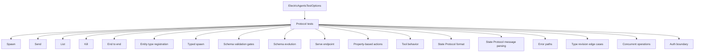
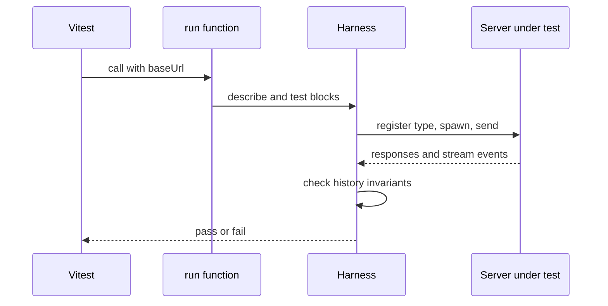

# Overview of the conformance suite

This document describes the public options, the test groups, and the way to run the suite against a server implementation. The suite starts from a base Uniform Resource Locator (URL).

## The four run functions

```ts
export function runElectricAgentsConformanceTests(
  config: ElectricAgentsTestOptions
): void
```

Source: `packages/agents-server-conformance-tests/src/electric-agents-tests.ts:92-94`.

`ElectricAgentsTestOptions` has one required field, `baseUrl`. The protocol tests need no other input. Each run function returns `void` because it registers Vitest `describe` and `test` blocks. Source: `packages/agents-server-conformance-tests/src/electric-agents-tests.ts:29-31`.

```ts
export interface CliTestOptions {
  baseUrl: string
  cliBin: string
}
```

Source: `packages/agents-server-conformance-tests/src/electric-agents-tests.ts:2767-2770`.

```ts
export interface MockAgentTestOptions {
  baseUrl: string
}
```

Source: `packages/agents-server-conformance-tests/src/electric-agents-tests.ts:3137-3139`.

```ts
export interface MockAgentCliTestOptions {
  baseUrl: string
  cliBin: string
}
```

Source: `packages/agents-server-conformance-tests/src/electric-agents-tests.ts:3285-3288`.

The `baseUrl` is the only required input for the protocol tests. The CLI tests also need the path to a command-line interface (CLI) executable.

## The test groups



The eighteen describe blocks below belong to `runElectricAgentsConformanceTests`. The CLI run functions repeat the server checks through the CLI. The mock run functions add the model path on top of the server checks.

| Group | Main assertions |
|-------|-----------------|
| Spawn | Entity creation, stream paths, duplicate rejection, unknown type |
| Send | State Protocol event, webhook context, order, principal fallback |
| List | Entity list, status filter, missing entity |
| Kill | Status change, send rejection, stream persistence |
| End to end | Spawn, send, webhook, read, kill |
| Entity type registration | Register, list, inspect, delete, upsert, required fields |
| Typed spawn | Creation schema validation, parent, tags |
| Schema validation gates | Inbox schema validation and unknown message types |
| Schema evolution | Additive amendment and rejection of key changes |
| Serve endpoint | Registration through a serve endpoint and name mismatch |
| Property-based actions | Random sequences against a world model |
| Tool behavior | `bash`, `read_file`, `web_search`, `fetch_url` interfaces |
| State Protocol format | Insert before update, tool call states, text deltas |
| State Protocol message parsing | `findLastUserMessage` reads the stream format |
| Error paths | Missing entities, missing payloads, stopped entities, tag update on a stopped entity |
| Type revision edge cases | Schemas added across amendments, amendment of a deleted type |
| Concurrent operations | Sequential tag updates accumulate, concurrent spawns succeed |
| Auth boundary | Write token, principal permission, no token leak |

The tool behavior group checks tools that an entity handler can call during a model turn. The auth boundary group checks that a write requires the write token and that a principal permission is enforced. It also checks that no token appears in a response.

## The protocol route helper

The suite accepts entity paths without the control-plane prefix.

```ts
function routeControlPlanePath(path: string): string {
  const pathname = path.split(`?`, 1)[0]!
  if (pathname.startsWith(`/_electric/`) || isEntityStreamPath(pathname)) {
    return path
  }
  return `/_electric/entities${path}`
}
```

Source: `packages/agents-server-conformance-tests/src/electric-agents-tests.ts:51-57`.

A test can write `/my-type/my-instance`. The helper turns it into `/_electric/entities/my-type/my-instance`. A stream path such as `/my-type/my-instance/main` passes through unchanged. `isEntityStreamPath` recognizes a path whose last segment is a stream name.

## Running against another server

Create a Vitest file in the target project.

```ts
import { describe } from 'vitest'
import { runElectricAgentsConformanceTests } from '@electric-ax/agents-server-conformance-tests'

describe('my server', () => {
  runElectricAgentsConformanceTests({ baseUrl: 'http://localhost:4437' })
})
```

The server must be running before the tests start. The suite does not start it. The server must accept the standard control-plane paths and the stream paths. The control-plane paths start with `/_electric/`. A stream path is an entity path with a stream name, such as `/my-type/my-instance/main`.

For the CLI tests, pass the executable path.

```ts
runCliConformanceTests({
  baseUrl: 'http://localhost:4437',
  cliBin: '/path/to/electric-ax/dist/index.js',
})
```

The CLI test harness runs the executable with `pnpm exec tsx` and a 30 second limit per command. `tsx` runs both TypeScript source and built JavaScript, so `cliBin` can point to a source entry or a built artifact. The harness sets `ELECTRIC_AGENTS_URL` to the base URL and `ELECTRIC_AGENTS_IDENTITY` to `test-user@test-host`.

## Test isolation



Many tests use a time-based identifier.

```ts
const id = `cli-mock-${Date.now()}`
```

Source: `packages/agents-server-conformance-tests/src/electric-agents-tests.ts:3293`.

A shared server therefore does not accumulate fixed-name collisions across runs. Some tests still register a fixed type name. A target server should be dedicated to the test run.

## Timeouts

| Scope | Limit | Source |
|-------|-------|--------|
| Property-based sequences | 30 seconds | `electric-agents-tests.ts:1641` |
| CLI lifecycle tests | 15 seconds | `electric-agents-tests.ts:3033`, `3088` |
| Mock agent tests | 15 seconds | `electric-agents-tests.ts:3236`, `3257`, `3277` |
| Status polling | 8 seconds | `electric-agents-tests.ts:71` |
| Agent response wait | 10 seconds | `electric-agents-tests.ts:3186` |
| CLI command | 30 seconds | `cli-dsl.ts:332` |

The limits apply to different waits. They do not combine into one test budget. A limit on a lifecycle wait, for example, is not a limit on the whole test.

## Aha: the suite tests behavior, not implementation

The suite never imports the server. It speaks Hypertext Transfer Protocol (HTTP) and reads streams. It cannot see a database table, a class name, or an internal function.

Key insight: this is why the suite can certify a second server written in another language. The only contract is the wire behavior. A passing run is a strong statement about compatibility.

## Related documents

- [README.md](README.md) for the package introduction.
- [01-conformance-harness.md](01-conformance-harness.md) for the scenario builder and invariants.
- [../agents-server/README.md](../agents-server/README.md) for the reference implementation.
- [../README.md](../README.md) for the full exploration index.
