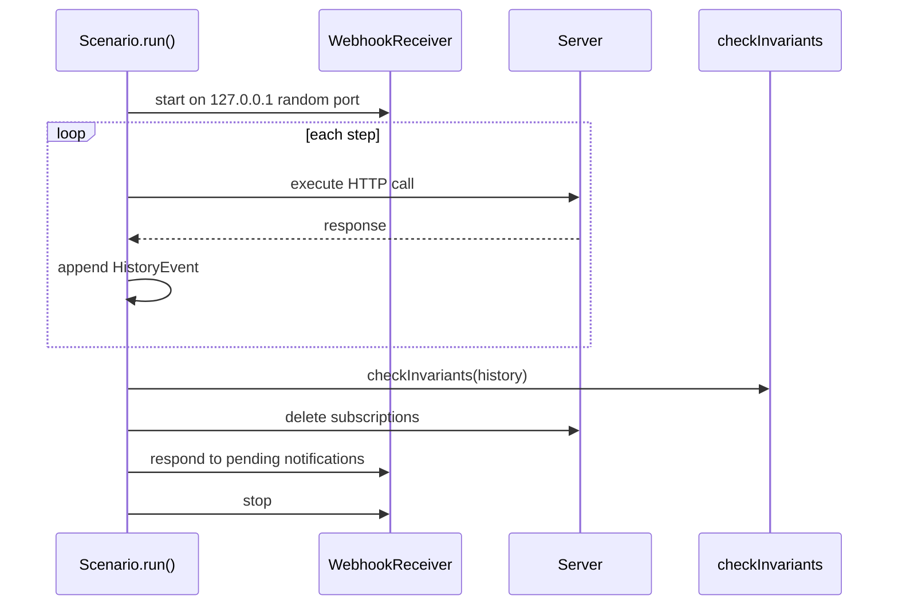
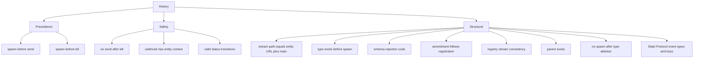

# The conformance harness

The harness is a fluent scenario builder. A test declares a sequence of steps. The harness starts a webhook receiver over Hypertext Transfer Protocol (HTTP). It runs the steps against the server and records a history. It then checks invariants against that history.

The implementation is `packages/agents-server-conformance-tests/src/electric-agents-dsl.ts`, 2,574 lines. The file name uses `dsl`, which means domain-specific language. The scenario builder is that language.

## The scenario builder

A scenario starts with a base Uniform Resource Locator (URL).

```ts
export function electricAgents(baseUrl: string): ElectricAgentsScenario {
  return new ElectricAgentsScenario(baseUrl)
}
```

Source: `packages/agents-server-conformance-tests/src/electric-agents-dsl.ts:2383-2385`.

The builder has three tiers of methods.

| Tier | Methods | Use |
|------|---------|-----|
| High level | `subscription` (704), `spawn` (711), `send` (733), `sendTo` (743), `kill` (748), `killUrl` (753), `registerType` (815), `inspectType` (825), `deleteType` (830), `amendSchemas` (840), `listTypes` (856), `registerTypeViaServe` (861), `write` (868), `writeStateProtocol` (873), `setTags` (904) | Normal operations |
| Assertions | `expectWebhook` (760), `respondDone` (765), `expectEntityContext` (770), `expectStatus` (777), `expectStreamContains` (782), `readStream` (787), `expectListCount` (803), `expectListTotal` (808), `expectTypeExists` (820), `expectTypeNotExists` (835), `expectStreamEvent` (883), `expectStreamEventCount` (899), `expectTags` (909), `expectSpawnSchemaError` (916), `expectSendSchemaError` (932), `expectWriteSchemaError` (946), `expectSendUnknownType` (957), `expectWriteUnknownType` (971), `expectEntityPersisted` (984), `expectSpawnError` (991), `expectSendError` (996) | Check a result |
| Raw | `custom` (1003), `wait` (1008), `skipInvariants` (1015) | Escape hatches |

The line numbers are in `electric-agents-dsl.ts`. The class does not group methods by tier. The methods are interleaved: `registerType` at line 815 comes after `expectWebhook` at line 760. `skipInvariants` is at line 1,015, the `run` method starts at line 1,022, and the class ends at line 1,077.

The high-level methods include:

```ts
subscription(pattern: string, id: string): this
spawn(typeName: string, instanceId: string, opts?: {
  args?: Record<string, unknown>
  tags?: Record<string, string>
  parent?: string
  initialMessage?: unknown
}): this
send(payload: unknown, opts?: { from?: string; type?: string }): this
sendTo(url: string, payload: unknown, opts?: { from?: string }): this
kill(): this
killUrl(url: string): this
registerType(registration: EntityTypeRegistration): this
amendSchemas(name: string, schemas: {
  inbox_schemas?: Record<string, Record<string, unknown>>
  state_schemas?: Record<string, Record<string, unknown>>
}): this
write(payload: unknown, opts?: { type?: string }): this
writeStateProtocol(event: { ... }): this
setTags(tags: Record<string, string>): this
```

Source: `packages/agents-server-conformance-tests/src/electric-agents-dsl.ts:704-753`, `815`, `840`, `868-873`, `904`.

The assertion methods include:

```ts
expectWebhook(opts?: ExpectWebhookOpts): this
expectStatus(status: string): this
expectStreamContains(messageType: string): this
expectStreamEvent(type: string, key: string, operation: `insert` | `update`, valueCheck?: (value: Record<string, unknown>) => void): this
expectStreamEventCount(type: string, count: number): this
expectTypeExists(name: string): this
expectTypeNotExists(name: string): this
expectTags(expected: Record<string, string>): this
expectSpawnSchemaError(typeName: string, instanceId: string, opts?: { args?: Record<string, unknown> }): this
```

Source: `packages/agents-server-conformance-tests/src/electric-agents-dsl.ts:760`, `777`, `782`, `820`, `835`, `883`, `899`, `909`, `916`.

## The run lifecycle



```ts
async run(): Promise<Array<HistoryEvent>> {
  const receiver = new WebhookReceiver()
  await receiver.start()

  const ctx: RunContext = {
    baseUrl: this.baseUrl,
    receiver,
    history: [],
    // ...
  }

  try {
    for (const step of this.steps) {
      await executeStep(ctx, step)
    }

    if (!this._skipInvariants) {
      checkInvariants(ctx.history)
    }

    return ctx.history
  } finally {
    // delete subscriptions, answer pending webhooks, stop receiver
  }
}
```

Source: `packages/agents-server-conformance-tests/src/electric-agents-dsl.ts:1022-1076`.

The `finally` block is important. A failed assertion still cleans up the server subscription and the local receiver. A test run does not leave a webhook target that points at a closed port. The receiver answers every pending webhook request before it stops. A webhook request holds the connection open until the receiver answers it, so cleanup must not stop the server while a request is pending.

## The webhook receiver

The receiver is a local HTTP server on a random port.

```ts
this.server.listen(0, `127.0.0.1`, () => {
  const addr = this.server!.address()
  if (typeof addr === `object` && addr) {
    this._url = `http://127.0.0.1:${addr.port}`
  }
  resolve(this._url!)
})
```

Source: `packages/agents-server-conformance-tests/src/electric-agents-dsl.ts:311-317`.

Port 0 asks the operating system for a free port. The bind address is `127.0.0.1`, so the receiver is not reachable from another host. This matters when the test server runs on the same machine.

The receiver normalizes the payload because servers may send snake case or camel case keys. The normalized shape uses snake case for the webhook fields: `consumer_id`, `wake_id`, `primary_stream`, `triggered_by`, and `trigger_event`. The nested `entity` context keeps its camel-case field names, such as `entityUrl`. Source: `packages/agents-server-conformance-tests/src/electric-agents-dsl.ts:269-291`. It exposes three methods:

| Method | Behavior |
|--------|----------|
| `waitForNotification(10_000)` | Wait up to 10,000 milliseconds for the next webhook |
| `expectNoNotification(500)` | Assert that no webhook arrives in 500 milliseconds |
| `received` | Read all received notifications |

A subscription step registers the receiver URL.

```ts
const res = await fetch(subscriptionEndpoint(ctx.baseUrl, step.id), {
  method: `PUT`,
  headers: { 'content-type': `application/json` },
  body: JSON.stringify({
    type: `webhook`,
    pattern: subscriptionPattern(step.pattern),
    webhook: { url: ctx.receiver.url },
  }),
})
```

Source: `packages/agents-server-conformance-tests/src/electric-agents-dsl.ts:1086-1094`.

`subscriptionPattern` only removes leading slashes (`pattern.replace(/^\/+/, '')`, `packages/agents-server-conformance-tests/src/electric-agents-dsl.ts:500-502`). It does not expand the pattern. In a pattern, `**` matches every entity path under the type.

## The serve endpoint receiver

A server can fetch an entity type definition from a serve endpoint. The harness can stand in for that endpoint.

```ts
export class ServeEndpointReceiver {
  private manifest: EntityTypeRegistration | null = null

  async start(manifest: EntityTypeRegistration): Promise<string> {
    this.manifest = manifest
    // start HTTP server, return URL
  }
}
```

Source: `packages/agents-server-conformance-tests/src/electric-agents-dsl.ts:414-420`.

The receiver answers every request with the manifest as JavaScript Object Notation (JSON). It does not check the request method. The source comment states that Electric Agents sends a `PUT` request during `registerTypeViaServe`, but the receiver accepts any method. This lets a test register a type without sending the full definition in the registration request. The source does not state why the caller uses `PUT`. This is an open question. The comment is at `packages/agents-server-conformance-tests/src/electric-agents-dsl.ts:409-412`; the method-agnostic handler is at `:453-456`.

## The history

Every step appends one or more events to `ctx.history`. The event types cover:

- `subscription_created`
- `entity_spawned`
- `message_sent`
- `webhook_received`, `webhook_responded`
- `entity_status_checked`
- `entity_killed`
- `entity_list_fetched`
- `stream_read`
- `send_rejected`, `spawn_rejected`
- `entity_type_registered`, `entity_type_inspected`, `entity_type_deleted`, `entity_type_schemas_amended`
- `entity_write`
- `tags_updated`, `tags_checked`
- `spawn_schema_rejected`, `send_schema_rejected`, `write_schema_rejected`
- `send_unknown_type_rejected`, `write_unknown_type_rejected`
- `entity_persisted_verified`
- `state_protocol_write`

Source: `packages/agents-server-conformance-tests/src/electric-agents-dsl.ts:29-151`.

The history is the evidence. The invariants read only the history, not the live server.

`RunContext` also holds the scenario state that is not shown in the snippet, such as the current entity URL and the current stream paths. The invariants read those fields through the history events.

## The history invariants

The code has twelve named checks plus one State Protocol check.



```ts
export function checkInvariants(history: Array<HistoryEvent>): void {
  checkSpawnPrecedesSend(history)
  checkSpawnPrecedesKill(history)
  checkNoSendAfterKill(history)
  checkEntityContextOnWebhook(history)
  checkStreamPathsMatchEntityUrl(history)
  checkStatusTransitionsValid(history)
  checkEntityTypeExistsBeforeSpawn(history)
  checkSchemaValidationAtGates(history)
  checkAdditiveSchemaEvolution(history)
  checkRegistryStreamConsistency(history)
  checkParentExists(history)
  checkNoSpawnAfterTypeDeleted(history)
  // plus a check on state_protocol_write event types and keys
}
```

Source: `packages/agents-server-conformance-tests/src/electric-agents-dsl.ts:1904-1938`.

The stream path check is a good example.

```ts
if (event.type === `entity_spawned`) {
  expect(event.streams.main).toBe(`${event.entityUrl}/main`)
}
```

Source: `packages/agents-server-conformance-tests/src/electric-agents-dsl.ts:2024-2030`.

The error path is also checked. Every schema rejection must carry the code `SCHEMA_VALIDATION_FAILED`.

```ts
expect(
  event.code,
  `Safety: ${event.type} must have code SCHEMA_VALIDATION_FAILED, got '${event.code}'`
).toBe(`SCHEMA_VALIDATION_FAILED`)
```

Source: `packages/agents-server-conformance-tests/src/electric-agents-dsl.ts:2092-2096`.

## The State Protocol invariants

`checkStateProtocolInvariants` examines the raw stream events. It checks eight rules.

The raw stream uses keys. A run key identifies one model run. A step key identifies one step inside a run. A text key identifies one text block. An `insert` event creates the record for a key, and a later update changes it. `args_complete` and `executing` are tool call states.

| Rule | Requirement |
|------|-------------|
| E1 | Every run key starts with `insert` |
| E2 | Every step key starts with `insert` |
| E3 | Every text key starts with `insert` |
| E4 | A tool call follows started, optional args_complete, executing, completed or failed |
| E5 | A text delta key is `<text_id>:<sequence>` and the value matches |
| E6 | A step carries a consistent `step_number` |
| E7 | Text delta sequences increase |
| E8 | A completed run or step has a `finish_reason` |

Source: `packages/agents-server-conformance-tests/src/electric-agents-dsl.ts:2387-2574`.

The tool call rule is the most detailed. The first event must be `insert` with status `started`. The event at index 1 is `args_complete` or `executing`. The last event is `completed` or `failed`. The tool name is the same in every event.

## The property-based model

Three functions describe a state machine.

```ts
export function enabledElectricAgentsActions(
  model: ElectricAgentsWorldModel
): Array<ElectricAgentsAction>
```

Source: `packages/agents-server-conformance-tests/src/electric-agents-dsl.ts:2264-2266`.

```ts
export function applyElectricAgentsAction(
  model: ElectricAgentsWorldModel,
  action: ElectricAgentsAction,
  targetIdx?: number,
  opts?: { typeName?: string }
): ElectricAgentsWorldModel
```

Source: `packages/agents-server-conformance-tests/src/electric-agents-dsl.ts:2304-2309`.

The enabled predicate applies limits:

| Action | Enabled when |
|--------|--------------|
| `register_type` | Fewer than 3 types exist |
| `delete_type` | A type has no running entity |
| `spawn` | At least one type exists and fewer than 4 entities exist |
| `send` | At least one entity is running |
| `kill` | At least one entity is running |
| `check_status` | At least one entity exists |
| `list` | Always |

Source: `packages/agents-server-conformance-tests/src/electric-agents-dsl.ts:2264-2298`.

The property test generates a random action sequence. It applies each action to the model and to the server. It then checks that the server state matches the model and that the invariants hold. The model is a plain object that records the registered types, the spawned entities, and the status of each entity. The comparison uses the server responses after each action.

## Aha: the history is a second implementation of the server

The harness records what it believes happened. The invariants then check that record for contradictions. This is a model check, not a simple assertion.

Key insight: a test can pass every expected response and still fail an invariant. For example, a server can return success for a send after a kill. The response looks fine. The history shows `message_sent` after `entity_killed`, and the invariant fails. The harness catches an error that a response-only test would miss.

## Related documents

- [00-overview.md](00-overview.md) for the options and test groups.
- [README.md](README.md) for the package introduction.
- [../agents-runtime/README.md](../agents-runtime/README.md) for the State Protocol that E1 to E8 check.
- [../README.md](../README.md) for the full exploration index.
