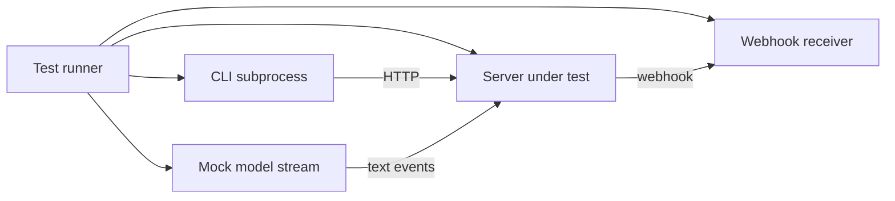
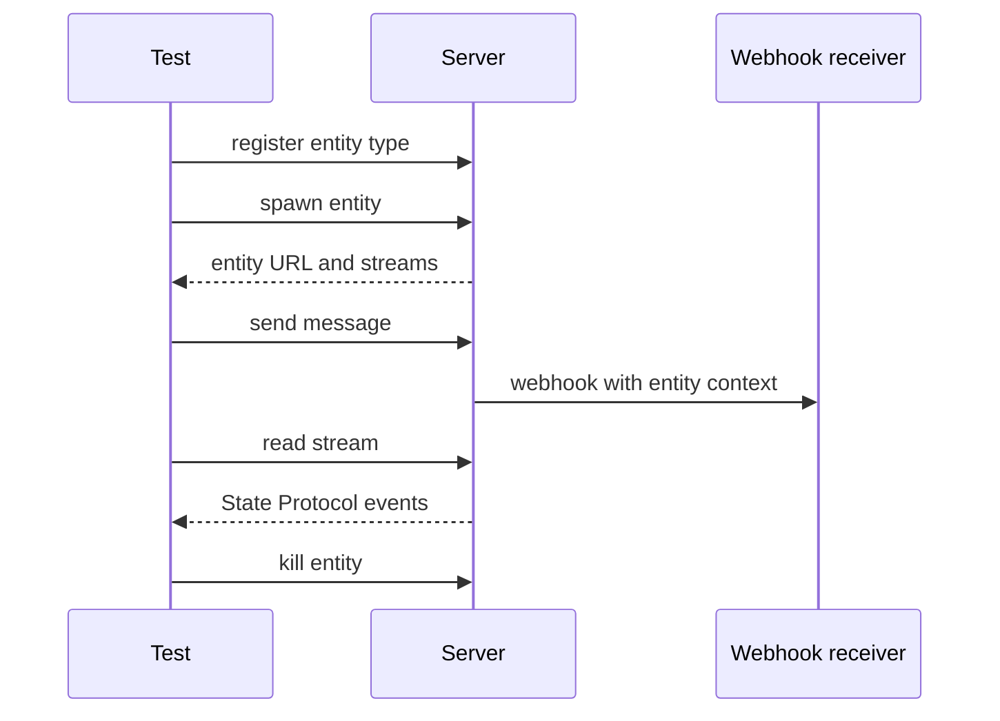

# The conformance test suite

`agents-server-conformance-tests` is a black-box test suite for any server that implements the Electric Agents protocol. It starts from a base Uniform Resource Locator (URL). It does not import server internals. It checks the protocol from the outside.

The protocol is the Hypertext Transfer Protocol (HTTP) and stream contract that an agents server exposes. It defines entity types, spawn, send, event streams, and signals.

Package location: `packages/agents-server-conformance-tests`. Version: `0.6.0`. Package name: `@electric-ax/agents-server-conformance-tests`.

## What the suite checks

The suite has four run functions.

| Function | What it starts | What it checks |
|----------|----------------|----------------|
| `runElectricAgentsConformanceTests` | No local agent | Protocol behavior by HTTP |
| `runCliConformanceTests` | No local agent | Command-line interface (CLI) against the server |
| `runMockAgentTests` | Nothing; the caller supplies the mock model | End-to-end response events |
| `runMockAgentCliTests` | Nothing; the caller supplies the mock model | End-to-end flow through the CLI |

The mock model is local to the test process. It is not a separate server and not a webhook receiver. The run functions do not start a model, and their options type has only the base URL (`packages/agents-server-conformance-tests/src/electric-agents-tests.ts:3137-3141`). The caller attaches the model to the server under test through the `mockStreamFn` option; `packages/agents-server/test/conformance.test.ts:100-107` shows this.



## The four interfaces

The package exports four layers.

1. **Fixed tests.** The four `run*` functions contain the complete test list.
2. **A scenario builder.** `electricAgents(baseUrl)` builds a fluent test case.
3. **A property-based model.** `enabledElectricAgentsActions` and `applyElectricAgentsAction` describe a random action sequence. The model types are `ElectricAgentsWorldModel`, `EntityModel`, `ElectricAgentsAction`, `HistoryEvent`, and `RunContext`.
4. **Command-line interface and mock helpers.** `cliTest` and `CliScenario` build CLI scenarios. `CliHistory` is their recorded history type. `createMockStreamFn` supplies a mock model stream.

## Reading order

| Order | Document | What you learn |
|-------|----------|----------------|
| 1 | [00-overview.md](00-overview.md) | Options, exports, and test groups |
| 2 | [01-conformance-harness.md](01-conformance-harness.md) | The scenario builder, the receivers, and the invariants |

## The core contract

A conforming server must accept a spawn, store an entity, deliver a message, and expose a stream. The first test group proves this path. The spawn response includes the stream paths for the new entity. The main stream holds the conversation. A State Protocol event is one record in that stream; it records a state change such as a text delta or a tool call.



## Source anchor

The four run functions are the public entry points.

```ts
export {
  runElectricAgentsConformanceTests,
  runCliConformanceTests,
  runMockAgentTests,
  runMockAgentCliTests,
} from './electric-agents-tests'
```

Source: `packages/agents-server-conformance-tests/src/index.ts:1-6`.

The scenario builder is the second entry point.

```ts
export {
  electricAgents,
  ServeEndpointReceiver,
  ElectricAgentsScenario,
  applyElectricAgentsAction,
  checkInvariants,
  checkStateProtocolInvariants,
  enabledElectricAgentsActions,
} from './electric-agents-dsl'
```

Source: `packages/agents-server-conformance-tests/src/index.ts:13-21`.

The CLI and mock helpers are the fourth entry point.

```ts
export { cliTest, CliScenario } from './cli-dsl'
export { createMockStreamFn } from './mock-stream'
```

Source: `packages/agents-server-conformance-tests/src/index.ts:29-31`.

## Aha: conformance is a separate package on purpose

The fixed tests are plain Vitest groups.

```ts
test(`spawn creates entity and streams`, () =>
  electricAgents(config.baseUrl)
    .subscription(`/spawn-test-agent/**`, `spawn-test-sub`)
    .registerType({
      name: `spawn-test-agent`,
      description: `Test entity type for spawn`,
      creation_schema: { type: `object` },
    })
    .spawn(`spawn-test-agent`, `entity-1`)
    .expectStatus(`running`)
    .custom(async (ctx) => {
      const mainRes = await fetch(
        appendPathToUrl(ctx.baseUrl, ctx.currentEntityStreams!.main),
        { method: `HEAD` }
      )
      expect(mainRes.status).toBe(200)
    })
    .run())
```

Source: `packages/agents-server-conformance-tests/src/electric-agents-tests.ts:101-119`.

In this test body, `config` is the options object passed to the run function. `creation_schema` is the schema field that the server uses to validate spawn arguments. The `**` in the subscription path is a wildcard that matches every entity path under the type.

The suite does not live inside `agents-server`. It is a dependency of the server test setup, not a part of the server code.

Key insight: this separation makes the suite usable against a second implementation. Any server that passes the suite can claim protocol conformance. The suite is the specification in executable form.

The suite cannot prove that it covers every protocol rule. A server can pass every fixed test and still differ in an untested corner. The property-based tests reduce that risk but do not remove it.

## Related documents

- [00-overview.md](00-overview.md) for options and test groups.
- [01-conformance-harness.md](01-conformance-harness.md) for the harness internals.
- [../agents-server/README.md](../agents-server/README.md) for the reference server.
- [../README.md](../README.md) for the full exploration index.
