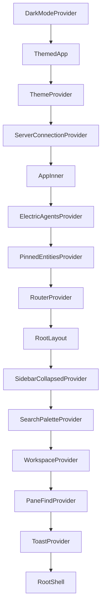
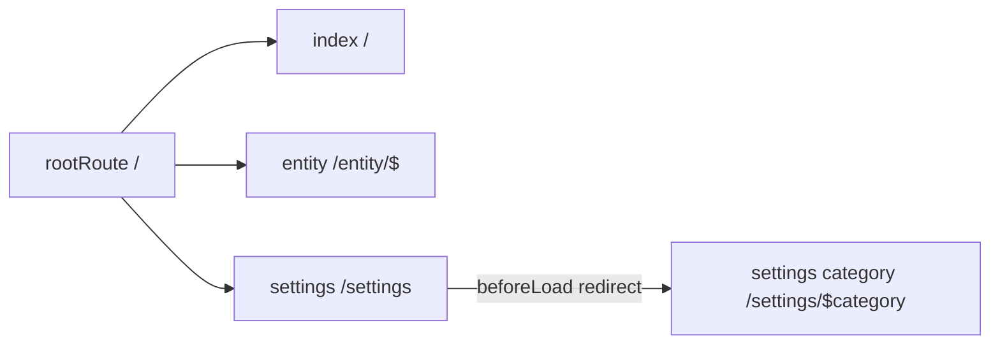

# App shell and routing

This document explains how the application starts, how it selects routes, and how the browser address stays in step with a multi-tile workspace.

## Entry point

The browser loads `src/main.tsx`. The module does five things in a fixed order:

1. In development only, it loads `react-scan` and enables it. This must happen before React mounts. Source: `packages/agents-server-ui/src/main.tsx:8-12`.
2. It imports the user interface primitives, the markdown style sheet, and the view registration module. The registration module runs for its side effect. Source: `packages/agents-server-ui/src/main.tsx:16-21`.
3. It replaces `window.fetch` with a wrapper that adds `ngrok-skip-browser-warning` for ngrok hosts. ngrok is a tunnelling service. Source: `packages/agents-server-ui/src/main.tsx:51-65`.
4. It finds the `#root` element and throws if the element is missing. Source: `packages/agents-server-ui/src/main.tsx:67-71`.
5. It mounts `<App />` inside `<StrictMode>`. Source: `packages/agents-server-ui/src/main.tsx:73-77`.

`StrictMode` runs effects twice in development. The code must therefore tolerate double mount and double cleanup. The entity connection cache uses reference counts for this reason.

## Provider chain

The providers are nested in this order:



Sources: `packages/agents-server-ui/src/App.tsx:46-52`, `packages/agents-server-ui/src/App.tsx:27-44`, and `packages/agents-server-ui/src/router.tsx:120-134`.

Each provider has a narrow duty:

- `DarkModeProvider` stores the theme preference and reports the resolved appearance.
- `ThemeProvider` supplies design tokens to the Base UI components.
- `ServerConnectionProvider` stores the saved servers, the active server, and the connection status.
- `ElectricAgentsProvider` creates the shape-backed collections. It receives `baseUrl` only when the connection is active.
- `PinnedEntitiesProvider` stores pinned Uniform Resource Locator (URL) addresses for entities.
- `WorkspaceProvider` holds the tile tree.
- `PaneFindProvider` holds the search state for each tile.
- `ToastProvider` renders notifications.

`ThemedApp` calls `window.electronAPI.setNativeAppearance(preference)` when the preference changes. The desktop preload bridge exposes this method. Source: `packages/agents-server-ui/src/App.tsx:31-33`.

## Route tree

The router uses four routes:



`/settings` has no screen. Its `beforeLoad` hook throws a redirect to `/settings/general`. Source: `packages/agents-server-ui/src/router.tsx:534-544`.

The entity route uses a trailing splat (`/entity/$`). An entity URL contains slashes, for example `/coding/session-42`. The splat captures the full path after `/entity/`. The route loader rebuilds the leading slash. Source: `packages/agents-server-ui/src/router.tsx:508-526`.

### Hash history

The router does not use the browser History application programming interface (API) path mode. It uses hash history:

```ts
// packages/agents-server-ui/src/router.tsx:586
export const router = createRouter({
  routeTree,
  history: createHashHistory(),
  defaultPreload: `intent`,
})
```

A hash route looks like `#/entity/coding/session-42`. This choice removes the need for a server rewrite rule. The agents server can serve one HyperText Markup Language (HTML) file at `/__agent_ui/` and the fragment does not reach the server.

`defaultPreload: 'intent'` starts a route loader when the user hovers or focuses a link. Source: `packages/agents-server-ui/src/router.tsx:589`.

## Route loaders

Both workspace routes use the same component, `WorkspacePage`. The difference is the loader:

```tsx
// packages/agents-server-ui/src/router.tsx:508
const entityRoute = createRoute({
  getParentRoute: () => rootRoute,
  path: `/entity/$`,
  loader: async ({ abortController, params }): Promise<null> => {
    const baseUrl = getActiveBaseUrl()
    if (!baseUrl) return null
    await Promise.all([
      preloadAppCollections(baseUrl),
      preloadEntityStream({
        baseUrl,
        entityUrl: `/${params._splat}`,
        signal: abortController.signal,
      }),
    ])
    return null
  },
  component: WorkspacePage,
  validateSearch: workspaceSearchSchema,
})
```

The loader does two jobs in parallel:

- `preloadAppCollections` starts the shape sync for the entity list and the related tables.
- `preloadEntityStream` opens or reuses the entity stream connection and waits for the initial backlog.

The loader returns no data. Components read from the collections and the stream cache. The loader only warms the caches.

The index route loader calls only `preloadAppCollections`. Source: `packages/agents-server-ui/src/router.tsx:496-506`.

**Key insight:** A route loader that returns `null` is unusual, but it fits this design. The loader is a cache warmer, not a data fetcher. Route rendering does not wait for a second copy of the data. TanStack DB and the stream database already provide reactive reads.

## Search parameters

The workspace routes share one Zod schema:

```ts
// packages/agents-server-ui/src/router.tsx:471
const workspaceSearchSchema = z.object({
  view: z.string().optional(),
  source: z.string().optional(),
  layout: z.string().optional(),
})
```

- `view` selects a view other than the default. The default view is the first registered entity view, which is `chat`. The workspace-to-address effect omits `view=chat` from the address to keep the common link short. Source: `packages/agents-server-ui/src/components/workspace/Workspace.tsx:223`.
- `source` selects the collection shown by the State Explorer.
- `layout` carries an encoded workspace tree. Any route can receive a layout link.

The settings route has its own schema with one optional field, `serverId`. Source: `packages/agents-server-ui/src/router.tsx:477-479`.

## Address to workspace

`Workspace` treats the address as input and the tile tree as output. One effect handles three cases. Source: `packages/agents-server-ui/src/components/workspace/Workspace.tsx:118-195`.

| Case | Address | Action |
|------|---------|--------|
| A | `/` | Focus an existing new-session tile. If none exists, replace the active tile with one. |
| B1 | `/entity/<url>?view=x` | If a tile already shows that entity and view, make it active. |
| B2 | `/entity/<url>` while the active tile shows the same entity | Swap the view in place. The tile identifier does not change. |
| B3 | `/entity/<url>` for a new entity | Replace the active tile, or create the first tile. |

A `lastSyncedKey` reference guards both directions. Without the guard, the address-to-workspace effect would dispatch a change. The workspace-to-address effect would then write the address. The first effect would run again in a loop. Source: `packages/agents-server-ui/src/components/workspace/Workspace.tsx:117`.

The address-to-workspace key includes the entity URL, the view, and the State Explorer source:

```ts
// packages/agents-server-ui/src/components/workspace/Workspace.tsx:150
const key = `${entityUrl}::${desiredViewId}::${requestedSource ?? ``}`
```

## Workspace to address

The reverse effect reads the active tile and writes its entity and view into the address with `replace: true`. Source: `packages/agents-server-ui/src/components/workspace/Workspace.tsx:206-228`.

A standalone new-session tile maps to `/`. An entity tile maps to `/entity/<url>`. The effect omits the default chat view.

`replace: true` is important. The user action that changed the active tile already pushed a history entry. This effect only corrects the address, so a second push would make the Back button require two presses.

## Layout links

A layout link contains a compressed description of the full tile tree. The decoder is `decodeLayout`. Source: `packages/agents-server-ui/src/lib/workspace/layoutCodec.ts`.

```tsx
// packages/agents-server-ui/src/components/workspace/Workspace.tsx:60
useEffect(() => {
  if (!layoutParam || layoutParam === lastLayoutParam.current) return
  lastLayoutParam.current = layoutParam
  const decoded = decodeLayout(layoutParam)
  if (decoded.kind === `ok` && decoded.workspace.root) {
    helpers.replaceWorkspace(decoded.workspace)
  }
  // Strip the ?layout= param regardless of decode success.
```

After import, the code removes the parameter from the address. It also removes a bad payload. The code does not leave a broken link in the address bar.

## Persistence

The workspace persists to browser local storage after each change. The code debounces the write by 250 milliseconds. Source: `packages/agents-server-ui/src/hooks/useWorkspacePersistence.ts:35-36`.

The key includes the schema version and the server URL:

```ts
// packages/agents-server-ui/src/hooks/useWorkspacePersistence.ts:43
function storageKey(serverId: string | null): string | null {
  if (!serverId) return null
  return `electric-agents-ui.workspace.${serverId}.v${SCHEMA_VERSION}`
}
```

The stored value is an envelope: `{ v: 2, workspace }`. The code ignores version 1 envelopes. The server URL is the namespace instead of the server name, because a name can change or repeat. Source: `packages/agents-server-ui/src/hooks/useWorkspacePersistence.ts:13-19`, `:53-59`, `:115`, `:158`.

On hydration, the code prunes tiles whose entity no longer exists in the live `entities` collection. A split with one surviving child collapses to that child. The code normalises the sizes again. Source: `packages/agents-server-ui/src/hooks/useWorkspacePersistence.ts:177-218`.

## Root shell layout

`RootShell` renders one of two sidebars:

- On `/settings/<category>`, it renders `SettingsSidebar`.
- On every other route, it renders the session `Sidebar`.

The right column is always `<Outlet />`. Source: `packages/agents-server-ui/src/router.tsx:419-430`.

`DesktopTitleBar` is always first. `TitlebarControls` renders only outside settings. Source: `packages/agents-server-ui/src/router.tsx:413` and `packages/agents-server-ui/src/router.tsx:434`.

On a narrow viewport, the sidebar floats over the content. On a wide viewport, the sidebar stays mounted and animates its width. The `data-sidebar-state` attribute tells the style sheet which state applies. Source: `packages/agents-server-ui/src/router.tsx:405-418`.

## Keyboard shortcuts

`RootShell` registers the application shortcuts. Source: `packages/agents-server-ui/src/router.tsx:169-278`.

| Shortcut | Action |
|----------|--------|
| `mod+b` | Toggle the sidebar. |
| `mod+k` | Toggle the search palette. |
| `mod+f` | Open find in the active tile. |
| `mod+g` | Find next in the active tile. |
| `mod+shift+g` | Find previous in the active tile. |
| `mod+n` | Open a new session. |
| `mod+shift+o` | Open a new session in a browser. |
| `escape` | Send `SIGINT` to the active entity. |
| `shift+escape` | Send `SIGSTOP`, then `SIGINT`. |

`mod` is the Command key on macOS and the Control key elsewhere.

`mod+n` does not work in a browser because the browser reserves it. The code also binds `mod+shift+o`. Source: `packages/agents-server-ui/src/router.tsx:202-227`.

The desktop application handles the same actions in its native menu. In that case, `nativeMenuHandlesAppHotkeys` is true, and some in-page hotkeys are disabled to prevent a double action. Only `mod+n` receives `{ disabled: nativeMenuHandlesAppHotkeys }` (`packages/agents-server-ui/src/router.tsx:216-223`). `mod+shift+o` stays bound (`:224-227`), and the `escape` and `shift+escape` bindings stay bound (`:261-278`). The workspace hotkey hook receives the flag as a whole (`:280`). Source: `packages/agents-server-ui/src/router.tsx:149-150` and `packages/agents-server-ui/src/router.tsx:169`.

The desktop menu sends `desktop:command` events. One effect maps each command to the same helper that a button or hotkey uses:

```ts
// packages/agents-server-ui/src/router.tsx:289
const off = window.electronAPI?.onDesktopCommand?.((command) => {
  switch (command) {
    case `new-chat`:
      openNewSession()
      break
    case `toggle-sidebar`:
      toggle()
      break
```

The full set is `new-chat`, `toggle-sidebar`, `open-settings`, `open-servers-settings`, `open-search`, `open-find`, `find-next`, `find-previous`, `close-tile`, `split-right`, `split-down`, and `cycle-tile`. Source: `packages/agents-server-ui/src/router.tsx:290-346`.

## Aha: the address is the layout application programming interface

**Aha:** Navigation is not a side effect of the workspace. The address and the workspace are two views of one state, kept in sync by two guarded effects. This is why a user can open a split view, copy the address, and send it to another person. It is also why the Back button moves between tiles instead of closing the application.

The split is not always one-to-one. On refresh, the address describes only the active tile, while local storage describes the full tree. The hydration code resolves this by restoring the stored tree after the address effect has created a single tile. The comment at `packages/agents-server-ui/src/hooks/useWorkspacePersistence.ts:124-126` states this rule.

## Related documents

- [Overview](00-overview.md) gives the package context.
- [Data and streams](02-data-and-streams.md) explains what the loaders preload.
- [Entity management](04-entity-management.md) explains the sidebar and tile controls.
- [Settings and permissions](05-settings-and-permissions.md) explains the settings routes.
