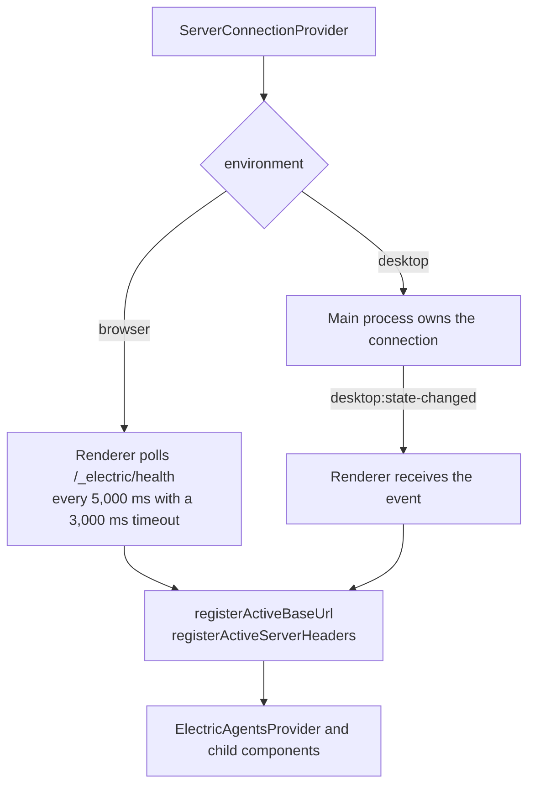
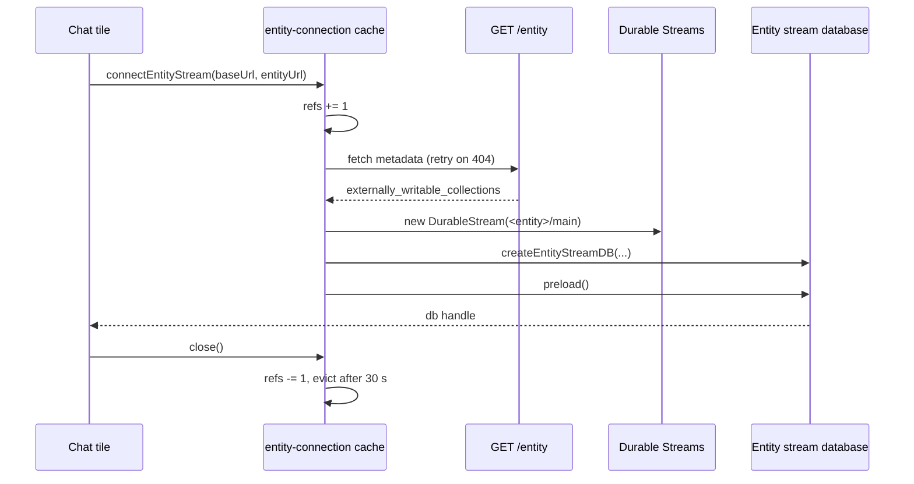

# Data and streams

This document explains how the user interface gets data. The application reads from two planes:

1. **The control plane.** Electric shapes sync tables such as `entities`, `entity_types`, `runners`, and `users`.
2. **The data plane.** One Durable Stream per entity carries the conversation.

Both planes start from the same base address. Both use the same fetch wrapper, so both receive the same authentication headers.

## Server selection

`ServerConnectionProvider` is the first data component. It runs before the router and before `ElectricAgentsProvider`.

On mount it calls `loadServers()` and `loadDesktopState()` in parallel. Source: `packages/agents-server-ui/src/hooks/useServerConnection.tsx:134-167`.

- In a browser, `loadServers()` reads local storage under the key `electric-agents-servers`. Source: `packages/agents-server-ui/src/lib/server-connection.ts:480` and `packages/agents-server-ui/src/lib/server-connection.ts:508-526`.
- In the desktop application, `loadServers()` asks the main process with `window.electronAPI.getServers()`. Source: `packages/agents-server-ui/src/lib/server-connection.ts:509-511`.

The provider then registers the active server in two module-level variables:

```ts
// packages/agents-server-ui/src/hooks/useServerConnection.tsx:151-152
registerActiveBaseUrl(active?.url ?? null)
registerActiveServerHeaders(active)
```

`registerActiveBaseUrl` feeds the entity connection module. Source: `packages/agents-server-ui/src/lib/entity-connection.ts:61-67`.

`registerActiveServerHeaders` feeds the fetch wrapper. Source: `packages/agents-server-ui/src/lib/auth-fetch.ts:167-175`.

### Browser health checks

In a browser, no main process exists. The provider polls the health route itself:

```ts
// packages/agents-server-ui/src/hooks/useServerConnection.tsx:222
const res = await serverFetch(
  appendPathToUrl(activeServer.url, `/_electric/health`),
  {
    signal: AbortSignal.timeout(3000),
  }
)
```

The check runs immediately and then every 5,000 milliseconds. Source: `packages/agents-server-ui/src/hooks/useServerConnection.tsx:256-257`.

In the desktop application, the main process owns the connection state and sends changes over `desktop:state-changed`. The renderer subscribes with `onDesktopStateChanged`. Source: `packages/agents-server-ui/src/hooks/useServerConnection.tsx:178-198`.

The two environments use the same provider but a different owner for the health signal. This is why the provider has two loaders instead of one.



A browser tab can lose the network without warning, so the poll is the only signal. A desktop application has a process that can own a socket for the life of the window, so the main process is the better owner. The provider hides the difference from every component below it.

## Control plane: shape collections

`ElectricAgentsProvider` creates five shared collections. The factories start at `packages/agents-server-ui/src/lib/ElectricAgentsProvider.tsx:216`.

| Collection | Table | Key | Source |
|------------|-------|-----|--------|
| Entities | `entities` | `url` | `packages/agents-server-ui/src/lib/ElectricAgentsProvider.tsx:216-250` |
| Entity types | `entity_types` | `name` | `packages/agents-server-ui/src/lib/ElectricAgentsProvider.tsx:252-265` |
| Runners | `runners` | `id` | `packages/agents-server-ui/src/lib/ElectricAgentsProvider.tsx:267-280` |
| Users | `users` | `id` | `packages/agents-server-ui/src/lib/ElectricAgentsProvider.tsx:282-295` |
| Effective permissions | `entity_effective_permissions` | `id` | `packages/agents-server-ui/src/lib/ElectricAgentsProvider.tsx:297-310` |

Each collection uses the same shape endpoint and the same fetch client:

```ts
// packages/agents-server-ui/src/lib/ElectricAgentsProvider.tsx:217
return createCollection(
  electricCollectionOptions({
    id: `entities`,
    schema: entitySchema,
    shapeOptions: {
      url: appendPathToUrl(baseUrl, `/_electric/electric/v1/shape`),
      params: {
        table: `entities`,
        columns: [
          `url`,
          `type`,
          `status`,
          `tags`,
          `spawn_args`,
          `sandbox`,
          `dispatch_policy`,
          `parent`,
          `created_by`,
          `type_revision`,
          `inbox_schemas`,
          `state_schemas`,
          `created_at`,
          `updated_at`,
        ],
      },
      fetchClient: serverFetch,
      parser: {
        int8: (v: string) => Number(v),
      },
    },
    getKey: (item) => item.url,
  })
)
```

Three details matter:

- **Column list.** The `entities` shape requests an explicit column list. A column that is not in the list does not reach the browser. For example, a new server column needs an edit here.
- **`int8` parser.** PostgreSQL `bigint` values arrive as strings. The parser converts them to JavaScript numbers. The schema also uses `z.coerce.number()` for `created_at`, `updated_at`, `type_revision`, and the permission `id`.
- **`fetchClient: serverFetch`.** Shape requests use the same authenticated wrapper as ordinary calls.

The provider also creates one on-demand collection: `createRunnerRuntimeDiagnosticsCollection(baseUrl, runnerId)`. Its collection identifier includes the base address and the runner identifier, and its shape adds a `where` filter. Source: `packages/agents-server-ui/src/lib/ElectricAgentsProvider.tsx:312-332`.

### Collection cache

The code caches collections by base address in `appCollectionsCache`. Source: `packages/agents-server-ui/src/lib/ElectricAgentsProvider.tsx:350`.

```ts
// packages/agents-server-ui/src/lib/ElectricAgentsProvider.tsx:352
function getOrCreateAppCollections(baseUrl: string): AppCollections {
  const cached = appCollectionsCache.get(baseUrl)
  if (cached) return cached
  const collections = {
    entities: createEntitiesCollection(baseUrl),
    entityTypes: createEntityTypesCollection(baseUrl),
    runners: createRunnersCollection(baseUrl),
    users: createUsersCollection(baseUrl),
    entityEffectivePermissions:
      createEntityEffectivePermissionsCollection(baseUrl),
  }
  appCollectionsCache.set(baseUrl, collections)
  return collections
}
```

A cache means two components that ask for the same server share one logical collection. A change of server cleans up the old collections. Source: `packages/agents-server-ui/src/lib/ElectricAgentsProvider.tsx:889-896`.

`preloadAppCollections` calls `preload()` on four collections in parallel. It does not preload `users`. Source: `packages/agents-server-ui/src/lib/ElectricAgentsProvider.tsx:384-395`.

## Data plane: one stream per entity

The entity stream is separate from the shapes. The connection module keeps a cache of open connections. Each key is the base address plus the entity Uniform Resource Locator (URL):

```ts
// packages/agents-server-ui/src/lib/entity-connection.ts:90
function cacheKey(baseUrl: string, entityUrl: string): string {
  return `${baseUrl}${entityUrl}`
}
```

The connection path is:



### Metadata fetch and spawn race

A new entity can exist in the shape before its stream is ready. The metadata request therefore retries a 404 response with a fixed delay sequence:

```ts
// packages/agents-server-ui/src/lib/entity-connection.ts:43
const ENTITY_METADATA_RETRY_DELAYS_MS = [250, 500, 1000, 2000]
```

The retry loop runs only for status 404. Any other failure throws at once. Source: `packages/agents-server-ui/src/lib/entity-connection.ts:236-259`.

### Stream construction

After the metadata arrives, the module reads `externally_writable_collections`. This field tells the interface which extra state collections the entity type supports. Comments are the current example. Source: `packages/agents-server-ui/src/lib/entity-connection.ts:35-39`.

```ts
// packages/agents-server-ui/src/lib/entity-connection.ts:278
const streamUrl = appendPathToUrl(baseUrl, getMainStreamPath(entityUrl))
const stream: EntityStreamHandle = isReactNativeRuntime()
  ? createReactNativeStream(streamUrl)
  : (new DurableStream({
      url: streamUrl,
      contentType: `application/json`,
      fetch: serverFetch,
    }) as unknown as EntityStreamHandle)
const mergedCustomState: Parameters<typeof createEntityStreamDB>[1] = {
  ...uiCustomStateForEntity(metadata?.externally_writable_collections),
  ...(customState ?? {}),
}
const db = createEntityStreamDB(streamUrl, mergedCustomState, undefined, {
  stream,
})
```

`getMainStreamPath` returns `${entityUrl}/main`. Source: `packages/agents-server-ui/src/lib/entity-connection.ts:15-17`.

On a React Native runtime, the client uses long polling instead of Server-Sent Events. Source: `packages/agents-server-ui/src/lib/entity-connection.ts:122-134`. The browser uses the default live mode of the Durable Streams client.

`createEntityStreamDB` comes from the runtime client package. It builds a local database from the stream. The fourth argument carries the stream handle, so the caller controls the transport.

### Reference counting and eviction

`connectEntityStream` increments a reference count. `close()` decrements it. Source: `packages/agents-server-ui/src/lib/entity-connection.ts:211-234`.

When the count reaches zero, the code does not close the entry at once. It schedules the entry for eviction after 30,000 milliseconds. Source: `packages/agents-server-ui/src/lib/entity-connection.ts:101-112`.

This delay prevents a close and immediate reopen when the user switches between tiles that show the same entity. A new connection request clears the timer and reuses the entry. Source: `packages/agents-server-ui/src/lib/entity-connection.ts:150-154`.

`preloadEntityStream` does not increment the count. It starts the connection and schedules eviction when no consumer holds it. Source: `packages/agents-server-ui/src/lib/entity-connection.ts:196-209`.

**Key insight:** The route loader preloads the stream without owning it. The chat tile then attaches and increments the count. If the tile never mounts, the connection closes after 30 seconds. If the tile mounts, the same connection is reused. The loader can therefore run on hover without leaking connections.

## Mutations and optimistic updates

The provider exposes five write actions over Hypertext Transfer Protocol (HTTP):

| Action | HTTP request | Optimistic change |
|--------|--------------|-------------------|
| Spawn | `PUT /_electric/entities/<type>/<name>` | Insert a row with status `spawning` |
| Signal | `POST <entityUrl>/signal` | Map the signal to a status |
| Kill | `POST <entityUrl>/signal` with `SIGKILL` | Set status `killed` |
| Set title | `POST <entityUrl>/tags/title` | Set `tags.title` |
| Fork | `POST <entityUrl>/fork` | None |

Spawn, kill, set title, and signal use a TanStack DB `createOptimisticAction`. Fork does not: `createForkEntity` is a plain async function (`src/lib/ElectricAgentsProvider.tsx:788`). An optimistic action applies `onMutate` first, then calls the server, then waits for the write to appear in the shape.

The wait uses the transaction identifier from the server:

```ts
// packages/agents-server-ui/src/lib/ElectricAgentsProvider.tsx:588
const data = await readRequiredJson<{ txid?: number }>(res)
if (typeof data.txid !== `number`) {
  throw new Error(`Spawn returned an invalid txid response`)
}
await entitiesCollection.utils.awaitTxId(data.txid, 10_000)
```

The same pattern appears in the kill, title, and signal actions at `packages/agents-server-ui/src/lib/ElectricAgentsProvider.tsx:648-653`, `:708-713`, and `:773-778`.

The timeout is 10,000 milliseconds. If the shape does not show the transaction in that time, the promise rejects and the action rolls back.

The signal action maps each signal to an expected status:

```ts
// packages/agents-server-ui/src/lib/ElectricAgentsProvider.tsx:658
function optimisticStatusForSignal(
  status: EntityStatus,
  signal: EntitySignal
): EntityStatus | null {
  switch (signal) {
    case `SIGKILL`:
      return `killed`
    case `SIGINT`:
      return null
    case `SIGTERM`:
      if (status === `idle` || status === `paused`) return `stopped`
      if (status === `running`) return `stopping`
      return null
```

`SIGINT` keeps the current status because an interrupt does not stop the entity. `SIGSTOP` sets `paused` only when the entity is `idle` or `running`. `SIGCONT` returns from `paused` to `idle`. Source: `packages/agents-server-ui/src/lib/ElectricAgentsProvider.tsx:658-679`.

The fork action accepts an optional event pointer. It converts the camel-case `subOffset` to the wire name `sub_offset`. Source: `packages/agents-server-ui/src/lib/ElectricAgentsProvider.tsx:807-815`.

### Failure reporting

Each action shows a toast on failure. The toast text is the parsed error message, limited to 360 characters. Source: `packages/agents-server-ui/src/lib/ElectricAgentsProvider.tsx:447-450`.

## Authentication headers

`serverFetch` is the single entry point for authenticated requests. It merges headers in this order:

1. Headers already on the `Request` object.
2. Headers from `init.headers`.
3. Registered server headers, if absent.

Source: `packages/agents-server-ui/src/lib/auth-fetch.ts:218-235`.

```ts
// packages/agents-server-ui/src/lib/auth-fetch.ts:230
const configuredHeaders = getConfiguredServerHeaders(input)
const applyConfiguredHeaders = (): void => {
  for (const [key, value] of Object.entries(configuredHeaders)) {
    if (!headers.has(key)) headers.set(key, value)
  }
}
```

The registered headers apply only to URLs that match the active server origin and base path. Source: `packages/agents-server-ui/src/lib/auth-fetch.ts:67-86`.

### Principal

If the server configuration has no `electric-principal` header, the code uses a default principal of `system:dev-local`. Source: `packages/agents-server-ui/src/lib/auth-fetch.ts:17` and `packages/agents-server-ui/src/lib/auth-fetch.ts:205-209`.

`getConfiguredActivePrincipal` returns the principal as a path: `/principal/<encoded value>`. Source: `packages/agents-server-ui/src/lib/auth-fetch.ts:200-203`.

### Desktop bridge path

In the desktop application, mutating requests to a local server go through the main process. The condition is:

- The method is one of `POST`, `PUT`, `PATCH`, or `DELETE`.
- The active server uses `http:` and a loopback host.
- The request URL matches the active server.
- The preload bridge exposes `serverFetch`.

Source: `packages/agents-server-ui/src/lib/auth-fetch.ts:126-137`.

The bridge cannot carry every body type. The code cannot serialize a `FormData` body, so it falls back to a browser fetch and applies the headers itself. Source: `packages/agents-server-ui/src/lib/auth-fetch.ts:253-259`.

The reason for this path is not visible in this package. The desktop package explains it: the main process adds credentials and avoids browser restrictions for local servers.

## Aha: two failure models, one screen

**Aha:** A broken control plane and a broken data plane look different. If the shape connection drops, the session list keeps its last rows and stops updating. If an entity stream drops, the chat keeps its last events and shows a connection state. The screen does not go blank, because each plane owns its own cache and its own retry. The user sees stale data with a live indicator, not an error page.

The retry behaviour differs too. The browser health check runs every 5 seconds. Entity metadata retries four times over 3.75 seconds. The stream client handles its own reconnect.

## Related documents

- [App shell and routing](01-app-shell-and-routing.md) explains the loaders that warm these caches.
- [Chat and timeline](03-chat-and-timeline.md) explains how stream events become rows.
- [How the runtime sets up a stream](../04-how-the-runtime-sets-up-a-stream.md) explains the server side of the stream.
- [Overview](00-overview.md) gives the package summary.
