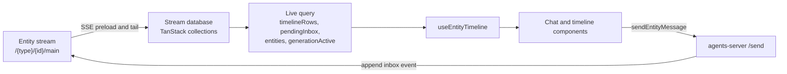
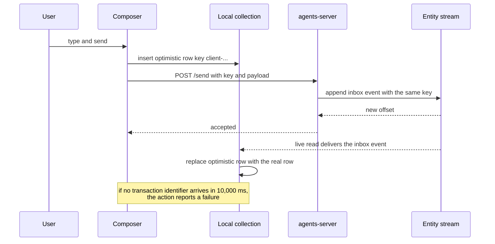

# Chat and timeline

The chat view is the default view for an entity. It turns one entity stream into a scrollable list of rows and sends user messages back to the server.

This document covers four parts:

1. The timeline query.
2. The row renderer and virtual list.
3. The composer and queue.
4. The stop and fork controls.

## From stream to rows

`useEntityTimeline` is the data source. It opens the entity stream, builds a live query, and returns eight values:

- `timelineRows`: the ordered history.
- `pendingInbox`: messages that are queued but not processed.
- `entities`: child and source entities declared by manifests.
- `generationActive`: true when a run has status `started`.
- `db`: the stream database handle, or null before the connection opens.
- `loading`: true while the connection opens.
- `error`: the connection error message, or null.
- `commentsEnabled`: true when the entity type declares the comments collection.

Source: `packages/agents-server-ui/src/hooks/useEntityTimeline.ts:53-74`.

The connection effect runs on each change of `baseUrl` or `entityUrl`:

```ts
// packages/agents-server-ui/src/hooks/useEntityTimeline.ts:92
connectEntityStream({ baseUrl, entityUrl })
  .then((result) => {
    if (cancelled) {
      result.close()
      return
    }
    closeRef.current = result.close
    setDb(result.db)
    setLoading(false)
  })
```

If React cancels the effect before the connection is ready, the callback closes the connection at once. This prevents a connection leak when the user switches entity faster than the stream opens. Source: `packages/agents-server-ui/src/hooks/useEntityTimeline.ts:92-100`.

The hook does not read the raw stream in the component. It builds a live query over the materialized collections. The query is reactive: an append changes a collection, the query recomputes, and the component renders the new rows.



The loop closes through the server. A message send does not write to the local collections directly. It posts to the server, the server appends an event, and the same stream that fed the query returns the new row. The optimistic row bridges the gap until that append arrives.

### The timeline query

The main query comes from the runtime client:

```ts
// packages/agents-server-ui/src/hooks/useEntityTimeline.ts:125
const { data: timelineRows = [] } = useLiveQuery(
  (q) => {
    if (!db) return undefined
    return createEntityTimelineQuery(db, {
      customSources: {
        compaction: createCompactionTimelineSource(db),
        ...(includeComments && {
          comment: createCommentsTimelineSource(db),
        }),
      },
    })(q)
  },
  [db, includeComments]
)
```

`createEntityTimelineQuery` merges several stream collections into one ordered row list. The order uses `compareTimelineOrders` and a fallback constant, `TIMELINE_ORDER_FALLBACK`. Both come from the runtime client. Source: `packages/agents-server-ui/src/hooks/useEntityTimeline.ts:1-9`.

The row kinds visible in the renderer are:

- Inbox messages.
- Runs and their steps.
- Manifests.
- Comments.
- Compaction markers.
- Wake events.
- Signals.
- Errors.

### Manifests

A manifest declares a child entity or a source entity. The hook filters manifests with `isTimelineEntityManifest`. Source: `packages/agents-server-ui/src/hooks/useEntityTimeline.ts:37-51`.

```ts
// packages/agents-server-ui/src/hooks/useEntityTimeline.ts:139
const { data: manifests = [] } = useLiveQuery(
  (q) =>
    db
      ? q
          .from({ manifest: db.collections.manifests as any })
          .orderBy(({ manifest }: any) => manifest._seq, `asc`)
      : undefined,
  [db]
)
```

The query orders manifests by the raw stream sequence number, not by the timeline order field. This keeps the declared tree in creation order.

The normalized entities list includes a `wake` field and an `observed` flag. A source entity is always `observed`. A child entity is observed only if its manifest says so. Source: `packages/agents-server-ui/src/hooks/useEntityTimeline.ts:221-243`.

### Pending inbox

The hook reads inbox rows with status `pending`:

```ts
// packages/agents-server-ui/src/hooks/useEntityTimeline.ts:148
const { data: pendingInboxRows = [] } = useLiveQuery(
  (q) =>
    db
      ? q
          .from({ inbox: db.collections.inbox as any })
          .where(({ inbox }: any) => eq(inbox.status, `pending`))
          .orderBy(
            ({ inbox }: any) =>
              coalesce(inbox._timeline_order, TIMELINE_ORDER_FALLBACK),
            `asc`
          )
          .orderBy(({ inbox }: any) =>
            coalesce(inbox._seq, Number.MAX_SAFE_INTEGER)
          )
      : undefined,
  [db]
)
```

A second sort in JavaScript refines the order:

1. If both rows have a queue `position`, compare the positions as strings.
2. A row with a position sorts before a row without one.
3. If both have a timestamp, compare the timestamps.
4. Fall back to the timeline order.

Source: `packages/agents-server-ui/src/hooks/useEntityTimeline.ts:196-214`.

The position string supports lexical comparison. It starts with a 16-digit millisecond timestamp, a colon, and a fractional index. Source: `packages/agents-server-ui/src/lib/sendMessage.ts:94-123`.

### Compaction filtering

A compaction marker appears in history only when the checkpoint is complete. A running or failed checkpoint appears in the composer indicator instead. Source: `packages/agents-server-ui/src/hooks/useEntityTimeline.ts:165-174`.

### Generation state

`generationActive` is true when any timeline row has a run with status `started`. Source: `packages/agents-server-ui/src/hooks/useEntityTimeline.ts:217-220`.

The composer uses this value to switch the send button into a stop button.

## Row rendering and virtual scrolling

`EntityTimeline` renders the list. It uses TanStack Virtual with an overscan of 6 rows. Source: `packages/agents-server-ui/src/components/EntityTimeline.tsx:1685-1702`.

Rows have estimated heights. The estimator counts characters and lines:

```ts
// packages/agents-server-ui/src/components/EntityTimeline.tsx:253
const BOTTOM_PIN_THRESHOLD = 8
const CHAT_SURFACE_GUTTER = 24
const ROW_GAP = 24
const MANIFEST_ROW_GAP = 10
const ROW_SETTLE_MS = 500
```

- `BOTTOM_PIN_THRESHOLD` is the distance in pixels from the bottom that still counts as "pinned to bottom". Source: `packages/agents-server-ui/src/components/EntityTimeline.tsx:1944`.
- The code removes `CHAT_SURFACE_GUTTER` from the content width to compute the text column. Source: `packages/agents-server-ui/src/components/EntityTimeline.tsx:1524`.
- `ROW_GAP` separates message rows.
- `MANIFEST_ROW_GAP` separates compact rows such as manifests, wakes, signals, and compactions.
- `ROW_SETTLE_MS` delays a second measurement until the row has settled. Source: `packages/agents-server-ui/src/components/EntityTimeline.tsx:1642`.

The gap selector is:

```ts
// packages/agents-server-ui/src/components/EntityTimeline.tsx:260
function timelineRowGap(
  row: RenderTimelineRow,
  nextRow?: RenderTimelineRow
): number {
  if (shouldCollapseCommentMeta(row, nextRow)) return 6
  return row.manifest || row.wake || row.signal || row.compaction
    ? MANIFEST_ROW_GAP
    : ROW_GAP
}
```

Two adjacent plain comments from the same principal collapse their metadata and use a 6-pixel gap. Source: `packages/agents-server-ui/src/components/EntityTimeline.tsx:276-284`.

### Scroll behaviour

The list keeps the user at the bottom when new rows arrive, but only if the user was already near the bottom. If the user scrolled up, the list does not jump. A change in the scroll-to-bottom signal forces a scroll to the last row. Source: `packages/agents-server-ui/src/components/EntityTimeline.tsx:1809`.

Find-in-pane scrolls a matching row to the centre. Source: `packages/agents-server-ui/src/components/EntityTimeline.tsx:1720`.

## The composer

`MessageInput` owns the text editor, attachments, slash commands, and the queue drawer. It creates actions from `sendMessage.ts`.

### Sending

`sendEntityMessage` posts to `<entityUrl>/send` with this body:

```ts
// packages/agents-server-ui/src/lib/sendMessage.ts:329
body: JSON.stringify({
  key,
  payload: effectivePayload,
  mode,
  position,
  type,
}),
```

The default mode is `queued`. Source: `packages/agents-server-ui/src/lib/sendMessage.ts:303`.

The client generates a message key:

```ts
// packages/agents-server-ui/src/lib/sendMessage.ts:67
export function createClientInboxKey(): string {
  return `client-${Date.now()}-${Math.random().toString(36).slice(2, 10)}`
}
```

The optimistic row uses a different prefix, `optimistic-`, plus the local order index. Source: `packages/agents-server-ui/src/lib/sendMessage.ts:63-65`.

### Optimistic row

The optimistic action inserts the row before the request completes:

```ts
// packages/agents-server-ui/src/lib/sendMessage.ts:384
const action = createOptimisticAction<SendMessageInput>({
  onMutate: ({ payload, type, mode, key, pendingOrderIndex, position }) => {
    const sender = from ?? getActivePrincipal()
    const now = new Date().toISOString()
    const message: OptimisticInboxMessage = {
      key,
      _timeline_order: createPendingTimelineOrder(pendingOrderIndex),
      from: sender,
      from_principal: sender,
      payload,
      ...(type ? { message_type: type } : {}),
      timestamp: now,
      mode,
      status:
        mode === `queued` || mode === `paused` ? `pending` : `processed`,
      ...(position ? { position } : {}),
```

The local order starts just below `Number.MAX_SAFE_INTEGER`:

```ts
// packages/agents-server-ui/src/lib/sendMessage.ts:14
const OPTIMISTIC_INBOX_ORDER_START = Number.MAX_SAFE_INTEGER - 1_000_000
```

This puts a pending local row after every real stream row. When the real event with the same key arrives, the local row is replaced. Source: `packages/agents-server-ui/src/lib/sendMessage.ts:12-16`.

After the server accepts the message, the action waits for the transaction identifier with a 10,000 millisecond timeout. Source: `packages/agents-server-ui/src/lib/sendMessage.ts:442`.



The key is the join between the two paths. The optimistic row and the real event carry the same client key. The materializer can therefore replace one with the other instead of showing a duplicate. The local order value puts the optimistic row after every real row until that replacement happens.

### Attachments

An attachment upload is a multipart request to `<entityUrl>/attachments`:

```ts
// packages/agents-server-ui/src/lib/sendMessage.ts:224
const form = new FormData()
const addField = isNativeFileDescriptor(file)
  ? form.append.bind(form)
  : form.set.bind(form)
addField(`id`, id)
addField(`file`, file as unknown as Blob, file.name || `attachment`)
addField(`subject`, JSON.stringify({ type: `inbox`, key }))
addField(`role`, `input`)
if (file.type) {
  addField(`mimeType`, file.type)
}
if (file.name) {
  addField(`filename`, file.name)
}
```

The code supports two file shapes:

- A browser `File` object.
- A React Native descriptor `{ uri, name, type }`.

React Native `FormData` has `append` but not `set`. The code binds the correct method for each case. Source: `packages/agents-server-ui/src/lib/sendMessage.ts:32-39` and `:225-231`.

If any upload fails, the code deletes the attachments that already succeeded. Source: `packages/agents-server-ui/src/lib/sendMessage.ts:264-267`.

After a successful upload, the message send waits for both the attachment transactions and the message transaction. Source: `packages/agents-server-ui/src/lib/sendMessage.ts:419-423`.

### Queue editing

The composer drawer can edit a pending message, delete it, steer it, or reorder it. These actions are optimistic updates against the local `inbox` collection. The update action starts at `:505`, delete at `:568`, and steer at `:596`; reorder goes through the `position` field of the update action. Source: `packages/agents-server-ui/src/lib/sendMessage.ts:505-630`.

Reordering uses `createQueuePositionBetween`. It uses the `fractional-indexing` package to generate a string between two neighbours. When a previous neighbour exists, the function keeps its timestamp; otherwise it uses the next timestamp. It subtracts 1 millisecond from the next timestamp only when the next position has no fractional index. Source: `packages/agents-server-ui/src/lib/sendMessage.ts:125-160`.

## Stop, steer, and fork

### Stop

The stop button sends `SIGINT`, not `SIGKILL`:

```ts
// packages/agents-server-ui/src/components/views/ChatView.tsx:370
const stopGeneration = useCallback(() => {
  if (!canSignal) return
  if (!entityUrl || !signalEntity || !generationActive || stopPending) return
  setStopPending(true)
  const tx = signalEntity({
    entityUrl,
    signal: `SIGINT`,
    reason: `Stopped from chat UI`,
  })
```

The `stopPending` flag prevents a second request while the first is in flight. It resets when `generationActive` becomes false or when the entity changes. Source: `packages/agents-server-ui/src/components/views/ChatView.tsx:360-382`.

A hard stop uses two signals. `SIGSTOP` halts the process at once. `SIGINT` then interrupts the current run. The keyboard path in `RootShell` does this. Source: `packages/agents-server-ui/src/router.tsx:240-260`.

### Fork

A fork creates a new entity from a point in the stream. `useForkFromHere` builds a button for each run. It calls `forkEntity` with an event pointer. Source: `packages/agents-server-ui/src/hooks/useForkFromHere.ts` and `packages/agents-server-ui/src/components/views/ChatView.tsx:384-389`.

The pointer uses `offset` and `subOffset` in TypeScript, and the request body uses `sub_offset`. Source: `packages/agents-server-ui/src/lib/ElectricAgentsProvider.tsx:807-815`.

## Permissions in the view

The chat view needs three permissions:

```ts
// packages/agents-server-ui/src/components/views/ChatView.tsx:30
const CHAT_VIEW_PERMISSIONS: ReadonlyArray<EntityPermission> = [
  `write`,
  `signal`,
  `fork`,
]
```

- Without `write`, the composer shows the placeholder `Read-only`. Source: `packages/agents-server-ui/src/components/views/ChatView.tsx:418-420`.
- Without `signal`, the code disables the stop control. Source: `packages/agents-server-ui/src/components/views/ChatView.tsx:419`.
- Without `fork`, the fork controls appear disabled with the label `Fork permission required` (`packages/agents-server-ui/src/hooks/useForkFromHere.ts:46-60`; `packages/agents-server-ui/src/components/AgentResponse.tsx:808-840`).

The server enforces the permission. The view only hides controls.

## Spawning state

While an entity is spawning, the chat does not connect the stream. `connectUrl` is null. Source: `packages/agents-server-ui/src/components/views/ChatView.tsx:52-55`.

This avoids a 404 retry loop against an entity whose stream does not exist yet. The timeline shows an empty state and the code disables the composer until the entity row becomes active.

## Aha: pending messages are a projection, not a second store

**Aha:** The composer does not keep its own message list. It inserts the pending row into the same `inbox` collection that the stream fills. The runtime timeline query defaults to `inboxMode: 'processed'`. That mode admits a pending row only when the row is not synced and its order starts with `~pending:`. Source: `packages/agents-runtime/src/entity-timeline.ts:1393-1407`. The optimistic row uses exactly that prefix: `createPendingTimelineOrder` returns `~pending:<12-digit index>`. Source: `packages/agents-runtime/src/entity-timeline.ts:552-554`. One collection therefore serves the optimistic row, the queue drawer, and the confirmed history. The replacement works because the client key is sent to the server and echoed in the stream event. A synced but still pending message leaves the main timeline and appears only in the queue drawer.

## Related documents

- [Data and streams](02-data-and-streams.md) explains the stream connection and its cache.
- [Entity management](04-entity-management.md) explains the entity row and status controls.
- [How the runtime sets up a stream](../04-how-the-runtime-sets-up-a-stream.md) explains the event types on the server side.
- [Overview](00-overview.md) gives the package summary.
