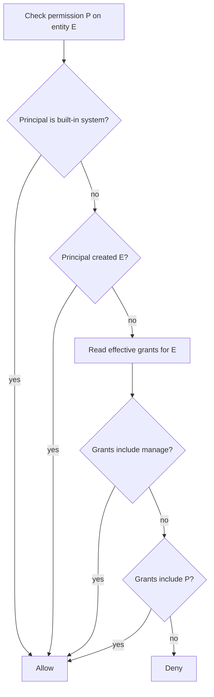

# Settings and permissions

Settings has eight categories. Four work in the browser. Four work only in the desktop application. This document explains each page and then explains the entity permission model that the share dialog edits.

## The settings shell

The settings routes use the same shell as the workspace. The left column changes from the session sidebar to `SettingsSidebar`, and the right column renders the category page. Source: `packages/agents-server-ui/src/router.tsx:395-430`.

```mermaid
flowchart TB
    S[/settings] -->|redirect| G[/settings/general]
    G --> Gen[General]
    G --> A[Account desktop only]
    G --> Srv[Servers]
    G --> C[Credentials]
    G --> CL[Command Line desktop only]
    G --> App[Appearance]
    G --> LR[Local Runtime desktop only]
    G --> M[MCP Servers desktop only]
```

The category identifiers are fixed:

```ts
// packages/agents-server-ui/src/components/settings/SettingsSidebar.tsx:19
export type SettingsCategoryId =
  | `general`
  | `account`
  | `servers`
  | `credentials`
  | `command-line`
  | `appearance`
  | `local-runtime`
  | `mcp-servers`
```

The router uses the same list. Source: `packages/agents-server-ui/src/router.tsx:62-71`.

`/settings` itself has no screen. Its `beforeLoad` throws a redirect to `/settings/general`. Source: `packages/agents-server-ui/src/router.tsx:534-544`.

### Desktop-only categories

Each category carries a `visible` flag. The desktop check is `Boolean(window.electronAPI)`. Source: `packages/agents-server-ui/src/components/settings/SettingsSidebar.tsx:59`.

```tsx
// packages/agents-server-ui/src/components/settings/SettingsSidebar.tsx:89
{
  id: `account`,
  label: `Account`,
  icon: <Icon icon={UserCircle} size={2} />,
  // Sign-in only makes sense in the desktop build; the web build
  // doesn't have IPC to safely hold the resulting JWT.
  visible: isDesktop,
},
```

The four desktop-only categories are Account, Command Line, Local Runtime, and MCP Servers. General, Servers, Credentials, and Appearance are always visible.

Credentials is visible in the browser, but its provider-key controls are desktop-only. The page shows an explanation instead of the form when no desktop bridge exists.

## General

`GeneralPage` contains:

- The launch-at-login switch, when the platform supports it.
- The "prevent application suspension" switch.
- A clear-all-local-data action with a confirmation dialog.

Source: `packages/agents-server-ui/src/components/settings/pages/GeneralPage.tsx:44-110`.

The clear action calls the desktop bridge:

```ts
// packages/agents-server-ui/src/components/settings/pages/GeneralPage.tsx:93
await clearAllLocalData()
```

The call removes local data on the desktop, such as saved settings and runtime files. The page does not name every removed item, so this document does not either.

The launch-at-login row appears only when `launchAtLogin.supported` is true. Source: `packages/agents-server-ui/src/components/settings/pages/GeneralPage.tsx:173`. The platform support comes from the desktop main process.

## Account

`AccountPage` handles Electric Cloud sign-in and workspaces. The servers page creates servers (`packages/agents-server-ui/src/components/settings/pages/ServersPage.tsx:88-104`). Source: `packages/agents-server-ui/src/components/settings/pages/AccountPage.tsx`.

The package README states that Electric Cloud has shut down and that cloud sign-in and discovery no longer work. Source: `packages/agents-server-ui/README.md:3`. The page remains in the code. Treat its cloud actions as historical.

## Servers

`ServersPage` lists every available server. An entry can come from four sources:

- A saved self-hosted server.
- A server found by local network discovery.
- An Electric Cloud server.
- The current browser server.

Source: `packages/agents-server-ui/src/components/settings/pages/ServersPage.tsx:80-118`.

A server row offers these actions:

| Action | Effect |
|--------|--------|
| Select | Make the server active. |
| Connect | Start the connection, with an optional local runtime. |
| Disconnect | Stop the connection. |
| Toggle local runtime | Enable or disable the bundled runtime for that server. |
| Forget | Remove the saved server after confirmation. |

Source: `packages/agents-server-ui/src/components/settings/pages/ServersPage.tsx:150-180`.

The connection status has six values: `connected`, `connecting`, `reconnecting`, `offline`, `error`, and `disconnected`. Source: `packages/agents-server-ui/src/components/settings/pages/ServersPage.tsx:52-62`.

The cloud path calls `prepareCloudAgentServerConnection` and then adds a server with `source: 'electric-cloud'`. Source: `packages/agents-server-ui/src/components/settings/pages/ServersPage.tsx:88-104`. This path is non-functional after the cloud shutdown.

### Discovery

The desktop main process scans localhost ports. The renderer shows a discovered server as a one-click suggestion. Source: `packages/agents-server-ui/src/lib/server-connection.ts:18-29` and `:579-583`.

The scan details belong to the desktop package.

## Credentials

`CredentialsPage` manages the keys that the local runtime uses. Source: `packages/agents-server-ui/src/components/settings/pages/CredentialsPage.tsx`.

The supported provider keys are:

- Anthropic.
- OpenAI.
- DeepSeek.
- Moonshot.
- Brave, for search.
- e2b, for remote sandboxes.

Source: `packages/agents-server-ui/src/lib/server-connection.ts:82-119`.

The page also supports Codex authentication from three sources: desktop OAuth, the Codex command-line interface, and OpenCode. Source: `packages/agents-server-ui/src/lib/server-connection.ts:121-159`.

A key change does not apply to a running runtime. The desktop state carries `credentialsRestartPending`, and the page shows a restart banner. Source: `packages/agents-server-ui/src/lib/server-connection.ts:43-49`.

The model picker reads a list of choices and an enabled set. Source: `packages/agents-server-ui/src/lib/server-connection.ts:130-141`.

Keys are stored by the main process, not in the browser. The renderer receives status values and never reads `process.env` directly. Source: `packages/agents-server-ui/src/lib/server-connection.ts:82-98`.

## Command Line

`CommandLinePage` installs and removes the `electric` command. It recognises five states:

```ts
// packages/agents-server-ui/src/components/settings/pages/CommandLinePage.tsx:24
'not-installed': { label: `Not installed`, tone: `neutral` },
managed: { label: `Managed`, tone: `success` },
manual: { label: `Self-managed`, tone: `info` },
shadowed: { label: `Shadowed`, tone: `warning` },
```

The fifth state is `broken`. Source: `packages/agents-server-ui/src/lib/server-connection.ts:202-207`.

| State | Meaning |
|-------|---------|
| `not-installed` | No `electric` command was found. |
| `managed` | The desktop application installed the command. |
| `manual` | A user-managed command exists. The desktop application does not overwrite it. |
| `shadowed` | A managed command exists, but another command appears earlier on the search path. |
| `broken` | The managed command exists but cannot run. |

Source: `packages/agents-server-ui/src/components/settings/pages/CommandLinePage.tsx:217-226`.

Uninstall is available only when `managedPath !== null`. Source: `packages/agents-server-ui/src/components/settings/pages/CommandLinePage.tsx:86-87`.

The page calls `installCli()` or `uninstallCli()` and refreshes the status. Source: `packages/agents-server-ui/src/components/settings/pages/CommandLinePage.tsx:61`.

## Appearance

`AppearancePage` selects the theme preference: system, light, or dark. The `DarkModeProvider` stores the preference. `ThemedApp` resolves it to an appearance and calls `window.electronAPI.setNativeAppearance(preference)`. Source: `packages/agents-server-ui/src/App.tsx:27-43`.

The appearance affects the desktop window chrome as well as the page.

## Local Runtime

`LocalRuntimePage` controls the bundled runtime for each server that has `localRuntimeEnabled !== false`. Source: `packages/agents-server-ui/src/components/settings/pages/LocalRuntimePage.tsx:161-167`.

The page uses the `?serverId=` search parameter to preselect a server. Source: `packages/agents-server-ui/src/components/settings/pages/LocalRuntimePage.tsx:153-154` and `:261-280`.

### Runtime health

For each runner, the page can call a health endpoint:

```ts
// packages/agents-server-ui/src/components/settings/pages/LocalRuntimePage.tsx:130
function runnerHealthEndpoint(
  baseUrl: string | null | undefined,
  runnerId: string | null | undefined
): string | null {
  if (!baseUrl || !runnerId) return null
  return appendPathToUrl(
    baseUrl,
    `/_electric/runners/${encodeURIComponent(runnerId)}/health`
  )
}
```

The page shows runner diagnostics from the `runners` collection:

- Start time.
- Stream connection state and duration.
- Reconnect count.
- Last error and last heartbeat.
- Last claim result.
- Event and claim counters.

Source: `packages/agents-server-ui/src/lib/ElectricAgentsProvider.tsx:127-146`.

### Skill directories

The runtime reads skill directories from the host file system. The page can add a directory with a native picker or remove one. Source: `packages/agents-server-ui/src/components/settings/pages/LocalRuntimePage.tsx:282-304`.

The list is saved through `saveSkillDirectories`. Source: `packages/agents-server-ui/src/lib/server-connection.ts:661-667`.

### Start, restart, and stop

The page calls the desktop bridge to start, restart, or stop the runtime. The buttons live at `packages/agents-server-ui/src/components/settings/pages/LocalRuntimePage.tsx:524-564`.

A restart applies pending credential changes and clears the banner.

## MCP Servers

`McpServersPage` shows the Model Context Protocol (MCP) server registry of the in-process `BuiltinAgentsServer`. Source: `packages/agents-server-ui/src/components/settings/pages/McpServersPage.tsx`.

The page comment states the reason it is desktop-only: the web build cannot read the registry over IPC, and remote runtimes are no longer aggregated. Source: `packages/agents-server-ui/src/components/settings/SettingsSidebar.tsx:124-127`.

The form supports adding and editing a server through `McpServerFormDialog`. Source: `packages/agents-server-ui/src/components/settings/pages/McpServerFormDialog.tsx`.

## Permissions

The user interface recognises eight entity permissions:

- `read`
- `write`
- `delete`
- `signal`
- `fork`
- `schedule`
- `spawn`
- `manage`

Source: `packages/agents-server-ui/src/lib/sharePermissions.ts:1-9`.

The source of truth is the `entity_effective_permissions` shape. Each row has an entity URL, a source entity URL, a source grant identifier, a permission, a subject kind, a subject value, and an optional expiry. Source: `packages/agents-server-ui/src/lib/ElectricAgentsProvider.tsx:188-198`.

### Evaluation

The client evaluates a permission in three steps:



The code is:

```ts
// packages/agents-server-ui/src/hooks/useEntityPermission.ts:40
return useMemo(() => {
  if (!entity) return false
  if (isBuiltInSystemPrincipal(principal)) return true
  if (isEntityCreator(entity, principal)) return true

  const permissions = new Set(grants.map((grant) => grant.permission))
  return permissions.has(permission) || permissions.has(`manage`)
}, [entity, grants, permission, principal])
```

The built-in system principals are `system:framework`, `system:auth-sync`, and `system:dev-local`. Source: `packages/agents-server-ui/src/hooks/useEntityPermission.ts:18-22`.

`manage` implies every other permission. A manage grant therefore also passes a `read`, `write`, or `signal` check.

**Important:** This evaluation runs in the browser. It controls which controls appear. It does not grant access to the server. The agents server checks the real permission on every request. A user who edits the browser state gains no server access.

### Share roles

A share dialog does not set individual permissions. It sets a role, and the role maps to a permission set:

```ts
// packages/agents-server-ui/src/lib/sharePermissions.ts:27
export const SHARE_ROLE_PERMISSIONS = {
  view: [`read`, `fork`],
  chat: [`read`, `write`, `signal`, `fork`, `schedule`, `spawn`],
  manage: [`manage`, `delete`],
} as const satisfies Record<ShareRole, ReadonlyArray<SharePermission>>
```

The dialog reads the current grants, computes the role, and writes the difference:

- It deletes grants that the new role does not include.
- It creates grants that the new role includes and the old set does not.

Source: `packages/agents-server-ui/src/components/ShareEntityDialog.tsx:293-323`.

The grant endpoints are:

- `GET <entityUrl>/grants` to load the raw grants.
- `POST <entityUrl>/grants` to create a grant.
- `DELETE <entityUrl>/grants/<id>` to remove a grant.

Source: `packages/agents-server-ui/src/components/ShareEntityDialog.tsx:266-275` and `:673-699`.

### Subjects

A grant targets one of two subject kinds:

- `principal`: one user or agent principal.
- `principal_kind`: a whole kind of principal.

The "All users" row uses `subject_kind: 'principal_kind'` and `subject_value: 'user'`. Source: `packages/agents-server-ui/src/components/ShareEntityDialog.tsx:64-72` and `:299-303`.

This is how a workspace-wide share is expressed: every principal of kind `user` receives the role.

## Aha: the interface shows intent, the server enforces truth

**Aha:** The share dialog never sends a role name. It expands the role into individual permission rows. The server stores grants, not roles. As a result, a role can change over time without a data migration, and a client can show a role only when the grant set matches one exactly. `rolePermissionsMatchGrants` performs that exact comparison. Source: `packages/agents-server-ui/src/lib/sharePermissions.ts:43-54`. A custom grant set has no role, and the dialog shows it as custom rather than guessing.

## Related documents

- [Entity management](04-entity-management.md) explains the share button and entity header.
- [Data and streams](02-data-and-streams.md) explains the permission shape.
- [Overview](00-overview.md) gives the package summary.
- [Security, tenancy, and permissions](../06-security-tenancy-and-permissions.md) explains the server side.
