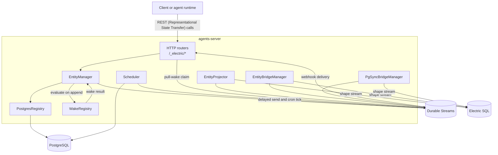
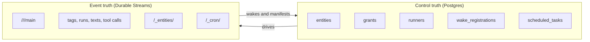
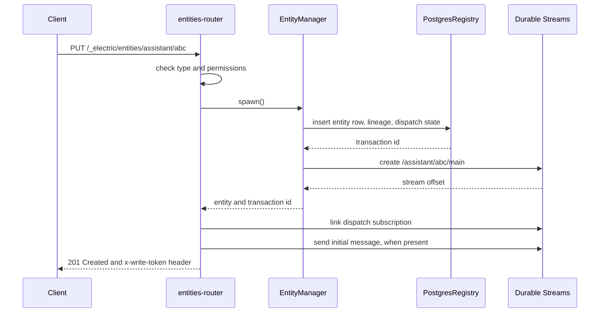

# Overview: the control plane of Electric Agents

`@electric-ax/agents-server` is the server package of the Electric Agents platform. It owns four things at the same time:

1. A PostgreSQL (Postgres) registry of entity types, entities, grants, runners, wakes, and schedules.
2. An HTTP (Hypertext Transfer Protocol) interface that creates entities, sends messages, and manages their lifecycle.
3. A proxy in front of the Durable Streams server.
4. A set of background loops that deliver wakes, fire schedules, and project entities into membership streams.

The package has 58 TypeScript source files. They total 22,905 lines. The database schema has 21 tables. The migration chain has 17 files, numbered 0000 to 0016. The package version is 0.6.4. The license is Apache-2.0. The file and line counts come from `find src -name '*.ts'` and `wc -l` at the source root on 2026-11-07. The test count is separate: `find test -name '*.test.ts'` returns 53 files.

The package name is `@electric-ax/agents-server`. The executable name is `electric-agents-server`.

## The one-sentence architecture

The server keeps the *control record* of every entity in Postgres and keeps the *event truth* in one append-only Durable Stream per entity. It connects the two with wake subscriptions and a scheduler.



The arrows show one important split. Management traffic arrives from the left. Wake matching starts when the entity manager or the append proxy decodes an event. Projection traffic arrives from Electric SQL on the right. A pull-wake runner also calls the server, and the server then calls Durable Streams on its behalf.

Electric SQL is the Postgres sync service. It serves shape streams. A shape stream is a live query result that stays current as the table changes. The three bridge components read shape streams and write the result into Durable Streams.

## Why the package exists

An agent needs more than a handler. It needs a stable identity, a durable log, a way to wake, a way to limit access, and a way to find its peers. The separate `@electric-ax/agents-runtime` package provides two things: the handler that runs one entity, and the stream materializer that turns stream events into typed collections. The `agents-server` package provides everything around them:

| Responsibility | Main code |
|----------------|-----------|
| Entity creation and lifecycle | `src/entity-manager.ts` |
| Registry and permission materialization | `src/entity-registry.ts` |
| Durable Streams access | `src/stream-client.ts` |
| Wake conditions and delivery | `src/wake-registry.ts` |
| Delayed sends and cron ticks | `src/scheduler.ts` |
| HTTP route surface | `src/routing/*.ts` |
| Membership projection | `src/entity-projector.ts`, `src/entity-bridge-manager.ts` |
| Postgres to stream mirroring | `src/pg-sync-bridge-manager.ts` |
| Boot and shutdown | `src/server.ts`, `src/standalone-runtime.ts`, `src/entrypoint-lib.ts` |

## Two kinds of state

The server separates state by purpose. This separation is the central design rule.



Postgres answers questions such as "which entities exist", "who may read this entity", and "which wake is due". The stream answers questions such as "what did the agent do", "what is in the inbox", and "which run failed". A restart can rebuild in-memory wake state from Postgres. A lost Postgres row cannot be rebuilt from the stream alone, because grants, dispatch state, and schedule rows exist only in Postgres. The creation events do not contain them.

**Aha: the server is not a message broker.** It does not store messages in Postgres. It stores *routing* in Postgres and delegates message storage to Durable Streams. That is why the server can proxy raw stream reads without copying bytes.

## The three surfaces

The package exposes three surfaces.

### 1. The management application programming interface (API)

All management routes use the prefix `/_electric`. Examples are `PUT /_electric/entities/:type/:instanceId`, `POST /_electric/entities/:type/:instanceId/send`, and `GET /_electric/runners/:id/health`. [06-http-routing.md](06-http-routing.md) describes the routers.

### 2. The stream pass-through

The server forwards any path that is not a management route to the Durable Streams server. It adds authorization for entity streams, attachment streams, and shared-state streams. The catch-all is in `src/routing/durable-streams-router.ts`.

```ts
// packages/agents-server/src/routing/durable-streams-router.ts:100-104
durableStreamsRouter.get(`/__ds/jwks.json`, webhookJwks)
durableStreamsRouter.all(`/__ds`, controlPassThrough)
durableStreamsRouter.all(`/__ds/*`, controlPassThrough)
durableStreamsRouter.post(`*`, streamAppend)
durableStreamsRouter.all(`*`, proxyPassThrough)
```

The order matters. The server serves the JavaScript Object Notation (JSON) Web Key Set (JWKS) endpoint locally. The server rewrites and forwards control-plane subscription calls. A `POST` append passes through a write-token and schema check first. All other traffic is a transparent proxy.

### 3. The background workers

The server starts five background components in a standard deployment. They run in the same Node.js process in the standalone deployment. Two of them are conditional. The projector does nothing without an Electric Uniform Resource Locator (URL). The pg-sync bridge manager only acts when `pgSync` is configured. The two membership components are alternatives: the standalone runtime uses `EntityBridgeManager`, and the multi-tenant host uses `EntityProjector`.

- `WakeRegistry` matches events to wake conditions.
- `Scheduler` claims due rows from `scheduled_tasks`.
- One membership component, either `EntityBridgeManager` or `EntityProjector`, writes membership streams.
- `PgSyncBridgeManager` mirrors Electric shapes into durable streams.
- `TagStreamOutboxDrainer` publishes tag changes without a distributed transaction.

## Boot in one view

`ElectricAgentsServer.start()` performs the steps in a fixed order. The embedded Durable Streams server starts before the database migration. The runtime starts before the HTTP listener.

```ts
// packages/agents-server/src/server.ts:213
const streamsUrl = await this.options.durableStreamsServer.start()
// ...
// packages/agents-server/src/server.ts:217-218
this.options.durableStreamsUrl =
  durableStreamTestServerBackendUrl(streamsUrl)

// packages/agents-server/src/server.ts:234-236
await runMigrations(this.options.postgresUrl)
const { db, client } = createDb(this.options.postgresUrl)
// ...
// packages/agents-server/src/server.ts:240-251
this.standaloneRuntime = await startStandaloneAgentsRuntime({
  service: this.tenantId,
  db,
  pgClient: client,
  streamClient: this.streamClient,
  electricUrl: this.options.electricUrl,
  electricSecret: this.options.electricSecret,
  pgSync: this.options.pgSync,
})
this.electricAgentsManager = this.standaloneRuntime.manager
this.entityBridgeManager = this.standaloneRuntime.entityBridgeManager
await this.electricAgentsManager.ensurePrincipalEntityType()
```

Start-up details are in [01-boot-and-configuration.md](01-boot-and-configuration.md). The full runtime wiring is in [11-operations-testing-and-conformance.md](11-operations-testing-and-conformance.md).

## A request in one view

A spawn request shows the control path and the data path together.



The dispatch subscription connects the entity stream to a runner wake stream or to a webhook target. The router writes it, because the router resolves the dispatch policy. If the request has an initial message and a dispatch target, the router links the subscription before it sends the message. Otherwise the link runs after the send. See [09-runners-and-sandboxes.md](09-runners-and-sandboxes.md).

The stream creation can fail with an ordinary error. The manager then deletes the stream it created and deletes the entity row. It also unregisters the wake when the request declared one. A duplicate entity or a stream conflict is different. The code skips all cleanup, because it assumes the other spawn owns both the row and the stream. That assumption is not guaranteed when only one of the two resources conflicts. The rollback path is in [02-entity-manager.md](02-entity-manager.md).

## Package layout

| Path | Purpose |
|------|---------|
| `src/server.ts` | Public server class, lifecycle, request handling |
| `src/entrypoint.ts`, `src/entrypoint-lib.ts` | Executable entry, environment variables |
| `src/standalone-runtime.ts` | Wires the runtime for a single-tenant process |
| `src/host.ts` | Multi-tenant host for embedding |
| `src/entity-manager.ts` | Spawn, send, fork, signals, manifests, attachments |
| `src/entity-registry.ts` | All Postgres reads and writes |
| `src/db/schema.ts`, `drizzle/*.sql` | Drizzle schema and migrations |
| `src/stream-client.ts` | HTTP client for Durable Streams |
| `src/wake-registry.ts`, `src/scheduler.ts` | Wake delivery |
| `src/entity-projector.ts`, `src/entity-bridge-manager.ts` | Membership streams |
| `src/pg-sync-bridge-manager.ts` | Postgres change mirroring |
| `src/routing/` | Every HTTP router |
| `test/` | 53 test files, including the conformance suite |

```ts
// packages/agents-server/src/index.ts:1-8
export { createDb, runMigrations } from './db/index.js'
export type { DrizzleDB, PgClient } from './db/index.js'
export { AgentsHost } from './host.js'
export type {
  AgentsHostOptions,
  AgentsHostTenantConfig,
  AgentsHostTenantRuntime,
} from './host.js'
```

The package index exports `AgentsHost` and the low-level helpers. `ElectricAgentsServer` is not exported from the index. It is the class in `src/server.ts` that the executable and the tests construct. The host lets one process manage several tenants.

## How to read this deep dive

| If you want to know | Read |
|---------------------|------|
| Which environment variable sets which value | [01-boot-and-configuration.md](01-boot-and-configuration.md) |
| How a spawn or a send works, step by step | [02-entity-manager.md](02-entity-manager.md) |
| What each database table stores | [03-entity-registry-and-postgres.md](03-entity-registry-and-postgres.md) |
| How the stream client calls the protocol | [04-stream-layout-and-stream-client.md](04-stream-layout-and-stream-client.md) |
| Why a wake fired, or why it did not | [05-wake-registry-and-scheduler.md](05-wake-registry-and-scheduler.md) |
| Which route exists and what it checks | [06-http-routing.md](06-http-routing.md) |
| How `/_entities/<ref>` stays current | [07-entity-projector.md](07-entity-projector.md) |
| Who may do what | [08-tenancy-permissions-and-principals.md](08-tenancy-permissions-and-principals.md) |
| How runners claim work and sandboxes attach | [09-runners-and-sandboxes.md](09-runners-and-sandboxes.md) |
| How external data becomes stream events | [10-pg-sync-and-bridges.md](10-pg-sync-and-bridges.md) |
| How to run, recover, and test it | [11-operations-testing-and-conformance.md](11-operations-testing-and-conformance.md) |

Return to the [parent exploration index](../README.md).

## Key insight

The package is a **state reconciler**, not a request handler. Each HTTP request makes a small control change. Background loops then converge the streams, the wakes, and the projections. This is why the ordering rules (entity row before stream, dispatch subscription before the first message when a target exists) appear in many places. A reconciler must always leave a state from which the next pass can recover.
