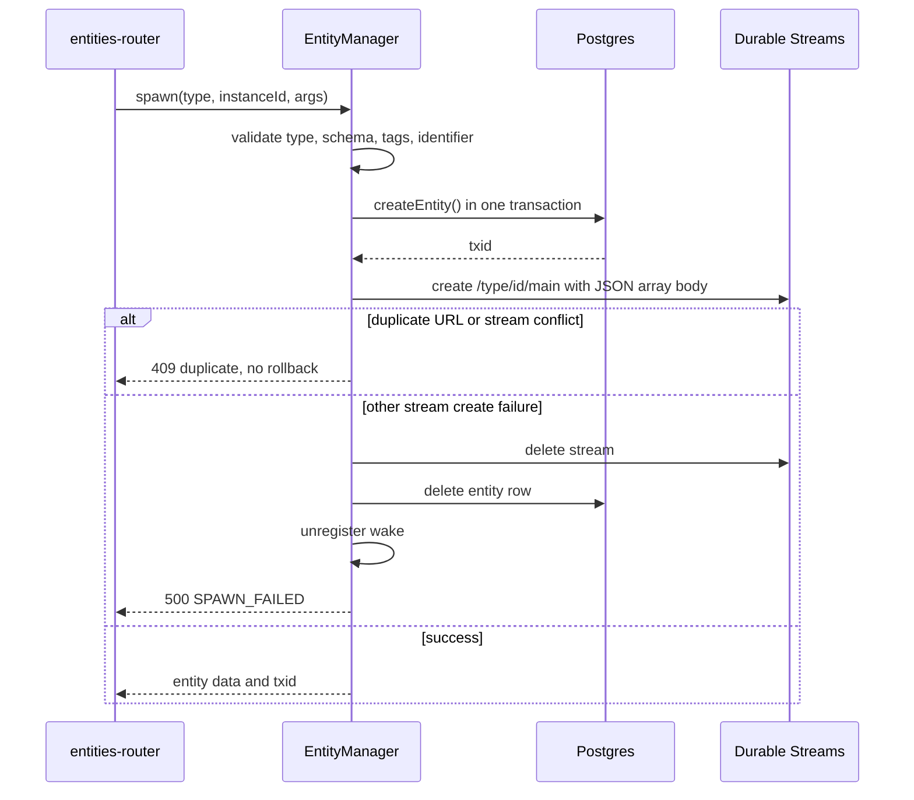
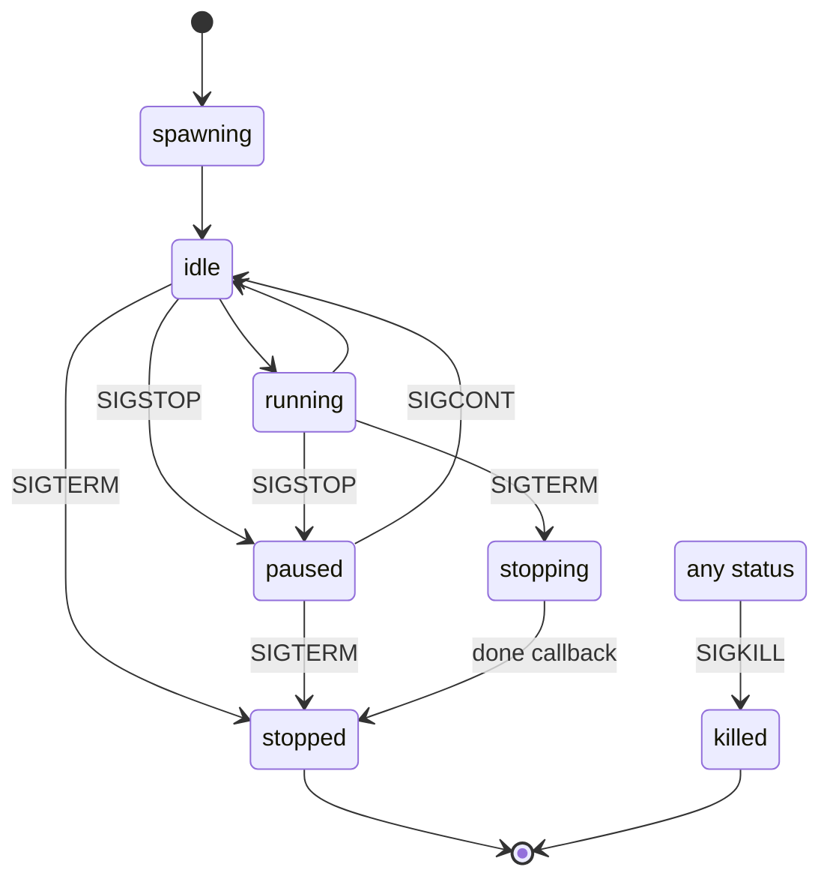

# Entity manager

`src/entity-manager.ts` is the largest source file in the package. It has 4,122 lines. It holds all entity operations that need both Postgres and Durable Streams:

- create an entity (spawn)
- copy a subtree (fork)
- send an inbox message
- write an externally writable collection
- store an attachment
- change a tag
- register a schedule
- send a signal or kill an entity
- validate an append against the entity schemas

The class is `EntityManager`. It receives six collaborators in its constructor: a `PostgresRegistry`, a `StreamClient`, a `SchemaValidator`, a `Scheduler`, an `EntityBridgeCoordinator`, and a `WakeRegistry`. It also receives a write-token validator callback.

Three terms appear early and often:

- A *principal* is the caller identity. The four kinds are `user`, `agent`, `service`, and `system`.
- A *change event* is one JSON (JavaScript Object Notation) object with a `type`, a `key`, a `value`, and optional `headers`. It is the unit that the stream stores.
- *Stream state* is the result of applying every change event of a stream in order. A read of the stream returns the events, not this state. A runtime materializes the state.

A *dispatch policy* is the routing rule for the entity. It holds a list of targets, and each target is a webhook or a runner. A *sandbox selection* is the container profile that the entity asks a runner to use.

## The spawn queue

Entity creation writes to Postgres and to Durable Streams. The two systems cannot share a transaction. The manager therefore serializes the *persistence* part of spawn through a queue.

```ts
// packages/agents-server/src/entity-manager.ts:411-418
const spawnConcurrency =
  opts.spawnConcurrency ??
  Number(process.env.ELECTRIC_AGENTS_SPAWN_CONCURRENCY ?? 16)
this.spawnPersistQueue = fastq.promise<
  unknown,
  SpawnPersistJob,
  SpawnPersistResult
>(async (job) => job(), spawnConcurrency)
```

`fastq` is a small promise queue. The concurrency default is 16. The queue limits parallel database inserts and stream creates. It does not limit schema validation or permission checks, which happen before the queue.

## Spawn, step by step

The public method is `spawn()`. The main body is `spawnInner()` at line 636. It performs these steps:

| Step | Check or action | Failure |
|------|-----------------|---------|
| 1 | Reject an entity type name that starts with `_`; the resulting URL (Uniform Resource Locator) begins `/_` | 400 |
| 2 | Look up the entity type | 404 |
| 3 | Validate `args` against `creation_schema` | 422 |
| 4 | Validate tags | 400 |
| 5 | Compute the instance identifier and the write token | 400 when the instance identifier contains `/` |
| 6 | Reject a duplicate entity URL | 409 |
| 7 | Look up the parent, if any | as needed |
| 8 | Resolve the dispatch policy | 400 when the request supplies an invalid policy |
| 9 | Resolve the sandbox selection | 400 |
| 10 | Build the entity row | none |
| 11 | Register the wake, if the request has one | none |
| 12 | Build the initial events | none |
| 13 | Insert the entity row, then create the stream | rollback |
| 14 | Return the entity data and the transaction identifier | none |

Step 5 is important. The caller can supply `instance_id`. The server rejects an identifier that contains a slash. Otherwise it uses `randomUUID()`. It also mints a `write_token` with `randomUUID()`. The token is the fallback credential for a manager that has no custom validator. The standalone runtime and `AgentsHost` install a claim-token validator, so their append route never accepts this row token. See [08-tenancy-permissions-and-principals.md](08-tenancy-permissions-and-principals.md).

Step 11 is a **wake registration**, not the dispatch subscription. It records the `req.wake` subscriber and source pair in `wake_registrations`. The dispatch subscription that connects the entity stream to a runner wake stream is created later by `entities-router`, after `spawn()` returns. If the request carries an initial message and a dispatch target exists, the router links that subscription before the send. Without that order, a fast append could reach the stream before the subscription includes it. If there is no initial message or no target, the link runs after the send or after creation. The two objects have different jobs: the wake registration decides *which events matter*, and the dispatch subscription decides *where those events go*. See [05-wake-registry-and-scheduler.md](05-wake-registry-and-scheduler.md) and [09-runners-and-sandboxes.md](09-runners-and-sandboxes.md).

The entity URL is `/{type}/{instanceId}`. The entity type `principal` is special. It is built in, it holds the identity of one principal, and its URL comes from `principalUrl(instanceId)`. That function returns `/principal/<percent-encoded kind:id>`, for example `/principal/agent%3Aworker-1` (`packages/agents-server/src/principal.ts:32`). The main stream path is `${entityURL}/main`.

### The initial events

The stream starts with at least one event. The first event is always `entity-created`:

```ts
// packages/agents-server/src/entity-manager.ts:788-800
const createdEvent = entityStateSchema.entityCreated.insert({
  key: `entity-created`,
  value: {
    entity_type: typeName,
    timestamp: new Date().toISOString(),
    args: req.args ?? {},
    ...(req.parent ? { parent_url: req.parent } : {}),
  },
} as any)

const initialEvents: Array<Record<string, unknown>> = [
  createdEvent as Record<string, unknown>,
]
```

Two optional groups follow it:

- One `slashCommands` insert per static slash command on the type. The key is the command name. The source is `static`.
- One `inbox` insert when `initialMessage` is present. The key is `msg-in-<milliseconds>-<random suffix>`. The sender is `created_by`, then the parent, then the literal `spawn`.

### The JSON body wrapping

The stream server works in JSON (JavaScript Object Notation) mode. In this mode, the server flattens one level of array. A create request does not wrap the body. So the manager wraps the events by hand:

```ts
// packages/agents-server/src/entity-manager.ts:829-831
// JSON-mode streams: server flattens one level. Append auto-wraps the
// body in [...] but create does not, so we wrap it ourselves.
const initialBody = `[${initialEvents.map((e) => JSON.stringify(e)).join(`,`)}]`
```

**Aha: the array brackets are load-bearing.** Without them, the server stores one JSON value that contains several events. With them, the server stores one message per event. A reader then applies each change event to the stream state, which means the materialized view after all events up to that point.

### The ordering rule

The entity row must exist before the stream. The reason is a race on the handler side, not a subscription created by this call. A subscription that already covers the new stream path can deliver a webhook as soon as the stream create lands. The injected webhook source can do the same. That handler looks up the entity by stream path. If the row is missing, the handler cannot find the entity.

```ts
// packages/agents-server/src/entity-manager.ts:836-863
const [mainStreamResult, entityResult] = await this.spawnPersistQueue.push(
  async () => {
    // Create entity first so it's visible in the DB before stream
    // creation can trigger webhooks that look up the entity.
    let entityTxid: number
    try {
      entityTxid = await withSpan(`db.createEntity`, () =>
        this.registry.createEntity(entityData)
      )
    } catch (err) {
      return [
        { status: `fulfilled`, value: undefined },
        { status: `rejected`, reason: err },
      ] as SpawnPersistResult
    }

    const [mainStreamResult] = await Promise.allSettled([
      this.streamClient.create(mainPath, {
        contentType,
        body: initialBody,
      }),
    ])

    return [
      mainStreamResult,
      { status: `fulfilled`, value: entityTxid },
    ] as SpawnPersistResult
  }
)
```

`createEntity` is one Postgres transaction. It runs five statements. It inserts the entity row, the dispatch state row, and the self lineage row with depth 0. When the entity has a parent, it also copies the parent's ancestor lineage rows with depth increased by one. Finally, it materializes the `descendants` grants that now reach the new entity into `entity_effective_permissions`. It returns `pg_current_xact_id()::xid::text` as the transaction identifier. See [03-entity-registry-and-postgres.md](03-entity-registry-and-postgres.md).

### Rollback

The rollback logic has one special case. Two spawns can compete for the same entity URL at the same time. The Postgres unique constraint lets only one entity row insert succeed, so the other spawn gets `EntityAlreadyExistsError`. The stream create can also collide: the stream server returns HTTP (Hypertext Transfer Protocol) status 409, or an error whose `code` is `CONFLICT_SEQ`. The first spawn to complete is the *winner*. The second spawn is the *loser*. A duplicate is not a failure of the winner. The loser must not delete the winner's row or stream.

`CONFLICT_SEQ` is an error code from the Durable Streams server. This package does not define it. The manager treats both forms the same way: as proof that another create holds the resource.

The assumption behind the skip is not always true. A duplicate row and a successful stream create can happen together, for example when an earlier spawn wrote the row but its stream create failed. In that case the loser leaves a stream that no row points to. The reverse is also possible. The code does not test which resource actually belongs to the other spawn. It only sees the error class.

```ts
// packages/agents-server/src/entity-manager.ts:882-902
const rollbacks: Array<Promise<unknown>> = []
// On duplicate, the winning spawn owns both the stream and the row —
// don't roll back either. For any other failure, clean up what succeeded.
if (!isDuplicate && !isStreamConflict) {
  if (mainStreamResult.status === `fulfilled`) {
    rollbacks.push(this.streamClient.delete(mainPath))
  }
  if (entityResult.status === `fulfilled`) {
    rollbacks.push(this.registry.deleteEntity(entityURL))
  }
  if (req.wake) {
    rollbacks.push(
      this.wakeRegistry.unregisterBySubscriberAndSource(
        req.wake.subscriberUrl,
        entityURL,
        this.tenantId
      )
    )
  }
  await Promise.allSettled(rollbacks)
}
```

Both duplicate cases then produce `ErrCodeDuplicateURL` with status 409. Any other rejected value that is an `Error` is rethrown unchanged. A non-`Error` rejected value becomes status 500 with code `SPAWN_FAILED`.



## Fork

`forkSubtree()` at line 946 copies an entity subtree. It is not a shallow copy. It copies:

- the entity rows and their lineage
- the manifests, child statuses, replay watermarks, and shared-state links
- the stream contents, using Durable Streams fork
- the wake registrations
- the permission grants that the caller asks for

The method waits for the subtree to become idle before it forks. The defaults are `DEFAULT_FORK_WAIT_TIMEOUT_MS` = 120,000 ms and `DEFAULT_FORK_WAIT_POLL_MS` = 250 ms. The caller can override both with `waitTimeoutMs` and `waitPollMs` in `ForkSubtreeOptions`. A fork failure code `FORK_WAIT_TIMEOUT` reports the timeout.

While a fork is in progress, the manager holds a fork lock on the source subtree. The lock is three in-memory `Map` objects on the manager instance: one for write-locked entities, one for write-locked stream paths, and one for work-locked entities. Writes to a locked entity receive `409 FORK_IN_PROGRESS`, and the stream append router checks the same lock through `isForkWriteLockedEntity` and `isForkWriteLockedStream` in `src/routing/stream-append.ts:109` and `src/routing/stream-append.ts:136`. The lock does not survive a restart, and it does not travel between processes. Two servers that share the Postgres database do not see each other's fork locks. The lock only protects the process that runs the fork.

The fork operation remaps identifiers. It builds new URLs from the caller's target type or identifier. It then creates the new streams with fork headers:

- `Stream-Forked-From` names the source stream.
- `Stream-Fork-Offset` selects the point to copy from.
- `Stream-Fork-Sub-Offset` selects the subscription starting point when it is above zero.

The mechanics of those headers are in [04-stream-layout-and-stream-client.md](04-stream-layout-and-stream-client.md).

## Send

`send()` at line 2362 appends one `inbox` change event to the entity main stream. The request validation (`validateSendRequest`) checks the sender identity, the entity status, and the message shape.

The value has these fields:

| Field | Source | Default |
|-------|--------|---------|
| `from` | `from_principal`, then `from` | none |
| `payload` | request | none |
| `timestamp` | server clock | now |
| `mode` | request | `immediate`; the other values are `queued`, `paused`, and `steer` |
| `status` | mode | `processed` for `immediate` and `steer`, `pending` for `queued` and `paused` |
| `from_principal` | request | omitted |
| `from_agent` | request | omitted |
| `message_type` | request `type` | omitted |
| `position` | request, or `createInitialQueuePosition` | generated for queued and paused |
| `processed_at` | server clock | now for `immediate` and `steer` |

The event carries a transaction identifier in its headers. This `txid` is a random Universally Unique Identifier (UUID) from `crypto.randomUUID()`. It is not the Postgres transaction identifier that `createEntity` returns. The two values share a name and have different sources.

```ts
// packages/agents-server/src/entity-manager.ts:2414-2443
const txid = crypto.randomUUID()
const envelope = entityStateSchema.inbox.insert({
  key,
  value,
  headers: { txid },
} as any)

const encoded = this.encodeChangeEvent(envelope as Record<string, unknown>)
try {
  if (opts?.producerId) {
    await this.streamClient.appendIdempotent(entity.streams.main, encoded, {
      producerId: opts.producerId,
    })
    return { txid }
  }

  await this.streamClient.append(entity.streams.main, encoded)
  if (entity.type === `principal` && req.type === `update_identity`) {
    const identity = (req.payload as { identity?: unknown })?.identity
    await this.streamClient.append(
      entity.streams.main,
      this.encodeChangeEvent({
        type: `identity`,
        key: `self`,
        value: identity,
        headers: { txid },
      })
    )
  }
  return { txid }
```

The two branches differ. With a producer identifier, the send uses the idempotent append and returns at once. Without one, the send uses the plain append. Only the plain branch also writes the `identity` event for a principal `update_identity` message.

Four behaviours are worth noting:

1. A send to a `paused` entity changes the status to `idle`, unless the message mode is also `paused`. The send calls `onEntityChanged` and then appends the inbox event. The wake does not come from the status change: it comes from the pull-wake subscription on the entity main stream, which the appended inbox event satisfies. The runner then reads an entity that no longer blocks work. A send whose mode is `paused` leaves the entity paused and the message pending. The send never writes a separate wake stream. See [09-runners-and-sandboxes.md](09-runners-and-sandboxes.md).
2. A scheduled send passes `producerId`, so a retry does not duplicate the message. Idempotent append is described in [04-stream-layout-and-stream-client.md](04-stream-layout-and-stream-client.md).
3. A send to a principal entity of type `update_identity` also appends a second `identity` event, but only on the non-idempotent branch. The identity projection can then read the current identity without scanning all inbox messages. The two appends are separate, so they are not atomic. If the second append fails, the inbox message is durable but the identity event is not. The idempotent branch returns before the second append, so a scheduled `update_identity` send never writes an identity event. The identity state then comes only from the inbox replay.
4. A closed stream produces `409 NOT_RUNNING`. The manager maps the low-level closed-stream error to a stable API (Application Programming Interface) error.

## Write collection

`writeCollection()` writes to a collection that the entity type declares as *externally writable*. This is how a user interface (UI) adds a comment, a rating, or another domain row without impersonating the agent.

The method enforces four rules:

1. The collection must exist in `externally_writable_collections`. Otherwise the result is 403.
2. The operation must be in the configured list. The default list is `[insert]`.
3. The entity status must accept normal writes. `rejectsNormalWrites` returns true for `stopping`, `stopped`, and `killed`, so those three states return `409 NOT_RUNNING`. The definition is at `packages/agents-server/src/electric-agents-types.ts:361-363`.
4. The fork lock must be clear.

The event type comes from the collection configuration. The headers carry the operation, the timestamp, and the principal. The key is the caller's key, or `${collection}-${randomUUID()}`.

The event then passes `validateWriteEvent` before the append. The route returns 201 for an insert and 200 for any other operation.

## Attachments

An attachment is a separate stream at `/{type}/{instanceId}/attachments/{attachmentId}`. The regular expression in `isAttachmentStreamPath` enforces that shape.

`createAttachment()` performs these steps:

1. Validate the attachment identifier.
2. Read the body and enforce the size limit. The default is 25 mebibytes. `ELECTRIC_AGENTS_MAX_ATTACHMENT_BYTES` can lower or raise it.
3. Compute the Secure Hash Algorithm 256-bit (SHA-256) digest.
4. Create the attachment stream and close it. The body cannot change after creation.
5. Write a manifest entry that points to the attachment.
6. On failure, delete the stream.

The subject of an attachment can be an inbox message, a run, a text block, a tool call, or a context object. `getAttachment()` returns metadata. `readAttachment()` returns the bytes. `deleteAttachment()` removes the manifest entry and the stream.

## Tags

Tags are key-value metadata with an index. The registry stores two forms: the `tags` JSON object and the `tags_index` text array. One transaction updates both forms and inserts an outbox row. The array has a GIN (Generalized Inverted Index) index.

`setTag()` and `deleteTag()` update Postgres in that transaction and then notify the entity bridge manager. They do not append to the entity stream directly. `TagStreamOutboxDrainer` publishes the outbox row later with a per-row producer identity. That design is in [10-pg-sync-and-bridges.md](10-pg-sync-and-bridges.md).

## Schedules

Two schedule kinds exist.

### Cron schedules

`upsertCronSchedule()` writes a manifest entry with key `schedule:${id}` and registers a wake on the cron stream. The cron stream path encodes the expression and the timezone. `getOrCreateCronStream()` ensures the stream exists and seeds the first tick.

### Future sends

`upsertFutureSendSchedule()` stores a manifest entry and calls `scheduler.syncManifestDelayedSend`. The producer identifier is `future-send-...`. The scheduler writes the task row in a transaction. It completes any previous task for the same manifest key, then inserts the new one.

`deleteSchedule()` removes the manifest entry, unregisters the wake, and cancels the pending task.

## Signals and kill

A signal is a state change on the server plus an event on the stream. The server decides the new state from a fixed table.



The open-source server never writes `spawning`. `entityData` sets `status: idle` before the insert (`packages/agents-server/src/entity-manager.ts:748-750`). The status appears in the type and in the database constraint, but no code sets it.

The handler is `serverHandlingForSignal()` at `packages/agents-server/src/entity-manager.ts:3610`. Key rules:

- `SIGKILL` always produces `killed` and unregisters wakes.
- `SIGTERM` produces `stopped` from `idle` or `paused`, and `stopping` from `running`.
- `SIGSTOP` produces `paused` from `idle` or `running`.
- `SIGCONT` produces `idle` from `paused`.
- After the `SIGKILL` and `SIGTERM` checks, a paused entity ignores every remaining signal except `SIGCONT`. The order of the checks makes `SIGTERM` an exception to the paused rule.
- Every other state and signal pair is ignored: the status does not change. A `stopped` or `killed` entity rejects the request with 409 before the handler runs, so no event is appended. For the ignored pairs that the handler does process (`spawning` and `stopping` with `SIGSTOP` or `SIGTERM`), the event has `status: unhandled` and no `outcome` field. Only a `paused` entity's ignored signal sets `outcome: ignored`, because that case returns `handled: true`.
- The `handled` flag is not the same as a status change. `SIGTERM` from `running` moves the entity to `stopping` and returns `handled: false`, because the runner must finish the run. `SIGCONT` and `SIGSTOP` from `running` also return `handled: false`.

The `stopping` to `stopped` step is not a signal. It happens when the runner posts its done callback to `/_electric/wake-callbacks/<wakeId>`. The handler at `packages/agents-server/src/routing/internal-router.ts:858-864` sets `stopped` when the entity is still in `stopping`, and `idle` otherwise. It makes that change only when the release cleared this entity's dispatch state, or when this consumer still owns the in-memory write token. If a newer wake owns the entity, the status stays as it is.

```ts
// packages/agents-server/src/entity-manager.ts:3614-3621
if (signal === `SIGKILL`) {
  return {
    status: `killed`,
    handled: true,
    outcome: `transitioned`,
    unregisterWakes: true,
  }
}
```

`kill()` is a thin wrapper around `signal(url, { signal: 'SIGKILL' })`. The legacy method exists for callers that predate the general signal route.

Each signal appends a `signal` event. The event records the signal name, the status `handled` or `unhandled`, the sender `server`, the reason, and the payload. When the new state is terminal, the manager appends with `close: true`. A closed stream rejects later appends with `409 NOT_RUNNING`.

The signal path then unregisters wakes when the table says so, and notifies the bridge manager when the status changed.

## Write validation

`validateWriteEvent()` at line 3710 checks one decoded event against the entity schemas. It uses the *effective* schemas: the entity row's stored schemas merged with the latest type schemas. The merge lets a type add fields without rewriting every entity.

The checks are:

- An entity type and an event type are both required before any schema check. If either is absent, the method returns no error.
- A null effective `stateSchemas` map also returns no error, so an entity that declares no state schemas accepts every event type.
- The event type must exist in the effective state schemas. An unknown type gets `422` with code `ErrCodeUnknownEventType`. There is no system-type exception in this method.
- A known type whose schema value is null is accepted without a value check.
- `value` must validate against the schema. For a `delete` operation, the method reads `old_value` instead.

The stream append router calls this method for every event in a `POST` body. This means a direct stream append by the agent runtime is validated the same way as a management API write.

`amendSchemas()` adds schemas to an entity type. It is additive only. It returns 409 when a key already exists with a different schema. Each change increments the type `revision`.

## Aha summary

| Insight | Why it matters |
|---------|----------------|
| Entity row before stream | A fast wake must always find a row |
| Manual JSON array wrapping | Create does not wrap; append does |
| Duplicate is not a failure | The loser must not delete the winner's data |
| Fork is a lock plus a copy | Writes during a fork would break the snapshot |
| Idempotent send when a producer identifier exists | Scheduler retries are safe |
| Terminal signals close the stream | The close is the durable "no more writes" marker |
| Write validation happens on the proxy path too | There is no unvalidated write route |

## Related documents

- [03-entity-registry-and-postgres.md](03-entity-registry-and-postgres.md) explains the tables that `createEntity` writes.
- [05-wake-registry-and-scheduler.md](05-wake-registry-and-scheduler.md) explains what happens after `evaluateWakes`.
- [06-http-routing.md](06-http-routing.md) shows which route calls each method.
- [08-tenancy-permissions-and-principals.md](08-tenancy-permissions-and-principals.md) explains the permission checks around these calls.
