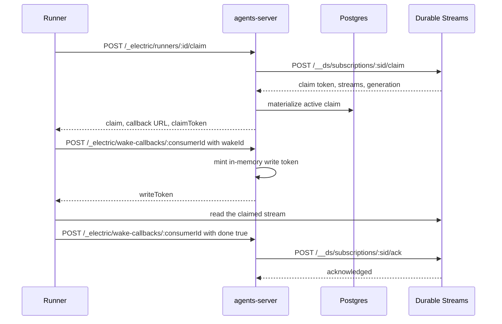
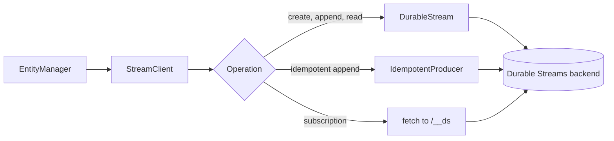

# Stream layout and stream client

Electric Agents is the runtime and server pair that runs one agent as one entity. The system has two stores. PostgreSQL (Postgres) holds the control tables, and Durable Streams holds the event log for each entity. Every agent-visible fact lives in a stream. Postgres indexes those streams and also holds control state that no stream contains, such as permission grants, dispatch state, and schedule rows. This document lists the stream paths the server uses. It then describes `src/stream-client.ts`, the single HTTP (Hypertext Transfer Protocol) client that the server uses to reach Durable Streams.

## The path namespace

A stream path is an absolute path on the Durable Streams server. It is not a Uniform Resource Locator (URL) with a host. The `StreamClient` adds the configured base URL.

| Path pattern | Writer | Purpose |
|--------------|--------|---------|
| `/<type>/<instanceId>/main` | Entity manager, agent runtime | Entity event log |
| `/<type>/<instanceId>/attachments/<attachmentId>` | Entity manager | Closed attachment body |
| `/principal/<encodedKey>/main` | Entity manager | Principal identity log |
| `/_entities/<sourceRef>` | Entity projector (`AgentsHost`) or entity bridge manager (standalone) | Membership stream for a tag set |
| `/_cron/<encodedSpec>` | Scheduler | Cron tick log |
| `/_electric/shared-state/<id>` | Agent runtime | Shared database stream |
| `/_electric/pg-sync/<namespace>/<sourceRef>` | Pg sync bridge | Mirrored Postgres rows |
| `/_webhooks/<endpointKey>[/<bucket>]` | An injected webhook source, not this package | Inbound webhook events |
| `/runners/<id>/wake` | Runner router, dispatch link | Wake notification stream |

The `/_webhooks` paths come from the optional `webhookSources` catalog (`WebhookSourceCatalog` in `src/routing/context.ts:18-28`). The embedding code supplies the catalog, and the external integration writes those streams. This package reads the paths through subscription manifests and never appends to them. Without a catalog, the webhook source routes return a not-found or a validation error. See [06-http-routing.md](06-http-routing.md).

The helpers that build most of these paths live in `@electric-ax/agents-runtime`. The server imports them, so the writer and the reader cannot disagree about the encoding.

The placeholders follow fixed rules:

- `<encodedKey>` is the percent-encoded string `<kind>:<id>` from `principal.ts`.
- `<sourceRef>` has two forms. In `/_electric/pg-sync/`, it is 16 hexadecimal characters. In `/_entities/`, it is `<tagSourceRef>-<principalHash>`, so it is 33 characters: 16 hexadecimal characters, a hyphen, and 16 more. Both parts use `hashString`, a 64-bit Fowler–Noll–Vo (FNV-1a) hash. Every membership stream is principal-scoped, in both the projector and the standalone bridge manager, so the short 16-character form never appears under `/_entities/`.
- `<encodedSpec>` is the base64url encoding of a JSON (JavaScript Object Notation) object with `expression` and `timezone`.
- `<namespace>` is the percent-encoded tenant identifier.
- `<endpointKey>` is a validated webhook endpoint key, and `<bucket>` is its normalized bucket name.

A `sourceRef` is a stable hash of a query or a source description. For a tag set, the input is the normalized tag map. For a Postgres sync source, the input is the canonical options plus the identity metadata. For a principal-scoped membership stream, the input is the tag reference plus the principal kind and URL. The same query always produces the same reference, and a different query produces a different stream.

```ts
// packages/agents-runtime/src/tags.ts:68-70
export function getEntitiesStreamPath(sourceRef: string): string {
  return `/_entities/${sourceRef}`
}
```

The cron path encodes a JSON object as base64url. That makes the path a pure function of the schedule:

```ts
// packages/agents-runtime/src/cron-utils.ts:65-67
export function getCronStreamPathFromSpec(spec: CronScheduleSpec): string {
  return `${CRON_STREAM_PREFIX}${encodeCronScheduleSpec(spec)}`
}
```

`CRON_STREAM_PREFIX` is `/_cron/`. The spec has an `expression` and a `timezone`. The same expression in a different timezone produces a different stream.

**Aha: a stream path is an identifier, not a location.** The server computes a stream URL instead of storing it. Three exceptions exist: the code stores `runners.wake_stream`, `entity_bridges.stream_url`, and `pg_sync_bridges.stream_url`, and each is unique. `runnerWakeStream(id)` and `getEntitiesStreamPath(sourceRef)` are pure functions. This keeps most control rows small and prevents a stale URL after a base URL change.

## The stream client

`StreamClient` has 794 lines. It wraps two client libraries from Durable Streams:

- `DurableStream` for create, append, read, head, and delete.
- `IdempotentProducer` for retry-safe appends.

The constructor stores `baseUrl` and an options object. The base URL already includes the backend prefix, such as `http://localhost:4437/v1/stream`.

### Path and header helpers

```ts
// packages/agents-server/src/stream-client.ts:182-188
private streamUrl(path: string): string {
  return appendPathToBaseUrl(this.baseUrl, path)
}

private streamHeaders(): HeadersRecord | undefined {
  return durableStreamsBearerHeaders(this.options.bearer)
}
```

The bearer can be a string or a provider function. The client stores the header as an async function, and the Durable Streams client resolves it on every request. A provider can therefore rotate a token without a new `StreamClient`. The client adds the `Bearer ` prefix when the value does not have it.

Subscription control uses the path `/__ds/subscriptions/<id>`. The `StreamClient` calls the backend directly, so the result is `<baseUrl>/__ds/subscriptions/<id>`, where `baseUrl` already ends in the backend prefix. With the embedded server, for example, the result is `http://localhost:4437/v1/stream/__ds/subscriptions/sub-1`. The join is in `subscriptionUrl`:

```ts
// packages/agents-server/src/stream-client.ts:209-214
private subscriptionUrl(subscriptionId: string): string {
  return appendPathToBaseUrl(
    this.baseUrl,
    `/__ds/subscriptions/${encodeURIComponent(subscriptionId)}`
  )
}
```

The same `/__ds` prefix appears on two different addresses, and they are not the same address:

- The `StreamClient` calls the Durable Streams backend at `<backendPrefix>/__ds/...`. This is the internal call.
- A runner or an agent runtime calls the `agents-server` at `http://<server>/__ds/...`. The `durableStreamsRouter` matches `/__ds` and `/__ds/*` and forwards the request to the backend. The default routing adapter appends the incoming path to the backend prefix, so `/__ds/x` becomes `<backendPrefix>/__ds/x`.

A client should use the server address when it must pass through the server's routing and bearer injection. It should use the backend address only when it already holds a direct connection.

## Every method

| Method | HTTP call | Behaviour |
|--------|-----------|-----------|
| `create(path, opts)` | `DurableStream.create` | Creates a stream. Options set the content type, an optional body, and `closed` |
| `fork(path, sourcePath, opts)` | `PUT` with fork headers | Copies from a source stream at an event pointer |
| `append(path, data, opts)` | `DurableStream.append` | Appends one body. With `close`, it closes the stream and returns `finalOffset` |
| `appendIdempotent(path, data, opts)` | `IdempotentProducer` | Appends with a producer identifier. An epoch defaults to 0 |
| `appendWithProducerHeaders(path, data, opts)` | `POST` with producer headers | Explicit `Producer-Id`, `Producer-Epoch`, and `Producer-Seq` |
| `read(path, fromOffset)` | `DurableStream.stream` | Non-live read. The default offset is `-1` |
| `readJson(path, fromOffset)` | `DurableStream.stream` | The same read, decoded as a JSON array |
| `waitForMessages(path, fromOffset, timeoutMs)` | live long-poll | Returns messages, or a timeout result |
| `delete(path)` | `DurableStream.delete` | Deletes the stream |
| `ensure(path, opts)` | head, then create | Ignores a 409 create race |
| `exists(path)` | `DurableStream.head` | Returns false for a not-found error |
| `createSubscription(pattern, id, url)` | `PUT` | Creates a webhook subscription |
| `putSubscription(id, input)` | `PUT` | Creates or replaces a subscription |
| `getSubscription(id)` | `GET` | Returns null on 404 |
| `deleteSubscription(id)` | `DELETE` | Treats 404 and 204 as success |
| `addSubscriptionStreams(id, streams)` | `POST /streams` | Adds streams to an existing subscription |
| `removeSubscriptionStream(id, path)` | `DELETE /streams/<path>` | Removes one stream |
| `claimSubscription(id, worker)` | `POST /claim` | Returns null on 204 or 404 |
| `ackSubscription(id, token, body)` | `POST /ack` | Sends the claim token as a bearer token |
| `releaseSubscription(id, token, body)` | `POST /release` | Returns the claim without completing it |

### Create and fork

`create` passes the body as bytes or as a string. The caller decides the shape. The entity manager passes a pre-wrapped JSON array, as described in [02-entity-manager.md](02-entity-manager.md).

`fork` sets the content type and `Stream-Forked-From`. When the caller supplies a fork pointer, it also sets `Stream-Fork-Offset`, with an explicit zero offset when the pointer has no offset. It adds `Stream-Fork-Sub-Offset` only when the sub-offset is above zero:

```ts
// packages/agents-server/src/stream-client.ts:256-269
const headers: Record<string, string> = {
  'content-type': `application/json`,
  'Stream-Forked-From': new URL(this.streamUrl(sourcePath)).pathname,
}
if (opts?.forkPointer) {
  // The durable-streams server returns 400 if Stream-Fork-Sub-Offset
  // > 0 without an accompanying Stream-Fork-Offset. When our
  // pointer's offset is `null` (anchor at stream start), send the
  // explicit zero-offset string to satisfy that constraint.
  const ZERO_OFFSET = `0000000000000000_0000000000000000`
  headers[`Stream-Fork-Offset`] = opts.forkPointer.offset ?? ZERO_OFFSET
  if (opts.forkPointer.subOffset > 0) {
    headers[`Stream-Fork-Sub-Offset`] = String(opts.forkPointer.subOffset)
  }
}
```

The zero offset is not optional. The server rejects `Stream-Fork-Sub-Offset` without `Stream-Fork-Offset`. A `null` offset means "from the start", so the client sends the explicit zero form.

### Append and close

A normal append uses `batching: false`. This is important for signals and inbox messages: the caller needs a result before it returns to the user.

A close append uses `handle.close({ body })`. The return value is the final offset, not the next write offset.

### Idempotent append

`appendIdempotent` creates a producer, appends, flushes, and detaches. The deduplication key is the triple of producer identifier, epoch, and sequence number. If the same triple arrives twice, the server accepts the first and reports success for the second. An epoch is a producer generation: it starts at 0. A new epoch tells the server to forget the sequence history of the old one. A new producer identifier also starts a new history.

The scheduler uses this path, through `manager.send(..., { producerId })` for a delayed send and through `executeCronTick` for a cron tick. That is why a retried task does not write a second message. The tag outbox does not use it. `TagStreamOutboxDrainer` calls `appendWithProducerHeaders`, because the outbox row already stores the producer identifier, epoch, and sequence number that the drainer must reuse. See [10-pg-sync-and-bridges.md](10-pg-sync-and-bridges.md).

The two membership components go one step further. They do not call `StreamClient.appendIdempotent`. `EntityBridgeManager` and `EntityProjector` build their own `IdempotentProducer` on the stream URL, with the producer identifier `entity-bridge-<sourceRef>` and `autoClaim: true` (`src/entity-bridge-manager.ts:201-210`, `src/entity-projector.ts:168-176`). `autoClaim` makes the producer retry a `403` stale-epoch rejection with a higher epoch. A restarted bridge can therefore take back its own stream without a manual epoch increment. See [10-pg-sync-and-bridges.md](10-pg-sync-and-bridges.md).

### Reads

`read` and `readJson` use `live: false`. They read to the current tail and stop. The entity manager uses them for manifests and attachments.

`waitForMessages` uses `live: 'long-poll'`. It subscribes to byte chunks and sets a timer. When the timer fires, the method aborts the request and returns `{ messages, timedOut: true }`. It never waits forever.

```ts
// packages/agents-server/src/stream-client.ts:438-446
const controller = new AbortController()
const timer = setTimeout(() => controller.abort(), timeoutMs)

try {
  const response = await handle.stream({
    offset: fromOffset,
    live: `long-poll`,
    signal: controller.signal,
  })
```

### Subscriptions

A subscription has a type, a stream list or pattern, and a delivery target. The server uses two types:

- `webhook`: the Durable Streams server sends an HTTP POST to a URL.
- `pull-wake`: a worker claims pending work and reads the stream itself.

The client normalizes paths before it sends them. The client removes a leading slash when the backend expects a relative path. The routing adapter can also add a tenant prefix. See [06-http-routing.md](06-http-routing.md).

The claim, ack, and release calls form the pull-wake handshake. The claim gives the runner an exclusive lease on the stream and one epoch. The server writes the claim to Postgres. The runner then owns the stream read; it does not wait for the server to send the bytes. The `wake-callbacks` route is the return path. A claim callback carries the `wakeId`. It is local: the server mints the claim write token and returns it without forwarding anything upstream. A done callback sets `done: true`. The server forwards it to the upstream subscription and acks or releases the claim.



The write token is not in the claim response. It arrives only on the claim callback, and it lives in the in-memory claim-token store. See [08-tenancy-permissions-and-principals.md](08-tenancy-permissions-and-principals.md) and [09-runners-and-sandboxes.md](09-runners-and-sandboxes.md).

`claimSubscription` returns `null` for 204 and 404. Both mean "no work". The runner router turns that into a 204 response.

`ackSubscription` and `releaseSubscription` send the claim token in the `authorization` header with a `Bearer` prefix. The token authorizes the operation on the claim. It is not the runner's Application Programming Interface (API) token.

## Error handling

The client defines one error class for subscription calls:

```ts
// packages/agents-server/src/stream-client.ts:79-90
export class DurableStreamsSubscriptionError extends Error {
  readonly code?: string
  readonly errorMessage?: string

  constructor(
    message: string,
    readonly status: number,
    readonly body: string
  ) {
    super(`${message}: ${status} ${body}`)
    this.name = `DurableStreamsSubscriptionError`
```

The constructor parses the body as JSON. It copies `error.code` and `error.message` into the two optional fields. A non-JSON body leaves them undefined, and the raw body stays in the error message.

The runner router recognizes two status codes as "normal contention": `409 NO_PENDING_WORK` and `409 ALREADY_CLAIMED`. It maps other errors to an HTTP error response.

Stream operations use plain `Error` objects. The entity manager converts a closed-stream error to `NOT_RUNNING`, as described in [02-entity-manager.md](02-entity-manager.md).

## Tracing

The eight stream operations wrap their work in `withSpan`: `create`, `fork`, `append`, `appendIdempotent`, `appendWithProducerHeaders`, `read`, `readJson`, and `waitForMessages`. The subscription methods do not. The span name is `stream.<operation>`, and the attributes include the stream path and the operation name. Only the methods that make their own `fetch` call also call `injectTraceHeaders`: `fork` and `appendWithProducerHeaders` (`packages/agents-server/src/stream-client.ts:271` and `packages/agents-server/src/stream-client.ts:357`). The other operations delegate to `DurableStream` or `IdempotentProducer`, so the trace context reaches the backend only if that library injects it. The span still records the client-side time.



## Related documents

- [01-boot-and-configuration.md](01-boot-and-configuration.md) explains how the code chooses the base URL.
- [02-entity-manager.md](02-entity-manager.md) explains how the code builds the create body.
- [05-wake-registry-and-scheduler.md](05-wake-registry-and-scheduler.md) explains how wake events reach this client.
- [09-runners-and-sandboxes.md](09-runners-and-sandboxes.md) explains the claim handshake in full.
