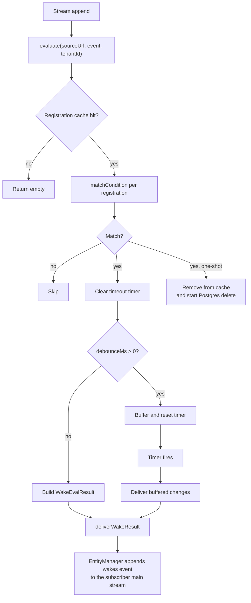
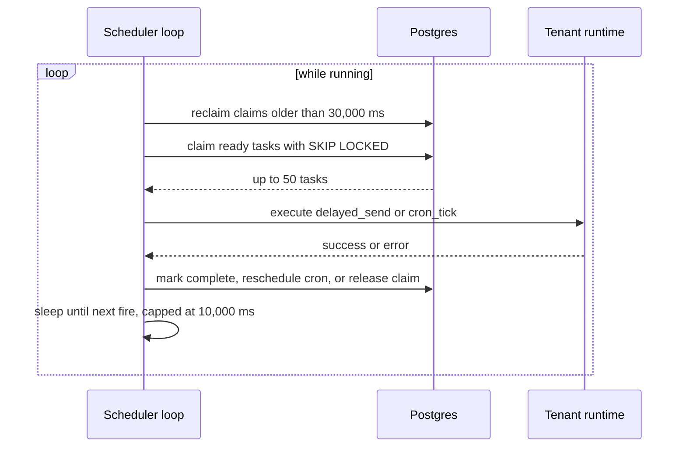
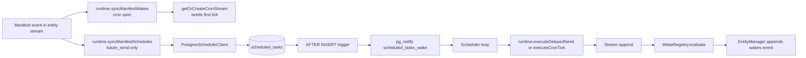

# Wake registry and scheduler

A wake tells a handler that something changed. A schedule tells the server to create a change at a fixed time. Two components implement these jobs:

- `src/wake-registry.ts` (992 lines) decides *whether* an event matches a subscription.
- `src/scheduler.ts` (818 lines) decides *when* a delayed send or a cron tick fires.

Both components keep PostgreSQL (Postgres) rows as the durable record. Both keep a process-local cache or claim loop for speed.

## Part 1: the wake registry

### What a registration contains

A wake registration has these fields:

| Field | Meaning |
|-------|---------|
| `subscriber_url` | The entity or stream that wants the wake |
| `source_url` | The stream to watch |
| `condition` | `runFinished`, or `{ on: 'change', collections, ops }` |
| `debounce_ms` | Wait this long after the last match. `0` means no wait |
| `timeout_ms` | Fire a timeout wake if no match arrives in this time |
| `one_shot` | Remove the registration after the first delivery |
| `include_response` | Include the run response in the wake |
| `manifest_key` | The manifest entry that owns the registration |
| `timeout_consumed` | Set to true when a match cancels the timeout timer |

`timeout_consumed` is a stored flag, not a caller field. The registry sets it after a match or a timeout delivery.

The table has a unique constraint on `(tenant_id, subscriber_url, source_url, one_shot, debounce_ms, timeout_ms, condition, manifest_key)`. That constraint makes `register()` idempotent. The `condition` column is `jsonb`, so key order does not change identity. Two conditions that differ only by an omitted optional field are different values, for example `{ on: 'change', collections: ['runs'] }` and the same object with `ops: []`. They create two rows that match the same events.

A conflicting `register()` does nothing. `onConflictDoNothing()` returns no row, and the method reloads the cache. It does not update the stored `debounce_ms`, `timeout_ms`, `one_shot`, or `include_response`, so the first registration's timing stays in force.

### Sync from Postgres

The registry does not poll the table. It opens an Electric shape stream. An Electric shape is a live query result that the Electric sync service keeps current from a Postgres table:

```ts
// packages/agents-server/src/wake-registry.ts:190-212
const stream = new ShapeStream<WakeRegistrationShapeRow>({
  url: electricUrlWithPath(electricUrl, `/v1/shape`).toString(),
  params: {
    table: `wake_registrations`,
    ...(this.tenantId
      ? { where: `tenant_id = ${sqlStringLiteral(this.tenantId)}` }
      : {}),
    ...(electricSecret ? { secret: electricSecret } : {}),
    columns: [
      `id`,
      `tenant_id`,
      `subscriber_url`,
      `source_url`,
      `condition`,
      `debounce_ms`,
      `timeout_ms`,
      `one_shot`,
      `timeout_consumed`,
      `include_response`,
      `manifest_key`,
      `created_at`,
    ],
    replica: `full`,
  },
```

`replica: full` is necessary. Without it, a delete message has only the primary key. The registry uses `old_value.id` to remove the matching cached row. If the old value is missing, it clears the whole cache and fails closed. The migrations do not set `REPLICA IDENTITY FULL` on `wake_registrations`, so that fallback can run. See [03-entity-registry-and-postgres.md](03-entity-registry-and-postgres.md).

Start-up waits for the first `up-to-date` control message. The method resolves its readiness promise at that point. A shape error before readiness rejects start-up. An error after readiness starts a recovery loop.

`recoverSync()` runs that loop. It has no timer and no backoff. It acts on the next error and does this:

1. If a recovery is already running, return the same promise. Two errors cause one recovery.
2. Stop the current shape stream.
3. Reload all registrations from Postgres into the cache.
4. Start the shape stream again.
5. Clear the recovery promise, whether the restart worked or not.

A failed restart is logged. The registry then waits for the next shape error to try again. If no Electric sync Uniform Resource Locator (URL) is configured, the method logs the error and returns without a restart.

### The cache

The cache key is `tenantId:sourceUrl`. The value is an array of registrations. `evaluate(sourceUrl, event, tenantId?)` resolves the tenant in this order: the explicit argument, then the tenant of the registry instance, then an error. In shared mode the registry has no tenant of its own, so the caller must pass one. `evaluate()` then looks up one key and loops over a small array. It does not query Postgres on the hot path.

**Aha: the wake path is a pure in-memory function after start-up.** The shape stream is the only external writer to the cache. Six local paths also write it: `register()`, `unregisterByManifestKey()`, `unregisterBySubscriber()`, `unregisterBySource()`, `unregisterBySubscriberAndSource()`, and `loadRegistrations()`. All of them change the same process memory. This is why the wake registry can match thousands of appends per second without a database round trip.

A second process does not see those local writes until its own shape stream delivers them. The shape stream is the only channel between processes.

### Matching a change

`matchCondition()` implements the two condition forms.

The `runFinished` form accepts only an event that meets all three tests:

1. `type` is `run`.
2. The header operation is `update`.
3. `value.status` is `completed` or `failed`.

It returns a change with collection `runs` and the run status attached.

The change form has these tests:

- If `collections` is set, `event.type` must be in the list. A *collection* is the entity collection name, and the code reads it from the event `type` field. There is no separate collection field.
- The header operation maps to `insert`, `update`, or `delete`. A missing operation counts as `insert`.
- If `ops` is set, the mapped kind must be in the list.

The change object copies `collection` from `event.type` and `key` from `event.key`. A missing key becomes an empty string.

```ts
// packages/agents-server/src/wake-registry.ts:943-956
const kind: `insert` | `update` | `delete` =
  operation === `delete`
    ? `delete`
    : operation === `update`
      ? `update`
      : `insert`

if (
  condition.ops &&
  condition.ops.length > 0 &&
  !condition.ops.includes(kind)
) {
  return null
}
```

For an `inbox` event, the match also copies `from`, `from_principal`, `from_agent`, `payload`, `timestamp`, and `message_type` into the change. The code detects an inbox event by the test `event.type === 'inbox'`. The handler then receives the message fields without a second stream read. The copy is shallow and only for fields of the right type; a `payload` field is copied even when its value is `undefined`.

### Debounce

Debounce is a trailing timer per registration. Each match appends to a buffer and resets the timer. When the timer fires, the registry delivers *one* wake with all buffered changes. The source event key is the key of the last change.

The last run status wins for a debounced `runFinished` wake. The registry stores it in a separate map so a later `failed` status replaces an earlier `completed` status.

The buffer and the timer live only in process memory. A crash before the timer fires loses the buffered changes, and no other component keeps a copy. A restart does not replay them: the source events stay in the stream, but the wake is a derived notification, and the registry does not recompute it from history. Debounce is therefore at-most-once for the buffered window. Delivery after the timer is retried through the producer identifier, so that part is at-least-once.

### The source event key

`wakeSourceEventId()` builds the source event key in a fixed order:

1. The `headers.offset` value, when it is a non-empty string.
2. `operation:key`, when both the header operation and the event key are strings.
3. The event key alone.
4. A random Universally Unique Identifier (UUID), when none of the above apply.

```ts
// packages/agents-server/src/wake-registry.ts:83-101
const offset = headers?.offset
if (typeof offset === `string` && offset.length > 0) {
  return offset
}

const operation = headers?.operation
const key = event.key
if (typeof operation === `string` && typeof key === `string`) {
  return `${operation}:${key}`
}
if (typeof key === `string`) {
  return key
}
return crypto.randomUUID()
```

The key becomes part of the delivery producer identifier. An event without an offset and without a key therefore produces a new identifier on each delivery and cannot be deduplicated. A debounced delivery uses the last buffered change key, not this helper. A timeout delivery uses the literal string `timeout`.

### Timeout

A timeout wake does not need a matching event. Each registration with `timeout_ms > 0` gets a timer. The timer fires at `created_at + timeout_ms`.

The deadline comes from Postgres, not from process memory. After a restart, `syncTimeoutTimer()` recomputes the remaining time from the stored `created_at`. Two paths start this rehydration:

- `upsertCachedRegistration()`, which `register()`, `loadRegistrations()`, and the shape handler all call.
- `syncTenantTimeoutTimers()`, which `setTimeoutCallback()` calls.

If the deadline has already passed and the row is not marked delivered, the registry delivers the timeout at once. The set `timeoutDelivered` prevents a second delivery in the same process.

When a match arrives first, `evaluate()` clears the timer and starts `markTimeoutConsumed()`, which writes `timeout_consumed = true`. The call is fire-and-forget: `evaluate()` does not await it. The write normally prevents a second process from delivering the timeout after a restart. Two small windows remain. If the process crashes before the write lands, the flag stays false, and a restarted process can deliver a second wake (a duplicate). If the write lands but the process crashes before the append, the timeout wake is lost. A timeout is therefore neither strictly once nor strictly at-least-once across a crash.

A timeout delivery has `timeout: true` and an empty change list:

```ts
// packages/agents-server/src/wake-registry.ts:694-704
return {
  tenantId: reg.tenantId,
  subscriberUrl: reg.subscriberUrl,
  registrationDbId: dbId,
  sourceEventKey: `timeout`,
  wakeMessage: {
    source: reg.sourceUrl,
    timeout: true,
    changes: [],
  },
}
```

### One-shot

A one-shot registration is removed when it *matches*, not when it delivers. The removal happens in the same `evaluate()` call, after the result is built. It does three things in order:

1. It deletes the registration from the cache array.
2. It clears local timers and buffers.
3. It starts a Postgres delete and does not await it.

If the array becomes empty, the whole cache key is deleted. Because the Postgres delete is not awaited, a process crash between the memory removal and the database delete leaves the row in Postgres. The shape stream then re-adds it, and the registration can match again.

One edge case follows from the order. A one-shot registration with a debounce first buffers the change and starts a timer. The same call then clears the debounce state, which removes the timer and the buffer. The buffered wake is therefore discarded. This is the observed behaviour of the code, and the source has no comment that states it as intended.



### Delivery

The registry does not append events itself. Each match returns a `WakeEvalResult`, and `EntityManager.evaluateWakes()` delivers it. The delivery has three gates:

1. A result whose tenant differs from the manager's tenant is dropped.
2. A subscriber entity that no longer exists is dropped, with no error.
3. Otherwise the manager appends a `wakes` event to the subscriber main stream.

The producer identifier is `wake-reg-<dbId>-<sourceEventKey>`, and the event key has the same two parts. That identifier makes the append idempotent across retries.

The wake message contains the source stream, the timeout flag, and the change list. If `includeResponse` is set for a `runFinished` wake, the manager reads the run response and adds it. The rule has more conditions than the flag alone:

- The source entity must be a child of the subscriber, that is, `sourceEntity.parent === subscriber.url`. A `runFinished` wake on an observed entity that is not a child gets no response.
- The run key is the key of the last change in the wake.
- The manager calls `extractRunResponse()`, which reads the whole child stream with `readJson` and joins the `text_delta` values whose `run_id` equals that key.
- For a `failed` run, it also collects `error` events for the same `run_id`.

The result goes into a `finished_child` object with `url`, `type`, `run_status`, and optional `response` and `error` fields. A missing source entity makes the manager throw; `evaluateWakes` catches the error and logs it. The code is `packages/agents-server/src/entity-manager.ts:3415-3510`.

The delivery catches its own errors. `evaluateWakes` uses `Promise.allSettled`, so one failed subscriber does not block the others. It writes a warning for each rejection.

## Part 2: the scheduler

### The task table

`scheduled_tasks` holds two kinds:

| Kind | Payload | Fire rule |
|------|---------|-----------|
| `delayed_send` | The send request and optional manifest reference | `fire_at` timestamp |
| `cron_tick` | A stream path | `fire_at`, plus expression, timezone, and tick number |

A `cron_tick` row has a unique constraint on `(tenant_id, cron_expression, cron_timezone, cron_tick_number)`. Two instances cannot insert the same tick.

### Notification

A database trigger sends a notification after every insert:

```sql
-- packages/agents-server/drizzle/0000_baseline.sql:79-89
CREATE OR REPLACE FUNCTION notify_scheduled_tasks_wake() RETURNS trigger AS $$
BEGIN
	PERFORM pg_notify('scheduled_tasks_wake', '');
	RETURN NEW;
END;
$$ LANGUAGE plpgsql;
--> statement-breakpoint
CREATE TRIGGER scheduled_tasks_notify
	AFTER INSERT ON "scheduled_tasks"
	FOR EACH ROW
	EXECUTE FUNCTION notify_scheduled_tasks_wake();
```

The scheduler listens on the same channel:

```ts
// packages/agents-server/src/scheduler.ts:301-308
this.listenerMeta = await this.pgClient.listen(
  `scheduled_tasks_wake`,
  () => this.wakeEarly()
)
```

A new task therefore wakes the loop immediately. Without the notification, the loop would wait for its next poll. The `listen` call uses the Postgres `LISTEN` command, and the trigger sends `NOTIFY` through `pg_notify`. This is a message channel inside Postgres, not a network connection.

### The loop



The defaults are `claimExpiryMs = 30_000` and `safetyPollMs = 10_000`. The loop sleeps for the smaller of two values: the time to the next `fire_at`, or the safety poll. The safety poll bounds the damage from a missed notification.

### Claiming

The claim query uses `FOR UPDATE SKIP LOCKED`. It selects at most 50 rows, ordered by `fire_at` and `id`. The query has three forms, chosen by the scheduler mode:

| `tenantId` value | `tenantIds` provider | Claimed scope |
|------------------|----------------------|---------------|
| A tenant identifier | Not used | That one tenant |
| `null` | Present | Only the listed tenants; an empty list claims nothing |
| `null` | Absent | Every tenant in the table |

The standalone runtime passes the service identifier, so it uses the first form. The multi-tenant `AgentsHost` passes `tenantId: null` and a provider of its registered tenants, so it uses the second form. The third form is a fallback for a shared scheduler built without a provider. No constructor in this package uses it in version 0.6.4: both in-package callers pass a provider when the tenant is null. The code is in [01-boot-and-configuration.md](01-boot-and-configuration.md) for the standalone case and [08-tenancy-permissions-and-principals.md](08-tenancy-permissions-and-principals.md) for the shared case.

```ts
// packages/agents-server/src/scheduler.ts:560-577
const rows = await this.pgClient<Array<ScheduledTaskRow>>`
  update scheduled_tasks
  set claimed_by = ${this.instanceId}, claimed_at = now()
  where tenant_id = ${this.tenantId}
    and id in (
    select id
    from scheduled_tasks
    where tenant_id = ${this.tenantId}
      and completed_at is null
      and claimed_at is null
      and fire_at <= now()
    order by fire_at, id
    for update skip locked
    limit 50
  )
  returning tenant_id, id, kind, payload, fire_at, cron_expression, cron_timezone, cron_tick_number
    , owner_entity_url, manifest_key
`
```

The shared branch replaces the two `tenant_id = ${this.tenantId}` tests with `tenant_id = any(...)`, and the branch below it drops the tenant test completely:

```ts
// packages/agents-server/src/scheduler.ts:515-526
if (this.tenantId === null) {
  const tenantIds = this.sharedTenantIds()
  if (tenantIds && tenantIds.length === 0) return []
  if (tenantIds) {
    const rows = await this.pgClient<Array<ScheduledTaskRow>>`
      update scheduled_tasks
      set claimed_by = ${this.instanceId}, claimed_at = now()
      where id in (
        select id
        from scheduled_tasks
        where tenant_id = any(${this.sharedTenantIdsParameter(tenantIds)})
          and completed_at is null
```

`SKIP LOCKED` means two schedulers never claim the same row. `claimed_by` names the instance. Every completion or release checks `claimed_by = instanceId`, so a stale worker cannot complete another worker's task.

### Claim expiry

A crash leaves a row claimed forever. The loop first resets any claim older than 30,000 ms:

```ts
// packages/agents-server/src/scheduler.ts:492-498
await this.pgClient`
  update scheduled_tasks
  set claimed_by = null, claimed_at = null
  where tenant_id = ${this.tenantId}
    and completed_at is null
    and claimed_at < now() - (${this.claimExpiryMs} * interval '1 millisecond')
`
```

The reset makes the task available again. The reset query has the same three tenant forms as the claim query. The operation must therefore be idempotent. Delayed sends use the manifest producer identifier. Cron ticks use `scheduler-cron-<base64url-encoded cron spec>-<tickNumber>`, where the encoded spec is the final segment of the `/_cron/<encoded spec>` stream path.

The claim is not renewed. The loop does not extend `claimed_at` while a task runs. A task that takes longer than 30,000 ms therefore becomes visible to the reset query, and another instance can claim it. The completion update still checks `claimed_by = instanceId`, so when the first worker finishes late, its update matches zero rows. The update reports success and raises no error, because a zero-row `UPDATE` is not an error in Postgres. The first worker cannot tell that it lost the claim, and the scheduler logs nothing. The producer identifiers above make the duplicate execution harmless.

### Error classes

`executeTask()` separates three outcomes:

- A *permanent* error marks the task complete with `last_error`. The task does not retry.
- An unregistered tenant releases the claim and logs a warning.
- Any other error releases the claim. The task retries on a later pass.

`isPermanentElectricAgentsError()` defines permanent with two tests. The error must have `name === 'ElectricAgentsError'`, and it must have a numeric `status` from 400 to 499. `ElectricAgentsError` is the package error class that the routing layer raises; a plain `Error` with a 4xx status is not permanent. A 5xx status is also not permanent, so the task retries.

### Cron rescheduling

A cron tick completes in a transaction. The transaction first marks the current row complete. It then computes the next fire time with `getNextCronFireAt`.

Before it inserts the next tick, it checks that at least one wake registration still points at the cron stream. The check is `select 1 from wake_registrations where tenant_id = ... and source_url = <streamPath> limit 1`. A single row is enough. An empty result stops the chain.

```ts
// packages/agents-server/src/scheduler.ts:702-707
// Cron streams are virtual shared sources. If no wake registrations
// still point at this cron stream (e.g. the owning manifest schedule was
// deleted), stop the chain here instead of keeping a forever-global tick
// alive. Rehydration/getOrCreateCronStream will seed a fresh tick when a
// subscription is recreated.
if (subscriberRows.length === 0) return
```

**Aha: a cron chain is demand-driven.** The chain stops when nobody listens. It restarts when a wake registration appears again. This prevents abandoned schedules from firing forever.

### Delayed send

`executeDelayedSend` calls `manager.send` with the stored payload. The producer identifier is `payload.producerId` when present, and `scheduler-task-<taskId>` otherwise. The event key is `payload.key` when present, and `scheduled-task-<taskId>` otherwise. When the payload carries a `manifest` reference, a success updates the manifest entry to `status: sent` with `sentAt`. On a permanent failure, the same field updates the entry to `status: failed` with `failedAt` and `lastError`. A non-permanent failure writes no manifest entry and rethrows, so the task retries. A payload with no manifest reference writes no status event.

The update uses a second producer identifier, `manifest-status-<producerId>-sent` or `manifest-status-<producerId>-failed`. A retry cannot write two conflicting status events.

### Manifest synchronization

`syncManifestDelayedSend()` runs in a transaction:

1. It completes any open delayed send for the same `(owner_entity_url, manifest_key)`.
2. It inserts the new row.

Step 1 does not filter on claim state. It clears `claimed_at` and `claimed_by` as well as setting `completed_at`. A send that is running in another instance therefore keeps running, but its own completion update, which requires `completed_at is null`, changes nothing. The new row is the only live send.

This makes the manifest the source of truth. A user edit replaces the pending send. A manifest delete completes the row and inserts nothing. Both methods call `wakeEarly()` after the commit, so the loop sees the change without a poll delay.

## How the pieces meet

`syncManifestSchedules()` is the bridge from the entity stream to the future-send part of the task table. It accepts one event or an array. It ignores every event whose type is not `manifest` and every event with no key. It then passes the key, the header operation, and the value to `applyManifestFutureSendSchedule`. A manifest entry that is not a `schedule` with `scheduleType: 'future_send'` and `status` absent or `pending` cancels any delayed send for that key instead of creating one.

Cron manifests travel a different path. `syncManifestWakes()` builds the wake registration and also calls `extractManifestCronSpec()`. When a cron spec is present, it calls `getOrCreateCronStream()`, which seeds the first tick. See [02-entity-manager.md](02-entity-manager.md).



The same append can also arrive through the Hypertext Transfer Protocol (HTTP) proxy. `src/routing/stream-append.ts` calls `evaluateWakePayload`, `checkRunFinished`, `syncManifestWakes`, `syncManifestEntitySources`, and `syncManifestSchedules` after a successful append. The scheduler path and the proxy path therefore converge on the same functions. See [06-http-routing.md](06-http-routing.md).

## Related documents

- [02-entity-manager.md](02-entity-manager.md) shows where registrations are created and where wakes are appended.
- [04-stream-layout-and-stream-client.md](04-stream-layout-and-stream-client.md) explains the idempotent append used for delivery.
- [10-pg-sync-and-bridges.md](10-pg-sync-and-bridges.md) shows another producer that calls `evaluateWakes`.
- [11-operations-testing-and-conformance.md](11-operations-testing-and-conformance.md) explains how these loops are tested.
