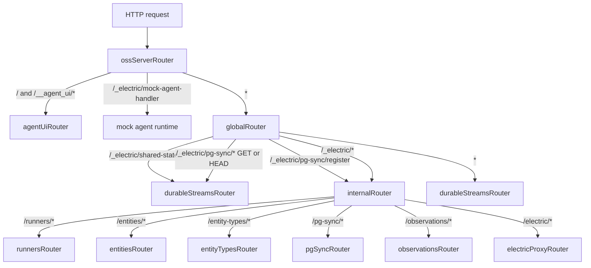
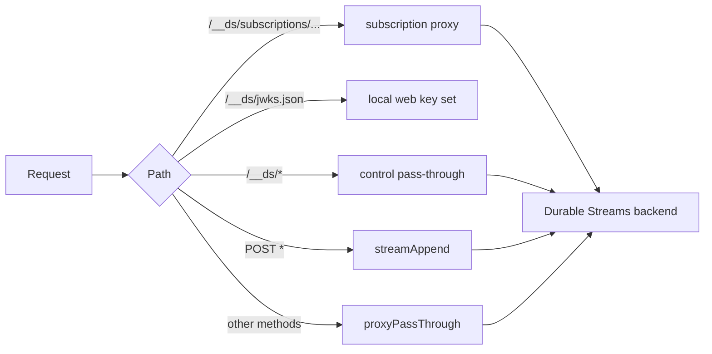
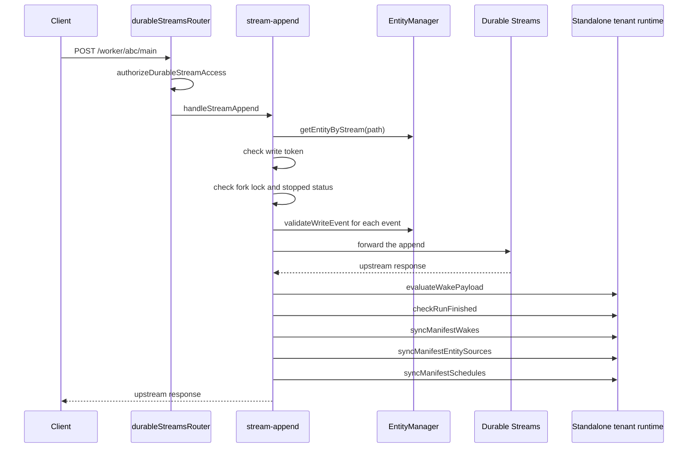

# Hypertext Transfer Protocol routing

The server has one Hypertext Transfer Protocol (HTTP) listener. A single dispatch chain sends each request to one router. The global router splits control paths from stream paths. A sub-router then mounts a method-specific route, such as `GET /_electric/health`. This document lists every router and every route, then follows the most important path: a stream append.

## Terms

- A **stream** is an append-only event log with a path, an offset, and JSON (JavaScript Object Notation) events. A **stream path** names data, for example `/<entity path>/main`. A **control path** names a management resource, for example `/_electric/health`.
- The **Durable Streams backend** is the external service that stores streams. The package reaches it through `StreamClient`. The server may also start an in-process `DurableStreamTestServer` for development.
- The **Electric sync service** is a different HTTP service. It serves a live query, called a **shape**, over one Postgres table at `/v1/shape`. The server uses shapes to learn about table changes.
- **PostgreSQL (Postgres)** holds control state: entities, permissions, wake registrations, runners, and claims.
- An **entity** is one agent or agent-owned object with a Uniform Resource Locator (URL), a type, and a status. An **entity type** is the registered schema and permission record for a class of entity. A **principal** is an identity: kind (`user`, `agent`, `service`, or `system`), identifier, key, and URL. A **tenant** is an isolation key for Postgres rows and stream origins.
- A **runner** is a process that executes agent work. It claims a work stream, receives a wake, and writes events.
- A **wake** is a notification that a stream changed. A **subscription** is a stored instruction to deliver changes of selected streams to a callback. A **pull-wake** subscription makes the consumer claim work instead of receiving a push.
- A **claim token** is the credential in a claim response. It authorizes the runner to acknowledge and release the upstream subscription. A **write token** is the credential in the wake callback response. It authorizes appends to one entity stream for one wake.
- A **manifest** is a `manifest` event in an entity stream that lists the sources, schedules, and children the entity owns.
- `__ds` is the path prefix of the Durable Streams control Application Programming Interface (API). `_electric` is the path prefix of this server's control and stream routes.

## The dispatch chain

The listener calls `ossServerRouter`. That router is the outermost layer. It redirects `/` to the agent user interface, serves `/__agent_ui/*` through `agentUiRouter`, serves the mock agent handler, and falls through to `globalRouter`. The global router adds tracing, shutdown rejection, and the cross-origin resource sharing (CORS) headers. It then sends the request to `internalRouter` or to `durableStreamsRouter`.

Both routers come from `itty-router`. A router is a list of entries, each with a method and a path pattern. `.get`, `.post`, `.head`, and `.all` add an entry; `.all` matches every method. `.fetch` runs the list. The first entry that matches both method and path wins, and a handler returns a `Response`. A handler that returns `undefined` lets the list continue to the next entry.

```ts
// packages/agents-server/src/routing/oss-server-router.ts:37-41
ossServerRouter.get(`/`, redirectToAgentUi)
ossServerRouter.head(`/`, redirectToAgentUi)
ossServerRouter.all(`/__agent_ui/*`, agentUiRouter.fetch)
ossServerRouter.post(`/_electric/mock-agent-handler`, mockAgentHandler)
ossServerRouter.all(`*`, (request, ctx) => globalRouter.fetch(request, ctx))
```

```ts
// packages/agents-server/src/routing/global-router.ts:31-36
globalRouter.all(`/_electric/shared-state/*`, durableStreamsRouter.fetch)
globalRouter.all(`/_electric/pg-sync/register`, internalRouter.fetch)
globalRouter.get(`/_electric/pg-sync/*`, durableStreamsRouter.fetch)
globalRouter.head(`/_electric/pg-sync/*`, durableStreamsRouter.fetch)
globalRouter.all(`/_electric/*`, internalRouter.fetch)
globalRouter.all(`*`, durableStreamsRouter.fetch)
```

The order is significant. `itty-router` stops at the first match. A shared-state path is a stream path, so it goes directly to the stream router. A PostgreSQL (Postgres) sync `register` call is control traffic, so it goes to the internal router. A `GET` or `HEAD` on `/_electric/pg-sync/*` is a stream read. Every other `/_electric/*` path is control traffic. Every path that is not control traffic is a stream path.

A third traffic class sits under the control prefix. `GET /_electric/electric/*` is a proxy to the Electric sync service, not a Postgres control resource. The internal router mounts it with `internalRouter.get(...)`, so only `GET` reaches it. The other methods on that path return 404 from the internal router.

Each sub-router is mounted by path. The `runners` sub-router has two mount entries: `/runners` matches the collection route with no trailing segment, and `/runners/*` matches every route with an identifier. A single wildcard mount would not match the bare `/runners` path. The `entities`, `entity-types`, `pg-sync`, `observations`, and `electric` mounts use the wildcard form only, because none of them has a bare collection route at the mount point.

Each sub-router also declares its own `base` path, for example `base: '/_electric/entities'`. The base is stripped before the sub-router matches. A request to `/_electric/entities/agent/abc/send` arrives at `entitiesRouter` as `/agent/abc/send`, and its route `POST /:type/:instanceId/send` matches that remainder.



**Aha: the `/_electric` prefix does two opposite jobs.** Under `/_electric/*`, the internal router serves the control plane in Postgres. Under `/_electric/shared-state/*` and `/_electric/pg-sync/*`, the same prefix names stream resources. The global router separates the two classes before the internal router can see them.

## Every router

| Router | Base path | Source |
|--------|-----------|--------|
| `ossServerRouter` | `/` | `src/routing/oss-server-router.ts` |
| `agentUiRouter` | `/__agent_ui` | `src/routing/agent-ui-router.ts` |
| `globalRouter` | `/` | `src/routing/global-router.ts` |
| `internalRouter` | `/_electric` | `src/routing/internal-router.ts` |
| `entitiesRouter` | `/_electric/entities` | `src/routing/entities-router.ts` |
| `entityTypesRouter` | `/_electric/entity-types` | `src/routing/entity-types-router.ts` |
| `runnersRouter` | `/_electric/runners` | `src/routing/runners-router.ts` |
| `pgSyncRouter` | `/_electric/pg-sync` | `src/routing/pg-sync-router.ts` |
| `observationsRouter` | `/_electric/observations` | `src/routing/observations-router.ts` |
| `electricProxyRouter` | `/_electric/electric` | `src/routing/electric-proxy-router.ts` |
| `durableStreamsRouter` | `/` | `src/routing/durable-streams-router.ts` |
| `electricAgentsStreamAppendRouter` | none | `src/routing/stream-append.ts` |

`durableStreamsRouter` declares the base `/`, but it does not own one mount. The global router sends it `/_electric/shared-state/*` and `GET`/`HEAD` `/_electric/pg-sync/*`. It also acts as the catch-all for every other path. The stream append router has no base of its own; the durable streams router calls it from the `POST *` branch.

## The internal router

The internal router holds the top-level control routes and mounts the control sub-routers. This excerpt shows the top-level routes and the first sub-router mount. The `...` stands for the remaining sub-router mounts, the entity type routes, the observations routes, and the Electric proxy mount:

```ts
// packages/agents-server/src/routing/internal-router.ts:130-154
internalRouter.get(`/health`, () => json({ status: `ok` }))
internalRouter.get(`/webhook-sources`, listWebhookSources)
internalRouter.post(
  `/wake`,
  withSchema(wakeRegistrationBodySchema),
  registerWake
)
internalRouter.post(
  `/wake/unregister`,
  withSchema(wakeUnregisterBodySchema),
  unregisterWake
)
internalRouter.post(
  `/subscription-webhooks/:subscriptionId`,
  subscriptionWebhook
)
internalRouter.post(`/wake-callbacks/:consumerId`, wakeCallback)
internalRouter.all(`/runners`, runnersRouter.fetch)
...
internalRouter.all(`*`, () => status(404))
```

| Method and path | Handler | Purpose |
|-----------------|---------|---------|
| `GET /_electric/health` | inline | Liveness check |
| `GET /_electric/webhook-sources` | `listWebhookSources` | Advertised inbound webhook contracts |
| `POST /_electric/wake` | `registerWake` | Create a wake registration |
| `POST /_electric/wake/unregister` | `unregisterWake` | Remove a wake registration |
| `POST /_electric/subscription-webhooks/:subscriptionId` | `subscriptionWebhook` | Durable Streams webhook receiver |
| `POST /_electric/wake-callbacks/:consumerId` | `wakeCallback` | Pull-wake callback |

The final route returns 404. No control path falls through to a stream.

The next sections describe `durableStreamsRouter`, not the internal router. Its `controlPassThrough` route is the exception to the control/stream split. It forwards an unrecognised `/__ds` call to the Durable Streams backend.

It still needs a principal. The request context resolves a principal for every request. The resolution order is the `authenticateRequest` option, then the `electric-principal` header, then the development fallback. The fallback is enabled when `allowDevPrincipalFallback` is unset and any of these is true: `ELECTRIC_INSECURE` is `true`, `NODE_ENV` is not `production`, or the process owns the embedded streams server. With no principal and no fallback, the context returns `401`. `controlPassThrough` does no resource check of its own. A caller that holds a principal can therefore call any Durable Streams control endpoint that the backend accepts, including subscription creation for any stream path.

The backend bearer is a separate credential: a bearer token for the Durable Streams backend, from `durableStreamsBearer` or the server environment. The server adds it to the upstream request. See [04-stream-layout-and-stream-client.md](04-stream-layout-and-stream-client.md).

The callback route `POST /_electric/wake-callbacks/:consumerId` is the return path of a pull-wake claim. A *consumer* is the runner or runtime instance that the subscription names. `consumer_callbacks` stores one callback URL for each `(tenant_id, consumer_id)`. An unknown consumer returns `404`.

The flow is:

1. The runner claims work on the upstream subscription and receives a `claimToken`.
2. The runner sends the wake notification to this callback. A body with `wakeId` and without `done: true` is a claim.
3. The handler looks up the entity and mints a write token for the primary stream. It does this locally; it does not call the upstream server.
4. The handler returns `{ ok: true }`, and adds `writeToken` only when the primary stream mints one. The response has no `wakeId`. The runner uses that token for its appends to the entity stream.
5. The runner appends its events, then sends `done: true`.
6. A `done` body forwards to the subscription's acknowledgement path and releases the claim row.

Any body that is not a claim and not `done` is forwarded. When the stored callback URL starts with `ds-subscription:`, the handler calls `ackSubscription` on the Durable Streams subscription with the claim token from the request. Otherwise it posts to the stored URL.

Two side writes happen around the forward, both in Postgres. A forwarded request that is not done and that carries `generation` or `epoch` updates `consumer_claims.last_heartbeat_at` through `materializeHeartbeatClaim`, without a new lease time. A done request releases the claim and sets the entity status to `stopped` when the status is `stopping`, and to `idle` otherwise. The status change happens only when this consumer still owns the claim or its release cleared the entity. See [09-runners-and-sandboxes.md](09-runners-and-sandboxes.md).

## The entities router

The entities router has the largest surface: 24 route entries. The first row shows the full path. The remaining rows are relative to `/_electric/entities`. A *guard* is a function that runs before the handler and returns a `Response` to stop the request.

The entity permissions are `read`, `write`, `delete`, `signal`, `fork`, `schedule`, `spawn`, and `manage`. `write` allows appends and collection writes. `manage` allows grant and metadata changes that `write` does not. A route names one permission and `canAccessEntity` accepts either that permission or `manage`.

| Method and path | Permission guard | Handler |
|-----------------|------------------|---------|
| `GET /_electric/entities/` | none in the route; the handler filters by `read` | `listEntities` |
| `PUT /:type/:instanceId` | `spawn`, after a spawnable-type check and body validation | `spawnEntity` |
| `GET /:type/:instanceId` | `read` | `getEntity` |
| `HEAD /:type/:instanceId` | `read` | `headEntity` |
| `DELETE /:type/:instanceId` | `delete` | `killEntity` |
| `POST /:type/:instanceId/signal` | `signal` | `signalEntity` |
| `POST /:type/:instanceId/send` | `write` | `sendEntity` |
| `POST /:type/:instanceId/collections/:collection` | `write` | `writeCollection` |
| `POST /:type/:instanceId/attachments` | `write` | `createAttachment` |
| `GET /:type/:instanceId/attachments/:attachmentId` | `read` | `readAttachment` |
| `DELETE /:type/:instanceId/attachments/:attachmentId` | `write` | `deleteAttachment` |
| `PATCH /:type/:instanceId/inbox/:messageKey` | `write` | `updateInboxMessage` |
| `DELETE /:type/:instanceId/inbox/:messageKey` | `write` | `deleteInboxMessage` |
| `POST /:type/:instanceId/fork` | `fork` | `forkEntity` |
| `POST /:type/:instanceId/tags/:tagKey` | `write` | `setTag` |
| `DELETE /:type/:instanceId/tags/:tagKey` | `write` | `deleteTag` |
| `PUT /:type/:instanceId/schedules/:scheduleId` | `schedule` | `upsertSchedule` |
| `DELETE /:type/:instanceId/schedules/:scheduleId` | `schedule` | `deleteSchedule` |
| `PUT /:type/:instanceId/webhook-source-subscriptions/:subscriptionId` | `write` | `upsertWebhookSourceSubscription` |
| `DELETE /:type/:instanceId/webhook-source-subscriptions/:subscriptionId` | `write` | `deleteWebhookSourceSubscription` |
| `DELETE /:type/:instanceId/pg-sync-observations/:sourceRef` | `write` | `deletePgSyncObservation` |
| `GET /:type/:instanceId/grants` | `manage` | `listEntityPermissionGrants` |
| `POST /:type/:instanceId/grants` | `manage` | `createEntityPermissionGrant` |
| `DELETE /:type/:instanceId/grants/:grantId` | `manage` | `deleteEntityPermissionGrant` |

The route table is at `src/routing/entities-router.ts:385-533`. The first two path segments, `:type` and `:instanceId`, address the entity. Any further segments select an operation on that entity. `entityUrlFromSegments()` rejects a type that starts with `_` and rejects a `*` in either segment. The underscore rule keeps entity URLs out of the `_electric` and `_entities` namespaces. The asterisk rule prevents a wildcard path from matching a real entity.

A *spawn* is the creation of an entity from a registered type. It needs a type whose registration allows spawn and a body that satisfies the type schema. A *spawnable type* is a type record with that permission.

A row-level filter, not a route guard, protects the list. `listEntities` passes `readableBy` to `registry.listEntities()`. `principalSubject` maps the principal to `{ principalUrl, principalKind }`, and the filter also carries a `bypass` flag for a built-in system principal. The query keeps an entity when the principal created it or holds `read` or `manage` on it. A principal with no grants therefore sees only the entities it created, and no error. The spawn guard has two levels. The type-level `spawn` check always runs, because the new entity does not exist yet. When the body names a `parent`, the guard also needs `spawn` on that parent entity, and it returns 404 when the parent row is missing. A parented spawn that carries `grants` also needs `manage` on the parent, because those grants delegate access from the parent's subtree (`src/routing/entities-router.ts:829-863` and `src/routing/entities-router.ts:865-890`).

The *subtree* of an entity is that entity plus every entity below it in `entity_lineage`. A spawn with a `parent` adds a lineage row. A grant with `propagation = 'descendants'` on the parent therefore reaches the new child. The copy and request grants run after the spawn, and they are not in one transaction with it. A failure between the spawn and the grant writes leaves a created entity with partial grants and an error response.

## The entity types router

| Method and path | Permission guard | Handler |
|-----------------|------------------|---------|
| `GET /_electric/entity-types/` | none in the route | `listEntityTypes` |
| `POST /_electric/entity-types/` | registration | `registerEntityType` |
| `PATCH /:name/schemas` | `manage` | `amendSchemas` |
| `GET /:name` | `spawn` | `getEntityType` |
| `DELETE /:name` | `manage` | `deleteEntityType` |
| `GET /:name/grants` | `manage` | `listTypePermissionGrants` |
| `POST /:name/grants` | `manage` | `createTypePermissionGrant` |
| `DELETE /:name/grants/:grantId` | `manage` | `deleteTypePermissionGrant` |

An entity type is a registered record with a name, event schemas, collection schemas, and type-level grants. It is not an entity and has no stream.

A type has only two grant permissions: `spawn` and `manage`. The smaller set follows from what a type can do. A type cannot be read, written, deleted, signalled, or forked; it can only be used to create an entity or changed. The route file is at `src/routing/entity-types-router.ts:149-192`.

The *registration* guard on `POST /` has two branches. For an existing type name, it requires `manage` on that type. For a new name, it calls `canRegisterEntityType()`, which runs the authorization hook with `builtInAllowed: true`. The *authorization hook* is the optional `authorizeRequest` function that the host supplies. It receives the principal, the verb, the resource key, and a `builtInAllowed` advice, and it returns an allow or deny decision. The advice says that the built-in rule would allow the request; the hook may still deny it. Without a hook, the built-in decision stands, so a new type registration is allowed. That is an open-registration default, and a host that wants a closed registry must install a hook. The guard is a custom function, not the generic type permission wrapper.

`GET /:name` requires `spawn` on the type. That is why an agent can read the type it is allowed to spawn, and cannot read other types.

## The runners router

| Method and path | Handler |
|-----------------|---------|
| `POST /_electric/runners/` | `registerRunner` |
| `GET /_electric/runners/` | `listRunners` |
| `GET /:id/health` | `runnerHealth` |
| `GET /:id` | `getRunner` |
| `POST /:id/heartbeat` | `heartbeat` |
| `POST /:id/enable` | `setEnabled` |
| `POST /:id/disable` | `setDisabled` |
| `POST /:id/claim` | `claimWake` |

A *runner* is a process that executes agent work. It registers with this router, sends a heartbeat, and claims work. A *pull-wake* subscription makes the runner pull work instead of receiving a pushed webhook. `claimWake` is that pull. It returns the work stream and a `claimToken`, and it ends at `done` or `stop`.

The word "claim" also names the scheduler task claim, the tag outbox claim, and the dispatch claim. Those are separate rows in separate tables. The runner claim is the only one that the upstream stream server enforces as a lease. See [09-runners-and-sandboxes.md](09-runners-and-sandboxes.md).

The route table is at `src/routing/runners-router.ts:123-130`.

## The small routers

| Router | Routes | Handler |
|--------|--------|---------|
| `pgSyncRouter` | `POST /_electric/pg-sync/register` | `registerPgSync` |
| `observationsRouter` | `POST /_electric/observations/entities/ensure-stream` | `ensureEntitiesMembershipStream` |
| `observationsRouter` | `POST /_electric/observations/cron/ensure-stream` | `ensureCronStream` |
| `electricProxyRouter` | `GET /_electric/electric/*` | `proxyElectric` |
| `agentUiRouter` | `GET /__agent_ui/*` | `serveAgentUi` |
| `agentUiRouter` | `*` | 404 |

An *observation* is an entity's declared interest in a source of change. The entities route creates or reuses the membership stream for a tag set. The cron route creates or reuses the stream for a cron expression. Both return a stream path and a source reference.

`proxyElectric` prunes expired permission grants, then forwards the request to the configured Electric URL. A *permission grant* is a row in `entity_permission_grants` or `entity_type_permission_grants` with a permission, a subject, and an optional expiry. An expired grant is a row whose `expires_at` is in the past. The pruning rule is in [03-entity-registry-and-postgres.md](03-entity-registry-and-postgres.md). The projector and the bridges do not use this route; they call the Electric URL directly with the shape client. See [07-entity-projector.md](07-entity-projector.md) and [10-pg-sync-and-bridges.md](10-pg-sync-and-bridges.md).

The proxy is not a transparent pass-through. For the `/v1/shape` path, `buildElectricProxyTarget()` enforces four rules:

1. The request must name exactly one `table`. The table must be one of nine in the *proxy chain*, the fixed list of tables that the route is allowed to expose. The nine tables are: `entities`, `entity_types`, `runners`, `users`, `entity_effective_permissions`, `runner_runtime_diagnostics`, `entity_dispatch_state`, `wake_notifications`, or `consumer_claims`. Any other name falls to the default-deny branch and returns `403 TABLE_NOT_ALLOWED`.
2. The client `where` parameter must be a balanced, self-contained clause. The server wraps that clause in its own parentheses and appends its own conditions. A clause that could close the server's parenthesis and add its own `OR` returns `400 INVALID_WHERE`. For example, the server builds `where = (<client clause>) AND tenant_id = '...'`. A client clause that contains an unmatched `)` would close the group early, so the balance check rejects it before the string is used.
3. The server adds its own `where`: the tenant, and for the entity tables a readable-entity filter for the caller. The server sets a fixed `columns` list for each table, so a client cannot ask for a column outside that list.
4. The Electric secret is added from the server option.

Paths other than `/v1/shape` are forwarded without these rules, so a deployment should expose this route only to trusted callers. The code is `packages/agents-server/src/utils/server-utils.ts:115-277`.

## The durable streams router

This router is not a normal representational state transfer (REST) resource router. It is a reverse proxy with four jobs: subscription control, the local webhook key set, guarded stream reads, and validated appends.

The entries match in this order, and the first match wins:

1. `/__ds/subscriptions/...` goes to the subscription proxy.
2. `/__ds/jwks.json` goes to the local key set.
3. `/__ds` and `/__ds/*` go to `controlPassThrough`.
4. `POST *` goes to `streamAppend`. This covers an append to an entity stream.
5. Every other method and path goes to `proxyPassThrough`.

A `POST /__ds/foo` matches entry 3, not entry 4, because entry 3 comes first. A `POST /entity/main` matches entry 4.



| Method and path | Handler | Behaviour |
|-----------------|---------|-----------|
| `PUT /__ds/subscriptions/:id` | `putSubscriptionBase` | Rewrites body and webhook target, then forwards |
| `GET /__ds/subscriptions/:id` | `getSubscriptionBase` | Rewrites response paths |
| `DELETE /__ds/subscriptions/:id` | `deleteSubscriptionBase` | Forwards, then deletes the webhook row |
| `POST /__ds/subscriptions/:id/streams` | `postSubscriptionStreams` | Adds streams |
| `DELETE /__ds/subscriptions/:id/streams/:streamPath+` | `deleteSubscriptionStream` | Removes one stream |
| `POST /__ds/subscriptions/:id/claim` | `subscriptionAction('claim')` | Claims pending work |
| `POST /__ds/subscriptions/:id/ack` | `subscriptionAction('ack')` | Acknowledges work |
| `POST /__ds/subscriptions/:id/release` | `subscriptionAction('release')` | Releases work |
| `POST /__ds/subscriptions/:id/callback` | `subscriptionAction('callback')` | Resolves a callback |
| `GET /__ds/jwks.json` | `webhookJwks` | Returns the signing keys |
| `ALL /__ds` and `/__ds/*` | `controlPassThrough` | Unguarded control call |
| `POST *` | `streamAppend` | Guarded stream append |
| `ALL *` | `proxyPassThrough` | Guarded read or proxy |

The routes are registered at `src/routing/durable-streams-router.ts:74-104`.

### Subscription rewriting

A *subscription* is a stored request to watch a set of streams and deliver their changes. It has a path `pattern`, a list of `streams`, a `wake_stream`, a webhook target, and a set of `acks`. The Durable Streams backend creates it. The server stores the webhook target beside it so the callback can find the client URL.

The claim, acknowledge, and release routes are the work-queue protocol. A consumer claims pending work and receives a `claimToken`. It acknowledges the work when the append is complete. It releases the work when it stops without completing. The upstream server can then give the work to another consumer. This is the same pull-wake handshake that the runner routes use.

A client sends a subscription with runtime paths such as `/worker/abc/main`. The default adapter adds no tenant prefix, so a subscription path is the path that the stream server serves. A custom routing adapter can add a prefix. The backend may also namespace streams itself. The router converts each path in both directions with the configured adapter:

- `toBackendStreamPath` runs on `pattern`, each string in `streams`, `wake_stream`, and the `stream` and `path` fields of each `acks` entry.
- `toRuntimeStreamPath` runs on the response fields `pattern`, `streams`, `wake_stream`, `stream`, and the `stream` and `path` fields of `acks`. A `streams` entry that is an object is rewritten in its `path` field and left otherwise intact.

The default adapter is `streamRootDurableStreamsRoutingAdapter`. It only removes a leading slash from each path. It adds no tenant prefix. A custom adapter can add one. The adapter is chosen by `resolveDurableStreamsRoutingAdapter()`, which returns the adapter that the host injects through the `durableStreamsRouting` server option, or the default when the option is absent.

If the body has a `webhook.url`, the router replaces it with its own callback URL:

```ts
// packages/agents-server/src/routing/durable-streams-router.ts:342-348
if (payload.webhook?.url !== undefined) {
  targetWebhookUrl = rewriteLoopbackWebhookUrl(payload.webhook.url) ?? null
  payload.webhook.url = appendPathToUrl(
    ctx.publicUrl,
    `/_electric/subscription-webhooks/${encodeURIComponent(subscriptionId)}`
  )
}
```

The target URL goes into `subscription_webhooks` after the loopback rewrite. The write is an upsert on `(tenant_id, subscription_id)`. The delete route removes the row after it forwards. The response also gains a `webhook.signing` block with the JavaScript Object Notation (JSON) Web Key Set (JWKS) address. A receiver fetches that address to get the public key that verifies the webhook signature. This is how a local `localhost` webhook works inside Docker.

Two routes have "callback" in the path and do different jobs. `POST /_electric/subscription-webhooks/:subscriptionId` is the inbound webhook receiver. It verifies the signature, reads `subscription_webhooks`, and forwards the event to the client URL. `POST /__ds/subscriptions/:id/callback` is a control call that the server forwards to the Durable Streams backend, which resolves a stored callback. The first is the delivery path; the second is the control path.

`rewriteLoopbackWebhookUrl()` returns the input unchanged unless two conditions hold. The environment variable `ELECTRIC_AGENTS_REWRITE_LOOPBACK_WEBHOOKS_TO` must be set, and the host must be `localhost`, `127.0.0.1`, or `::1`. In that case the function replaces the host, or the whole scheme and authority, with the configured target. The stored row keeps the rewritten URL, not the original. This lets a container reach a webhook that a client addressed as `localhost`.

### Guarded reads

`proxyPassThrough` calls `authorizeDurableStreamAccess` before it forwards. The checks are:

1. A `GET` or `HEAD` on an entity stream needs `read` on the entity.
2. A `GET` or `HEAD` on an attachment stream needs `read` on the owning entity.
3. A `GET` or `HEAD` on `/_electric/shared-state/<id>` needs `read` on that shared state.
4. A `PUT` or `POST` on shared state needs `write` and the `electric-owner-entity` header.

A path that matches no resource class passes through. The source comment states that Durable Streams also hosts utility streams that the Agents layer does not own. These path classes have no per-entity read check in this function:

- `/_entities/<sourceRef>` membership streams. The entity bridge writes them; the projector filters them by principal before it writes.
- `/principal/<encodedKey>/main` principal streams. A principal identity owns them, and there is no entity row to check.
- `/_cron/<encodedSpec>` cron streams. The scheduler writes them; they are shared by every entity that uses the expression.
- `/_webhooks/<endpointKey>[/<bucket>]` webhook streams. An inbound webhook endpoint owns them.
- `/runners/<id>/wake` runner wake streams. The runner claims them through the runner route, not through an entity permission.

The handler cannot apply an entity permission to these paths, because no entity owns them. A read on one of these classes reaches the Durable Streams backend without an entity permission check. The deployment must protect them by other means, for example a network boundary or the Durable Streams bearer token.

The guard also depends on the method. `authorizeDurableStreamAccess` checks only `GET` and `HEAD`, plus `PUT` and `POST` on shared state. A `PUT` or `DELETE` to an entity stream path is not a `POST`. Therefore `streamAppend` does not handle it and `proxyPassThrough` forwards it after a check that does nothing for that method. Such a request reaches the backend without an entity permission check and without the write-token check (the write token is defined in the append path below). The backend still enforces its own rules, but this package adds no entity guard for it. A client that needs to delete or replace a stream directly must be trusted by the deployment.

An attachment read is different. A `GET` or `HEAD` attachment path uses the owning entity for its `read` check. When that entity row does not exist, the request returns 404. The append path answers the same missing entity with 401 instead, as described below.

A successful write to shared state also writes the owner link at once:

```ts
// packages/agents-server/src/routing/durable-streams-router.ts:726-731
if (ownerEntityUrl) {
  await ctx.entityManager.registry.replaceSharedStateLink(
    ownerEntityUrl,
    `shared-state:${sharedStateId}`,
    sharedStateId
  )
}
```

Without that write, the first preload of a new shared-state stream can fail with 401. A *preload* is the runtime's read of the stream when it starts an entity. The manifest event that also creates the link is an entity-owned `manifest` entry with a shared-state source. It arrives later, and the runtime reads the stream before that event.

A shared-state check does not name an entity. `canAccessSharedState()` reads `shared_state_links` for the identifier. It allows the request when the principal holds the permission on **any** linked entity. The `electric-owner-entity` header supplies the owner before the link row exists; the write path uses it to create the row in the same request. See [08-tenancy-permissions-and-principals.md](08-tenancy-permissions-and-principals.md).

## The append path

Every `POST` that no earlier entry matched goes through `streamAppend`. The route first calls `authorizeDurableStreamAccess`, then delegates to `electricAgentsStreamAppendRouter`. That router has one route: `POST *` to `handleStreamAppend`.

Two layers exist because they have different scopes. `streamAppend` is the catch-all for the durable streams router, and it must decide whether the path is an Agents entity stream at all. `handleStreamAppend` runs only after that decision, and it holds the entity-specific checks. A path with no entity and no shared-state prefix returns `undefined` from the first layer, and the request falls through to `proxyPassThrough`.



The handler resolves the entity from the stream path. A path with no entity and no shared-state prefix returns `undefined`. That makes the router fall through to `proxyPassThrough` for a normal read or a non-Agents stream. The exception is an attachment path: a `POST` to an attachment whose entity row is missing returns `401 Invalid write token`. That is the same status as a bad token, so the client cannot tell the two causes apart. A `GET` on the same path returns 404 from the read guard.

The token comes from the `electric-claim-token` header first, then from the `Authorization` header with an optional `Bearer` prefix. The value is checked by `isValidWriteToken`.

Two token types can satisfy the check:

- A **static write token** is the value stored on the entity row.
- A **claim write token** is the value that the wake callback mints for one claim. `ClaimWriteTokenStore` keeps it in memory, keyed by `service` and stream path.

`ElectricAgentsServer` and `AgentsHost` always install a claim-token validator, so the static row token is not accepted through those entry points. The minting flow is as follows. The runner claims upstream and gets a `claimToken`. The runner calls the wake callback with the `wakeId`. The callback mints a claim write token, and the runner uses it for appends. The token ends when the runner sends `done` or `stop`, or when a new claim replaces it. A bad token returns 401 before any work. The token is checked only for an entity stream. A shared-state append has no entity, so it has no write-token check; the earlier `authorizeDurableStreamAccess` call is its only guard.

The handler reads the whole body into a byte array before the forward. It parses the same bytes as JSON. The package sets no body size limit of its own, so the listener and any upstream limit decide the maximum. When the body is not valid JSON, `decodeStreamAppendEvent` returns `null`. The handler then skips schema validation and the wake and manifest side effects, and forwards the buffered bytes unchanged. A non-JSON append is therefore a plain proxy write: the stream receives it, but no wake fires and no manifest index updates. A caller that needs those effects must send valid JSON.

`validateWriteEvent` checks the event against the entity type's registered event schemas. A type may declare a schema for an event type, and the validator rejects an event that does not match it. A type with no schema for that event type accepts the event.

The handler rejects three states before the forward:

| State | Status and code |
|-------|-----------------|
| Fork lock on the entity, the stream, or the shared-state stream | `409 FORK_IN_PROGRESS` |
| Entity status `stopped` | `409 NOT_RUNNING` |
| Event fails schema validation | The status and code from `validateWriteEvent` |

The *fork lock* is a reference-counted entry in an in-memory map on the entity manager. `forkEntity()` adds a lock for every entity in the forked subtree and for each forked shared-state stream, and releases the locks in a `finally` block. The lock exists only in the process that runs the fork, and only while the fork runs.

A body that is not valid JSON produces no event. The handler forwards it and runs no side effect.

The side effects have these jobs:

- `evaluateWakePayload(source, event)` matches the event against the wake registrations whose source is that stream path, and delivers a wake to each subscriber.
- `checkRunFinished` looks for a `run` event with a terminal status and schedules the post-run work for that entity.
- `syncManifestWakes` rebuilds the wake registrations and cron streams that a `manifest` event declares.
- `syncManifestEntitySources` updates `entity_manifest_sources` and `shared_state_links`.
- `syncManifestSchedules` updates the delayed-send schedule for a `manifest` entry.

Only after a successful upstream response does the runtime run the side effects. `evaluateWakePayload`, `syncManifestWakes`, `syncManifestEntitySources`, and `syncManifestSchedules` are fire-and-forget, and each failure is logged. `checkRunFinished` runs directly; it schedules work and does not block on a stream read.

Fire-and-forget has a crash window. The stream append is already committed when the side effects start. If the process stops before one of them completes, nothing retries it: there is no outbox and no replay marker for this step. The event is in the stream, but the wake does not fire and the manifest index or schedule does not change. A restart does not repair that state from the stream, because the side effects are not recorded as work to do. This is the cost of treating the append as the commit point for the write, and not for the derived state.

For a shared-state append, the handler calls `evaluateWakePayload(path, event)` with the stream path as the source. The other four side effects run only for an entity stream.

**Aha: the append is the write barrier for the whole system.** The stream write is the commit point. The wake evaluation, the run-finished check, and the manifest sync all read the same decoded event after that commit. The manifest syncs do write Postgres rows: `syncManifestWakes` replaces wake registrations, `syncManifestEntitySources` replaces manifest-source rows and shared-state links, and `syncManifestSchedules` replaces delayed sends. Those writes follow the stream commit and are not part of it. See [05-wake-registry-and-scheduler.md](05-wake-registry-and-scheduler.md).

## Request context and principal

`ElectricAgentsServer.handleRequest` builds one `TenantContext` per request. The context binds the tenant and the principal, which is the caller identity. It then calls `ossServerRouter.fetch(request, ctx)`, so the same context object reaches every router. A host that embeds this package calls `handleRequest` directly; the package's own listener wraps it in a WHATWG (Web Hypertext Application Technology Working Group) fetch adapter.

The principal is resolved in this order:

1. `authenticateRequest(request)`. The option is a function that receives the `Request` and returns a `Principal` or `null`. The first non-null result wins.
2. `getPrincipalFromRequest(request)`, which reads the `electric-principal` header as a principal key.
3. `getDevPrincipal()`, when the fallback is allowed.

An exception anywhere in steps 1 and 2 becomes `400 INVALID_REQUEST`; it does not fall through to the next step. A request with no principal after all three steps returns `401 UNAUTHORIZED`.

The context carries:

- `entityManager`, which owns the entity operations and the wake evaluator.
- `streamClient`, the Durable Streams client.
- `runtime`, the standalone tenant runtime.
- `entityBridgeManager`, the membership coordinator. In the standalone server it is an `EntityBridgeManager` with one membership stream per tag set. In `AgentsHost` it is the projector's per-tenant facade, built with `this.entityProjector.forTenant(serviceId, registry)` (`src/host.ts:305`).
- `pgDb`, the Drizzle database object.
- `authorizeRequest`, the optional authorization hook.
- `pgSyncBridgeManager`, the separate and optional Postgres sync coordinator.

The development fallback is enabled when `ELECTRIC_INSECURE=true`, when `NODE_ENV` is not `production`, or when the process owns the embedded streams server. The third condition is the one to watch. A process that starts the in-process `DurableStreamTestServer` allows an unauthenticated caller to act as the development principal without any other flag. That is safe only for a local or test process. See [08-tenancy-permissions-and-principals.md](08-tenancy-permissions-and-principals.md).

## Middleware

The global router installs these hooks in this order:

1. `preflightCors` answers an `OPTIONS` request with 204.
2. `withParams` parses the URL parameters.
3. `otelStartSpan` starts an OpenTelemetry span.
4. `rejectIfShuttingDown` returns `503 SERVER_STOPPING` for a subscription webhook during shutdown.
5. `errorMapper` converts an `ElectricAgentsError` or an `ElectricProxyError` to a JSON error.
6. `otelEndSpan` records the status and ends the span.
7. `applyCors` adds `access-control-allow-origin: *` and the allowed header list.

The order matters. `preflightCors` must answer before any handler needs a principal. `errorMapper` runs before `otelEndSpan`, so the span records the mapped status. `applyCors` runs last, so an error response still receives the CORS headers.

`rejectIfShuttingDown` applies only to `/_electric/subscription-webhooks/`. Every other route keeps serving until the listener closes. The scope is deliberate: a webhook sender retries on `503`, while a control client that receives a refusal has no retry contract. Returning `503` only where retry is expected avoids losing a delivery without breaking normal requests during the short shutdown window.

`ElectricAgentsError` is this package's error class with a status and an error code. `ElectricProxyError` is the shape proxy's error class for a rejected table or `where` clause. `ngrok-skip-browser-warning` is a header that the ngrok tunnel reads to suppress its browser warning page; the server allows it so a tunnelled browser call is not blocked.

The allowed header list includes `content-type`, `authorization`, `electric-claim-token`, `electric-owner-entity`, `electric-principal`, and `ngrok-skip-browser-warning`.

## Related documents

- [02-entity-manager.md](02-entity-manager.md) describes the methods that these routes call.
- [04-stream-layout-and-stream-client.md](04-stream-layout-and-stream-client.md) describes the proxy target and the stream client.
- [08-tenancy-permissions-and-principals.md](08-tenancy-permissions-and-principals.md) describes the permission guards in full.
- [09-runners-and-sandboxes.md](09-runners-and-sandboxes.md) describes the runner routes.
