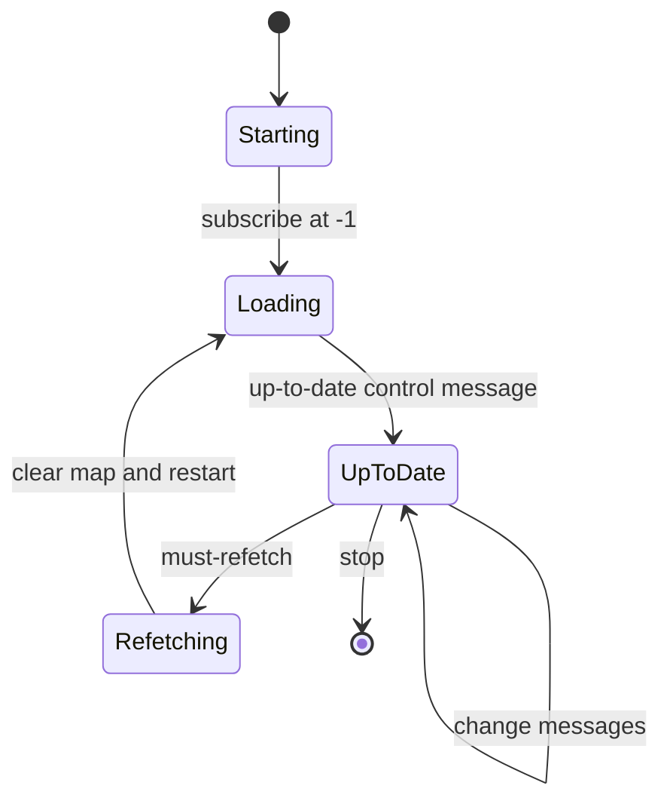
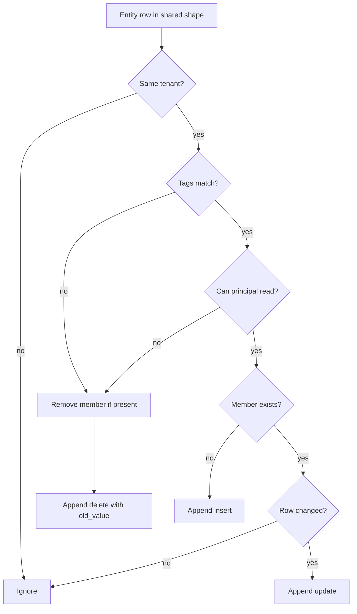

# Entity projector and membership streams

An agent often needs a list of its peers. The question is "which entities have these tags, and which of them may I read?". A SQL (Structured Query Language) query could answer it. But an agent runtime cannot hold a database connection. The server answers with a stream: `/_entities/<sourceRef>`.

Each event in that stream is a `members` change. The client reads the stream and holds a local list. This document describes `src/entity-projector.ts` (827 lines), the component that keeps those streams correct.

Two implementations exist:

- `EntityBridgeManager` in `src/entity-bridge-manager.ts` serves the single-tenant standalone runtime.
- `EntityProjector` serves the multi-tenant `AgentsHost`.

Both write the same `members` event shape to the same path namespace. This document covers the projector. [10-pg-sync-and-bridges.md](10-pg-sync-and-bridges.md) covers the manager.

## Terms and architecture

Two systems meet in this document:

- **PostgreSQL (Postgres)** holds the `entities` table and the permission tables. It is the authority for who may read what.
- **Durable Streams** is an append-only event log. Each stream has a path, an offset, and a list of JavaScript Object Notation (JSON) events. A client reads a stream and holds the result. `Durable Streams` is not Postgres and does not query it.
- **Electric** is the sync service that turns a Postgres query into a live **shape**. A *shape stream* carries the initial rows and then the changes, with offsets. Offset `-1` means the start of the log and `now` means the current tail. The control messages `up-to-date` and `must-refetch` arrive in band on the same response.

An **entity** is one agent or agent-owned object with a Uniform Resource Locator (URL), a type, a status, tags, and a parent. A **tenant** is an isolation key. A **principal** is an identity with a kind (`user`, `agent`, `service`, or `system`), a URL, and a key.

A **projection** is the in-memory object `ProjectedEntityBridge`. It owns one membership stream, one producer, and one member map. A **bridge row** is the `entity_bridges` Postgres row that stores the tag set, principal, and stream path for that projection. The **registry** is `PostgresRegistry`, the data-access layer for entities, permissions, and bridge rows. A **source reference** (`sourceRef`) is the 33-character identifier of one bridge: two 16-hexadecimal parts joined by a hyphen.

`AgentsHost` is the multi-tenant host object. The **standalone runtime** is the single-tenant runtime that `ElectricAgentsServer` starts.

A *members event* is one event in the membership stream. Its envelope is `{ type: 'members', key: <entity URL>, value?: row, old_value?: row, headers: { operation, timestamp } }`. The document describes the row fields later.

## One shape for all tenants

The projector opens one Electric shape stream over the `entities` table. It has no tenant filter:

```ts
// packages/agents-server/src/entity-projector.ts:510-535
private createShapeStream(
  offset: Offset,
  signal: AbortSignal
): ShapeStreamInterface<EntityShapeRow> {
  return new ShapeStream<EntityShapeRow>({
    url: electricUrlWithPath(this.electricUrl!, `/v1/shape`).toString(),
    params: {
      table: `entities`,
      ...(this.electricSecret ? { secret: this.electricSecret } : {}),
      columns: [...ENTITY_SHAPE_COLUMNS],
      replica: `full`,
    },
    parser: {
      int8: (value: string) => Number.parseInt(value, 10),
    },
    offset,
    signal,
    onError: (error) => {
      if (signal.aborted) {
        return {}
      }
      serverLog.warn(`[entity-projector] shared shape error:`, error)
      return {}
    },
  })
}
```

The column list is 14 columns: `tenant_id`, `url`, `type`, `status`, `tags`, `created_by`, `spawn_args`, `sandbox`, `parent`, `type_revision`, `inbox_schemas`, `state_schemas`, `created_at`, and `updated_at`.

Three choices matter:

- `replica: full` asks for the whole row plus `old_value` on an update, and the whole old row on a delete. The default mode sends only the changed columns in an update, which is not enough to compare a member row.
- The `int8` parser converts Postgres `bigint` text to a JavaScript number. The timestamp columns then arrive as numbers, not strings.
- The shape has no `where` clause. One network subscription serves every tenant.

**Aha: the fan-out is in memory, not in Postgres.** One shape stream carries all tenants. The projector therefore holds one copy of the selected entity columns for the whole process. The map uses `tenantId:url` as the key. An insert or update message replaces that key; a delete removes it. Each membership stream filters the same map by its own tenant, tags, and principal. Adding a tenant adds no database listener and no shape subscription.

## Readiness and refetch

The shape stream sends control messages in band, on the same response as the data. The projector treats two of them specially:

- `must-refetch` means the server cannot continue from the client's offset. The projector clears the entity map, resets the readiness promise, and restarts the shape at offset `-1`.
- `up-to-date` means the snapshot is complete. The projector sets the ready flag, reconciles every projection against the full map, and resolves the readiness promise.

During a refetch, the map is empty until the new snapshot arrives. Live projections keep their existing member map and receive no events, because change messages before `up-to-date` only update the shared map. The next `up-to-date` reconcile compares each projection's stored member map with the new snapshot and appends the differences. A member that vanished during the refetch gets one `delete`, not a transient delete followed by an insert.



`start()` waits for the first `up-to-date` before it loads the stored bridge rows. That order prevents a projection from starting with a partial map. A reconcile against a partial map treats every current member that the partial map lacks as stale. It would therefore append a `delete` for a member that still exists. The member would not come back until its row changed again.

A change message that arrives before `up-to-date` updates the map only. It does not touch a projection. The `up-to-date` reconcile then writes the full result once.

`register()` calls `start()` first, so a registration made during the initial load waits for the same readiness promise. It does not fail and does not create a projection against a partial map.

## Registration and the principal scope

A client registers a tag set through the observations route or the runtime. The HTTP (Hypertext Transfer Protocol) route is `POST /_electric/observations/entities/ensure-stream`. Its body is `{ tags }`, where `tags` is a string-to-string map. The caller does not send a principal. The route takes the authenticated principal from the request context and passes its URL and kind to `register()`. The projector derives a source reference from two inputs: the normalized tags and that principal.

```ts
// packages/agents-server/src/entity-projector.ts:96-104
function principalScopedSourceRef(
  tagSourceRef: string,
  principalUrl: string,
  principalKind: string
): string {
  return `${tagSourceRef}-${hashString(
    JSON.stringify({ principalKind, principalUrl })
  )}`
}
```

`sourceRefForTags` hashes the normalized tag map with a 64-bit Fowler–Noll–Vo (FNV-1a) hash and prints 16 hexadecimal characters. `hashString` is the same function: it XORs each character code into the state and multiplies by the FNV prime. The principal scope adds a second hash of `{principalKind, principalUrl}` with the same function. The code joins the two hashes with a hyphen.

A 64-bit hash can collide in principle; the code has no collision check. Two different tag sets with the same principal would then share one membership stream. Two different principals with the same tag set would also share one stream. The second case defeats the isolation rule. The probability is small, but the code does not detect it.

The principal kinds are `user`, `agent`, `service`, and `system`. The source reference includes the kind, so the same principal URL with a different kind gives a different stream.

The full `register()` path is:

1. Normalize and assert the tags.
2. Compute the principal-scoped source reference.
3. Compute the stream path `/_entities/<sourceRef>`.
4. Upsert the `entity_bridges` row with the tags, path, principal URL, and principal kind.
5. Touch the row's activity time.
6. Start the projection.

A second `register()` with the same tags and principal computes the same source reference. The upsert then updates the same row, and `ensureProjection` returns the running projection. A different tag set computes a different source reference, so it creates a second row and a second stream. The first row stays until the idle sweep removes it; a new registration never rewrites the old stream in place.

The projector stores the stream path in `entity_bridges.stream_url`. The value is a relative path such as `/_entities/1a2b3c4d5e6f7788-0123456789abcdef`, not an absolute URL. The projector joins it to the base URL of the tenant's stream client. That column is one of three stored exceptions to the computed-path rule; the others are `runners.wake_stream` and `pg_sync_bridges.stream_url`. See [04-stream-layout-and-stream-client.md](04-stream-layout-and-stream-client.md).

```ts
// packages/agents-server/src/entity-projector.ts:427-440
const tags = normalizeTags(assertTags(tagsInput))
const sourceRef = principalScopedSourceRef(
  sourceRefForTags(tags),
  principalUrl,
  principalKind
)
const streamUrl = getEntitiesStreamPath(sourceRef)
const row = await registry.upsertEntityBridge({
  sourceRef,
  tags,
  streamUrl,
  principalUrl,
  principalKind,
})
```

The principal scope is necessary. Membership includes a permission test. Two principals with the same tag filter can see different entities. They must not share one stream.

## The membership stream

`ProjectedEntityBridge` owns one stream. Its start sequence is:

1. Create the stream if it does not exist.
2. Create an `IdempotentProducer` with producer identifier `entity-bridge-<sourceRef>` and `autoClaim: true`.
3. Read the whole stream from its first offset and rebuild the current member map. The map uses the entity URL as the key and stores the last member row for that URL. An event with operation `delete` removes the key.
4. Reconcile against the shared entity map.

`autoClaim` is an `IdempotentProducer` option from the Durable Streams client. This package sets it and does not implement it. The producer starts at epoch 0. The Durable Streams server remembers the highest epoch for a producer identifier. When the client presents an older epoch, the server rejects the append. With `autoClaim`, the client reads the current epoch and retries the same append with epoch plus one. That covers a restart that reuses the producer identifier after an earlier process advanced the epoch. See [04-stream-layout-and-stream-client.md](04-stream-layout-and-stream-client.md).

Inside one run, a retry is safe because the producer keeps the same `(producerId, epoch, seq)` triple and the server drops the duplicate. Across a restart, the rebuild is what makes the stream correct. The projection reads its own history, so it recomputes any write that the old process lost from the shared map. The code does not persist a sequence number; it relies on the producer object and on the rebuild.

After step 3 the projection has a stored set. After step 4 it has a computed set: every entity in the shared map with the same tenant, matching tags, and a passing read check. The reconcile walks the stored set, removes each entity that is also in the computed set, and appends a `delete` for every URL that remains. It then appends `insert` or `update` for each computed entity. This same rule handles a member that disappears from the shared map entirely: it stays in the stored set, so it gets one `delete`.

Each event has one of three operations:

| Operation | Payload | Effect on the reader |
|-----------|---------|----------------------|
| `insert` | `value` is the member row | Add the member |
| `update` | `value` is the new member row | Replace the member |
| `delete` | `old_value` is the last member row | Remove the member |

The key is always the entity URL. The event type is always `members`.

```ts
// packages/agents-server/src/entity-projector.ts:312-333
const event =
  operation === `delete`
    ? {
        type: `members`,
        key: row.url,
        old_value: row,
        headers: {
          operation,
          timestamp: new Date().toISOString(),
        },
      }
    : {
        type: `members`,
        key: row.url,
        value: row,
        headers: {
          operation,
          timestamp: new Date().toISOString(),
        },
      }

this.producer.append(JSON.stringify(event))
```

A member row carries only what a peer needs to display and route work. The fields are URL, type, status, tags, spawn arguments, sandbox descriptor, parent URL, type revision, the two schema maps, and the two timestamps. The field names match the `entities` columns (`spawn_args`, `type_revision`, `inbox_schemas`, `state_schemas`, `created_at`, `updated_at`). The row drops `tenant_id`, `created_by`, and the permission graph. `tenant_id` is implicit in the stream, because the projection belongs to one tenant. `created_by` is a permission input, not a display field, and the permission test already consumed it.

## Tag matching

Tags are a flat map of string keys to string values. `buildTagsIndex()` turns a map into a sorted list of JSON strings, one per entry, each of the form `["key","value"]`. A projection matches when every required entry is present:

```ts
// packages/agents-server/src/entity-projector.ts:113-118
function entityMatchesTags(entity: EntityShapeRow, tags: EntityTags): boolean {
  const required = buildTagsIndex(tags)
  if (required.length === 0) return true
  const entityTags = new Set(buildTagsIndex(entity.tags))
  return required.every((tag) => entityTags.has(tag))
}
```

An empty tag set matches every entity. Tag matching is a subset test, not an equality test. An entity with extra tags still matches.

The database also has a Generalized Inverted Index (GIN) index on `tags_index`, but the projector does not use it. It filters the shared in-memory map instead. `tags_index` is a `text[]` column that the registry fills with the same sorted JSON strings from `buildTagsIndex()`. The single-tenant `EntityBridgeManager` uses that column in its shape filter, with the containment operator `tags_index @> ARRAY[...]`. The projector does not select the column in its shape stream at all.

## The permission test

Tag match is necessary but not sufficient. `canReadEntity()` runs up to four checks in order:

```ts
// packages/agents-server/src/entity-projector.ts:259-267
private async canReadEntity(entity: EntityShapeRow): Promise<boolean> {
  if (this.permissionBypass) return true
  if (!this.principalUrl || !this.principalKind) return false
  if (entity.created_by === this.principalUrl) return true
  return await this.registry.hasEntityPermission(entity.url, `read`, {
    principalUrl: this.principalUrl,
    principalKind: this.principalKind,
  })
}
```

1. A built-in system principal bypasses the check.
2. A projection with no principal identity returns false.
3. The entity creator may always read its own entity. Here the bypass covers read only, because this function asks for read.
4. The materialized effective-permission table decides the rest.

Two permission tables matter. `entity_permission_grants` stores the grant as written: entity URL, permission, subject kind, subject value, propagation, and expiry. `entity_effective_permissions` stores the resolved result: one row for each entity and subject that may act, after the code applies propagation and expiry. `hasEntityPermission` reads the effective table. A grant with `propagation = 'descendants'` produces effective rows for the entity and every entity below it in `entity_lineage`. `copy_to_children` writes grant rows on the children as well. A type grant uses the same model and applies to entities of that type.

The constructor sets `permissionBypass` from `isBuiltInSystemPrincipalUrl(row.principal_url)`. It is true only for `system:framework`, `system:auth-sync`, and `system:dev-local`. A bridge row with a null `principal_url`, or with a malformed one, gets no bypass and no creator match.

A projection with no principal identity returns false for every entity except through the bypass. That is a fail-closed default.

`applyEntity()` is the per-entity decision used by both the initial reconcile and each live change. It compares the entity against the tag and read tests, then adds, updates, or deletes that one member. This test is why an `update` can produce a `delete`. If an entity loses a tag or loses read permission, `applyEntity()` writes a `delete` for the stored member row.

The permission change itself is not an entity change. A grant write changes `entity_permission_grants` and `entity_effective_permissions`, not the `entities` row, so the shared shape over `entities` sends no event. The grant routes compensate with a direct call to `entityBridgeManager.onEntityChanged(entityUrl)` after a create or a delete.

`EntityBridgeCoordinator` is the interface that both implementations satisfy. It has `register`, `onEntityChanged`, `touchByStreamPath`, `beginClientRead`, `start`, and `stop`. In the multi-tenant host the object is the `EntityProjectorTenantFacade`. Its `onEntityChanged` asks the projector for the cached row, then calls `applyEntity` on every projection of that tenant. The call re-applies **that** entity only. It does not re-apply descendants that inherit the grant through `propagation = 'descendants'`, because their rows are not the row that changed. A descendant's membership can therefore stay stale until its own row changes.

The standalone runtime has a different object under the same name. There, `entityBridgeManager` is the real `EntityBridgeManager`, and its `onEntityChanged` is a no-op. That is not a bug: the standalone bridge holds no second copy of the filter, so it has no cached decision to refresh. See [10-pg-sync-and-bridges.md](10-pg-sync-and-bridges.md).



The registry lookup is per entity per evaluation. Reconciling a large tag set does many point queries. The `hasEntityPermission` query is a single indexed lookup, as described in [03-entity-registry-and-postgres.md](03-entity-registry-and-postgres.md).

`reconcile()` walks the entities in sequence and awaits each permission check. It does not run the checks in parallel. It filters by tenant first, then by tags, and only then asks for permission, so a non-matching entity costs no database round trip. A tenant with many matching entities therefore takes one round trip after another during a full reconcile. An incremental change message runs the same check for one entity only.

`reconcile()` has no `try`/`catch` around `hasEntityPermission`. A database error rejects that reconcile pass, and the code does not evaluate the remaining entities in it. The next start or refetch repairs the projection. An error on one live change message also rejects the callback for that message batch.

**Aha: the fan-out is cheap but the filter is not free.** The entity map is in memory, and all tenants and projections share it. Each projection still asks Postgres once per candidate entity, because the grant table is the authority. A cache of permission decisions could remove those lookups, and the code has no such cache here.

## Keeping a projection alive

A projection costs one stream, one producer, and one map. The server removes it when nobody needs it. Two read signals keep it alive:

- A `HEAD` request on the stream calls `touchByStreamPath`. The routing hook is in `proxyPassThrough`, as described in [06-http-routing.md](06-http-routing.md).
- A `GET` request calls `beginClientRead`, which increments a counter, touches the row on open, and touches it again on close. The counter is per tenant and source reference. A nested close decrements the counter and clears it at zero.

The idle sweep runs every 5 minutes, and only for tenants that the projector has a registry for. Each tenant uses its own `PostgresRegistry`, and `listStaleEntityBridges` adds `tenant_id = <tenant>` to the query, so the sweep never reads another tenant's rows. Its steps are:

1. Read `listReferencedEntitySourceRefs()`. That method returns the distinct `source_ref` values in `entity_manifest_sources` for the tenant. These are the "manifest" references that keep a bridge alive.
2. Touch every referenced bridge row, so its activity time is current.
3. Read `listStaleEntityBridges(now - 15 minutes)`. That method returns rows whose `last_observer_activity_at` is older than the cut-off.
4. For each stale row, delete only when all three conditions hold:
   - No manifest references the source.
   - No client read is active.
   - The row is stale.
5. Stop the projection before it deletes the row.

A later `HEAD` or `GET` does not recreate the row. `touchEntityBridge` is an `UPDATE`, so it does nothing when the row is gone, and `ensureProjectionForSourceRef()` returns when `getEntityBridge()` finds no row. A `register()` call is what creates the row again. A client that holds the stream path after a sweep must register the tag set again. The stream itself, with its event history, remains.

A new `register()` for the same tags and principal computes the same source reference and therefore the same path. The new producer reads the remembered epoch and claims the next one, so its first append does not collide with the old history. The start sequence reads that history into the member map before it reconciles, so the projection appends only the differences. It does not replay every member as a new `insert`.

## Multi-tenant wiring

`AgentsHost` owns one `EntityProjector`. Each tenant gets a facade:

```ts
// packages/agents-server/src/entity-projector.ts:789-804
async register(
  tagsInput: unknown,
  principalUrl: string,
  principalKind: string
): Promise<{
  sourceRef: string
  streamUrl: string
}> {
  return await this.projector.register(
    this.tenantId,
    this.registry,
    tagsInput,
    principalUrl,
    principalKind
  )
}
```

The facade implements `EntityBridgeCoordinator`. The entity manager and the runtime see the same interface in both deployment modes. See [08-tenancy-permissions-and-principals.md](08-tenancy-permissions-and-principals.md).

A tenant enters the projector through `forTenant(tenantId, registry)`, which stores the registry in a map and returns a facade. The optional `tenantIds` provider is a function that returns the set of tenant identifiers that the host wants to serve. It filters the persisted bridge rows at start and during the idle sweep. The projector therefore ignores a row from a tenant that the host does not serve. Without a provider, the projector loads every tenant row. `loadTenantBridges()` waits for readiness and then loads one tenant's rows. That is the hook that `AgentsHost` calls after it registers a tenant. The verb "register" here means "add a tenant to the host", not "register a tag set on the projector".

The read side uses one shared Electric URL, because the shape has no tenant filter. The write side is per tenant. `streamClientForTenant(tenantId)` returns a `StreamClient` for that tenant's Durable Streams origin. If the host has no client for the tenant, the call throws an error that `isUnregisteredTenantError` recognizes. The projector logs a warning and skips that row. It does not fail the whole shape stream because one tenant row cannot resolve a stream client.

## Limits and open questions

- The shared shape stream needs the Electric URL. Without it, `start()` returns at once and does nothing, and `register()` throws `Electric URL is required for entities()`.
- The projector keeps the whole `entities` table in memory for the selected columns. For a very large table, that is the main cost.
- The source code does not state a maximum number of projections. The idle sweep bounds the number of unused ones.
- A read does not restore a swept bridge row. It needs a new `register()` call.
- A grant that propagates to descendants does not refresh those descendants in the membership streams.
- The permission test does not call the external authorization hook. The hook is the optional `authorizeRequest` function that the server calls during permission checks; a host uses it to add or deny access. The membership test uses the materialized table only. A custom hook that grants read access does not affect membership. This is observed behaviour, not a documented rule.

## Related documents

- [03-entity-registry-and-postgres.md](03-entity-registry-and-postgres.md) explains `entity_bridges` and the permission tables.
- [04-stream-layout-and-stream-client.md](04-stream-layout-and-stream-client.md) explains the `/_entities/` path.
- [06-http-routing.md](06-http-routing.md) explains the observations routes that create membership streams.
- [10-pg-sync-and-bridges.md](10-pg-sync-and-bridges.md) covers the single-tenant `EntityBridgeManager`.
