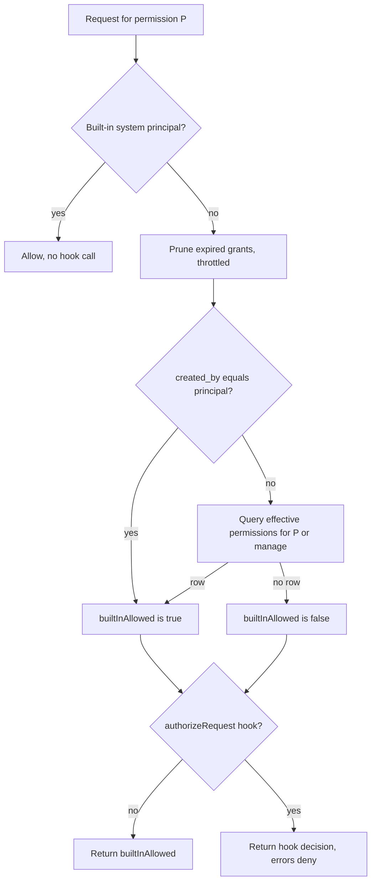
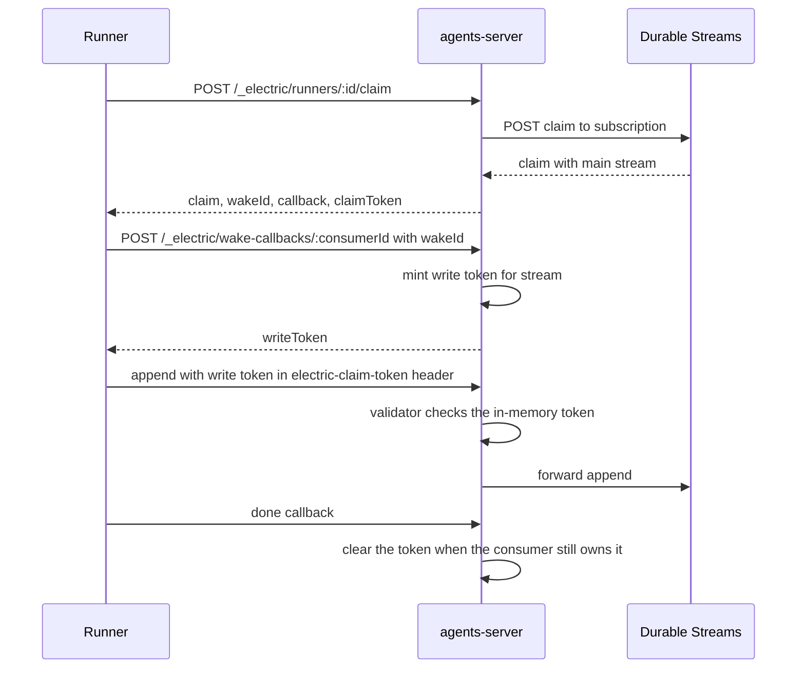

# Tenancy, permissions, and principals

Every request is evaluated under two identities: a tenant and a principal. The tenant selects the PostgreSQL (Postgres) rows. The principal selects the grants. The principal may come from the request, from an authentication option, or from the development fallback described below. This document describes the identities, then the grant model, the authorization hook, the write tokens, and the webhook signatures.

## Terms

- An **entity** is one agent or agent-owned object. An agent is represented by one entity, and the entity Uniform Resource Locator (URL) identifies it. The URL has the shape `/<entity type>/<instance id>`, for example `/worker/abc`. Its **entity path** is that URL. Its **main stream** is `<entity path>/main`.
- A **stream** is an append-only event log served by the Durable Streams server, a separate stream backend. A **stream path** is the path that names it. The **routing adapter** converts a runtime stream path to a backend path and back. With the default adapter, both forms lose the leading slash: `/worker/abc/main` becomes `worker/abc/main`. A custom adapter can add a tenant prefix.
- `AgentsHost` is the multi-tenant host. A **tenant runtime** is the object that `AgentsHost` creates for one tenant. The **standalone runtime** is the single-tenant runtime that `ElectricAgentsServer` starts.
- A **registry** is the `PostgresRegistry` object that reads and writes the Postgres tables for one tenant. A **`DrizzleDB`** is the database handle that the registry uses. All tenants share one connection pool.
- The **embedded streams server** is the in-process `DurableStreamTestServer` that the server can start for development.
- A **grant row** is a row that direct Structured Query Language (SQL) or a grant route writes: `entity_permission_grants` or `entity_type_permission_grants`. An **effective row** is a row in `entity_effective_permissions`. Propagation creates effective rows, and expiry makes them unusable until the pruner removes them. A permission check reads the effective row, not the grant row.
- A **write token** authorizes an append to one entity main stream. A **claim token** is the upstream credential that a runner receives in a claim response. A **claim write token** is the local in-memory token that the wake callback returns as `writeToken`. It is the write token that this package's server accepts. This document uses all three terms in the write-token section.

The tenant does not select the stream namespace by default. The default routing adapter removes a leading slash from each stream path and adds no prefix. Two tenants with the same entity path would then use the same stream. The registry keeps the rows apart with `tenant_id`, but the stream path alone is not tenant-scoped. `AgentsHost` can give each tenant its own `durableStreamsUrl`, and a deployment can inject a routing adapter that adds a prefix. Both keep the stream namespaces apart. See [04-stream-layout-and-stream-client.md](04-stream-layout-and-stream-client.md).

The default standalone server has one tenant, so a collision cannot occur there. For a multi-tenant `AgentsHost`, either do not share one `durableStreamsUrl`, or share it and install a prefixing routing adapter. Without one of these choices, two tenants that use the same entity path share one stream.

## Principals

A principal is a caller. It has one of four kinds: `user`, `agent`, `service`, or `system`. The kind is a label. The package grants no privilege by kind; the only exception is the three built-in `system` identifiers described below. The package does not attach a different behaviour to the `user`, `agent`, and `service` labels.

```ts
// packages/agents-server/src/principal.ts:21-30
export function parsePrincipalKey(input: string): Principal {
  const colon = input.indexOf(`:`)
  if (colon <= 0) throw new Error(`Invalid principal identifier`)
  const kind = input.slice(0, colon) as PrincipalKind
  const id = input.slice(colon + 1)
  if (!PRINCIPAL_KINDS.has(kind)) throw new Error(`Invalid principal kind`)
  if (!id || id.includes(`/`)) throw new Error(`Invalid principal id`)
  const key = `${kind}:${id}`
  return { kind, id, key, url: `/principal/${encodeURIComponent(key)}` }
}
```

A `Principal` has four fields: `kind`, `id`, `key`, and `url`. The canonical key is `<kind>:<id>`. The identity URL is `/principal/<encoded key>`. An identifier cannot contain a slash, so the URL is always one path segment.

`parsePrincipalKey` throws on a bad key: no colon, an unknown kind, an empty id, or an id with a slash. `parsePrincipalUrl` returns `null` on a bad URL. Callers choose the behaviour they need.

A request supplies the principal in the `electric-principal` header. `getPrincipalFromRequest` accepts either the canonical key or the `/principal/...` URL form. The host can put the `authenticateRequest(request)` option before this step; it returns a `Principal` or `null`, and a `null` result falls through to the header.

A malformed header value becomes `null` and then `401 UNAUTHORIZED`, unless the development fallback applies. A throw from `authenticateRequest` is different: it becomes `400 INVALID_REQUEST` with the error message in the body.

### Built-in system principals

Three system principals bypass entity and type checks:

- `system:framework`
- `system:auth-sync`
- `system:dev-local`

```ts
// packages/agents-server/src/principal.ts:74-92
const BUILT_IN_SYSTEM_PRINCIPAL_IDS = new Set([
  `framework`,
  `auth-sync`,
  `dev-local`,
])

export function isBuiltInSystemPrincipalUrl(url: string | undefined): boolean {
  if (!url?.startsWith(`/principal/`)) return false
  try {
    const principal = parsePrincipalUrl(url)
    if (!principal) return false
    return (
      principal.kind === `system` &&
      BUILT_IN_SYSTEM_PRINCIPAL_IDS.has(principal.id)
    )
  } catch {
    return false
  }
}
```

A `system` principal with an id other than the three built-ins does not bypass checks. Only these three identifiers do.

`isPermissionBypassPrincipal(ctx)` is the request-side wrapper. It returns `true` when the context principal is one of the three built-in URLs. A bypass skips the creator test, the effective-permission query, and the authorization hook, so those requests are allowed without a grant. The bypass is called by the entity check, the entity type check, the type registration check, and the shared-state check. The grant routes use the entity or type check, so the bypass covers them too.

The creator rule is separate and broader than it looks. In `canAccessEntity`, `entity.created_by === ctx.principal.url` sets `builtInAllowed` to true for **every** permission value, including `manage` and `delete`. The creator therefore passes the built-in stage of every entity check. The authorization hook can still deny it. If no hook is installed, the creator is allowed every entity operation.

### Development fallback

The server uses `system:dev-local` when no principal arrives and the fallback is allowed. The option `allowDevPrincipalFallback` has three-valued behaviour:

1. When the option is set to `true` or `false`, that value wins. An explicit `false` disables the fallback even in development.
2. When the option is unset, the fallback is allowed if `ELECTRIC_INSECURE` is `true`.
3. When the option is unset and that variable is not `true`, the fallback is allowed if `NODE_ENV` is not `production`. It is also allowed if the process owns the embedded streams server (`options.durableStreamsServer` is set). A production process that sets `options.durableStreamsServer` therefore allows the fallback, because the embedded server is a development facility.

Without the fallback, a request with no usable principal returns `401 UNAUTHORIZED`. The context is in [06-http-routing.md](06-http-routing.md).

The resolution order is:

| Situation | Result |
|-----------|--------|
| `authenticateRequest` returns a principal | That principal |
| `authenticateRequest` is absent or returns `null`, and the header is valid | The header principal |
| `authenticateRequest` is absent or returns `null`, and the header is absent or malformed | `system:dev-local` if the fallback applies, else `401 UNAUTHORIZED` |
| `authenticateRequest` throws | `400 INVALID_REQUEST`, and the fallback does not apply |

The principal is not authenticated by this package. The `authenticateRequest` option has the first chance to build a principal. When that option is absent or returns `null`, the package trusts the `electric-principal` header or the principal URL in it. The server therefore assumes a trusted proxy or an application-level check in front of it. A throw from `authenticateRequest` becomes `400 INVALID_REQUEST`, with the error message in the body; it does not become `401` or `500` (`packages/agents-server/src/server.ts:407-415`). A malformed header from an unauthenticated request is not a throw: it produces `null`, so the result is `401` when the fallback is off.

## Tenants

The tenant identifier is the `service` value in the request context. In the standalone server it is `options.service`, then `options.tenantId`, then `default`. In `AgentsHost` it is the `serviceId` of the tenant runtime. The base value is:

```ts
// packages/agents-server/src/tenant.ts:1
export const DEFAULT_TENANT_ID = `default`
```

The tenant is a string, not a connection. Every registry instance holds one `DrizzleDB` over the shared pool and one tenant identifier. Every read and write includes `tenant_id`. The primary keys are composite. For example, `entities` uses `(tenant_id, url)`.

Two deployment shapes use the same rows:

- `ElectricAgentsServer` starts one standalone runtime for one tenant.
- `AgentsHost` starts one runtime per registered tenant.

`AgentsHost` has no single Hypertext Transfer Protocol (HTTP) listener. The embedder chooses the tenant, for example from the host name or a path prefix, and calls `getTenant(serviceId)` or `requireTenant(serviceId)`. The returned tenant runtime handles the request.

`AgentsHost` shares four long-lived components across tenants:

| Component | What it does | Why it is shared |
|-----------|--------------|------------------|
| `WakeRegistry` | Matches stream events to wake conditions | One shape stream over `wake_registrations` for all tenants |
| `Scheduler` | Reserves due rows from `scheduled_tasks` and fires them | One loop over `scheduled_tasks`, scoped to the registered tenant list |
| `TagStreamOutboxDrainer` | Drains `tag_stream_outbox` and appends tag events | One drain loop over `tag_stream_outbox` |
| `EntityProjector` | Projects `entities` rows into membership streams | One shape stream over `entities` |

The wake registry and the projector read rows for all tenants and resolve the tenant from each row. The scheduler and the tag outbox filter by the registered tenant list, which they sample at the start of each pass. The scheduler's *claim* is a row reservation; it is not the runner claim described in the write-token section.

Each tenant gets its own `StreamClient`, `PostgresRegistry`, and `PostgresSchedulerClient`. The scheduler client forwards a task to the tenant runtime by tenant identifier.

Tenant registration is serialized per tenant:

```ts
// packages/agents-server/src/host.ts:160-172
async registerTenant(
  config: AgentsHostTenantConfig
): Promise<AgentsHostTenantRuntime> {
  const serviceId = config.serviceId
  return await this.withTenantOperation(serviceId, async () => {
    const runtime = this.tenantRuntimes.get(serviceId)
    if (runtime) return runtime

    const existing = this.tenantRegistrations.get(serviceId)
    if (existing) return existing

    const runtimePromise = this.createTenantRuntime(config)
    this.tenantRegistrations.set(serviceId, runtimePromise)
    // ...
```

`withTenantOperation` chains operations on a per-tenant promise. Two concurrent register calls for one tenant cannot create two runtimes. Two calls for different tenants can run in parallel.

**Aha: tenancy is a filter, not a partition.** A partition would give each tenant its own database or schema. Here all tenants share one Postgres pool, one wake cache, and one scheduler loop, and only the `tenant_id` column separates their rows. A missing tenant filter is therefore a data leak, not a performance bug. The registry applies the filter in every query by construction, because the tenant is a constructor argument and not a method argument.

An unregistered tenant raises `UnregisteredTenantError`. Shared loops catch this error and skip the tenant instead of stopping. The entity projector also skips it during start-up. In the scheduler, the tenant list is sampled at the start of a pass. A tenant that is unregistered after that sample can still reach an executor for an already-claimed row. The scheduler then releases the claim and logs a warning, so the row is not lost and does not block the loop.

## The grant model

The grant model has three tables. `entity_type_permission_grants` holds type grants. `entity_permission_grants` holds entity grants. `entity_effective_permissions` holds the materialized rows that the check query reads.

A **grant row** is the source of truth for one grant: who granted what, to which subject, with which propagation and expiry. An **effective row** is the resolved permission for one entity and subject after propagation and expiry. The type check reads `entity_type_permission_grants` directly, because a type has no lineage and no materialized table. The entity check reads `entity_effective_permissions`. A grant row with `propagation = 'descendants'` is one row, but it can produce an effective row for every entity in the subtree.

Each of the two grant tables has a list, create, and delete route. A *subject* is the principal or principal kind that receives the grant.

- Entity grants: `GET` and `POST /_electric/entities/:type/:instanceId/grants`, and `DELETE /_electric/entities/:type/:instanceId/grants/:grantId`.
- Type grants: `GET` and `POST /_electric/entity-types/:name/grants`, and `DELETE /_electric/entity-types/:name/grants/:grantId`.

Every route in both groups requires `manage` on the entity or the entity type whose grants it lists. It does not require `manage` on the subject that receives the grant. Entity grant routes use `canAccessEntity`, so the creator of an entity passes this check without a grant. Type grant routes have no creator rule. For a fresh deployment, the first entity grant can come from the entity creator. The first type grant must come from one of the three built-in system principals or from a request that an authorization hook allows.

Entity permissions have eight values. Each one gates a route or a manager method:

| Permission | Allows |
|------------|--------|
| `read` | `GET` and `HEAD` on the entity and its attachments, and membership in a projection (the filtered membership stream described in [07-entity-projector.md](07-entity-projector.md)) |
| `write` | Send, collection write, attachment create and delete, inbox update and delete, tag set and delete, webhook-source subscription changes |
| `delete` | `DELETE /:type/:instanceId`, which kills the entity |
| `signal` | `POST /:type/:instanceId/signal` |
| `fork` | `POST /:type/:instanceId/fork` |
| `schedule` | Create, replace, and delete a schedule |
| `spawn` | Spawn a new entity under this parent; the type-level `spawn` is also required |
| `manage` | Every other permission, plus grant list, create, and delete |

On an entity type, the `spawn` permission allows `GET /_electric/entity-types/:name`, which returns the type record. The route mapping is in [06-http-routing.md](06-http-routing.md). The operations in the `write` row are the entity manager methods described in [02-entity-manager.md](02-entity-manager.md).

Entity type permissions have two values: `spawn` and `manage`.

A grant names a subject in one of two forms:

- `subject_kind = 'principal'`: the subject value is a principal URL.
- `subject_kind = 'principal_kind'`: the subject value is a principal kind, such as `user`. Every user matches.

Both grant tables share the fields `tenant_id`, `permission`, `subject_kind`, `subject_value`, `created_by`, `expires_at`, `created_at`, and `updated_at`. An entity grant adds `entity_url` and the two fields below. A type grant adds `entity_type` and has neither of the two fields. `expires_at` is a timestamp or null; null means the grant does not expire.

| Field | Values | Meaning |
|-------|--------|---------|
| `propagation` | `self`, `descendants` | `self` covers the granted entity; `descendants` covers that entity and its whole subtree |
| `copy_to_children` | boolean | Copy the grant to a new child at spawn |

`manage` implies every other permission. Both check functions ask for the requested permission **or** `manage`:

```ts
// packages/agents-server/src/entity-registry.ts:1046-1066
const permissions = [permission, `manage`] as const
const rows = await this.db
  .select({ id: entityTypePermissionGrants.id })
  .from(entityTypePermissionGrants)
  .where(
    and(
      eq(entityTypePermissionGrants.tenantId, this.tenantId),
      eq(entityTypePermissionGrants.entityType, entityType),
      inArray(entityTypePermissionGrants.permission, [...permissions]),
      sql`(${entityTypePermissionGrants.expiresAt} IS NULL OR ${entityTypePermissionGrants.expiresAt} > now())`,
      sql`(
        (${entityTypePermissionGrants.subjectKind} = 'principal'
          AND ${entityTypePermissionGrants.subjectValue} = ${subject.principalUrl})
        OR
        (${entityTypePermissionGrants.subjectKind} = 'principal_kind'
          AND ${entityTypePermissionGrants.subjectValue} = ${subject.principalKind})
      )`
    )
  )
  .limit(1)
return rows.length > 0
```

The entity check uses the same pattern against `entity_effective_permissions`. The grant is stored once, and the effective rows are materialized. `principalSubject(principal)` returns `{ principalUrl: principal.url, principalKind: principal.kind }`, so one grant can match a named principal or every principal of one kind. See [03-entity-registry-and-postgres.md](03-entity-registry-and-postgres.md).

### Descendants and copy

`propagation = 'descendants'` writes effective rows for the granted entity and for every descendant that exists at grant time. `entity_lineage` is a closure table: each row holds a tenant, an ancestor URL, a descendant URL, and a depth. A self row has depth 0, and a row with depth *n* links an ancestor *n* levels above that descendant. The insert joins lineage rows where `ancestor_url` is the granted entity, so the depth 0 self row makes the granted entity match as well. The coverage is not limited to direct children.

A future child gets the same access inside its own `createEntity` transaction. That transaction inserts the child's self lineage row and copies the parent's ancestor rows with depth plus one. It then inserts an effective row for every unexpired `descendants` grant whose `entity_url` is one of the child's ancestors. The row records the source entity, the source grant identifier, the permission, the subject, and the expiry.

`copy_to_children = true` is a different mechanism. It copies a parent grant to the new child as a new grant row with `propagation = 'self'`. The copy keeps the same permission, subject, expiry, and `copy_to_children` value. It changes the entity URL and sets the propagation to `self`. The copy therefore cannot add a permission or a subject that the parent grant did not have. Only an unexpired parent grant is copied. The copy runs after the spawn, in the entities router, and it reads the parent from the `parent` field of the spawn request body. It does not copy grants from the type, and it does not copy grants of the fork source.

| Mechanism | Rows created for a new child | When | Child grant list shows it |
|-----------|----------------------------|------|---------------------------|
| `propagation = 'descendants'` | Effective row only | Inside `createEntity` | No |
| `copy_to_children = true` | New grant row plus its effective row | After the spawn, in the router | Yes |

The spawn request body has an optional `grants` array. Each entry creates an entity grant on the new entity. The `copy_to_children` copy and the request `grants` run as separate writes after the spawn has committed, and the handler has no transaction around them (`packages/agents-server/src/routing/entities-router.ts:1497-1519`). A failure in the middle leaves the entity spawned with a partial set of grants. The caller then receives an error for a spawn that did happen. A retry with the same instance identifier then reports a conflict on the entity row.

A grant with `propagation = 'descendants'` and `copy_to_children = false` still gives a future child effective access for the granted permission. The child gets no grant row of its own, so the grant list on the child does not show it, because that list reads `entity_permission_grants`. The effective row is the only proof of the access.

### Expiry

The check query ignores an expired row. A pruner removes expired rows. The pruner is lazy and throttled to one pass per 30,000 ms. The throttle bounds how often a pass starts; it does not bound how long a request waits. A request that arrives while a pass runs waits for that pass. The first permission-aware request after a process start therefore pays for a full pass. The throttle timestamp records the start of the last pass, and it starts at 0. A failed pass resets the timestamp to 0, so the next request tries again. A second pass cannot overlap a running one; the caller waits for the current promise. Each registry prunes only its own tenant. In one transaction, the pruner deletes expired entity grant rows and their effective rows, then every remaining expired effective row, then expired type grant rows.

The future-child insert filters `expires_at IS NULL OR expires_at > now()`. An expired grant is therefore not copied to a new child, even if its effective rows are still present.

## The resolution chain

`canAccessEntity` runs this chain:

```ts
// packages/agents-server/src/permissions.ts:29-53
export async function canAccessEntity(
  ctx: TenantContext,
  entity: ElectricAgentsEntity,
  permission: EntityPermission,
  request?: Request
): Promise<boolean> {
  if (isPermissionBypassPrincipal(ctx)) return true
  await ctx.entityManager.registry.pruneExpiredPermissionGrants?.()

  const builtInAllowed =
    entity.created_by === ctx.principal.url ||
    (await ctx.entityManager.registry.hasEntityPermission(
      entity.url,
      permission,
      principalSubject(ctx.principal)
    ))

  return await applyAuthorizationHook(ctx, {
    verb: permission,
    resourceKey: `entity:${entity.url}`,
    resource: { kind: `entity`, entity },
    builtInAllowed,
    request,
  })
}
```



The entity type check has the same shape but no creator rule. Type registration is the route `POST /_electric/entity-types`, which creates a new type name. Its check always passes `builtInAllowed: true`, so the hook is the only gate. Without a hook, a principal may register a new type name. An existing type name is different: the route first asks for `manage` on that type, and a deny returns 401 before the registration check runs.

`canAccessSharedState` is different. A *shared-state identifier* is the value after `/_electric/shared-state/`; the stream path is `/_electric/shared-state/<id>`. The check reads `shared_state_links` for that identifier. For each linked entity, it reads the entity row and accepts when the principal is the creator or holds the effective row for the permission. The loop stops at the first link that passes; the hook then runs once with `builtInAllowed: true`. If no link passes, the hook runs once with `builtInAllowed: false`, and it still decides. A built-in system principal bypasses the whole check. The cost is one entity read and one effective-row query per linked entity, in sequence, up to the first match.

The `electric-owner-entity` header adds a bootstrap link before the link row exists. A write request (`PUT` or `POST`) may carry the header. The header value is an entity URL. The server does not trust the header on its own. It adds the URL to the candidate list. It then requires the principal to be the creator of that entity, or to hold the permission through `entity_effective_permissions`. The header has no effect when the stored link list is not empty. The resolved list is the union of the stored links and that one owner.

The write route persists the link **before** the append, not after it. It calls `replaceSharedStateLink` synchronously, so a read that follows the write can resolve the owner immediately. The source comment gives the reason. Without this, a new shared state returns 401 on the first *preload*, the runtime's read of shared state at startup. The link row would otherwise appear only later through the entity source manifest stream described in [10-pg-sync-and-bridges.md](10-pg-sync-and-bridges.md). See [06-http-routing.md](06-http-routing.md).

## The authorization hook

The hook is `authorizeRequest`. The server passes it in the options and stores it in the request context.

```ts
// packages/agents-server/src/electric-agents-types.ts:130-141
export type AuthorizeRequest = (input: {
  tenant: string
  principal: Principal
  verb: EntityPermission | EntityTypePermission
  resource: AuthorizationResource
  request?: {
    method: string
    url: string
    headers: Record<string, string>
  }
  builtInAllowed: boolean
}) => Promise<AuthorizationDecision> | AuthorizationDecision
```

The hook returns `{ decision: 'allow' | 'deny', expires_at?: string }`.

When a hook is installed, and the principal is not a built-in system principal, the hook has the final word. An allow from the creator rule or the materialized table does not bypass it. A deny in the hook denies the request, even when the materialized table has a matching grant. The hook receives `builtInAllowed` as advice, not as a result.

A hook error denies the request and writes a warning:

```ts
// packages/agents-server/src/permissions.ts:190-196
} catch (error) {
  serverLog.warn(`[agent-server] authorization hook failed:`, error)
  return false
}
// ... success path continues:
cacheDecision(hook, cacheKey, decision)
return decision.decision === `allow`
```

A decision is cached only when it has a valid `expires_at`. The cache key is `service|principalUrl|verb|resourceKey`. The `resourceKey` values are `entity:<url>`, `entity_type:<name>`, `entity_type_registration:<name>`, and `shared_state:<id>`. The cache is a module-level `WeakMap` keyed by the hook function, with one `Map` per hook, in process memory. A restart empties it, and a grant change does not invalidate it; an entry disappears only when a request reads it after its expiry. The cache belongs to the hook function object, so two different hooks do not share entries. A decision without `expires_at`, with an unparseable value, or with a value in the past is not cached. A `deny` decision is cached in the same way as an `allow`, so a deny can last until its `expires_at`. A hook error is not cached.

The cache key does not include the request method, the request URL, the request headers, or `builtInAllowed`. The hook still receives them, but a cached decision cannot depend on them. A hook that branches on, for example, the HTTP method, a custom header, or `builtInAllowed` gives one answer for the first request. It then reuses that answer for every later request with the same service, principal, verb, and resource until the entry expires. That can serve a stale allow or deny after a grant changes. Write such a hook to return decisions that depend only on the four key fields. Alternatively, return no `expires_at`, so the hook runs for every request.

The hook runs for entities, entity types, type registration, and shared state. It does not run inside the entity projector. A hook allow therefore does not change which entities appear in a membership stream, such as `/_entities/<source>`; the projector applies its own read filter. This follows from the code path, because the projector has no call to the hook. That is an observed limit, not a documented rule.

## Write tokens

A stream append to an entity main stream must carry a write token. A shared-state append does not; its guard is the permission check. The server supports two write-token schemes, chosen by whether a custom validator is installed.

### The row token

`spawn` creates a random token and stores it in `entities.write_token`. The spawn response returns the same value in the `x-write-token` header. The manager compares the presented token with the row token when no custom validator is installed:

```ts
// packages/agents-server/src/entity-manager.ts:444-448
isValidWriteToken(entity: ElectricAgentsEntity, token: string): boolean {
  return this.writeTokenValidator
    ? this.writeTokenValidator(entity, token)
    : token === entity.write_token
}
```

That output header is never read on an append. An append presents its write token in the `electric-claim-token` request header. The header name is historical: it carries the write token, not the `claimToken` from a claim response. If the header is absent, the append reads `Authorization` and removes an optional `Bearer ` prefix, in any letter case. The first source wins.

An entity main stream is the only stream that uses this write token. Attachment streams and shared-state streams are separate paths. A shared-state append uses the permission check instead, and a claim write token does not authorize an attachment.

### The claim write token

The runtime always installs a validator that uses claim write tokens:

```ts
// packages/agents-server/src/runtime.ts:95-100
writeTokenValidator: (entity, token) =>
  this.claimWriteTokens.isValid(
    this.serviceId,
    entity.streams.main,
    token
  ),
```

Because the runtime always installs this validator, a server started through `ElectricAgentsServer` or `AgentsHost` does not accept the static row token. The row token is the fallback only for a manager created without a validator. The claim write token is the local token that the wake callback returns as `writeToken`. It is scoped to one stream: the main stream of one entity in one tenant. It does not authorize an attachment or a shared-state stream.

The row column still has two jobs. The `entities` table declares `write_token` as `NOT NULL`, so every entity needs a value. A manager constructed outside this package without a write-token validator still uses it. But an append through this package's server never compares against it, so the value from the spawn header is not a working credential there.

`ClaimWriteTokenStore` holds a map from stream key to one active token. The key is `service\0streamPath`. `mint()` replaces any previous token for that stream, records the `consumerId` that minted it, and returns a new Universally Unique Identifier (UUID).

The flow has two different tokens with similar names:

1. A runner claims work with `POST /_electric/runners/:id/claim`. The response carries `claimToken`, `consumerId`, `wakeId`, and `callback`. The `claimToken` is the upstream claim credential from Durable Streams. It is not the write token, and the append path does not accept it.
2. The `callback` value is the wake callback URL, `/_electric/wake-callbacks/<wakeId>`.
3. The runner posts the `wakeId` to that callback. The callback is local: the server mints a claim write token for the claimed stream and returns it as `writeToken`, without an upstream call.
4. The runner appends to the main stream with that write token.
5. A `done` callback or a terminal signal clears the token.

A second wake callback for the same stream replaces the token and invalidates the earlier one. This matches the one-active-consumer rule of the pull-wake model. A *pull-wake* subscription is one where the worker claims pending work and reads the stream itself, rather than receiving the event in a webhook. See [09-runners-and-sandboxes.md](09-runners-and-sandboxes.md). The store is in memory, not in Postgres. A process restart clears every token, and a runner must claim again. See [06-http-routing.md](06-http-routing.md).



The `done` handler clears the token only when `owns(service, streamPath, consumerId)` is true, which means the token entry still records this consumer. A newer claimant keeps its own token. `killEntity` and a terminal signal also clear the stream token. A *terminal signal* is a signal whose resulting state is `stopped` or `killed`.

## Webhook signatures

The server signs the webhook bodies that it forwards to an agent handler. An *agent handler* is the webhook target that receives wake notifications for one entity. The scheme is Ed25519, an elliptic-curve signature scheme. The signature value has three parts:

```ts
// packages/agents-server/src/webhook-signing.ts:89-97
export function signWebhookBody(
  privateKey: KeyObject,
  kid: string,
  body: Uint8Array | string
): string {
  const timestamp = Math.floor(Date.now() / 1000)
  const payload = bytesWithTimestamp(timestamp, body)
  const signature = sign(null, payload, privateKey).toString(`base64url`)
  return `t=${timestamp},kid=${kid},ed25519=${signature}`
}
```

The signed payload is `<timestamp>.<body>`. The timestamp is in seconds. The server puts the result in the `webhook-signature` header of each forwarded webhook delivery, after it has enriched the body. A receiver must check the timestamp to prevent a replay. The server signs the timestamp but does not define how old a timestamp may be. The receiver must choose that tolerance, for example five minutes, and reject an older or future-dated value.

The public key is a JavaScript Object Notation (JSON) Web Key (JWK) with curve `Ed25519` and algorithm `EdDSA`. `EdDSA` is the Edwards-curve Digital Signature Algorithm that the scheme uses. The server serves the key set at `GET /__ds/jwks.json` on the public URL, as listed in [06-http-routing.md](06-http-routing.md). The *public URL* is the base URL that the tenant runtime advertises. The `__ds` prefix is the control-plane namespace of the Durable Streams backend. The `jwks_url` in the signing metadata is built from the public URL plus `/__ds/jwks.json`. A receiver on another host must therefore use that URL, not a path on its own host.

A subscription is a Durable Streams record that links streams to a delivery target. The subscription routes are in [06-http-routing.md](06-http-routing.md). A request body with a `webhook` object configures an HTTP delivery target; the response then carries the signing metadata:

```json
{"alg":"ed25519","kid":"...","jwks_url":"https://host/__ds/jwks.json"}
```

The `alg` member in this metadata block is the literal lowercase string `ed25519`. It is a different member from the `alg` inside the JWK: the JWK `alg` is `EdDSA`. The `kid` comes from the first key in the key set. The key set always has exactly one key, so it has no rotation window and no second key to publish. The metadata block is added only when the request body has a `webhook` object.

The `kid` is a supplied value, or `ds_` followed by the base64url thumbprint of the public key under Secure Hash Algorithm 256-bit (SHA-256). A supplied value comes only from the `kid` option of `createEd25519WebhookSigner`, or from a custom `WebhookSigner` passed in `options.webhookSigner`. `ElectricAgentsServer` does not pass a `kid`, so the normal server path always derives the thumbprint. The thumbprint input is the JSON object `{crv, kty, x}`, with the keys in that order and no whitespace (`packages/agents-server/src/webhook-signing.ts:167-175`). A receiver can therefore compute the same `kid` from the public key.

The key comes from `ELECTRIC_AGENTS_WEBHOOK_SIGNING_PRIVATE_KEY`, or from its short alias `WEBHOOK_SIGNING_PRIVATE_KEY`, or from a key pair that the process generates at start. The lookup is in `packages/agents-server/src/entrypoint-lib.ts:142-145`. The entry point reads the first variable that is set, so the full name wins when both are set. The value may be a Privacy-Enhanced Mail (PEM) string, a JSON JWK string, or a JSON JWK object. A PEM value may contain literal backslash-n sequences; the parser converts them to newlines. The key must be an Ed25519 private key, or the signer throws at start.

A generated key changes on each restart, and its `kid` changes with it. Every signature made with the old key fails to verify after the restart, and a receiver that cached the old key set must refetch it. This is an observed limit of the generated-key mode, not a documented rotation policy. Set the environment variable when signatures must survive a restart.

## Related documents

- [03-entity-registry-and-postgres.md](03-entity-registry-and-postgres.md) describes the grant tables and the materialized rows.
- [06-http-routing.md](06-http-routing.md) maps the permission guards to the routes.
- [07-entity-projector.md](07-entity-projector.md) describes the read filter on membership streams.
- [09-runners-and-sandboxes.md](09-runners-and-sandboxes.md) describes claims and leases.
