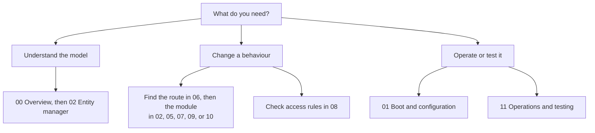
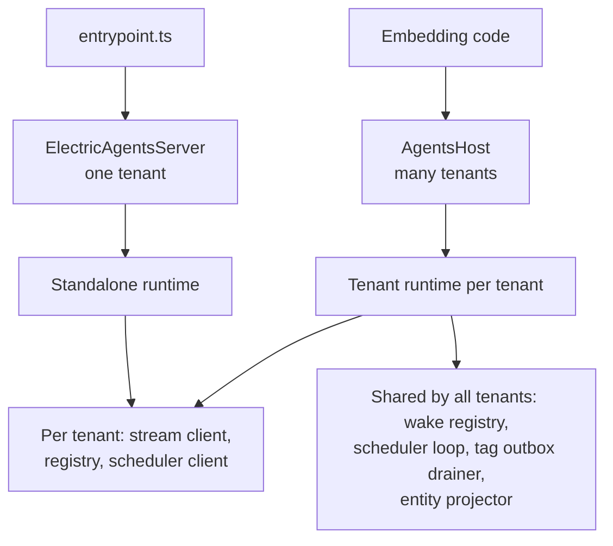

# agents-server package

This directory documents `@electric-ax/agents-server`, the server package of Electric Agents. Each agent is an entity. Each entity owns an append-only Durable Stream. A Durable Stream is an append-only log served by the Durable Streams server. For agent-visible data, the stream is the database, the message bus, and the audit log. PostgreSQL (Postgres) holds the control tables that point to those streams, plus control state that has no stream.

Source root: `packages/agents-server` in the Electric repository.
Package version at the time of writing: 0.6.4.
License: Apache 2.0.
Language: TypeScript, ECMAScript modules, Node.js 18 or later.

This index links the twelve chapters of the study. Start with the overview if you are new to the package. Start with a chapter if you need one subsystem.

## Reading order

| Document | What it answers |
|----------|-----------------|
| [00-overview.md](00-overview.md) | What the package is, its role in Electric Agents, the three surfaces (management interface, stream pass-through, background workers), and the main data flow |
| [01-boot-and-configuration.md](01-boot-and-configuration.md) | How `ElectricAgentsServer` starts and stops, the entry point, every environment variable, the embedded streams server, and Docker Compose |
| [02-entity-manager.md](02-entity-manager.md) | The largest module: spawn, send, fork, kill, schedules, signals, attachments, tags, and write validation |
| [03-entity-registry-and-postgres.md](03-entity-registry-and-postgres.md) | The Drizzle schema, all 21 tables, the 17 migrations, and the stored form of grants |
| [04-stream-layout-and-stream-client.md](04-stream-layout-and-stream-client.md) | The stream path namespace and every method of `StreamClient` |
| [05-wake-registry-and-scheduler.md](05-wake-registry-and-scheduler.md) | Wake conditions, the shape sync, debounce, timeouts, delayed sends, cron ticks, and the task claim loop |
| [06-http-routing.md](06-http-routing.md) | Every router and every route, from the public control plane to the raw stream proxy |
| [07-entity-projector.md](07-entity-projector.md) | The `/_entities/` membership streams, tag filtering, principal scope, and the shared shape |
| [08-tenancy-permissions-and-principals.md](08-tenancy-permissions-and-principals.md) | Principals, tenants, grants, the authorization hook, write tokens, and webhook signatures |
| [09-runners-and-sandboxes.md](09-runners-and-sandboxes.md) | Runner registration, the claim handshake, the two leases, health, and sandbox selection |
| [10-pg-sync-and-bridges.md](10-pg-sync-and-bridges.md) | Entity bridges, Postgres sync bridges, the tag outbox, and the manifest indexes |
| [11-operations-testing-and-conformance.md](11-operations-testing-and-conformance.md) | Start-up, shutdown, recovery paths, logging, tracing, the test backend, and the conformance suite |



## The three ways to run it

The package has one internal model and three ways to expose it.



- `ElectricAgentsServer` is the single-tenant server. It can start an embedded Durable Streams test server, run the migrations, and listen on one port.
- `AgentsHost` is the multi-tenant host. It shares the wake registry, scheduler, tag outbox drainer, and entity projector across tenants. Each tenant gets its own stream client, registry, and scheduler client.
- `entrypoint.ts` reads environment variables, starts an `ElectricAgentsServer`, and handles process signals.

## The one idea

**A client reads state from a stream, not from a table.** A spawn writes the entity row and then appends the creation events. A send appends a message. A tag change goes through a transactional outbox and then reaches the entity stream. A wake is a notification that a registered stream condition matched, and it follows a stream event. A runner claims a stream, not a row. Every part of the package follows this rule.

The Postgres tables exist to make the streams findable, permissioned, and recoverable. They are an index over the stream log. They also own state that the log does not carry, such as grants, dispatch state, and schedules.

## Source map

| Source path | Document |
|-------------|----------|
| `src/server.ts`, `src/entrypoint.ts`, `src/entrypoint-lib.ts`, `src/host.ts`, `src/standalone-runtime.ts`, `src/tenant.ts` | [01](01-boot-and-configuration.md), [08](08-tenancy-permissions-and-principals.md), [11](11-operations-testing-and-conformance.md) |
| `src/entity-manager.ts` | [02](02-entity-manager.md) |
| `src/entity-registry.ts`, `src/db/schema.ts`, `drizzle/*.sql` | [03](03-entity-registry-and-postgres.md) |
| `src/stream-client.ts`, `src/routing/tenant-stream-paths.ts` | [04](04-stream-layout-and-stream-client.md) |
| `src/wake-registry.ts`, `src/scheduler.ts`, `src/manifest-side-effects.ts` | [05](05-wake-registry-and-scheduler.md), [02](02-entity-manager.md) |
| `src/routing/*.ts` | [06](06-http-routing.md) |
| `src/entity-projector.ts` | [07](07-entity-projector.md) |
| `src/principal.ts`, `src/permissions.ts`, `src/claim-write-token-store.ts`, `src/webhook-signing.ts` | [08](08-tenancy-permissions-and-principals.md) |
| `src/routing/runners-router.ts`, `src/routing/sandbox.ts`, `src/routing/dispatch-policy.ts` | [09](09-runners-and-sandboxes.md) |
| `src/entity-bridge-manager.ts`, `src/pg-sync-bridge-manager.ts`, `src/tag-stream-outbox-drainer.ts` | [10](10-pg-sync-and-bridges.md) |
| `test/*`, `vitest.config.ts`, `docker-compose.dev.yml` | [11](11-operations-testing-and-conformance.md) |

**Key insight: the naming tells you where to look**. The package name, the module type, and the tenant default are three short facts that explain most of the design:

```json
// packages/agents-server/package.json:2-3
"name": "@electric-ax/agents-server",
"version": "0.6.4",
```

```ts
// packages/agents-server/src/tenant.ts:1
export const DEFAULT_TENANT_ID = `default`
```

```ts
// packages/agents-server/src/index.ts:3
export { AgentsHost } from './host.js'
```

The name `agents-server` marks this as the server half of the split. The default tenant means a single-tenant process needs no tenant configuration. The index export is `AgentsHost`, not `ElectricAgentsServer`: the multi-tenant host is the supported embedding surface. The single-tenant class lives in `src/server.ts` and the executable uses it directly. See [01-boot-and-configuration.md](01-boot-and-configuration.md) and [08-tenancy-permissions-and-principals.md](08-tenancy-permissions-and-principals.md).

## How to read a claim

Every chapter cites the source as `packages/agents-server/src/file.ts:line`. A citation with a range covers the whole block. A few prose citations shorten the path to `src/file.ts:line` after the chapter has already named the package root; the file and line are still exact. The text around a citation states only what the cited code does.

A statement marked as an open question is not proven by the source. The study keeps those statements separate on purpose. The main open items are:

- The parent index says this package has 12 documents; this directory has 12 chapters plus this index.
- The dispatch-recovery options are parsed but not consumed in version 0.6.4. See [11](11-operations-testing-and-conformance.md).
- The manifest rebuild on start reads at most 10,000 entities. See [11](11-operations-testing-and-conformance.md).

## Back to the parent study

- [Electric Agents exploration index](../README.md)
- [How the runtime sets up a stream](../04-how-the-runtime-sets-up-a-stream.md)
