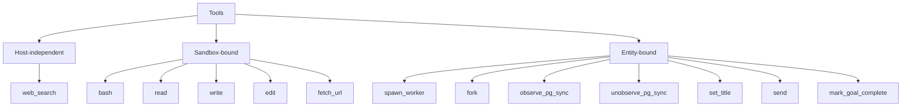
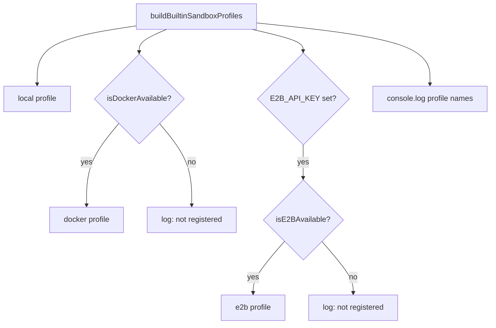

# Tools and sandboxes

A tool is a function that the model can call. A sandbox is the environment where those functions run. This document describes the tool factories, the three sandbox profiles, the documentation index, and the stream cache.

## The tool families

The package provides three groups of tools.



| Family | Tools | What it needs |
|--------|-------|---------------|
| Host-independent | `web_search` | A search Application Programming Interface (API) key |
| Sandbox-bound | `bash`, `read`, `write`, `edit`, `fetch_url` | A sandbox object |
| Entity-bound | `spawn_worker`, `fork`, `observe_pg_sync`, `unobserve_pg_sync`, `set_title`, `send`, `mark_goal_complete` | A handler context |

`PG` in `observe_pg_sync` means PostgreSQL. A fourth provider, the Model Context Protocol (MCP) tool provider, adds remote tools at wake time. It is described in [01-built-in-runtimes.md](01-built-in-runtimes.md) and in [../agents-mcp/04-tools-and-resources.md](../agents-mcp/04-tools-and-resources.md).

The second tool builder is `createBuiltinElectricTools`. It adds the shared Electric tools:

| Set | Tools |
|-----|-------|
| Webhook source | `list_webhook_sources`, `list_webhook_source_subscriptions`, `subscribe_webhook_source`, `unsubscribe_webhook_source` |
| Schedule | `list_schedules`, `upsert_cron_schedule`, `upsert_future_send`, `delete_schedule` |

The builder also accepts a custom factory. It removes duplicate tool names after it merges the lists. Source: `packages/agents/src/bootstrap.ts:145-156`; tool names: `packages/agents-runtime/src/tools/webhook-sources.ts:195-281`, `packages/agents-runtime/src/tools/schedules.ts:223-393`.

Sandbox-bound tools take the sandbox as their first argument. This is how the same tool implementation runs on a local host, in Docker, or in a remote virtual machine.

```ts
return [
  createBashTool(sandbox),
  createReadFileTool(sandbox),
  createWriteTool(sandbox),
  createEditTool(sandbox),
  braveSearchTool,
  // ...
```

Source: `packages/agents/src/agents/horton.ts:392-396`.

## Sandbox profiles

`buildBuiltinSandboxProfiles` always adds the `local` profile. It adds `docker` only when the Docker daemon is reachable. It adds `e2b` only when `E2B_API_KEY` is set and the optional package is installed. E2B is a hosted sandbox service.



Each profile has a `name`, a `label`, a `description`, and a `factory`. The factory receives the spawn arguments, the sandbox key, a persistent flag, an owner, the entity type, and the entity address (Uniform Resource Locator, URL).

### Local

```ts
{
  name: `local`,
  label: `Local`,
  description: `Runs on the host without isolation. Full filesystem access.`,
  factory: ({ args }) =>
    chooseDefaultSandbox(resolveCwd(args, workingDirectory)),
}
```

Source: `packages/agents/src/bootstrap.ts:359-366`.

The local profile runs on the host. It has no isolation. The spawning entity can also pass a `workingDirectory` argument. When it does, the sandbox uses that directory. When it does not, the sandbox uses the bootstrap working directory. `chooseDefaultSandbox` picks the concrete sandbox implementation for that directory. The worker arguments do not include `workingDirectory`, so a worker cannot choose its own directory.

### Docker

The Docker profile is registered after a daemon probe. The profile is lazy.

```ts
return lazySandbox({
  name: `docker`,
  workingDirectory: `/work`,
  factory: () =>
    dockerSandbox({
      initialNetworkPolicy: { mode: `allow-all` },
      ...resolveDockerSandboxOpts(
        cwd
          ? { hostPath: cwd, containerPath: `/work`, readOnly: false }
          : undefined,
        dockerOpts
      ),
      sandboxKey,
      persistent,
      owner,
      entityType,
      entityUrl,
    }),
  reclaim: owner
    ? () => reclaimDockerSandboxByKey(sandboxKey)
    : undefined,
})
```

Source: `packages/agents/src/bootstrap.ts:404-439`.

`sandboxKey` is the key that identifies the container. `persistent` asks the profile to keep the container across wakes. `owner` is the entity that holds the reclaim lease.

Four properties are important.

- **Lazy.** The container starts only when a wake actually uses the sandbox. A cron tick that does nothing does not start a container.
- **Pinned working directory.** The container path is `/work`. When the spawn sets `cwd`, the host path is mounted read-write. When it does not, no host path is mounted.
- **Open network by default.** `initialNetworkPolicy` is `allow-all`. The comment states that this is a development default. The policy is a capability of the profile, not a separate profile. Here a capability means a profile that the deployment can actually run.
- **Reclaim.** A lease is the right to use and reclaim a sandbox. An owner lease can remove the container by key at the end of a terminal wake. A terminal wake is the last wake for an entity. An attacher is an entity that uses an existing sandbox without owning it. An attacher cannot reclaim another owner's sandbox.

At startup, the package calls `sweepOrphanedDockerSandboxes`. This removes containers that a crashed or force-quit process left behind. The package has no periodic reaper. A shared container is a container that more than one entity attaches to through the same key. Shared containers stop themselves after their last lease is disposed.

### E2B

The E2B profile is a remote micro-virtual-machine.

```ts
name: `e2b`,
label: `E2B`,
description: `Runs in a remote E2B microVM. Persistent sandboxes survive across wakes and are reachable from any runner.`,
remote: true,
```

Source: `packages/agents/src/bootstrap.ts:459-464`.

The profile is marked `remote: true`. The server skips the single-runner co-location guard for keyed sandboxes on a remote profile, because any runner can reach the virtual machine. The guard requires keyed sandboxes on a local profile to run on the same runner. A keyed sandbox is a sandbox identified by `sandboxKey` rather than by an entity instance.

Key insight: the profile list is a capability list, not a preference list. A deployment without Docker silently advertises only `local`. A deployment with Docker advertises `docker` and `local`. The model and the user see only profiles that can actually run.

## The documentation index

The package includes a local documentation search index. The bootstrap builds the index from the built-in documentation set. It uses SQLite with the `sqlite-vec` extension for vectors and `fts5` for keyword search. `fts5` is the SQLite full-text search module.

### Index structure

| Table | Purpose |
|-------|---------|
| `index_meta` | Index version and metadata |
| `docs` | One row per document |
| `chunks` | One row per text chunk, with an embedding |
| `chunks_fts` | Full-text index over chunk text |

The embedding has 128 dimensions. The embedding model is defined in `embed.ts`. The package does not name that model in this file, so its identity is an open question here.

```ts
export const EMBEDDING_DIMENSIONS = 128
```

Source: `packages/agents/src/docs/embed.ts:3`.

A chunk has a maximum of 1,200 characters. A long paragraph splits into overlapping slices with 150 characters of overlap.

```ts
const overlap = 150
let start = 0
while (start < paragraph.length) {
  const end = Math.min(start + 1200, paragraph.length)
  // ...
  start = Math.max(end - overlap, start + 1)
}
```

Source: `packages/agents/src/docs/knowledge-base.ts:218-236`.

### Hybrid search

`hybridSearch` runs two rankings and merges them with reciprocal rank fusion. Reciprocal rank fusion (RRF) combines ranked lists by adding `1 / (k + rank)` for each result.

```ts
function reciprocalRank(rank: number | null, k = 60): number {
```

Source: `packages/agents/src/docs/knowledge-base.ts:281`.

The search function returns eight results by default. The tool exposes a `limit` parameter with a range of 1 to 12 and a default of 6.

```ts
const limit = Number((params as { limit?: unknown }).limit ?? 6)
const results = kb.hybridSearch(
  query,
  Math.min(Math.max(limit, 1), 12)
)
```

Source: `packages/agents/src/docs/knowledge-base.ts:951-955`.

The tool name is `search_electric_agents_docs`. Horton is instructed to use it first for any question about Electric Agents. The prompt adds that rule only when the index is available.

### Fallback mode

When SQLite cannot open, the index falls back to an in-memory list of chunks. The fallback still runs vector scoring and keyword scoring. The search results remain useful, but the index is not persistent.

## The stream cache

The server installs a fetch cache for Durable Streams reads.

```ts
const MEMORY_CACHE_SIZE_BYTES = 100 * 1024 * 1024

let installed = false
```

Source: `packages/agents/src/durable-streams-cache.ts:8-10`.

The cache can use memory or SQLite. The default store is memory. The store is chosen by the option that installation receives. The installation composes on the current global dispatcher. The global dispatcher is the `undici` object that sends Hypertext Transfer Protocol (HTTP) requests. An interceptor is a middleware layer on that dispatcher.

```ts
setGlobalDispatcher(
  getGlobalDispatcher().compose(
    interceptors.cache({ store })
  )
)
```

Source: `packages/agents/src/durable-streams-cache.ts:45-51`.

A second call is ignored with a warning. The `durableStreamsFetchCache` option set to `false` skips installation entirely.

Key insight: the cache composes instead of replaces. The desktop application installs a Cloud authentication interceptor on the global dispatcher before the built-in runtime starts. A fresh dispatcher would drop that interceptor and break authentication. Composition preserves it.

## Logging

The package uses `pino`. The default level is `info`.

| Variable | Default | Effect |
|----------|---------|--------|
| `ELECTRIC_AGENTS_LOG_LEVEL` | `info` | Minimum level |
| `ELECTRIC_AGENTS_LOG_FILE` | on | Set to `false` for console only |
| `ELECTRIC_AGENTS_LOG_DIR` | `<cwd>/logs` | Log directory |

Source: `packages/agents/src/log.ts:5-22`.

## Aha: sandbox choice is data on the entity

The sandbox profile is chosen at spawn time and stored on the entity row. A later wake does not choose again. The spawn options select the profile; when they do not name one, the entity type default applies. This is why a worker can inherit a parent sandbox and why a Docker container can be reclaimed by key.

Key insight: the sandbox is part of the entity record, not part of the process. A runner that restarts can reattach to the same container or virtual machine. The filesystem survives the process. This applies to the Docker and E2B profiles. The local profile has no separate instance to reattach.

## Related documents

- [02-horton.md](02-horton.md) for the agent that uses these tools.
- [03-worker-runtime.md](03-worker-runtime.md) for sandbox inheritance.
- [01-built-in-runtimes.md](01-built-in-runtimes.md) for where the profiles are built.
- [README.md](README.md) for the package index.
