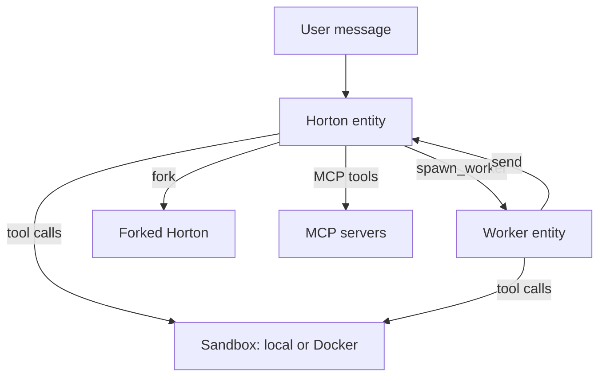
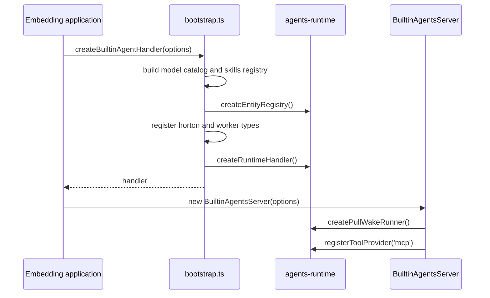

# The agents package

The `agents` package gives Electric Agents its built-in agent behavior. It is the layer that turns the generic runtime into a working assistant. The package supplies two entity types, **Horton** and **worker**. It also supplies the tools, model catalog, sandbox profiles, and Model Context Protocol (MCP) wiring that those types use.

Electric Agents is the durable agent runtime in the Electric project. An entity is one agent instance with an address and an append-only event stream. A handler is a function that runs one entity turn. A stream is that ordered event log. A wake is a server request that asks a runtime to run one entity turn. A pull-wake runner is the process that claims pending wake work and calls the handler. A sandbox is the environment where the entity's tools run.

Horton is the default assistant entity type. A worker is a short-lived subagent entity type. A skill is a reusable instruction block that the handler can load into its prompt. A skills registry is the lookup for those blocks. The `fork` tool creates a copy of a Horton entity.

Package location: `packages/agents`. Version: `0.6.3`. Command-line binary: `electric-agents`.

## Why this package matters

The `agents-runtime` package defines what an entity is. It provides the entity registry, the handler contract, and the stream database. It does not define what an agent does. The `agents` package answers the practical question. When a user sends a message, which model receives it, which tools can it call, and where does it run?

Read the platform-level document [04-how-the-runtime-sets-up-a-stream.md](../04-how-the-runtime-sets-up-a-stream.md) first. It explains the stream that every handler in this package reads and writes.

## Reading order

| Order | Document | What you learn |
|-------|----------|----------------|
| 0 | [04-how-the-runtime-sets-up-a-stream.md](../04-how-the-runtime-sets-up-a-stream.md) | The platform-level stream model that this package uses |
| 1 | [00-overview.md](00-overview.md) | The package shape, exports, and dependency graph |
| 2 | [01-built-in-runtimes.md](01-built-in-runtimes.md) | Bootstrap, the server class, and the entrypoint |
| 3 | [02-horton.md](02-horton.md) | The Horton assistant: model, prompt, tools, slash commands, goals |
| 4 | [03-worker-runtime.md](03-worker-runtime.md) | The worker entity type and shared state |
| 5 | [04-tools-and-sandboxes.md](04-tools-and-sandboxes.md) | Tool wiring, sandbox profiles, and the documentation search index |

## The two entity types in one picture



Horton is the conversation partner. A worker is a short-lived subagent with a narrow tool set. Both are registered by the same bootstrap function. Both run through the same runtime handler.

## The bootstrap chain



The important detail is that the bootstrap function does not start a server. It returns a handler. The `BuiltinAgentsServer` class in `src/server.ts` owns the process lifetime.

## Three source anchors

The public surface is small and explicit.

```ts
export const DEFAULT_BUILTIN_AGENT_HANDLER_PATH = `/_electric/builtin-agent-handler`
```

Source: `packages/agents/src/bootstrap.ts:40`.

The `agents-server` control plane serves this path. The server sends an entity wake to it. The bootstrap result is the handler behind the path.

```ts
subscriptionPathForType: (name) => `/${name}/*/main`,
// ...
idleTimeout: 5 * 60_000,
```

Source: `packages/agents/src/bootstrap.ts:231-234`.

```ts
export const HORTON_MODEL = `claude-sonnet-4-6`
```

Source: `packages/agents/src/agents/horton.ts:50`.

## Aha: the package is a composition root

The `agents` package adds no new runtime primitive. It only composes what `agents-runtime` already provides. A handler is a function. A tool is an object with a name and a call. A sandbox is an interface. The package wires these parts into two useful entity types.

Key insight: this design means that you can replace Horton without changing the server. The entity type registry accepts any handler with the same signature. The package registers its types by calling `registry.define`. The runtime learns the type names only from the subscription paths that the bootstrap supplies.

## Related documents

- [00-overview.md](00-overview.md) for the export list and dependency graph.
- [01-built-in-runtimes.md](01-built-in-runtimes.md) for the server lifecycle.
- [../README.md](../README.md) for the full exploration index.
