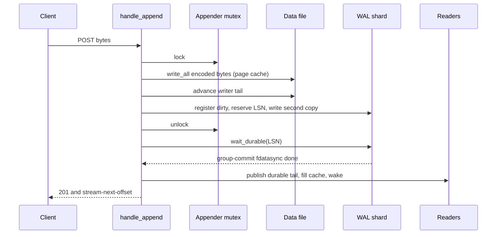
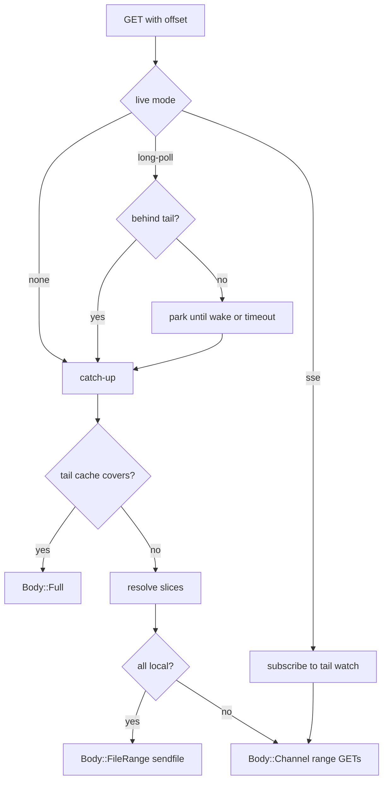

# Architecture

The server has one design goal: make an append cheap and make a read a direct copy. It reaches that goal with three choices. First, a stream is one contiguous file of encoded bytes. For a binary stream these are the posted bytes. For a JavaScript Object Notation (JSON) stream they are each value plus a comma. Second, a per-stream lock orders appends. A sharded write-ahead log (WAL) carries a second copy of each append and groups their durability barriers. Third, a read resolves an offset to a byte range and sends that range without decoding it.

This document follows one append and one read through the code. It then explains the Hypertext Transfer Protocol (HTTP) engine and the three response body types.

## Request routing

The engine parses a request and calls `handlers::handle`. That function opens a trace span and dispatches by method (`src/handlers.rs:248-282`).

| Method | Operation | Handler |
|--------|-----------|---------|
| `PUT` | create a stream | `handle_create` (`src/handlers.rs:367`) |
| `POST` | append bytes | `handle_append` (`src/handlers.rs:909`) |
| `GET` | catch-up, long-poll, or Server-Sent Events (SSE) read | `handle_read` (`src/handlers.rs:1529`) |
| `HEAD` | read the metadata without a body | `handle_head` (`src/handlers.rs:2075`) |
| `DELETE` | delete a stream | `handle_delete` (`src/handlers.rs:2103`) |
| `OPTIONS` | capability request | returns 204 (`src/handlers.rs:276`) |

A path of `/health` returns `ok` before the method check (`src/handlers.rs:267-269`). An unknown method returns 405 (`src/handlers.rs:277`).

The protocol uses these headers (`src/handlers.rs:15-30`). The direction column separates what the client sends from what the server returns. Several headers appear in both directions.

| Header | Direction | Meaning |
|--------|-----------|---------|
| `stream-next-offset` | response | position after the returned bytes |
| `stream-up-to-date` | response | the reader has reached the durable tail |
| `stream-closed` | both | request: close the stream; response: the stream can accept no more appends |
| `stream-cursor` | response | advisory time-based cursor for live responses. The server derives it from 20-second intervals and adds jitter when the client is current, so collapsed clients do not retry in lockstep (`src/store.rs:1573-1596`) |
| `stream-ttl` | both | request: set a time to live (TTL) in seconds; response: the configured TTL window in seconds. A `HEAD` reports the window and does not reset it (`src/handlers.rs:376`, `src/handlers.rs:2089-2090`) |
| `stream-expires-at` | both | request: set an absolute expiry time; response: the configured expiry time |
| `stream-seq` | request | writer sequence string. A value not greater than the last accepted value returns 409 (`src/handlers.rs:1082-1105`) |
| `producer-id` | request | idempotent producer identifier |
| `producer-epoch` | both | request: producer incarnation; response: the current epoch |
| `producer-seq` | both | request: append sequence; response: the accepted or last sequence |
| `producer-expected-seq` | response | the sequence the server expected, on a gap |
| `producer-received-seq` | response | the sequence the server received, on a gap |
| `stream-sse-data-encoding` | response | encoding of the SSE data field |
| `stream-forked-from` | request | source stream for a fork |
| `stream-fork-offset` | request | logical fork point in the source |
| `stream-fork-sub-offset` | request | message or byte offset past the fork point |

A close is a `POST` with `Stream-Closed: true` and an empty body (`src/handlers.rs:941`, `src/handlers.rs:995-1015`). A fork is a `PUT` with `Stream-Forked-From` and the optional fork offset headers (`src/handlers.rs:399-401`).

## The write path

### Step 1: validate the request

The handler loads the stream from the store. A missing stream returns 404. A soft-deleted stream returns 410 (`src/handlers.rs:924-936`). A soft-deleted stream still exists on disk but is closed to reads and appends. The server removes it when its last fork reference is released, as the delete section below explains. The handler checks the producer headers and the body content type (`src/handlers.rs:937-963`).

A producer sends `Producer-Id`, `Producer-Epoch`, and `Producer-Seq`. The identifier names the producer. The epoch names one incarnation of that producer. A new epoch replaces the old one. The sequence number counts appends inside one epoch. A repeat of the same triple returns a success without a second append (`src/handlers.rs:812-884`). A lower epoch returns 403. A higher epoch is accepted only when its sequence is 0. Otherwise it returns 400 (`src/handlers.rs:864-869`). A sequence gap returns 409 (`src/handlers.rs:1052-1073`). The deduplication state lives in the sidecar. It can lag an acknowledged append. A producer should therefore start a new epoch after a server restart (source package `README.md:147`).

### Step 2: encode the wire bytes

The create request sets the stream type from the `Content-Type` header. The default is `application/octet-stream` (`src/handlers.rs:366-375`). Only the media type `application/json` selects a JSON stream, after parameter removal and case folding. Every other type is binary (`src/store.rs:1206-1212`). An append must send the same media type as the stream, after parameter removal. A binary stream therefore accepts its configured type. That type is normally `application/octet-stream`. A JSON stream accepts `application/json` (`src/handlers.rs:948-956`).

`encode_wire` turns the body into the on-disk representation (`src/handlers.rs:641-670`).

- A binary stream stores the body unchanged.
- A JSON stream with one value stores the value followed by a comma.
- A JSON stream with an array stores each element followed by a comma. On append, an empty array is rejected. On create, it is accepted as an empty initial body (`src/handlers.rs:548`, `src/handlers.rs:650-655`, `src/handlers.rs:969`).

The flatten is one level only. The body `[1,[2,3]]` is stored as two values, `1,` and `[2,3],`. The nested array stays one value (`src/handlers.rs:641-664`).

### Step 3: take the per-stream appender lock

The append takes one asynchronous mutex for the stream (`src/handlers.rs:975-982`). This mutex is the only serialization point for appends to that stream. Two different streams never wait for each other. The mutex protects an `Appender` value that holds the data file handle and the written byte count (`src/store.rs:97-100`).

### Step 4: write the bytes to the data file

`write_wire` calls `write_all` on the data file (`src/handlers.rs:749-770`). The bytes enter the operating system page cache. This write is not durable. The function then advances the writer tail under a short read-write lock. A reader must not use that tail. It uses the durable tail from step 7.

A failed partial write is truncated back to the previous length (`src/handlers.rs:751-759`). Without that rollback, later appends would land after garbage bytes and every logical offset would be wrong.

### Step 5: stage the record in the WAL

The handler computes the pre-append stream offset from the file base and the written count before this append (`src/handlers.rs:691-693`). It then calls `stage_for_durability` while it still holds the appender lock (`src/handlers.rs:708-731`).

The stage function does three things:

1. In `memory` mode, it returns no log sequence number (LSN) and writes no second copy.
2. In `wal` mode, it registers the stream in the shard's dirty set before it stages the record. The dirty set is the list of streams touched since the last checkpoint.
3. It reserves an LSN and writes the framed record into the shard segment. That record contains the same bytes just written to the data file.

The WAL record is the second copy, not a staging area for a later copy. A checkpoint never reads this record and rewrites it. It syncs the data-file copy and then unlinks whole segments whose records are below the recycle floor (`src/wal/shard.rs:915-1022`).

The register-before-stage order closes a race with checkpoint recycling. If the server staged the record first, a checkpoint could make the record durable and take a recycle floor above it. It could then unlink its segment without ever syncing the stream's data file. Registering first prevents that race. Any checkpoint that can recycle a record of this stream also syncs that stream's file (`src/handlers.rs:720-723`).

### Step 6: wait for durability without the lock

The handler drops the appender lock and waits for the shard to make the LSN durable (`src/handlers.rs:1212-1219`). The wait is off the lock because a same-stream second append can write its bytes while the first append waits for the disk. The second append still gets a higher LSN, because the LSN reservation happened under the same lock in byte order. The second append can publish the higher durable tail before the first append publishes its lower one. That is safe: the shard watermark is contiguous, so the higher value already covers every lower LSN (`src/handlers.rs:778-786`, `src/wal/shard.rs:1445-1474`). The watermark is the highest LSN below which every record on the shard is durable.

The code shows the split (`src/handlers.rs:1212-1219`):

```rust
drop(ap);

// Wait for durability off the lock before exposing the bytes.
if let Some(lsn) = staged_lsn {
    let dur_t0 = std::time::Instant::now();
    wait_durable_lsn(&store, &st, lsn).await;
    crate::srvstats::record_durwait(dur_t0.elapsed());
}
```

### Step 7: publish the durable tail

After the wait, `publish_durable_tail` advances the reader-visible tail (`src/handlers.rs:781-802`). It does four things in order:

1. It checks that the new tail is higher than the current durable tail.
2. It writes the new durable tail under the shared lock.
3. It puts the new bytes in the resident tail cache. The resident tail cache is an optional in-memory copy of the newest stream bytes, sized by `--tail-cache-bytes`.
4. It wakes the live subscribers through the stream's tail watch channel. The watch channel is a single-value broadcast that carries the current tail.

The cache write happens before the wake. A woken reader therefore finds the bytes in memory and does not race to read the file (`src/handlers.rs:793-798`).



### Close is a separate ordering problem

A close sets the writer-visible `closed` flag at once, so a later append fails (`src/handlers.rs:1151-1163`). It does not wake readers yet. The handler first writes the metadata sidecar with a durable write. It syncs the sidecar data, renames the file, and syncs the parent directory (`src/handlers.rs:1231-1236`, `src/store.rs:1446-1473`). Only then does it set `closed_durable`, the reader-visible flag, and wake the readers (`src/handlers.rs:1237-1244`). A reader never observes an end-of-file that a crash could roll back.

### Create, delete, head, and fork

The other methods are short, but each has one ordering rule.

- **Create** (`PUT`) resolves the optional fork source, sets the content type, and encodes the initial body. It then calls `Store::create` on the blocking pool (`src/handlers.rs:367-569`). The blocking pool is the Tokio blocking thread pool. It runs calls that would block an asynchronous worker, such as a file fsync. The blocking pool matters because create writes the sidecar with a data fsync and a parent-directory fsync. A success therefore means the stream is durable (`src/handlers.rs:554-568`).
- **Delete** (`DELETE`) is durable before the 204 response (`src/handlers.rs:2111-2120`). If a fork still refers to the stream, delete marks it soft-deleted and writes the sidecar durably. The file stays until the last child is released (`src/store.rs:993-1010`). Otherwise delete unlinks the sidecar and the data file, then syncs the directory (`src/store.rs:1011-1024`). A soft-deleted parent is collected when its last child calls `release_parent`. That call decrements the reference count and cascades up the chain. The server has no periodic garbage collection pass (`src/store.rs:1036-1062`).
- **Head** (`HEAD`) returns the same metadata headers as a read and no body (`src/handlers.rs:2075`). It does not reset the TTL (`src/handlers.rs:2075-2100`).
- **Fork** is copy-on-write. The client sends `Stream-Forked-From` and the optional `Stream-Fork-Offset` and `Stream-Fork-Sub-Offset` in the create request (`src/handlers.rs:399-401`). The new stream stores its own bytes from `base_offset`, the fork point. It keeps a reference to the parent (`src/handlers.rs:432-528`, `src/store.rs:279-284`). A read below `base_offset` follows the parent chain. A parent therefore outlives its forks. Fork reads at or above `base_offset` use the child file in the normal way.

The TTL of a stream is enforced lazily, not by a background sweep. `Store::get` calls `is_expired` before it returns a stream. An expired stream is deleted, or soft-deleted when a fork still refers to it, and the lookup then reports it as missing (`src/store.rs:451-464`, `src/store.rs:959-972`). `is_expired` checks the absolute expiry time first, then `last_access + ttl`. A read or an append updates `last_access`. HEAD does not (`src/handlers.rs:766`, `src/handlers.rs:1539`).

## The read path

`handle_read` parses the query, the offset, and the live mode (`src/handlers.rs:1529-1572`). It resolves the start position in one shared function (`src/handlers.rs:1593-1611`). A numeric offset beyond the durable tail is accepted and treated as caught up. A malformed offset returns 400.

The server does not check that an offset lands on a JSON value boundary (`src/handlers.rs:1605-1620`). A client must therefore use an offset that the server returned, such as `stream-next-offset`. Every returned offset is a whole-value boundary, because an append writes whole values and a cold-tier cut also lands on a value boundary (`src/tier.rs:551-560`). A hand-made mid-value offset can produce a range that is not valid JSON.

### Catch-up read

`read_range_body` builds the response for a byte range (`src/handlers.rs:1323-1371`).

1. An empty range returns `[]` for JSON or an empty body for binary.
2. A range fully covered by the resident tail cache returns `Body::Full` from memory. The cache holds only the newest append chunk. It does so only when that chunk is at most the `--tail-cache-bytes` cap. A larger append is not cached. A range that the cache covers only in part falls back to the file path (`src/store.rs:419-434`, `src/handlers.rs:1334-1345`).
3. Otherwise the store resolves the range to placement-aware slices. Each slice is tagged local or remote (`src/handlers.rs:1361`). A placement-aware slice is a subrange plus the place that holds it. That place is either the live file or a cold-tier segment.
4. If every slice is local, the response is `Body::FileRange`.
5. If any slice is remote, the response is a chunked channel with one range request per remote segment (`src/handlers.rs:1369`).

A JSON response wraps the range with `[` and `]`. The stored range ends with a comma, so the code reads one byte less than the logical end (`src/handlers.rs:1331-1335`).

### Long-poll read

A long-poll request with an offset behind the durable tail returns the backlog at once. A caught-up request parks on the stream's tail watch channel (`src/handlers.rs:1676-1737`). A new durable tail wakes it. The timeout is 30 seconds by default (`src/handlers.rs:32`). On timeout the server returns 204 with the current offset (`src/handlers.rs:1772`).

### SSE read

An SSE request subscribes to the same tail watch channel (`src/handlers.rs:2005-2047`). On each change the server reads the new range, encodes it, and writes one event frame. A JSON stream uses JSON, a `text/*` content type uses text, and every other type uses base64 (`src/handlers.rs:1793-1800`). The `stream-sse-data-encoding` response header names the chosen encoding. The default limits are 60 seconds maximum duration and a 15-second keep-alive (`src/handlers.rs:110-114`).

Sizes use binary units: one kibibyte (KiB) is 1,024 bytes, one mebibyte (MiB) is 1,048,576 bytes, and one gibibyte (GiB) is 1,073,741,824 bytes.

On Linux, a separate reactor can own many subscribers (`src/sse_reactor.rs:29-37`). If a subscriber lets 8 MiB of framed data queue unsent, the reactor closes its connection. The client reconnects from its last offset (`src/sse_reactor.rs:33-37`, `src/sse_reactor.rs:413-416`). The value 256 is the epoll event batch size, not a per-subscriber limit (`src/sse_reactor.rs:37`, `src/sse_reactor.rs:241-248`). The reactor removes the per-subscriber connection task from the shared runtime. Each subscriber becomes one compact slab entry on a fixed reactor thread (`src/sse_reactor.rs:1-11`).



## The HTTP engine

The server does not use a web framework. `engine_raw` owns the listening socket and runs a hand-written HTTP/1.1 loop (`src/engine_raw.rs:96`). The wire parsing and framing live in `http1.rs` as pure functions over byte slices (`src/http1.rs:1-4`).

The engine limits are:

| Limit | Value | Meaning | Citation |
|-------|-------|---------|----------|
| Concurrent connections | 65,536 | active connection cap | `src/engine_raw.rs:79` |
| Request head | 64 KiB | maximum request line and header bytes | `src/http1.rs:11` |
| Small-body coalescing | 64 KiB | a response body up to this size is written in the same write as the response head | `src/http1.rs:14` |
| Request body | 1 GiB | maximum parsed request body | `src/api.rs:65-67` |
| Stream copy chunk | 256 KiB | copy buffer for a response file segment on the non-`sendfile` path | `src/engine_raw.rs:548` |

A semaphore caps concurrent connections (`src/engine_raw.rs:83-85`). Shutdown waits for in-flight requests for up to 25 seconds, then stops waiting and cuts off any request still running (`src/main.rs:445-464`). The committers then drain the records already staged, so no acknowledged append is lost. Shutdown does not force a checkpoint, so the next boot may replay the WAL.

The engine also chooses where a file read runs. The `--read-offload` flag accepts `inline`, `tail`, or `always` (`src/engine_raw.rs:38-59`). A live-tail read is a caught-up read whose range begins at or near the durable tail. A non-tail catch-up read covers older bytes. The default `tail` serves a live tail inline and sends a non-tail catch-up read to the blocking pool. `inline` sends every read inline. `always` sends every read to the blocking pool. A disk fault on a non-tail read therefore does not stall the asynchronous workers (`src/engine_raw.rs:38-59`, `src/engine_raw.rs:372-388`).

## The three body types

| Body | Source | Write method |
|------|--------|--------------|
| `Body::Full` | memory, small range, or error text | one coalesced head and body write |
| `Body::FileRange` | local data file or local sealed file | `sendfile(2)` on Linux, positioned reads elsewhere |
| `Body::Channel` | SSE or a mixed local and remote read | chunked transfer encoding |

The body choice is in `read_range_body` (`src/handlers.rs:1339-1369`) and the engine write path (`ARCHITECTURE.md:122-128`). A cold read streams in 1 MiB read windows for the local parts and one object request per remote segment, so memory stays bounded (`src/handlers.rs:1373-1378`).

## Key insight

**Aha:** the WAL stage happens under the per-stream appender lock. The durability wait happens after the unlock. The LSN order still matches the byte order. This looks like a contradiction. The resolution is that the stage reserves the LSN, and the reservation is the ordered event. `write_wire` runs first under the same lock, so the record's `stream_offset` describes the bytes just written (`src/handlers.rs:1103-1126`, `src/handlers.rs:1165-1174`). A later append can take the lock and get a higher LSN while the first append is still waiting for the disk. The shard publishes a contiguous watermark, so the first wait also covers every lower LSN (`src/wal/shard.rs:1451-1473`). The wait is long, so it must be off the lock. The order is short, so it belongs under the lock.

## Cross-references

- [00-overview.md](00-overview.md) gives the components and the central invariant.
- [02-storage-wal-and-recovery.md](02-storage-wal-and-recovery.md) gives the WAL record, commit, checkpoint, and recovery details.
- [03-conformance-benchmarks-and-operations.md](03-conformance-benchmarks-and-operations.md) gives the test evidence and the performance measurements.
- [../durable-streams/02-protocol-operations.md](../durable-streams/02-protocol-operations.md) defines the protocol operations that these handlers implement.
- [../durable-streams/03-live-reads-and-subscriptions.md](../durable-streams/03-live-reads-and-subscriptions.md) defines the live-read behaviour.
