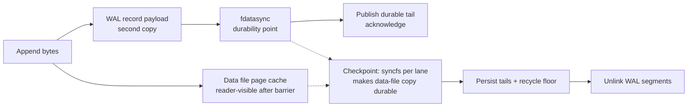
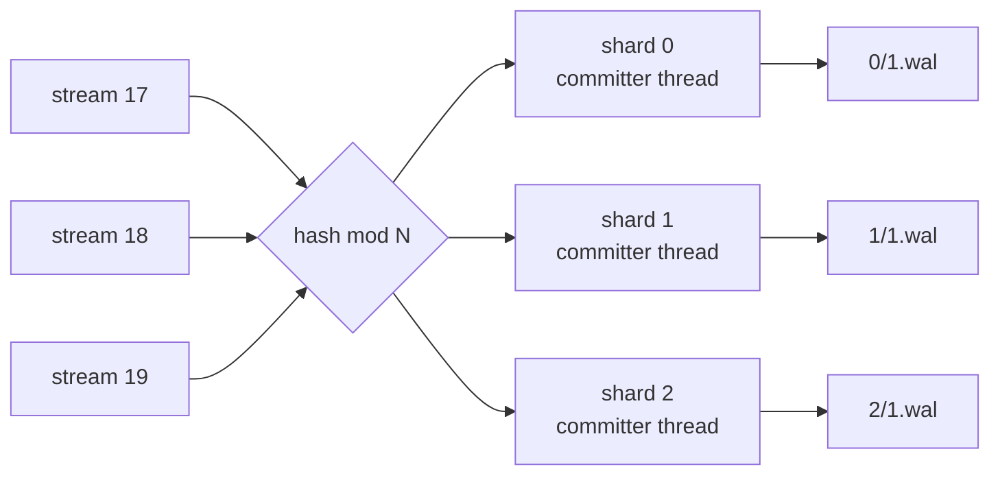
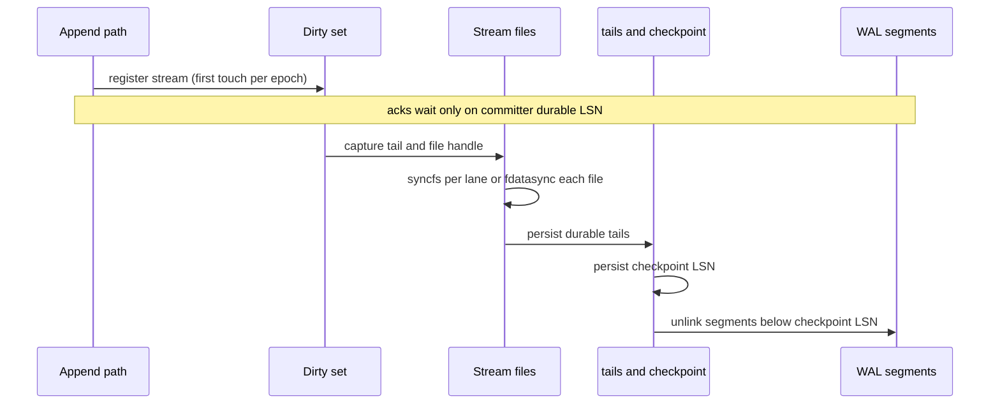

# Storage, WAL, and Recovery

In `wal` mode, the server writes every append to two places. The first place is the per-stream data file plus a small metadata sidecar. The second place is a record in a sharded write-ahead log (WAL). The data file receives the stream's encoded bytes. Those bytes are not always the exact response body. The data-file write is only a page-cache write. The WAL record holds a second copy of those bytes, and the WAL `fdatasync` is the barrier that makes the append durable. A checkpoint does not copy data from the WAL. It syncs the already-written data files, persists the per-stream durable-tail proofs, and then recycles the WAL segments whose records are no longer needed.

In `memory` mode, the data-file write is the only copy, and an operating-system crash or a power loss can lose or tear it. This document is about `wal` mode. This two-copy model is the centre of the document. The data file is the read surface. The WAL is the durability surface. A checkpoint joins the two: it makes the data-file copy durable before it removes the WAL copy.



An arrow means "leads to". The dashed arrows show the checkpoint path. The checkpoint never reads a record and rewrites it into a data file. The data file already holds the bytes. The checkpoint supplies the missing durability for that copy.

This document gives the on-disk layout, the WAL record, the group-commit protocol, the checkpoint, the recovery algorithm, and the lock inventory. It also lists the five defects that the crash simulation found.

## On-disk layout

Sizes use binary units: one mebibyte (MiB) is 1,048,576 bytes, and one gibibyte (GiB) is 1,073,741,824 bytes.

```text
<data-dir>/
├── streams/
│   ├── .lanes                        lane count (decimal text)
│   ├── <encoded-path>~<id>           data file (flat layout, --stream-lanes 1)
│   ├── <encoded-path>~<id>.meta      metadata sidecar (JavaScript Object Notation)
│   └── <0..N-1>/                     data files and sidecars when --stream-lanes N
├── wal/
│   ├── shards                        persisted shard count N (decimal text)
│   └── <0..N-1>/
│       ├── 1.wal                     segment named by its first log sequence number
│       ├── <start-lsn>.wal           later segments, 128 MiB each
│       ├── checkpoint                recycle floor (decimal log sequence number)
│       └── tails                     cumulative "stream_id durable_tail" lines
└── segments/                         staged sealed chunk files, 8 MiB each (tiering only)
```

With `--stream-lanes N`, the data files live in `streams/<0..N-1>/` (`src/store.rs:190-229`). The file name is the sanitized stream path, a tilde, and the numeric stream identifier (`src/store.rs:1085-1087`). The sanitizer keeps American Standard Code for Information Interchange (ASCII) letters, digits, `-`, `_`, and `.`. It replaces every other character with `+`. It truncates the result to 120 characters (`src/store.rs:1214-1227`). The file name is not percent-encoded. The lane is the Fowler-Noll-Vo 1a hash of that file name, modulo the lane count (`src/store.rs:207-217`). The lane count is a layout choice. It must match the on-disk layout across restarts. The store records the count in `streams/.lanes`, and a mismatch stops the server instead of hiding existing streams (`src/store.rs:519-556`).

Sealed chunk files are staged in `segments/`. That directory is separate from `streams/`, so the data-file scan never treats them as stream data (`src/store.rs:650-654`). The test-only local blobstore uses `cold/` as its "remote" directory. An Amazon Simple Storage Service (S3) deployment stores the objects in the bucket (`src/store.rs:1265-1280`).

Two structures use the word "segment". A **WAL segment** is up to 128 MiB and belongs to one WAL shard (`src/wal/segment.rs:20-22`). A **cold-tier segment** is 8 MiB and belongs to one stream's sealed history (`src/tier.rs:33-35`). The sizes differ because the readers differ: the committer `fdatasync`s whole WAL segments, while a reader range-fetches one cold segment through an object store. Do not use one size for the other.

The WAL shard count is also a layout choice. The server writes it to `wal/shards` on the first boot. A later boot with a different `--wal-shards` value exits with code 2 (`src/wal/walset.rs:60-68`, `src/wal/walset.rs:91-126`).

## The data file

The data file has no per-message header or length prefix. A binary stream stores the posted bytes unchanged. A JavaScript Object Notation (JSON) stream stores each encoded value followed by a comma. An array body flattens one level, so each element becomes one value and one comma (`src/store.rs:1-8`, `src/handlers.rs:641-670`). The stored bytes are therefore the stream's encoded form, not always the exact response body. A JSON response wraps the stored range as `[` + range minus its trailing comma + `]` (`src/handlers.rs:1318-1353`). A binary response is the stored range with no wrapper.

A read maps a logical offset to a byte position with `file_pos = logical - file_base`. The `file_base` is the logical offset of the first byte in the live file. It starts equal to `base_offset`: 0 for a root stream and the fork point for a fork. Compaction can move `file_base` forward, above `base_offset` (`src/store.rs:62-72`, `src/store.rs:1108-1116`).

The invariants are:

```text
base_offset <= file_base <= sealed_offset <= durable_tail <= tail
```

`base_offset` is where this stream's own history starts: 0 for a root stream, the fork point for a fork. `file_base` is the logical offset of the first byte in the live file. Compaction can raise it above `base_offset`. `tail` is the writer end. `durable_tail` is the reader end. `sealed_offset` is the end of the sealed prefix that the cold tier owns (`src/store.rs:62-72`, `src/store.rs:280-282`, `src/tier.rs:80-83`).

### The sidecar

The `.meta` sidecar is JSON. It holds the stream configuration, the sealed-segment manifest, the sealed offset, the file base, any pending compaction, and the durable tail (`src/store.rs:1406-1435`). The write is per-stream serialized. It writes a temporary file, fsyncs the temporary file, renames it over the final name, and optionally fsyncs the parent directory (`src/store.rs:1446-1474`).

The sidecar file always gets a data fsync, even for a non-durable flush. The `durable` flag controls only the parent-directory fsync. This prevents a crash from leaving a renamed but empty sidecar (`src/store.rs:1459-1466`). Create, close, delete, and recovery pass `durable = true`, so their sidecar rename survives a power loss (`src/store.rs:1167`, `src/handlers.rs:1233`, `src/store.rs:1004`, `src/wal/recovery.rs:394-396`). A checkpoint flush passes `durable = false`. The durability proof comes from the shard `tails` file instead.

## The WAL record

Each record has a 38-byte header and a payload (`src/wal/codec.rs:3-38`).

```text
offset  size  field
0       4     len             payload length
4       4     header_crc32c   CRC32C over the other header fields
8       8     lsn             monotonic within the shard
16      1     kind            1=Append 2=StreamCreate 3=StreamClose 4=StreamDelete
17      8     stream_id       stable per-stream identifier
25      8     stream_offset   logical offset before this append
33      1     flags           bit 0 = payload is checksummed
34      4     payload_crc32c  CRC32C over the payload
38      len   payload
```

The format defines four record kinds (`src/wal/codec.rs:49-57`). The current code writes only `Append` records (`src/handlers.rs:724-729`). A create, close, or delete changes the sidecar and is not staged as its own record. The other three kinds remain in the format for compatibility, and replay skips them because the sidecar pass owns identity and lifecycle (`src/wal/recovery.rs:193-201`).

CRC32C is a 32-bit Cyclic Redundancy Check that uses the Castagnoli polynomial (`Cargo.toml:30-32`). The header checksum covers the sequence `[lsn, kind, stream_id, stream_offset, len, flags, payload_crc]` in little-endian order (`src/wal/codec.rs:104-129`).

The decoder returns one of three results (`src/wal/codec.rs:81-102`):

| Result | Meaning |
|--------|---------|
| `Record` | The header checksum is valid, the payload is present, and the payload checksum matches |
| `Incomplete` | Too few bytes for a header, or an all-zero header. This is the clean end of the log, at the preallocated but unwritten tail |
| `Torn` | A header is present but its checksum is wrong, its kind byte is unknown, or the payload is incomplete or fails its checksum. The durable log ends here, and the remaining bytes are ignored (`src/wal/codec.rs:94-102`, `src/wal/codec.rs:190-238`) |

The difference matters to an operator. `Incomplete` is the normal state after the newest record. `Torn` means the log contains bytes that cannot be trusted.

The decoder applies the payload rule in one place (`src/wal/codec.rs:227-235`):

```rust
if flags & PAYLOAD_CHECKSUMMED == 0
    || crc32c::crc32c(&seg[payload_off..payload_off + len]) != payload_crc
{
    return Decoded::Torn;
}
```

Every writer sets the payload checksum flag (`src/wal/codec.rs:22-28`, `src/wal/codec.rs:40-43`). A record whose flag is clear is treated as torn, even if its payload checksum matches (`src/wal/codec.rs:227-235`). The segment is preallocated to its full size. On Linux this is `fallocate`. On macOS the code falls back to `set_len`. That call grows the file without reserving blocks (`src/wal/segment.rs:54-82`). A crash can therefore leave a valid header over a zeroed payload. The payload checksum detects that case (`ARCHITECTURE.md:218`).

### WAL segments

A WAL segment is 128 MiB by default (`src/wal/segment.rs:20-22`). On Linux, a new segment is created at full size with `fallocate`, a system call that reserves the disk blocks without writing them. The segment is named by its first log sequence number (`src/wal/segment.rs:26`, `src/wal/segment.rs:59`).

One record must fit inside one segment. The framed size is the 38-byte header plus the payload. `reserve_and_stage` returns an error when that size exceeds the segment size (`src/wal/shard.rs:639-646`). With the default segment, a `wal`-mode append above roughly 128 MiB fails. The Hypertext Transfer Protocol (HTTP) parser accepts a body of up to 1 GiB (`src/api.rs:65-67`). When the next record would not fit, the server seals the active segment. Sealing truncates the file to the exact written length and fsyncs it. An exactly packed segment lets recovery find the next segment without ambiguity (`src/wal/shard.rs:660-712`).

After the seal, the server opens a new segment and fsyncs the parent directory. A record's data fsync does not persist the directory entry. Without the directory fsync, a crash could orphan the new segment and lose acked records (`src/wal/shard.rs:699-711`).

Boot opens an existing segment non-destructively. `FileSegment::open_existing` opens the file without truncating or preallocating it (`src/wal/segment.rs:93-99`). This is the fix for crash finding 1.

## Sharding

The WAL has N shards. Each shard owns a disjoint set of streams. The routing function is the Fowler-Noll-Vo 1a hash of the stream identifier, modulo N (`src/wal/walset.rs:146-148`). The lane hash uses the file name instead, because the lane directory is chosen before the `StreamState` exists (`src/store.rs:207-217`). The hash uses only the persisted N and the stream identifier, so the route is the same on every boot and on every machine (`src/wal/walset.rs:142-145`).

On a fresh data directory, the default N is the `--worker-threads` value. That value defaults to available parallelism, normally the number of central processing unit (CPU) cores (`src/main.rs:335-337`, `src/main.rs:398-401`, `src/wal/walset.rs:67-68`). Each shard has one dedicated operating-system thread for its commits (`src/wal/walset.rs:169-177`).



## Group commit

`fdatasync` is a system call that forces a file's data to stable storage. A group commit is one `fdatasync` that covers many records.

An append follows this path in the WAL:

1. Register the stream in the shard's dirty set.
2. Reserve a log sequence number (LSN) and a byte range under the shard lock.
3. Release the lock, encode the record, and write it at the reserved offset.
4. Mark the LSN as written and wake the committer.
5. The committer takes a snapshot of the highest contiguous written LSN.
6. The committer `fdatasync`s the active segment. It also syncs any sealed segment that holds a record not yet covered by a barrier. A segment seal uses `fsync` because it changes the file size. The seal call covers only bytes already written. A record can be reserved before the seal but written after it. The committer's re-`fdatasync` of `sealed_pending` covers that record before the watermark passes it (`src/wal/shard.rs:663-673`, `src/wal/shard.rs:1450-1475`).
7. The committer publishes the snapshot as the durable LSN.
8. Waiters at or below the durable LSN wake.

The reservation is under a short lock. The write and the `fdatasync` run off the lock (`src/wal/shard.rs:650-722`, `src/wal/shard.rs:724-769`).

The "contiguous" word is important. The committer cannot publish LSN 10 if LSN 9 is still unwritten. A gap would make a later record durable while an earlier record is not (`src/wal/shard.rs:1445-1474`). The server tests this rule directly.

### Waiters

A waiter registers a one-shot channel in a heap ordered by LSN (`src/wal/shard.rs:1333-1379`). A commit pops only the waiters whose LSN the new watermark satisfies. The server does not broadcast to every parked subscriber (`src/wal/shard.rs:1415-1440`).

The registration and the watermark check have a lost-wakeup guard. The committer stores the durable LSN before it drains the heap. The waiter pushes before it re-reads the durable LSN. The heap mutex orders the two operations (`src/wal/shard.rs:1346-1354`). Only two interleavings are possible. The push runs first, and the committer's later drain finds it. Or the push runs after the committer's store, and the waiter's later re-read sees the new durable LSN and does not park. In both cases the waiter either is woken or never sleeps.

### Failure policy

A WAL write gets one attempt and then two retries, for three attempts in total. The encoded bytes stay in hand, so a failed positioned write is safe to repeat. A persistent write error aborts the process (`src/wal/shard.rs:732-756`). An error before the reservation returns a clean error and consumes no LSN. The test hook models that case (`src/wal/shard.rs:615-622`). A partial write after the reservation is retried in full or aborts. The reason is that a reserved but unwritten LSN is a permanent hole. Every later append would wait forever with no acknowledgement.

A failed `fdatasync` also aborts the process (`src/wal/shard.rs:1490-1503`). On Linux, a failed fsync can mark the dirty pages clean and consume the error. A retry can then return success without writing the data. The PostgreSQL project calls this failure mode "fsyncgate". Aborting is safe because the durable LSN did not advance, so no at-risk append was acknowledged.

## The lock inventory

The server has no global write lock. It has a small set of locks, each with one job. This table is the map.

| Lock | Type | Where | Protects | Held during input/output (I/O)? |
|------|------|-------|----------|------------------|
| `StreamState.appender` | asynchronous mutual exclusion (mutex) | `src/store.rs:285`; taken at `src/handlers.rs:979`; released at `src/handlers.rs:1212` | One append per stream at a time: producer validation, the data-file write, the pre-append offset, and the WAL stage stay in byte order | Yes for the page-cache write and the stage; no for the durability wait |
| `StreamState.shared` | reader-writer lock | `src/store.rs:286` | The stream fields that a reader and a writer share: `tail`, `durable_tail`, `file_base`, closed state, producer state | No. Held only for short reads and writes |
| `Shard.inner` | mutex | `src/wal/shard.rs:278` | The active segment, the reserved LSN counter, and the segment roll | No. The write runs after the lock. The contention study's T1b candidate (atomic reservation) is not implemented. The reservation still takes this lock (`src/wal/shard.rs:650-658`) |
| `Shard.dirty` | mutex | `src/wal/shard.rs:323` | The list of streams touched in this checkpoint interval | No. Taken only on the first touch per interval |
| `Shard.dirty_epoch` | atomic counter | `src/wal/shard.rs:333` | The interval number that the dirty list belongs to | Not a lock. A compare-and-swap claims a stream for the interval (`src/wal/shard.rs:795-824`) |
| `Shard.waiters` | mutex | `src/wal/shard.rs:290` | The LSN-ordered heap of parked durability waiters | No. One short critical section per commit |
| `StreamState.meta_lock` | mutex | `src/store.rs:309` | The sidecar temporary file, so two writers cannot reorder their renames | Yes, across the sidecar write, fsync, and rename (`src/store.rs:1446-1474`) |
| `StreamState.last_chunk` | reader-writer lock | `src/store.rs:318` | The resident tail cache: the newest appended chunk, served to live readers. This chunk is not a cold-tier chunk file | No |
| `TierState.manifest` | mutex | `src/tier.rs:237` | The sealed-segment manifest and the seal cut | No. The object-store work runs outside it |

**Aha:** the durability wait is the only long operation in the append path, and the code keeps it off the per-stream lock on purpose. The comment at `src/handlers.rs:734-735` states the rule. Among the WAL operations, only the LSN reservation needs the shard lock. The fsync wait must not serialize same-stream appenders. The data-file write and the stage stay under the per-stream appender lock, because their order defines the stream offset. Everything after the stage runs off the lock.

The append path acquires the locks in this order:

```text
appender (per stream)
  -> shared read (closed checks)
  -> shared write (producer, sequence, closed state)
  -> shared read (file_base and stream offset)
  -> Shard.dirty_epoch CAS, then Shard.dirty (first touch only)
  -> Shard.inner (LSN reservation)
  -> appender released
  -> Shard.waiters (registration and wake)
  -> shared write (publish durable tail)
  -> last_chunk write (fill the resident tail cache)
```

No path takes these locks in the opposite order. The checkpoint reads the floor from the `durable_lsn` atomic without a lock. It then takes the dirty lock to bump the epoch and drain the list. It then takes `meta_lock` per stream. It never takes `appender` (`src/wal/shard.rs:859-888`).

## Checkpoint

The checkpoint does not move data. The data files already hold every byte. The append path writes each byte to the data file before it stages the WAL record (`src/handlers.rs:1121-1126`, `src/handlers.rs:1169-1174`). The checkpoint makes the data-file copy durable, records the per-stream proof of that durability, and then frees the WAL copy. It has two triggers:

| Trigger | Flag | Default |
|---------|------|---------|
| Time since the shard's last checkpoint | `--wal-checkpoint-interval-ms` | 3,000 milliseconds (`src/wal/shard.rs:383`) |
| Retained WAL size | `--wal-checkpoint-wal-bytes` | 0, disabled (`src/wal/shard.rs:390`) |

The checkpoint has a strict order (`src/wal/shard.rs:826-848`, `src/wal/shard.rs:915-1022`):

1. Snapshot the committer's durable LSN as the recycle floor.
2. Drain the dirty set in one constant-time lock section.
3. Capture each touched stream's writer tail and file handle, before the barrier.
4. Barrier the per-stream files. This step makes the data-file copy durable. On Linux it is one `syncfs` call per stream lane. `syncfs` is a Linux system call. It flushes every dirty page on one file system. One call therefore covers every stream file in that lane. On other systems it is a serial `fdatasync` loop (`src/wal/shard.rs:960-962`).
5. Persist the cumulative durable-tail map to `tails`.
6. Persist the recycle floor to `checkpoint`.
7. Unlink every segment whose whole LSN range is below the floor.
8. Flush the metadata sidecars of touched streams that have a pending non-durable change. This step runs after the recycle. It carries producer state, the last-access time used by a sliding Time To Live (TTL), and expiry state. It does not carry the durability proof (`src/wal/shard.rs:1000-1022`).

The captured value in step 3 is the writer tail, not the durable tail. The barrier then makes the file durable up to at least that tail. A later append can extend the file past it, and that later append lands in the next checkpoint.

The order is the safety proof. Before step 4, the WAL record is the only guaranteed durable copy of the bytes. A previous checkpoint may have flushed the page cache by accident, but the server does not rely on that. Step 4 makes the second copy durable. The recycle in step 7 must therefore happen strictly after step 4. The durable-tail map in step 5 must be durable before step 7. It is the only proof of a stream's durable end after the WAL records are gone (`src/wal/shard.rs:1000-1022`, `src/wal/shard.rs:1055-1102`).

The `tails` file earns that role. The writer writes a temporary file, fsyncs its bytes, renames it, and fsyncs the shard directory (`src/wal/shard.rs:1082-1093`). The `checkpoint` file holds only the recycle floor. The code writes and renames it without an fsync (`src/wal/shard.rs:994-997`). That is safe because recovery always replays from the oldest retained record, not from the checkpoint floor (`src/wal/recovery.rs:189-190`).

Step 8 is not part of the durability proof. If the server crashes between the recycle in step 7 and the sidecar flush in step 8, recovery takes the stream's durable end from `tails`. Step 5 already persisted that value (`src/wal/recovery.rs:149-159`). A sidecar write that crashes before its rename leaves the previous sidecar, and the maximum rule still selects the newer proof.

The proof is per stream, not per shard. The `tails` map records the tail of each touched stream at the moment its file is synced. A stream that no append touched in this interval keeps its earlier proof (or its sidecar proof). The recycle floor is the committer's durable LSN at step 1. No record below the floor can be unlinked while its bytes lack a synced data-file copy (`src/wal/shard.rs:915-1022`).

A checkpoint never takes a stream's appender lock, and an append never waits for a checkpoint to finish (`src/wal/shard.rs:841-845`). The checkpoint does take short `shared` reads to capture tails and the per-stream `meta_lock` for a sidecar flush. Neither serializes an append's stage. A slow checkpoint delays WAL recycling and disk reclamation. It can also saturate the disk and slow the committer's `fdatasync`. That slowdown in turn delays acknowledgements. That is a device effect, not a lock effect.



## The cold tier

Tiering is optional and off by default. With tiering off, no stream seals, the manifest stays empty, and the read path is one live data file (`src/tier.rs:1-16`).

With `--tier s3` and a build that has the `tier` feature, the server seals the prefix of a stream. It does this once the unsealed part reaches `--tier-segment-bytes`, 8 MiB by default (`src/tier.rs:33-35`, `src/tier.rs:534-537`). It cuts only at `durable_tail`, so a byte that is not yet durable never enters a sealed object (`src/tier.rs:522-533`). For a JSON stream, the cut also lands on a whole-value boundary (`src/tier.rs:551-563`).

The seal writes a separate chunk file, fsyncs it, and fsyncs its directory. It then adds a `Local` entry to the per-stream manifest, raises `sealed_offset`, and persists the sidecar durably (`src/tier.rs:570-609`). The offload path then uploads the object. It verifies its size with a head request and flips the entry to `Remote` durably. Only then does it unlink the local chunk (`src/tier.rs:622-624`, `src/tier.rs:631-680`).

A read below `sealed_offset` resolves to one or more segments. A read at or above it uses the live file. A range that crosses the boundary becomes a mix of slices, and a range below `base_offset` follows the parent chain of a fork (`src/tier.rs:905-944`).

The live file keeps its sealed prefix until compaction. When that prefix reaches `--tier-compact-bytes`, 64 MiB by default, compaction rewrites the file with only the hot tail. That hot tail is the residual `[cut, tail)` that is not sealed. It writes that residual to a temp file and fsyncs the file and its directory. It then persists a `PendingCompaction { new_file_base, tail }` intent in the sidecar with the durable write. After that, it renames the temp file over the live file and raises `file_base` (`src/tier.rs:37-41`, `src/tier.rs:408-490`, `src/store.rs:369-372`). A crash after the intent is recoverable: the temp file holds the fsynced residual, so boot promotes it into place (`src/store.rs:800-812`). Sealing never weakens durability: it runs after the append is durable, and the manifest change is durable before the local chunk is removed. On boot, a segment still marked `Local` is offloaded again (`src/tier.rs:321-337`).

## Recovery

Recovery has two passes. The first pass is the sidecar pass inside `Store::new_with_tier`. It rebuilds stream identity and state from the data files and the `.meta` sidecars (`src/main.rs:349-351`, `src/store.rs:661`). The second pass is the WAL replay. It repairs each stream's file tail to its durable frontier (`src/wal/recovery.rs:1-45`).

The boot order is:

```mermaid
sequenceDiagram
    participant M as main
    participant S as Store
    participant W as WalSet
    participant R as recovery
    M->>S: new_with_tier
    S->>S: sidecar pass rebuilds streams
    M->>W: open existing segments
    Note over W: non-destructive open; replay scans from the oldest retained record
    M->>R: recover(store, walset)
    R->>R: replay from oldest retained record
    R->>R: truncate or extend each file to frontier
    R->>R: fdatasync each repaired file
    M->>W: reset_after_recovery
    W->>W: unlink old segments, create fresh 1.wal
    W->>W: fsync shard directory
    M->>W: attach WAL, spawn committers, serve
```

### The replay

Each shard replays in parallel, because the shards own disjoint stream sets (`src/wal/recovery.rs:105-117`). The replay starts at the oldest retained record, not at the checkpoint LSN (`src/wal/recovery.rs:124-160`, `src/wal/recovery.rs:189`). The code passes start LSN 0, so the scan begins below any retained segment. The persisted checkpoint LSN is not a start point.

The sidecar pass is also the identity filter. An orphan data file, left by a crash between file creation and a durable sidecar write, is unlinked. An unparsable sidecar is renamed to `.meta.corrupt`. Its data file is kept and the stream is skipped for that boot. An operator can then repair it instead of losing acked data (`src/store.rs:700-735`).

Recovery applies only `Append` records. It skips `StreamCreate`, `StreamClose`, and `StreamDelete` records, because the sidecar pass already rebuilt stream identity, closure state, and deletion state (`src/wal/recovery.rs:189-201`).

For each `Append` record, recovery does this:

1. If the stream has no state, skip the record. Recovery does not resurrect a deleted stream (`src/wal/recovery.rs:198-201`).
2. If the record offset is below `file_base`, skip the record. Those bytes are already in a sealed chunk (`src/wal/recovery.rs:202-207`).
3. Otherwise write the payload at `stream_offset - file_base` and raise the stream's recovered end (`src/wal/recovery.rs:208-223`). A gap is impossible. The first replayed record must start at or below the file's pre-replay end. One of the three proofs covers the bytes below that end (`src/wal/recovery.rs:273-292`).

### The frontier

The durable frontier for a stream is the maximum of three proofs:

- the `durable_tail` stored in the sidecar.
- the durable tail recorded in the shard's `tails` map.
- the highest end of a replayed record (`src/wal/recovery.rs:162-173`, `src/wal/recovery.rs:222-223`).

The maximum is sound. Every acknowledged byte is covered by at least one proof. The WAL record is retained until a checkpoint persists the tail. The sidecar or `tails` entry then covers it. A proof can exceed the last acknowledged byte. The `tails` entry captures the writer tail before its barrier, and that tail can include an append that is staged but not yet acknowledged. The barrier makes those bytes durable, so recovery may expose them. The delivery contract for such an append is at-least-once: it can appear, and a client that did not receive an acknowledgement may send it again. A producer identifier and sequence number suppress the duplicate only while the producer deduplication state survives. That state lives in the sidecar. The sidecar can lag the data. A producer must therefore start a new epoch after a restart to be safe (source package `README.md:147`). What recovery never does is expose a byte that no proof covers. Bytes in the data file above the maximum are unproven page-cache bytes, and recovery discards them.

Recovery then reconciles the file to that frontier. A longer file has a torn page-cache tail that never became durable. Recovery truncates it. A shorter file was extended by the replay writes. A file exactly at the frontier takes a fast path and gets no I/O (`src/wal/recovery.rs:235-294`, `src/wal/recovery.rs:330-359`).

The chain that makes a shorter-file repair sound is: the checkpoint syncs the data file before it persists the `tails` proof. A persisted proof therefore never describes bytes that the data file lacks, unless a retained record can supply them. The replay writes those records, and `reconcile_tail` extends the file to the frontier (`src/wal/shard.rs:915-1022`, `src/wal/recovery.rs:235-294`).

Recovery fsyncs every repaired file before it publishes the new tail (`src/wal/recovery.rs:350-356`). Without that fsync, a second crash after recovery could lose the repair.

### Reset

Before the reset, recovery writes each repaired stream's durable tail to its sidecar with the durable path, including the parent-directory fsync (`src/wal/recovery.rs:388-396`). This keeps a proof after the old `tails` file is gone.

After the replay, `reset_after_recovery` deletes every old segment and the old `checkpoint` and `tails` files. It creates a fresh `1.wal` at LSN 1 and fsyncs the shard directory (`src/wal/shard.rs:540-590`).

The reset is not cosmetic. The live WAL writer starts at LSN 1 and offset 0. If the old segment stayed in place, a new and possibly shorter record could overwrite the start of the old segment. A stale suffix of valid framed records would remain. A second crash would replay that suffix as if it were new data (`src/main.rs:371-391`).

## The durable-tail proof chain

| Source | Written when | Survives a crash | Survives WAL recycle | Citation |
|--------|--------------|------------------|----------------------|----------|
| `Shared.durable_tail` | after every group commit | no: in memory only | not applicable. It is the live value | `src/store.rs:48-61` |
| `.meta` sidecar `durable_tail` | create, close, recovery, and checkpoint when a sidecar flush is pending | yes | yes | `src/store.rs:1431-1435`, `src/wal/shard.rs:1000-1022` |
| shard `tails` map | every checkpoint | yes | yes, until the reset wipes the file | `src/wal/shard.rs:1055-1102` |
| replayed record end | recovery | recomputed at boot from the retained WAL | until reset | `src/wal/recovery.rs:189-229` |

Recovery uses the maximum of the three persisted or replayable values: the sidecar proof, the `tails` proof, and the replayed record ends. `Shared.durable_tail` is not a fourth proof. It is the live value that the sidecar and `tails` writers capture. A stream whose WAL records were all recycled still gets a correct truncation proof from the sidecar or the `tails` map (`src/wal/recovery.rs:149-173`).

## Key insight

**Aha:** recovery replays from the oldest retained record, not from the checkpoint. That looks wasteful. The checkpoint LSN is the point below which all data is already in the per-stream files. The reason is the torn page-cache tail. An append can write bytes to the data file and then crash before its WAL record is durable. No client saw those bytes, so they must be removed. If the WAL record was already checkpointed and recycled, the checkpoint LSN alone gives no per-stream frontier. The `tails` map and the sidecar supply the older frontier, but neither is written on every append. A stream can therefore have a proof that is older than its newest bytes, and it can have no retained record that reaches those bytes. Replaying every retained record supplies the newest record ends. Starting at the checkpoint would leave that stream with a stale proof and a torn tail above it, and the torn bytes would become reader-visible. Crash finding 4 is the case where a WAL-quiet stream had no proof at all. Its fix is the sidecar durable-tail proof (`CRASH_SIM_FINDINGS.md:89-113`). Replaying from the oldest retained record is what puts the replayed record ends into the same maximum.

## The five crash findings

The seeded simulation drives the real handler path. It drops the runtime, injects power-loss disk faults, and reboots through the real recovery sequence. It then checks a no-loss and no-torn oracle (`CRASH_SIM_FINDINGS.md:3-9`). Four of the five findings are code or format defects. Finding 3 is different. It is a defect in the architecture description. That description claimed visibility before the fsync. The correction is in this document and in the source package (`CRASH_SIM_FINDINGS.md:70-77`).

| Finding | Defect | Fix |
|---------|--------|-----|
| 1 | Boot re-preallocated a sealed or recycled first segment and silently dropped acked records | Open existing segments non-destructively (`CRASH_SIM_FINDINGS.md:27-54`) |
| 2 | A debug assert panicked on a healthy multi-boot recovery | Assert the real invariant: no hole above the pre-replay end. That end is the data-file logical end before replay writes (`CRASH_SIM_FINDINGS.md:56-69`) |
| 3 | The architecture document described pre-fsync visibility | Document and test durability-gated visibility (`CRASH_SIM_FINDINGS.md:71-78`) |
| 4 | A WAL-quiet stream exposed a torn, never-acked tail after power loss | Persist a `durable_tail` proof in the sidecar (`CRASH_SIM_FINDINGS.md:89-113`) |
| 5 | An acked DELETE could be resurrected after a crash | Await durable unlinks and a parent-directory fsync before the 204 (`CRASH_SIM_FINDINGS.md:115-131`) |

## Cross-references

Citations of `ARCHITECTURE.md`, `README.md`, `WAL_TUNING.md`, `CRASH_SIM_FINDINGS.md`, and the other package documents refer to files inside the source package, not inside this exploration directory. Citations of `src/` paths are also relative to the source package.

- [01-architecture.md](01-architecture.md) shows where each WAL call occurs in the append path.
- [00-overview.md](00-overview.md) gives the boot sequence and the durability invariant.
- [03-conformance-benchmarks-and-operations.md](03-conformance-benchmarks-and-operations.md) gives the tests, the throughput ladder, and the operational flags.
- [../durable-streams/05-storage-and-durability.md](../durable-streams/05-storage-and-durability.md) gives the protocol-level storage model.
- [../sync-service/03-shape-log-and-storage.md](../sync-service/03-shape-log-and-storage.md) shows a different storage design for the Electric shape protocol.
