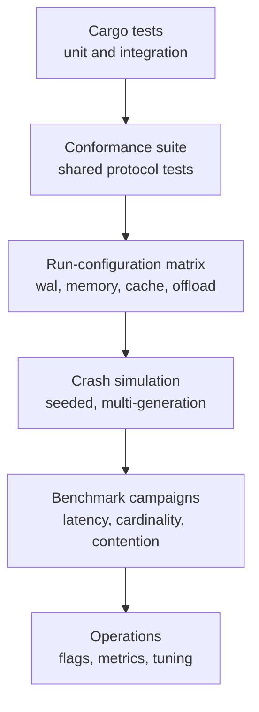
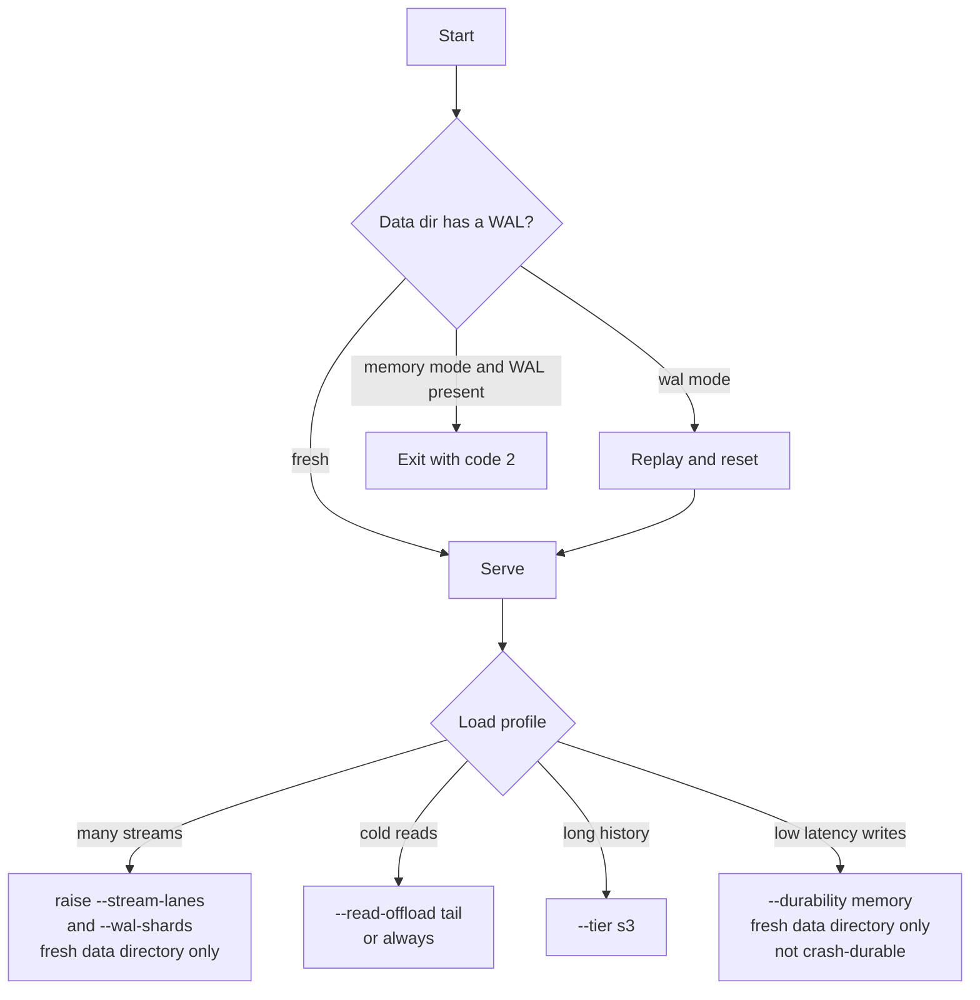

# Conformance, Benchmarks, and Operations

This document gives the evidence for the server's protocol correctness and performance. It also gives the flags and measurements that an operator needs to run the server.

The evidence has six layers. Unit and integration tests check the code. The shared conformance suite checks the protocol. The run-configuration matrix checks the default build's durability, tail-cache, and read-offload variants. The crash simulation checks recovery. The benchmark campaigns measure throughput and latency under controlled conditions. The operations layer turns those findings into flags, metrics, and tuning rules.

**Citation scope.** A citation such as `README.md:189-195`, `ARCHITECTURE.md:102-108`, `WAL_TUNING.md:12-21`, `CARDINALITY_1M.md:5-7`, `CONTENTION_INVESTIGATION.md:87-105`, `CRASH_SIM_FINDINGS.md:3-9`, or `MIXED_WORKLOAD_VALIDATION.md:20-38` points inside the source package at `/Users/darkvoid/GitSources/src.Electric/electric/packages/durable-streams-rust`. It does not point inside this exploration directory. A path that starts with `../` points to another study. A path that starts with `src/` or `conformance/` points inside the source package.

## The evidence ladder



Each layer answers a different question:

| Layer | Question | Source |
|-------|----------|--------|
| Unit tests | Does each function obey its contract? | `src/wal/e2e_tests.rs`, module tests |
| Conformance | Does the server speak the protocol? | `conformance/conformance.test.ts` |
| Matrix | Is every matrix configuration protocol-equivalent? | `README.md:135-141` |
| Crash simulation | Does a crash preserve every acknowledged byte? | `src/wal/sim_tests.rs` |
| Benchmarks | What is the throughput and latency envelope? | `README.md:189-195`, campaign documents |
| Operations | Which flags, metrics, and limits apply in production? | `src/main.rs:142-292`, `src/telemetry.rs` |

## The conformance suite

The suite uses the shared `@durable-streams/server-conformance-tests` package (`package.json:16-19`). The harness has two modes (`conformance/conformance.test.ts:1-15`).

- The default mode spawns the release binary on port 4562 and uses a fresh temporary data directory (`conformance/conformance.test.ts:20-37`, `conformance/conformance.test.ts:40-60`).
- The manual mode reads `RUST_SERVER_URL` and tests an already-running server.

The harness sets the protocol configuration in one object (`conformance/conformance.test.ts:22-31`):

```ts
const externalUrl = process.env.RUST_SERVER_URL
const port = Number(process.env.RUST_SERVER_PORT ?? 4562)
const longPollTimeoutMs = 500

const config = {
  baseUrl: externalUrl ?? `http://localhost:${port}`,
  longPollTimeoutMs,
  // This server implements the core protocol only; the subscription/control-plane
  // suite is out of scope, so skip it rather than report it as failing.
  subscriptions: false,
}
```

The configuration sets a 500-millisecond long-poll timeout and disables the subscription suite (`conformance/conformance.test.ts:20-31`). This server implements the core protocol and Server-Sent Events (SSE) reads. It does not implement the separate subscription and control-plane extension that the disabled suite tests; that extension is not SSE itself. The port comes from `RUST_SERVER_PORT` and defaults to 4562 (`conformance/conformance.test.ts:22-23`). The suite passed 326 tests at the time of the cardinality study, together with 95 crate tests (`CARDINALITY_1M.md:29`).

### The run-configuration matrix

Every configuration in the continuous-integration matrix must pass the same suite. The matrix covers durability, the resident tail cache, and read offload (`README.md:135-141`). The harness reads extra server flags from `RUST_SERVER_ARGS`, for example:

```bash
RUST_SERVER_ARGS="--durability memory" pnpm vitest run --project server-rust
RUST_SERVER_ARGS="--read-offload always" pnpm vitest run --project server-rust
RUST_SERVER_ARGS="--tail-cache-bytes 65536" pnpm vitest run --project server-rust
```

Tiering needs two things: a build with the `tier` Cargo feature, and the `--tier s3` flag (`README.md:163`, `src/main.rs:167-177`). In a default build the flag fails at startup with the message `--tier s3 requires building with --features tier` (`src/store.rs:1282-1294`). Tiering is tested by a manual run against an Amazon Simple Storage Service (S3)-compatible endpoint. The continuous-integration matrix runs the default build without tiering (`README.md:163`).

## The crash simulation

The simulation is a seeded randomized test of the real recovery path (`src/wal/sim_tests.rs:1-30`). Each seed runs three generations by default. Each generation applies a random workload, drops the runtime, stops the committers, injects disk faults, reboots through the real recovery sequence, and checks a no-loss and no-torn oracle (`CRASH_SIM_FINDINGS.md:3-9`).

"Drop the runtime" means that the test drops the generation's Tokio runtime. This aborts in-flight requests at whatever await point they reached, which models a process death (`src/wal/sim_tests.rs:5-8`). The oracle has five parts (`src/wal/sim_tests.rs:18-25`):

1. Every acknowledged record is present, in order, and whole.
2. A maybe-applied record is either present and whole or absent. A maybe-applied record is a cancelled append or an append in flight at the crash.
3. No torn bytes, and no foreign bytes (bytes that no append wrote), exist.
4. The tail, the file base, and the closed flag are consistent.
5. A deleted stream stays deleted, and recovery itself does not panic.

The default controls are (`src/wal/sim_tests.rs:1069-1082`):

| Control | Default | Meaning |
|---------|---------|---------|
| `DS_SIM_SEEDS` | 4 | number of seeds |
| `DS_SIM_SEED0` | `0x0001_5EED` | first seed |
| `DS_SIM_GENS` | 3 | generations per seed |
| `DS_SIM_STEPS` | 100 | operations per generation |

The workload includes creates, appends, client-disconnect cancellations, closes, forks, deletes, and checkpoints. The fault model includes data-file truncation, scribbling (writing random bytes over a region), and zeroing in the un-fsynced region. It also includes write-ahead log (WAL) suffix damage above the durable log sequence number (LSN). It also includes torn staged appends and in-flight appends at the crash (`CRASH_SIM_FINDINGS.md:138-142`).

The provenance differs by finding. Finding 1 came from the first default seed, finding 2 from seed 89840, and findings 4 and 5 from the 1,000-seed hunts (`CRASH_SIM_FINDINGS.md:27-35`, `CRASH_SIM_FINDINGS.md:56-58`, `CRASH_SIM_FINDINGS.md:133-137`). Finding 3 came from a documentation review, not a simulation run (`CRASH_SIM_FINDINGS.md:70-77`). The full findings are in [02-storage-wal-and-recovery.md](02-storage-wal-and-recovery.md).

## Benchmark campaigns

Sizes use binary units: one mebibyte (MiB) is 1,048,576 bytes, and one gibibyte (GiB) is 1,073,741,824 bytes.

The campaigns used different hardware and different server builds. Do not compare one row of this table with another row as if only one variable changed.

| Campaign | Date | Server configuration | Load |
|----------|------|----------------------|------|
| Canonical ds-bench report | 2026-07-23 | One `c4d-standard-64-lssd` node, 8 pinned cores, distributed release 0.1.5, local raw-block Non-Volatile Memory Express (NVMe) | 256-byte binary appends, up to 100,000 streams, Kubernetes client fleet (`README.md:189-195`) |
| WAL write-path tuning | 2026-07-13 | `c4d-standard-64-lssd` with 6 local NVMe devices, 8 virtual central processing unit (vCPU) server, one data lane, then three data lanes and three WAL shards on separate devices | 256-byte appends, up to 100,000 streams in the ladder and 1,000,000 in the lane test (`WAL_TUNING.md:1-27`) |
| 1M-stream cardinality | 2026-07-02 | Remote 16 vCPU `c4d-standard-16-lssd` (local solid-state drive); the local comparison used a 6-server-core Linux harness, and the source does not state its storage | 256-byte appends, 20,000 to 1,000,000 streams (`CARDINALITY_1M.md:1-33`) |
| WAL contention | Not stated in the document | Linux harness, 6 server cores and 4 client cores, tmpfs (a memory file system), 1 to 6 shards | Saturation sweep (a load sweep to the saturation point) at 256 connections; append size and stream count not stated (`CONTENTION_INVESTIGATION.md:68-83`) |
| Mixed workload | 2026-07-02 | Local `kind` Kubernetes cluster, 2 central processing unit (CPU) cores and 2 GiB for the server, single-node MinIO object store | Writers, paced catch-up readers, and Server-Sent Events (SSE) subscribers (`MIXED_WORKLOAD_VALIDATION.md:1-18`) |

The name `c4d-standard-64-lssd` is a machine type. The `64` is not a core count. The tuning campaign used an 8 vCPU server on that machine type (`WAL_TUNING.md:1-5`).

### The canonical campaign

The maintained results are the ds-bench canonical report from 2026-07-23, measured on the 0.1.5 release (`README.md:189-195`). The 0.1.5 release label belongs to the distributed package: the npm wrapper is version 0.1.5 (`package.json:3`). It is not the Rust crate version, which is 0.1.0 (`Cargo.toml:3`). `ds-bench` is the external benchmark harness. The server runs on one `c4d-standard-64-lssd` node with raw-block local NVMe storage, pinned to 8 CPU cores. A Kubernetes client fleet sends 256-byte binary appends.

| Measurement | Result | Conditions |
|-------------|--------|------------|
| Append throughput at 10,000 streams | about 422,000 per second | `wal`, 8 pinned cores |
| Append throughput at 100,000 streams | about 388,000 per second | `wal`, 8 pinned cores |
| Cardinality change | −8% from 10,000 to 100,000 | no cliff |
| Memory mode at 100,000 streams | at least 636,000 per second | no fsync; the report states a lower bound and gives no higher measured point |
| Append throughput on 16 pinned cores | about 537,000 per second | separate 16-core run; the report calls this a true plateau |
| Catch-up read throughput | about 2.8 GiB per second | 512 concurrent connections; flat from 10 to 100 streams |
| 100,000 paced readers against a pinned 50,000 per second write load | write throughput unchanged relative to that load | zero errors |
| 1,000 SSE subscribers on one stream | about 27 MiB of process memory for fan-out | 2026-06-30 snapshot; one shared fan-out buffer per stream, not one per subscriber |

The append 50th-percentile (p50) latency is about 2.5 milliseconds at or below 80% load (`README.md:193`). Load here means the fraction of the measured saturation ceiling. The working set tracks stream count, not byte count. Each stream is a small record plus an open file, and the bytes stay on disk rather than in process memory (`README.md:193`).

### The write-path tuning ladder

An earlier campaign on a `c4d-standard-64-lssd` node with an 8 vCPU server measured 100,000 streams and 256-byte appends. The `64` in the machine type is not a core count. Each row adds one fix to the row above, so the numbers are cumulative (`WAL_TUNING.md:1-21`). The final `All of the above` row is the packaged stacked suite (`wal-stacked-1m`), not another single fix. The source does not attribute a further single change to that row; it is a separate suite that combines the fixes in one configuration.

| Configuration | Appends per second |
|---------------|--------------------|
| Before the fixes | 10,400 |
| Add the `syncfs` checkpoint barrier | 13,600 |
| Move stream files to local NVMe | 46,000 |
| Split WAL shards onto their own NVMe devices | 272,000 |
| Add the size-triggered checkpoint | 303,000 |
| Add exclusive pinned CPU cores | 328,000 |
| All of the above | 383,000 |
| Reference: memory durability | 512,000 |

The 512,000 memory figure comes from this earlier campaign. It is not the same run as the 636,000 canonical figure in the table above.

The tuning study gives four lessons (`WAL_TUNING.md:33-90`):

1. Use several physical NVMe devices. Never share one device between the WAL and the stream data files.
2. Put each WAL shard on its own device.
3. Use `--wal-checkpoint-wal-bytes 1073741824` and a 60-second fallback interval.
4. Give the server exclusive pinned cores.

The default `--wal-checkpoint-wal-bytes` is 0, so by default only the 3-second timer triggers a checkpoint. The tuning recommendation adds a 1 GiB size trigger and raises the timer to 60 seconds. That combination makes checkpoints less frequent and bounds replay to about 1 GiB per shard.

At 1,000,000 streams, one data lane reached a second wall. A second wall is a second throughput ceiling, this time from checkpoint writeback rather than from the commit path. The checkpoint writeback saturated the single device, and the `syncfs` call took 60 to 74 seconds (`WAL_TUNING.md:23-27`). This delays WAL recycling. It can also slow acknowledgements through device saturation, but no append waits on a checkpoint lock. The `--stream-lanes 3` layout broke that wall: 285,000 appends per second at 500,000 streams and 212,000 at 1,000,000 streams.

### The 1M-stream cardinality study

The cardinality study found one mechanism. A cost that a design pays once per stream in each checkpoint interval is divided by the number of operations on that stream. When that number falls below one, the cost is larger than the operation itself. At that point, a fixed per-stream cost becomes a per-operation cost (`CARDINALITY_1M.md:11-19`). It fixed four root causes:

1. The checkpoint drain held the dirty lock while it captured each stream. The fix takes the list and bumps the epoch in one short critical section, then captures after the release (`src/wal/shard.rs:877-881`).
2. Checkpoint phases ran on async runtime threads. The fix runs the whole checkpoint body in one blocking task, keeps the tails map in memory, and lets shards checkpoint concurrently (`src/wal/shard.rs:883-892`).
3. Every append rewrote the metadata sidecar. The fix marks the sidecar dirty on an append and flushes it at checkpoint (`src/handlers.rs:1245-1255`, `src/wal/shard.rs:1005-1017`).
4. Every append looked up the stream twice. The fix makes the inner handler return `is_json` with the response, so the outer handler does not look the stream up again (`src/handlers.rs:911-915`, `src/handlers.rs:919-928`).

The local before-and-after results were 43,000 to 46,000 before and 80,400 after at 20,000 streams. At 400,000 streams the result rose from 16,000 to 36,000 through 44,000 across the repeats, and the 99th-percentile latency fell from 144 milliseconds to about 28 milliseconds (`CARDINALITY_1M.md:23-27`).

The remote validation reached 1,114,644 appends per second at 1,000,000 streams with 64 client pods, and the rate was still climbing (`CARDINALITY_1M.md:39-43`). The degradation from 500,000 to 1,000,000 streams at equal load was −17%, and the cardinality study marks the earlier cliff as gone: its wording is "was a cliff" (`CARDINALITY_1M.md:5-7`). The one-lane tuning campaign did hit a wall at 1,000,000 streams, as the section above shows (`WAL_TUNING.md:23-27`).

### The contention study

The contention study tested the hypothesis that a WAL shard is a lock, not a CPU core (`CONTENTION_INVESTIGATION.md:9-13`). At six server cores on tmpfs, the baseline was flat across 1, 2, and 6 shards at 45,543, 46,905, and 48,825 appends per second, with about 80% CPU use (`CONTENTION_INVESTIGATION.md:68-83`). The commit and wakeup machinery, not the fsync, set that ceiling.

The fixes were:

| Candidate | Change |
|-----------|--------|
| T1a | Lock-free dirty registration after the first touch: an epoch compare-and-swap, with the dirty mutex taken only on that first touch |
| T1b | Atomic LSN and write-position reservation |
| T1c | Coalesced durability wakeups |
| T2a | Dedicated committer threads off the shared runtime |
| T2b | io_uring WAL writes |
| T3 | Shared-nothing thread-per-core design |

Three of the first four changes are in the current code: T1a, T1c, and T2a. T1b is not; it remains a candidate and is not scheduled. `reserve_and_stage` still takes `Shard.inner` to reserve the LSN and the write position (`src/wal/shard.rs:650-658`). T2b and T3 are future work. The `--wal-stats` line reports the effect of the three changes that landed: the `waiters_woken_avg` value collapses toward 1, and the dirty-lock load falls (`CONTENTION_INVESTIGATION.md:87-105`, `src/wal/shard.rs:795-824`, `src/wal/shard.rs:1415-1440`).

### The mixed-workload study

The mixed-workload study measured interference between writers, paced catch-up readers, and SSE subscribers on a 2-CPU server (`MIXED_WORKLOAD_VALIDATION.md:1-18`). A bounded catch-up reader replays at a fixed rate of one replay per second. An unbounded reader loops without pacing; the study uses that mode only to test overload.

| Finding | Evidence |
|---------|----------|
| Bounded catch-up reads do not cost write throughput | writers pinned at about 17,750 appends per second, which is 60% of the 29,700 unthrottled ceiling; 256-byte appends; the write rate held within noise at 0, 4, 16, 64, and 128 readers (`MIXED_WORKLOAD_VALIDATION.md:20-38`) |
| Interference appears only above about 60 MiB per second of read bandwidth | write 99th percentile (p99) latency rose from 6.5 milliseconds at 64 readers to 53 milliseconds at 128 readers; the study locates the turn at about 60 MiB of replay bandwidth per second on 2 CPUs (`MIXED_WORKLOAD_VALIDATION.md:34`) |
| SSE delivery p99 is the write p99 plus 1 to 3 milliseconds | both durability modes, all write rates (`MIXED_WORKLOAD_VALIDATION.md:40-61`) |
| 100 subscribers cost about 42% of the write ceiling on 2 CPUs | at write saturation, throughput fell from 29,700 to between 17,100 and 17,400 appends per second in `wal` mode |

The study also observed that, for catch-up reads, the server does not shed load at the request level. With unpaced readers, writes fair-share down, but the server returns no 429 or 503 status; the overload is silent (`MIXED_WORKLOAD_VALIDATION.md:35-38`). This statement does not cover the Server-Sent Events (SSE) reactor: a subscriber that lets 8 MiB of framed data queue unsent has its connection closed (`src/sse_reactor.rs:33-37`, `src/sse_reactor.rs:413-416`). That is a connection-level limit, not a 429 or 503 response.

## Observability

A blocking-pool wait is a wait for the Tokio blocking thread pool. The server uses that pool for file I/O that would otherwise block an asynchronous worker.

### WAL contention line

`--wal-stats N` prints a `WAL_CONT` line every N seconds (`src/main.rs:135-140`, `src/main.rs:419-425`). The line reports:

```text
WAL_CONT staged/s=... fsync/s=... batch_avg=... inner_wait_us=... inner_wait_load=... \
         dirty_wait_us=... dirty_wait_load=... waiters_woken_avg=...
```

The line is one interval of N seconds. `staged/s` and `fsync/s` are counts per second in that interval. `batch_avg` is appends per group commit. `inner_wait_us` and `dirty_wait_us` are mean wait times in microseconds. The `*_wait_load` value is the mean number of CPU cores spent waiting on that lock during the interval (`CONTENTION_INVESTIGATION.md:35-38`). A value above 1.0 means the server lost more than one whole core to lock parking.

The flag also arms the hot-path timers. Without the flag, the code does no clock reads on the append path (`src/main.rs:135-140`).

### Server load line

`--server-stats N` prints a `SRV_STATS` line every N seconds (`src/main.rs:239-248`, `src/srvstats.rs:96`). It reports CPU core use, in-flight requests, service time, appender-lock wait, and durability wait. Service time is the mean time from request start to response. The values are per interval, and the wait values are mean microseconds. This line shows the bottleneck directly.

### OpenTelemetry

The `telemetry` Cargo feature enables OpenTelemetry Protocol (OTLP) export over gRPC, a remote procedure call protocol (`Cargo.toml:57-67`). It is off by default. A default build does not compile the OpenTelemetry dependencies and does no hot-path work for them.

The configuration comes from the standard `OTEL_*` environment variables (`src/telemetry.rs:186`). For example, `OTEL_EXPORTER_OTLP_ENDPOINT` sets the collector address and `OTEL_TRACES_SAMPLER` sets the trace sampling policy (`README.md:167`). The two primary metrics are:

| Metric | Meaning | Citation |
|--------|---------|----------|
| `ds.append.fsync.batch_size` | appends per group commit | `src/telemetry.rs:69` |
| `ds.read.offload.wait` | blocking-pool queue wait for a cold read, in seconds | `src/telemetry.rs:92` |

The `ds.request` span records only bounded attributes. It does not record the stream path or identifier (`src/handlers.rs:248-264`).

## Operations

### Network and storage flags

| Flag | Default | Effect |
|------|---------|--------|
| `--host` | `127.0.0.1` | listen address (`src/main.rs:117`) |
| `--port` | `4437` | listen port (`src/main.rs:116`) |
| `--data-dir` | system temporary directory | storage root (`src/main.rs:118`) |
| `--long-poll-timeout-ms` | `30000` | long-poll block time (`src/handlers.rs:32`) |
| `--wal-shards` | the `--worker-threads` value on the first boot, which defaults to available parallelism (normally the number of central processing unit (CPU) cores) | fixed after the first boot; a different value stops the server with exit code 2 (`src/wal/walset.rs:91-115`, `src/main.rs:398-405`) |
| `--wal-segment-bytes` | 128 MiB | WAL segment size, not the cold-tier segment size (`src/wal/segment.rs:20-22`) |
| `--stream-lanes` | 1 | data-file lane count (`src/store.rs:197`) |
| `--worker-threads` | available parallelism | worker threads in Tokio, the asynchronous runtime, and the default WAL shard count on a fresh data directory (`src/main.rs:124-130`) |

### Durability and checkpoint flags

| Flag | Default | Effect |
|------|---------|--------|
| `--durability` | `wal` | `wal` or `memory` (`src/handlers.rs:54-60`) |
| `--wal-checkpoint-interval-ms` | 3,000 | time trigger (`src/wal/shard.rs:383`) |
| `--wal-checkpoint-wal-bytes` | 0 | size trigger, 0 disables it (`src/wal/shard.rs:390`) |

Memory mode cannot start over a WAL from an earlier `wal` run (`src/main.rs:298-322`). Memory mode also cannot be combined with tiering (`src/main.rs:298-305`). Tiering seals only bytes below the durable tail and treats a sealed object as permanent history. In memory mode the durable tail advances on the page-cache write. So a sealed segment could contain bytes that a crash erases, and no recovery pass trims a sealed segment (`src/tier.rs:522-533`).

### Read flags

| Flag | Default | Effect |
|------|---------|--------|
| `--tail-cache-bytes` | 0 on Linux, 65,536 on macOS | resident tail cache; 0 disables it, so every read comes from the file (`src/store.rs:376-397`) |
| `--read-offload` | `tail` | where file reads run (`src/engine_raw.rs:38-59`) |

The tail cache is off on Linux because `sendfile` is already fast. It is on by default on macOS because the server's macOS read path uses positioned reads rather than the Linux `sendfile` path (`src/store.rs:376-384`).

### Cold-tier flags

| Flag | Default | Effect |
|------|---------|--------|
| `--tier` | `off` | `off` or `s3` (`src/main.rs:167-177`, `src/tier.rs:208-212`) |
| `--tier-segment-bytes` | 8 MiB | cold-tier sealed segment size (`src/tier.rs:33-35`) |
| `--tier-compact-bytes` | 64 MiB | live-file compaction threshold (`src/tier.rs:37-41`) |
| `--tier-endpoint`, `--tier-region`, `--tier-bucket` | none | S3 connection (`src/main.rs:185-187`) |

The S3 credentials come from the environment, never from a flag. The server reads `DS_S3_ACCESS_KEY_ID` and `DS_S3_SECRET_ACCESS_KEY`, with the standard `AWS_ACCESS_KEY_ID` and `AWS_SECRET_ACCESS_KEY` as fallbacks (`src/main.rs:324-333`).

### Environment variables

| Variable | Purpose | Citation |
|----------|---------|----------|
| `DS_S3_ACCESS_KEY_ID` | S3 credential | `src/main.rs:327-329` |
| `DS_S3_SECRET_ACCESS_KEY` | S3 credential | `src/main.rs:330-332` |
| `OTEL_*` | OpenTelemetry configuration | `src/telemetry.rs:186` |
| `DS_UNSAFE_FAST_FSYNC` | benchmark-only plain fsync on macOS | `src/store.rs:109-117` |
| `DS_BENCH_FAST_FSYNC` | benchmark-only plain fsync instead of `F_FULLFSYNC` in the WAL; macOS only | `src/wal/segment.rs:136-143` |
| `DS_SIM_SEEDS`, `DS_SIM_SEED0`, `DS_SIM_GENS`, `DS_SIM_STEPS` | crash simulation controls | `src/wal/sim_tests.rs:1069-1082` |
| `DS_DUMP_DIR` | forensic disk dump directory | `src/wal/sim_tests.rs:991-997` |
| `RUST_SERVER_ARGS` | extra conformance server flags | `conformance/conformance.test.ts:44-60` |

The two fast-fsync variables are benchmark aids. `DS_UNSAFE_FAST_FSYNC` affects the store's `barrier_fsync`, which covers data and sidecar writes. `DS_BENCH_FAST_FSYNC` affects the WAL segment barrier. Both replace the macOS `F_FULLFSYNC` drive-cache barrier with a plain `fsync`. Here "plain fsync" means the standard `fsync` call instead of `F_FULLFSYNC`. They weaken the durability barrier on macOS. Never set them in production (`README.md:128-133`, `src/store.rs:109-117`, `src/wal/segment.rs:136-143`).

### File descriptors and shutdown

The server raises the soft open-file limit to the hard limit at startup (`src/main.rs:84-111`). In the measured 1,000,000-stream run, each live stream held one file descriptor; a fork can also need its parent file, and a cold read opens a chunk file. At 1,000,000 streams the server held about 1,005,724 descriptors, which is 96% of the default 1,048,576 limit (`WAL_TUNING.md:113-116`). Raise `LimitNOFILE` for a deployment near that scale.

A shutdown on `SIGINT` or `SIGTERM` stops accepting connections and stops the Server-Sent Events reactor on Linux. It waits up to 25 seconds for in-flight requests, joins the WAL committers, and flushes telemetry (`src/main.rs:445-464`, `src/main.rs:575-591`). It does not force a checkpoint, so the next boot may replay the WAL.

### Security boundary

The server has no authentication and no Transport Layer Security (TLS). The flag parser has no option for either (`src/main.rs:145-292`). Any client that can reach the port can read and write every stream.

The default listen address is the loopback address `127.0.0.1`, so only the local host can connect (`src/main.rs:116-117`). The engine adds two constant response headers to every response: `x-content-type-options: nosniff` and `cross-origin-resource-policy: cross-origin` (`src/api.rs:214-217`, `src/http1.rs:125-132`). The first header stops a browser from guessing a media type. The second header is permissive: it permits a page on another origin to load the response. Neither header is access control.

A deployment on an untrusted network must put the server behind a reverse proxy that provides authentication and TLS. Do not expose the server port directly. The server has no backup, restore, or on-disk format migration command; the flag parser lists every operation it supports (`src/main.rs:145-292`). Stop the server and copy the whole data directory. The cold tier is not a backup: it holds only sealed history, and the live tail plus the sidecar metadata stay on local disk. A cold-tier copy alone cannot restore a stream.



`--stream-lanes` and `--wal-shards` are layout choices. A different value on an existing data directory stops the server. Change them only when you create the data directory (`src/store.rs:519-556`, `src/wal/walset.rs:91-115`). Memory mode also refuses a directory that holds a WAL from an earlier `wal` run (`src/main.rs:298-322`).

## Key insight

**Aha:** the write throughput is almost independent of the stream count because one shard committer folds many streams' appends into one `fdatasync`. A design with one fsync per append pays the disk barrier once per message. This server pays it once per group commit. The measured flat curve from 10,000 to 100,000 streams is therefore not a caching effect. It is the direct result of the commit granularity (`ARCHITECTURE.md:104`, `WAL_TUNING.md:7-21`). In the one-lane tuning campaign, the wall that remained at 1,000,000 streams was checkpoint writeback on one device, not the commit path, and `--stream-lanes` broke it (`WAL_TUNING.md:23-27`). The remote cardinality study found no such cliff on its configuration, as the section above shows.

## Cross-references

- [00-overview.md](00-overview.md) gives the package facts and the boot sequence.
- [01-architecture.md](01-architecture.md) gives the write and read paths.
- [02-storage-wal-and-recovery.md](02-storage-wal-and-recovery.md) gives the WAL and recovery design.
- [../durable-streams/10-integrations-and-conformance.md](../durable-streams/10-integrations-and-conformance.md) gives the shared conformance programme.
- [../sync-service/06-telemetry-and-observability.md](../sync-service/06-telemetry-and-observability.md) gives the Electric server observability model for comparison.
