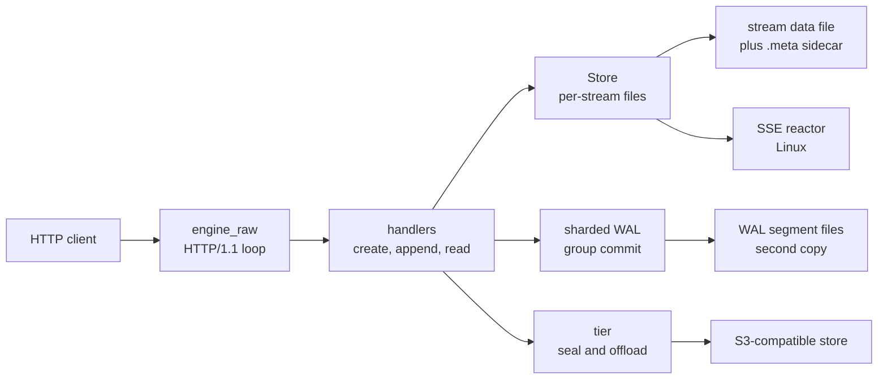
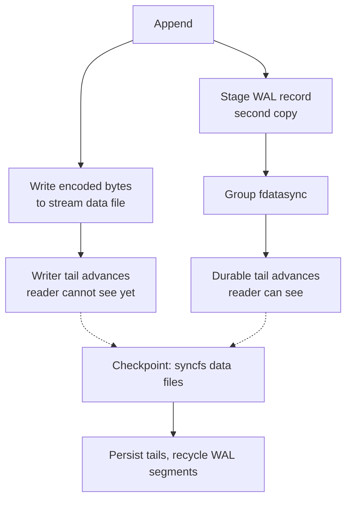

# durable-streams-rust

`durable-streams-rust` is the native Rust server for the Durable Streams protocol. It is one self-contained binary with no database and no broker. It stores each stream as encoded bytes in one contiguous file, so a write is an append and a read is a byte range. For a binary stream the encoded bytes are the posted bytes. For a JavaScript Object Notation (JSON) stream they are each value plus a comma. In its default `wal` mode, a sharded write-ahead log carries a second copy of each append. It makes that copy durable with `fdatasync`, a POSIX call that flushes file data to the storage device, before any reader sees it. The optional `memory` mode has no WAL and is not crash-safe.

Five terms are used throughout:

- A **stream** is an append-only log of bytes at one Hypertext Transfer Protocol (HTTP) path.
- An **offset** is a byte position inside a stream. A reader sends the offset to resume.
- A **write-ahead log (WAL)** is a sequential log that carries a second copy of each append until a checkpoint makes the data-file copy durable.
- A **shard** is one WAL log with one committer thread that syncs it.
- A **checkpoint** syncs the stream data files, records each stream's durable tail, and then recycles WAL segments.

Sizes use binary units: one mebibyte (MiB) is 1,048,576 bytes.

The source is at `/Users/darkvoid/GitSources/src.Electric/electric/packages/durable-streams-rust`. The Rust crate is `durable-streams`, version `0.1.0` (`Cargo.toml:2-10`). The npm wrapper package is `@electric-ax/durable-streams-server-rust`, version `0.1.5` (`package.json:2-5`); the benchmark reports use that release label. The licence is Apache-2.0 (`Cargo.toml:6`). The minimum supported Rust version is 1.75 (`Cargo.toml:8`). The binary name is `durable-streams-server` (`Cargo.toml:16-18`).

The parent study is [Electric and Durable Streams](../README.md). The protocol study is in [durable-streams](../durable-streams/README.md).

## What the package does

1. **Speaks the Durable Streams protocol over HTTP.** One request dispatcher handles create, append, read, head, and delete (`src/handlers.rs:248-282`).
2. **Stores encoded bytes contiguously.** The stream data file has no per-message header. A binary response is that byte range unchanged; a JSON response wraps the range in `[` and `]` and drops its final comma (`src/store.rs:1-8`, `src/handlers.rs:1318-1353`).
3. **Makes appends durable.** A sharded WAL groups many appends into one `fdatasync` call per shard. A segment roll adds a file sync and a parent-directory sync, but only to the append that fills the segment. The usual case is one barrier for many appends (`src/wal/shard.rs:663-673`, `src/wal/shard.rs:699-711`, `src/wal/shard.rs:1450-1475`).
4. **Gates visibility on durability.** A reader sees bytes only after the WAL barrier covers them (`src/handlers.rs:772-802`, `ARCHITECTURE.md:78`).
5. **Serves live reads.** Long-poll requests park for up to 30 seconds. Server-Sent Events (SSE) stream frames for up to 60 seconds (`src/handlers.rs:32`, `src/handlers.rs:110-114`).
6. **Offloads cold history.** Optional tiering seals cold-tier segments of 8 MiB each to an Amazon Simple Storage Service (S3)-compatible object store (`src/tier.rs:33-41`, `src/tier.rs:499-626`). A cold-tier segment is not a WAL segment; the WAL segment is 128 MiB (`src/wal/segment.rs:20-22`).
7. **Recovers after a crash.** Recovery replays the WAL, repairs torn file tails, then resets the WAL (`src/wal/recovery.rs:1-45`, `src/main.rs:371-410`).

## Documents

| Document | What you learn |
|----------|----------------|
| [00-overview.md](00-overview.md) | The purpose, package facts, components, boot sequence, and the central invariant |
| [01-architecture.md](01-architecture.md) | The write path, the read path, the HTTP engine, and the body types |
| [02-storage-wal-and-recovery.md](02-storage-wal-and-recovery.md) | The on-disk format, the WAL record, group commit, checkpoints, and crash recovery |
| [03-conformance-benchmarks-and-operations.md](03-conformance-benchmarks-and-operations.md) | The conformance suite, the benchmark campaigns, observability, and operations |



## Package map

```text
durable-streams-rust/
├── src/
│   ├── main.rs              argument parsing, boot order, checkpoint ticker
│   ├── api.rs               request, response, body types, status reasons
│   ├── http1.rs             HTTP/1.1 head parse and chunk framing
│   ├── engine_raw.rs        hand-rolled connection loop and read offload
│   ├── handlers.rs          protocol handlers for every method
│   ├── store.rs             stream state, data files, sidecars, recovery
│   ├── tier.rs              seal, manifest, compaction, offload
│   ├── blobstore.rs         S3-compatible object store adapter
│   ├── sse_reactor.rs       Linux SSE subscriber reactor
│   ├── telemetry.rs         optional OpenTelemetry export
│   ├── srvstats.rs          periodic server load line
│   └── wal/
│       ├── codec.rs         38-byte record header and CRC checks
│       ├── segment.rs       fixed-size segment file
│       ├── shard.rs         per-shard log, committer, checkpoint
│       ├── walset.rs        shard set and stream routing
│       ├── recovery.rs      replay and torn-tail repair
│       ├── telemetry.rs     WAL contention counters
│       ├── e2e_tests.rs     crash and recovery tests
│       └── sim_tests.rs     seeded randomized crash simulation
├── conformance/             protocol conformance harness
├── bench-latency/           latency matrix runner
├── ARCHITECTURE.md          design and performance reference
├── WAL_TUNING.md            write-path tuning ladder
├── CARDINALITY_1M.md        1,000,000-stream findings
├── CONTENTION_INVESTIGATION.md  lock contention study
├── CRASH_SIM_FINDINGS.md    crash simulation findings
└── MIXED_WORKLOAD_VALIDATION.md  read and write interference study
```

## Key insight

**Key insight:** for a binary stream, the storage format is the response format. The server does not decode a message, change it, and encode it again. It appends the posted bytes to a file. A catch-up read is then a byte range of that file, and the Linux server sends that range with `sendfile(2)` directly from the page cache to the socket (`ARCHITECTURE.md:159`, `src/handlers.rs:1361-1369`). `sendfile` is a Linux system call that copies file bytes to a socket without a user-space copy. The page cache is kernel memory that holds file data before the kernel writes it to disk. A JSON stream keeps the same byte-range model, but a read adds one `[` and one `]` and removes the range's one trailing comma (`src/handlers.rs:1318-1353`). The byte-range model removes a per-message copy from both paths. The cost is that every protocol feature must work on byte ranges. Sealing, compaction, and recovery all exist to keep that model correct (`src/tier.rs:551-564`, `src/wal/recovery.rs:34-45`).

**Aha:** the server writes each append twice, and the second write is what makes the durability barrier cheap. The data-file write fills the page cache and advances the writer tail. The WAL record is a second copy in a sequential log, and one `fdatasync` on that log covers many appends from many streams. The per-stream data files get their disk barrier later, in one checkpoint `syncfs` per lane. `syncfs` is a Linux system call that flushes every dirty file on one file system. `fsync` is the same barrier for a single file or directory. A lane is one directory that holds stream data files. If the server fsynced each stream file per append instead, every append would pay its own disk barrier. The duplicate write buys a shared barrier (`src/handlers.rs:1121-1174`, `src/wal/shard.rs:915-1022`). The price is real: the tuning study puts the residual gap to `memory` mode at about 1.6 times (`WAL_TUNING.md:29`), measured against the 328,000 row with pinned cores. Against the fully stacked 383,000 appends per second, the 512,000 memory result is about 1.3 times.



## Reading order

| Stage | Read | Why |
|-------|------|-----|
| 1 | [00-overview.md](00-overview.md) | The problem, the package facts, the components, the two durability modes, and the boot sequence |
| 2 | [01-architecture.md](01-architecture.md) | One append and one read through the code, plus the HTTP engine and the three response body types |
| 3 | [02-storage-wal-and-recovery.md](02-storage-wal-and-recovery.md) | The two-copy storage model, the WAL record, group commit, checkpoints, the lock inventory, and recovery |
| 4 | [03-conformance-benchmarks-and-operations.md](03-conformance-benchmarks-and-operations.md) | The conformance suite, the measured campaigns, the tuning levers, and the operational flags |

## Related studies

- [durable-streams](../durable-streams/README.md) documents the protocol that this server implements.
- [durable-streams/08-server-implementations.md](../durable-streams/08-server-implementations.md) compares this server with the other server implementations.
- [durable-streams/05-storage-and-durability.md](../durable-streams/05-storage-and-durability.md) gives the protocol-level durability model.
- [durable-streams/10-integrations-and-conformance.md](../durable-streams/10-integrations-and-conformance.md) explains the shared conformance suite.
- [sync-service](../sync-service/README.md) is the Electric sync server, a different storage design for shapes.
- [elixir-client](../elixir-client/README.md) and [typescript-client](../typescript-client/README.md) are clients for the Electric shape protocol.

## Source map

All paths are relative to `/Users/darkvoid/GitSources/src.Electric/electric/packages/durable-streams-rust`. A citation such as `README.md:189-195`, `ARCHITECTURE.md:102-108`, or `WAL_TUNING.md:12-21` also points inside that source package, not inside this exploration directory. A citation that starts with `../` points to another study.

| Area | File |
|------|------|
| Entry point and boot order | `src/main.rs` |
| HTTP engine | `src/engine_raw.rs`, `src/http1.rs` |
| Protocol handlers | `src/handlers.rs` |
| Stream storage | `src/store.rs` |
| Write-ahead log | `src/wal/` |
| Cold tier | `src/tier.rs`, `src/blobstore.rs` |
| Live fan-out | `src/sse_reactor.rs` |
| Crash simulation | `src/wal/sim_tests.rs` |
| Conformance harness | `conformance/conformance.test.ts` |

## Build, run, and test

The package is a Cargo project. A stable Rust toolchain of 1.75 or later is sufficient (`Cargo.toml:8`). No system library is required.

```bash
cargo build --release
./target/release/durable-streams-server --port 4438 --data-dir ./data
cargo test --release
```

The default address is `127.0.0.1:4437` (`src/main.rs:116-117`). The example above uses port 4438 to avoid a possible local service on the default port. The default data directory is under the system temporary directory (`src/main.rs:118`). The default durability mode is `wal` (`src/handlers.rs:41-49`).

The protocol operations, including create, close, delete, fork, and time-to-live behaviour, are defined in the protocol study: [durable-streams/02-protocol-operations.md](../durable-streams/02-protocol-operations.md).

The conformance suite needs the release binary and the Node.js harness. Run `pnpm vitest run --project server-rust`, or set `RUST_SERVER_URL` to an already-running server (`conformance/conformance.test.ts:1-15`).
