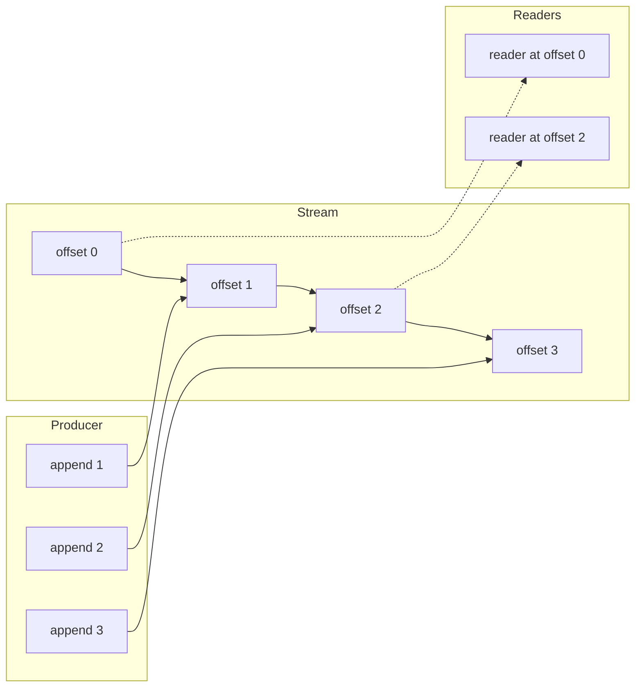
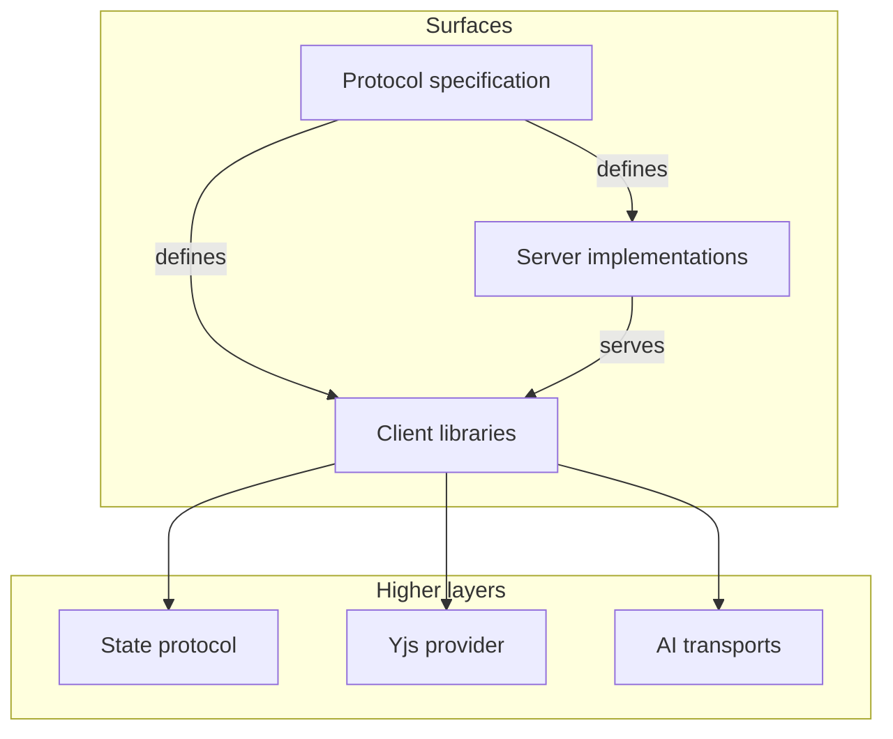
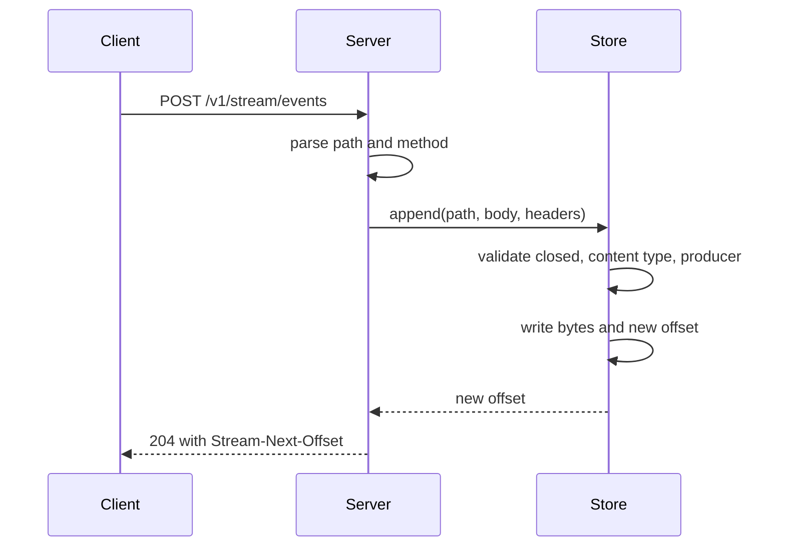

# Overview

Durable Streams is a small protocol with a large promise. The promise is that a reader can always resume from an exact position, even after a crash, a refresh, or a network failure. The protocol achieves this promise with an append-only log, an opaque offset, and plain Hypertext Transfer Protocol (HTTP).

This document gives the problem, the core design, the repository layout, and the constraints that shape every other document in this package.

## The problem

A normal HTTP response is transient. If the connection breaks, the bytes in flight are lost. A WebSocket connection is also transient. If a phone changes network, the socket closes. A Server-Sent Events (SSE) connection is transient too. A server restart ends the connection.

Application teams solve this problem in the same way each time. They add a database table for the messages. They add a resumable read endpoint. They add a notification path. They add a cleanup job. Each part works, but the parts do not share one model.

Durable Streams makes the log the first-class object. The protocol defines one stream model for all of these needs:

- Replay from any position.
- Live tail, the current end of the stream, with long-poll or SSE. A long-poll request is one that the server holds open until data arrives.
- Deduplicated writes with an idempotent producer, a writer that can retry without a duplicate append.
- Time To Live (TTL) and expiry.
- Stream closure.
- Stream forking with a shared offset space.
- Content types, including a JavaScript Object Notation (JSON) mode.

## The core idea

A stream is an ordered sequence of bytes at a Uniform Resource Locator (URL) path. The server assigns an offset to each append. The offset is opaque and lexicographically sortable. A reader sends the offset back and receives only the data after it.



The server never changes an old byte. A reader at offset 0 always sees the same bytes. A reader at offset 2 sees the same bytes as every other reader at offset 2. This property is called immutability by position.

Aha: the offset is not a message number. It is a position in a total order. The server can advance the position by a variable number of bytes. The client only needs to compare offsets and send one back. This is why the protocol can support forking, replay, and caching with one small set of rules.

## The three surfaces

The package has three surfaces. Each surface has one job. The protocol also has higher layers, including artificial intelligence (AI) transports.



1. The protocol surface is `PROTOCOL.md`. It defines the resource model, the headers, the status codes, and the live modes. It also defines the subscription control plane and the caching rules.
2. The server surface is a set of implementations. `packages/server` is the reference Node.js server. `packages/server-cloudflare` runs on Cloudflare Workers and Durable Objects. `packages/caddy-plugin` runs inside Caddy v2.
3. The client surface is a set of language libraries. The TypeScript client in `packages/client` is the reference implementation.

The state protocol, the Yjs provider, and the AI transports are higher layers. They use a stream as a transport. They do not change the protocol.

## Version and status

The protocol document has these facts:

- Version 1.0.
- Date `2025-01-XX`.
- Author ElectricSQL.
- Status draft in the repository.

The repository README labels the project status as beta. The client maturity document gives a more precise status for each client. The TypeScript client is Level 3, Production-Proven. The Python and Go clients are Level 2, Expert-Reviewed. The Java client is Level 1, Vibe-Engineered, and is a community contribution.

## Repository size and shape

The repository is a pnpm workspace. pnpm is the package manager that links the workspace packages. The root `package.json` sets the package manager to `pnpm@10.25.0` and the Node.js engine to `>=22`. The workspace contains ten language clients, three server implementations, five integration packages, two conformance suites, and a benchmark package.

The reference server is substantial:

```text
packages/server/src/server.ts                 60,505 bytes
packages/server/src/store.ts                  43,255 bytes
packages/server/src/file-store.ts             65,820 bytes
packages/server/src/subscription-manager.ts   24,967 bytes
packages/server/src/subscription-routes.ts    13,167 bytes
```

The reference client is also substantial:

```text
packages/client/src/stream.ts                 31,658 bytes
packages/client/src/response.ts               47,270 bytes
packages/client/src/idempotent-producer.ts    25,237 bytes
```

## The default server

The reference server starts at port `4437` and binds to `127.0.0.1` by default. The protocol selects the port from the Internet Assigned Numbers Authority (IANA) unassigned range 4434-4440. The port is not registered (`PROTOCOL.md:1493`).

```ts
this.options = {
  port: options.port ?? 4437,
  host: options.host ?? `127.0.0.1`,
  longPollTimeout: options.longPollTimeout ?? 30_000,
  dataDir: options.dataDir,
  onStreamCreated: options.onStreamCreated,
  onStreamDeleted: options.onStreamDeleted,
  compression: options.compression ?? true,
  cursorOptions: {
    intervalSeconds: options.cursorIntervalSeconds,
```

This block is an excerpt from `packages/server/src/server.ts:191`. The constructor selects a store before this block:

```ts
if (options.dataDir) {
  this.store = new FileBackedStreamStore({
    dataDir: options.dataDir,
  })
} else {
  this.store = new StreamStore()
}
```

This block is from `packages/server/src/server.ts:182`. The choice is important. Without `dataDir`, all data lives in memory. With `dataDir`, data lives in a log file and a Lightning Memory-Mapped Database (LMDB) metadata store. Document [05-storage-and-durability.md](05-storage-and-durability.md) explains the file-backed store.

## The default request path

The server receives an HTTP request and reads the path. A subscription control route starts with `__ds`, the reserved prefix for the subscription control plane, and is handled first. Every other path is a stream path. The method selects the operation.



The order of checks is part of the protocol. For an append, the server checks closure first, then content type, then sequence regression. This order is defined in `PROTOCOL.md` section 5.2 and implemented in `packages/server/src/store.ts` in the `append` method. Document [02-protocol-operations.md](02-protocol-operations.md) gives the full rule.

## Design constraints

Five constraints appear in every part of the code.

1. The offset is opaque. The server can choose any format. The reference server uses `<readSeq>_<byteOffset>` with 16 digits in each part.
2. The server must not split an append. A reader sees the whole append or no part of it.
3. The server must not reorder an append. The offset order is the append order.
4. The server must not delete a byte that a reader can still request. A stream with a retention or TTL rule is the exception.
5. The server must not return a success code before the data is durable. The file-backed store calls `fdatasync` (a file synchronisation call that flushes data without all file metadata) before it commits metadata.

## What the reader can rely on

The protocol gives a reader these guarantees:

- A read from an offset returns contiguous data.
- The `Stream-Next-Offset` header is the position after the returned data.
- The `Stream-Up-To-Date` header says whether the reader has reached the tail.
- The `Stream-Closed` header says whether the stream can receive more data.
- An event stream sends a control event after each data event.

These guarantees are small, but they are enough to build a resumable client. The TypeScript client uses them to implement a state machine with catch-up, long-poll, SSE, pause, and resume. Document [06-typescript-client.md](06-typescript-client.md) shows that state machine.

## Code example: create, append, read

The following example uses the Node.js server and the fetch application programming interface (API). It is a complete round trip.

```ts
const base = `http://127.0.0.1:4437/v1/stream`

await fetch(`${base}/orders`, {
  method: `PUT`,
  headers: { "content-type": `application/json` },
})

const append = await fetch(`${base}/orders`, {
  method: `POST`,
  headers: { "content-type": `application/json` },
  body: JSON.stringify({ type: `order.created`, id: 1 }),
})

const next = append.headers.get(`stream-next-offset`)

const read = await fetch(`${base}/orders?offset=${next}`)
const items = await read.json()
```

The create call uses `PUT`, not `POST`. The append call uses `POST`. The read call uses `GET` with the offset that the append returned. The read is at the tail, so it returns an empty array. The value `-1` is the sentinel for the beginning of the stream. The value `now` is the sentinel for the tail.

The same round trip with the TypeScript client uses one function call:

```ts
const res = await stream<{ type: string; id: number }>({
  url: `http://127.0.0.1:4437/v1/stream/orders`,
  offset: `-1`,
  live: false,
})
for await (const item of res.jsonStream()) {
  console.log(item)
}
```

The signature is at `packages/client/src/stream-api.ts:60`. The `jsonStream()` iterator is at `packages/client/src/response.ts:1052`. The client adds no protocol rule. It sends the same `GET` request.

## What this package does not define

The protocol does not define authentication. Section 12.1 says that authentication is out of scope. Each server implementation chooses its own model. The Cloudflare server uses an optional bearer token or a custom hook. The reference server has no authentication by default.

The protocol also does not define a schema for the bytes. A stream can hold JSON, text, or binary data. The JSON mode defines how the server treats a JSON body, but it does not define the meaning of the JSON objects. The state protocol in `packages/state` adds one common meaning for state changes.

## Related documents

- [README.md](README.md) is the package index.
- [01-protocol-stream-model.md](01-protocol-stream-model.md) explains the stream model in detail.
- [02-protocol-operations.md](02-protocol-operations.md) lists every operation and header.
- [04-node-server.md](04-node-server.md) starts the server implementation study.
- [../04-how-the-runtime-sets-up-a-stream.md](../04-how-the-runtime-sets-up-a-stream.md) shows a real consumer of this protocol.
