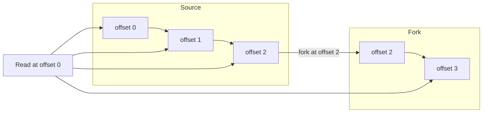
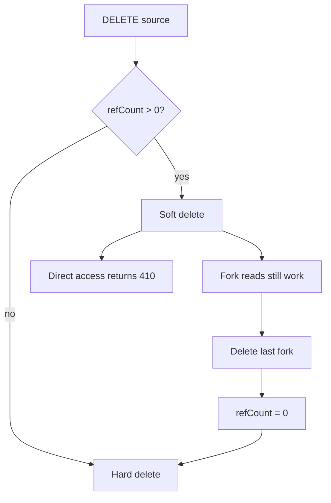

# Protocol Stream Model

This document explains the data model in `PROTOCOL.md` sections 3, 4, 8, and 9. It covers the stream, the offset, the content type, JavaScript Object Notation (JSON) mode, closure, forking, and the soft-delete lifecycle. It also shows how the reference server implements each rule.

The protocol is defined by Hypertext Transfer Protocol (HTTP) methods, query parameters, and headers on a stream Uniform Resource Locator (URL). It does not prescribe a URL structure. The reference server uses `/v1/stream/{path}`. Another server can use a different structure.

## The stream object

A stream is an append-only sequence of bytes. The protocol gives a stream seven properties:

| Property | Meaning |
|----------|---------|
| Durability | Acknowledged bytes persist until delete or expiry |
| Immutability by position | Bytes at an offset never change |
| Ordering | Bytes are strictly ordered by offset |
| Content type | One Multipurpose Internet Mail Extensions (MIME) type set at creation |
| Time To Live (TTL) or expiry | A sliding window or an absolute deadline |
| Retention | A server option that drops data older than a set age while the stream continues |
| Stream state | Open or closed |

A stream is addressable by URL. The URL is the identity. The protocol has no separate stream identifier.

Aha: the stream has no schema and no message type. The protocol sees bytes. A higher layer gives the bytes meaning. This is why one protocol can serve database synchronization, collaborative editing, and artificial intelligence token streams.

## Offsets

An offset is an opaque token that identifies a position. The protocol requires five properties:

1. Opaque: a client must not parse the value.
2. Lexicographically sortable: string comparison gives stream order.
3. Persistent: the same position keeps the same offset.
4. Unique: one offset identifies one position.
5. Strictly increasing: a later append has a greater offset.

The offset must not contain the characters `,`, `&`, `=`, `?`, or `/`. This restriction lets a server put an offset in a URL query parameter without escaping.

Two sentinel values are special:

- `-1` means the beginning of the stream.
- `now` means the current tail.

The sentinels are not offsets. They are requests for a position.

The reference server uses a two-part offset. The format is `<readSeq>_<byteOffset>`. Each part has 16 digits and leading zeros.

```ts
const FRAME_OVERHEAD = 5 // 4-byte length prefix + 1-byte newline
const newByteOffset = byteOffset + FRAME_OVERHEAD + processedData.length
const newOffset = `${String(readSeq).padStart(16, `0`)}_${String(newByteOffset).padStart(16, `0`)}`
```

This block is from `packages/server/src/store.ts:1370`. `processedData` is the byte sequence that goes into the frame. In JSON mode it is the normalized result of flattening one array level. For every other content type it is the request body unchanged. The constant `5` is the frame overhead. Four bytes hold the message length. One byte holds a newline. Document [05-storage-and-durability.md](05-storage-and-durability.md) explains the on-disk frame.

The `readSeq` part is reserved. The reference server starts it at zero, preserves it on every append, and does not increment it. The Caddy plugin names the field "For future log rotation support" (`packages/caddy-plugin/store/offset.go:13`). A client must treat the whole offset string as opaque and must not depend on the value of either part.

## Content types

The content type is set at creation. It is returned on every read. A later create request at the same URL must use the same content type. A mismatch returns `409 Conflict`.

The protocol has special rules for two groups:

1. `application/json` uses JSON mode.
2. `text/*` and `application/json` travel as Universal Character Set Transformation Format 8-bit (UTF-8) text in Server-Sent Events (SSE) mode. All other types use base64 encoding in SSE mode.

All other content types are byte-level. The server does not inspect the bytes. Newline-delimited JSON (`application/ndjson`), Protocol Buffers (`application/x-protobuf`), and plain text (`text/plain`) are all valid.

## JSON mode

JSON mode is the most detailed part of the stream model. It changes the meaning of an append and a read.

### Message boundaries

A JSON stream preserves message boundaries. Each append is a distinct message. A read returns a JSON array of messages.

The server stores the messages in a compact internal form. The reference server writes each message as JSON text followed by a comma. A read adds the opening and closing brackets.

```ts
if (Array.isArray(parsed)) {
  if (parsed.length === 0) {
    if (isInitialCreate) {
      return new Uint8Array(0)
    }
    throw new Error(`Empty arrays are not allowed`)
  }
  const elements = parsed.map((item) => JSON.stringify(item))
  result = elements.join(`,`) + `,`
} else {
  result = JSON.stringify(parsed) + `,`
}
```

This block is from `packages/server/src/store.ts:50`. The function is `processJsonAppend`.

### One-level array flattening

A JSON array in an append is a batch. The server flattens exactly one level. The rule is easy to state and easy to get wrong.

| Append body | Stored messages |
|-------------|-----------------|
| `{"event":"a"}` | one message `{"event":"a"}` |
| `[{"event":"a"},{"event":"b"}]` | two messages |
| `[[1,2],[3,4]]` | two messages: `[1,2]` and `[3,4]` |
| `[[[1,2,3]]]` | one message: `[[1,2,3]]` |

The client libraries use this rule to batch. A client call `append({"x":1})` can send `[{"x":1}]`. The server stores one message. Document [06-typescript-client.md](06-typescript-client.md) shows the client batching code.

### Empty arrays

An empty array has different meaning on create and append:

- `PUT` with `[]` creates an empty stream. The array means "no initial messages".
- `POST` with `[]` returns `400 Bad Request`. The array means "append nothing". That is probably a client bug.

The reference server implements the difference with the `isInitialCreate` argument.

### Validation and response

The server must validate JSON before it stores the bytes. Invalid JSON returns `400 Bad Request`. A read of an empty range returns `[]`, not an empty body. The server strips the final stored comma before it adds the opening and closing brackets, so the response is valid JSON.

The read format is a JSON array:

```http
HTTP/1.1 200 OK
Content-Type: application/json

[{"event":"created"},{"event":"updated"}]
```

Aha: JSON mode does not change the transport. It changes the framing. The stream is still a byte log. The server adds and removes array brackets at the edges. The client sees messages, not a byte stream.

## Closure

Closure is an explicit end-of-stream signal. It separates "no data yet" from "no more data ever". This distinction is necessary for a finite response, such as a proxied HTTP response or a completed job output.

Closure has five properties:

| Property | Meaning |
|----------|---------|
| Durable | The closed state survives a restart |
| Monotonic | A closed stream cannot reopen |
| Idempotent | A second close succeeds or returns a stable response |
| Observable | A reader can detect closure |
| Atomic with final append | One request can append and close |

The `Stream-Closed` header is present only when its value is exactly `true`, case-insensitive. The values `false`, `yes`, `1`, and the empty string are ignored. The server does not return an error for them.

A closed stream is still readable. Closure blocks new appends only.

```mermaid
stateDiagram-v2
    [*] --> Open: PUT create
    [*] --> Closed: PUT with Stream-Closed true
    Open --> Open: POST append
    Open --> Closed: POST Stream-Closed true
    Closed --> Closed: append returns 409; duplicate close returns 204
    Closed --> [*]: DELETE
    Open --> [*]: DELETE
```



The state diagram has one important edge. A close request can carry a final body. The final append and the closure happen in one operation. A reader sees the final bytes and the closed signal, or neither.

## Forking

A fork is a new stream that inherits data from a source stream up to a divergence point. The fork has its own URL, its own appends, and its own lifetime.

Fork creation uses `PUT` with three headers:

| Header | Meaning |
|--------|---------|
| `Stream-Forked-From` | Source stream path on the same server |
| `Stream-Fork-Offset` | Divergence offset. The default is the source tail |
| `Stream-Fork-Sub-Offset` | Refinement past the fork offset. The default is `0` |

The sub-offset has a content-type-dependent meaning:

- For `application/json`, it counts flattened messages.
- For all other types, it counts decoded body bytes.

The sub-offset is not part of the offset. It is a separate addressing dimension. It never appears in a response.

The `Content-Type` header is optional on a fork create. If it is omitted, the fork inherits the source stream's content type. If it is present, it must match the source type. A different type returns `409 Conflict`. The rule is in `PROTOCOL.md:167`.

A fork read stitches two sources. A client sends the last offset that it saw, from either range. The server compares that offset with the fork offset. If the offset is before the boundary, the server reads inherited messages from the source up to the boundary, then reads the fork's own messages. The inherited messages keep their source offsets. The fork's own messages start after the fork offset. The response is one continuous sequence. The client does not see the boundary except in the offset value. For a JSON stream, a read that crosses the boundary returns one JSON array, not two arrays. The rule is in `PROTOCOL.md:1310`.



### Fork TTL rules

A fork can inherit or override expiry. The protocol gives a nine-row decision table. The reference server implements the same table in `resolveForkExpiry`.

```ts
private resolveForkExpiry(
  opts: { ttlSeconds?: number; expiresAt?: string },
  sourceMeta: Stream
): { ttlSeconds?: number; expiresAt?: string } {
  if (opts.ttlSeconds !== undefined) {
    return { ttlSeconds: opts.ttlSeconds }
  }
  if (opts.expiresAt) {
    return { expiresAt: opts.expiresAt }
  }
  if (sourceMeta.ttlSeconds !== undefined) {
    return { ttlSeconds: sourceMeta.ttlSeconds }
  }
  if (sourceMeta.expiresAt) {
    return { expiresAt: sourceMeta.expiresAt }
  }
  return {}
}
```

This block is from `packages/server/src/store.ts:449`.

| Source | Fork request | Fork gets |
|--------|--------------|-----------|
| No expiry | No expiry | No expiry |
| No expiry | TTL | Own TTL |
| No expiry | Expires-At | Own Expires-At |
| TTL | No expiry | Inherit source TTL |
| TTL | TTL | Requested TTL |
| TTL | Expires-At | Requested Expires-At |
| Expires-At | No expiry | Inherit source Expires-At |
| Expires-At | TTL | Requested TTL |
| Expires-At | Expires-At | Requested Expires-At |

The table protects two different goals. It prevents unbounded retention when the source has a hard deadline. It also lets a fork outlive a source when the fork asks for its own deadline.

### Fork error rules

A fork create can fail for these reasons:

| Condition | Status |
|-----------|--------|
| Source not found | 404 |
| Fork offset beyond the tail | 400 |
| Invalid offset format | 400 |
| Invalid or overshooting sub-offset | 400 |
| Content-type mismatch | 409 |
| Target path in use with a different configuration | 409 |
| Source is soft-deleted | 409 |

Fork creation is idempotent. A second `PUT` with the same configuration returns `200 OK`. A different configuration returns `409 Conflict`.

A closed source can be forked. The fork starts open. A fork does not inherit producer state or `Stream-Seq` state. A writer to the fork must start a new producer epoch.

## Soft delete and reference counts

A stream tracks a reference count. The count is the number of active forks that name the stream as their source.

When `DELETE` arrives for a stream with a count greater than zero, the server does not remove the data. It marks the stream soft-deleted. The stream then behaves as follows:

- `GET`, `HEAD`, `POST`, and `DELETE` on the URL return `410 Gone`.
- `PUT` at the same path returns `409 Conflict`.
- A read on a fork still sees the inherited data.

When the last fork is deleted, the reference count reaches zero. The server can then remove the source. The cleanup can be asynchronous. A client must not assume that the source returns `404` immediately after the fork delete.



The reference in-memory store implements this rule in `delete` and `deleteWithCascade` at `packages/server/src/store.ts:512` and `:538`. The method walks up the fork chain and removes a soft-deleted source when its count reaches zero.

## Expiry

A stream can have one of two expiry forms:

- `Stream-TTL` is a sliding window. A GET read or a write refreshes it. A HEAD request does not refresh it.
- `Stream-Expires-At` is an absolute deadline.

A create request cannot send both. The server returns `400 Bad Request` if it does.

The reference server validates TTL with a strict pattern:

```ts
const ttlPattern = /^(0|[1-9]\d*)$/
if (!ttlPattern.test(ttlHeader)) {
  res.writeHead(400, { "content-type": `text/plain` })
  res.end(`Invalid Stream-TTL value`)
  return
}
```

This block is from `packages/server/src/server.ts:643`. The pattern rejects a leading zero, a plus sign, a decimal point, and whitespace. The value `0` is valid. It makes the stream expire at the next access check, because the sliding window has zero length.

An expired stream with no forks is removed. An expired stream with forks becomes soft-deleted. The `get` method enforces this rule at `packages/server/src/store.ts:480`.

## What the model does not include

The model does not include a message identifier. The offset is the only identifier. The model does not include a consumer group, an acknowledgement, or a dead-letter queue. A consumer stores its own offset.

The model does not include a schema. The JSON mode checks syntax, not shape. The state protocol adds a shape for state changes, but the base protocol does not require it.

The model does not include authorization. Section 12.1 puts authentication out of scope. Each server implementation chooses its own model. Document [08-server-implementations.md](08-server-implementations.md) compares the choices.

## Related documents

- [02-protocol-operations.md](02-protocol-operations.md) gives the HTTP operations that act on this model.
- [03-live-reads-and-subscriptions.md](03-live-reads-and-subscriptions.md) explains live reads and the subscription control plane.
- [05-storage-and-durability.md](05-storage-and-durability.md) shows the on-disk form of the model.
- [07-state-protocol.md](07-state-protocol.md) adds typed state events on top of JSON mode.
- [README.md](README.md) is the package index.
