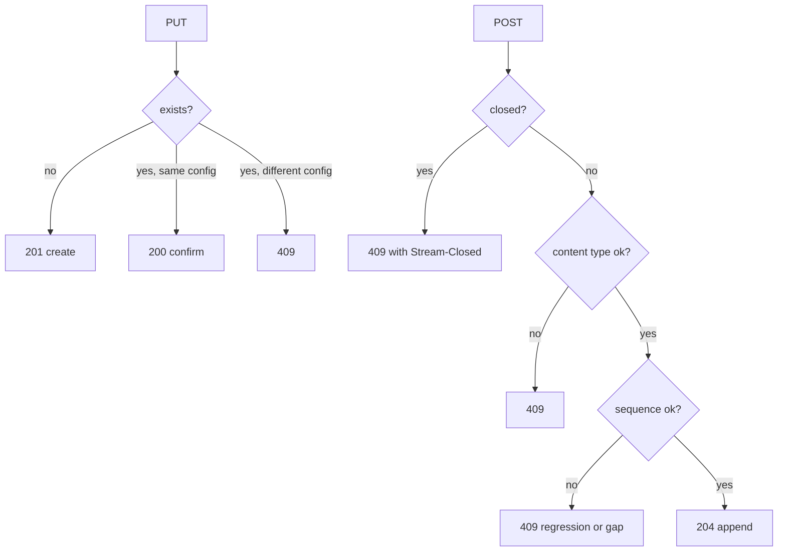
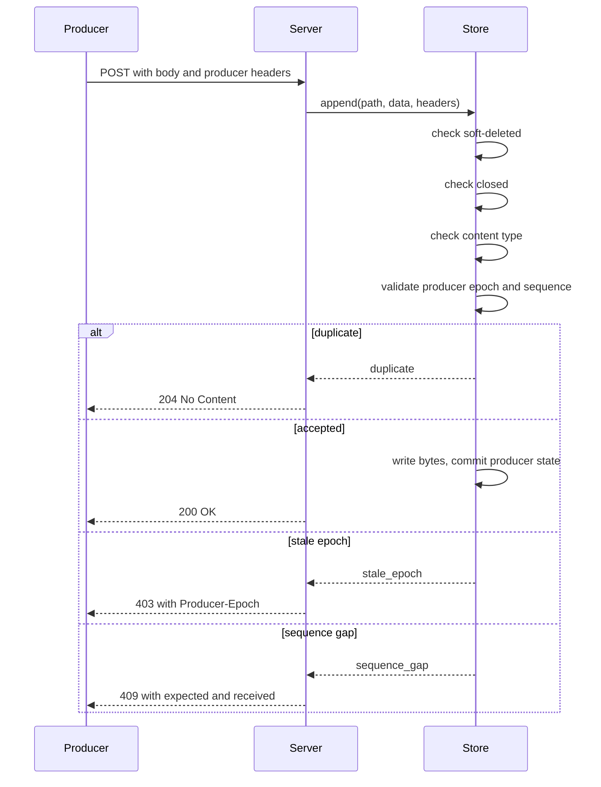

# Protocol Operations

This document covers `PROTOCOL.md` sections 5.1 to 5.8. It lists the operations, the main request and response headers, and the status codes. It then explains the two ordering mechanisms: the idempotent producer and `Stream-Seq`.

The protocol is defined on a stream Uniform Resource Locator (URL). The URL structure is not part of the protocol. The reference server uses `/v1/stream/{path}`. The examples below use `{stream-url}` for the general case.

## Operation summary

| Operation | Method | Success | Main effect |
|-----------|--------|---------|-------------|
| Create | `PUT` | 201 or 200 | Creates the stream, or confirms an identical stream |
| Append | `POST` | 204 | Adds bytes and advances the offset |
| Close | `POST` with `Stream-Closed: true` | 204 | Ends the stream |
| Delete | `DELETE` | 204 | Removes or soft-deletes the stream |
| Metadata | `HEAD` | 200 | Returns headers without a body |
| Catch-up read | `GET ?offset=` | 200 | Returns data and stops at the tail |
| Long-poll read | `GET ?offset=&live=long-poll` | 200 or 204 | Waits for data, then returns or times out |
| Server-Sent Events (SSE) read | `GET ?offset=&live=sse` | 200 | Streams data and control events |



The diagram shows the main cases. A duplicate close returns `204`, and a producer epoch or sequence error can return `400` or `409`; `PROTOCOL.md` section 5.2.1 gives those rules.

## Create a stream

`PUT {stream-url}` creates a stream. The operation is idempotent in the Hypertext Transfer Protocol (HTTP) sense. A second request with the same configuration returns `200 OK`. A request with a different configuration returns `409 Conflict`.

The configuration comparison includes five parts:

1. Content type.
2. Time To Live (TTL) or expiry.
3. Closure status.
4. Fork source and fork offset.
5. Fork sub-offset; an omitted value and `0` are equivalent (`packages/server/src/store.ts:287`).

Closure status is easy to miss. A `PUT` without `Stream-Closed` to a closed stream returns `409 Conflict`. A `PUT` with `Stream-Closed: true` to an open stream also returns `409 Conflict`.

### Create request headers

| Header | Required | Meaning |
|--------|----------|---------|
| `Content-Type` | No | Stream content type; the default is `application/octet-stream` |
| `Stream-TTL` | No | Sliding Time To Live in seconds |
| `Stream-Expires-At` | No | Absolute deadline in Request for Comments 3339 (RFC 3339) format, an Internet date and time format |
| `Stream-Closed` | No | `true` creates the stream in the closed state |
| `Stream-Forked-From` | No | Source path for a fork |
| `Stream-Fork-Offset` | No | Divergence offset for a fork |
| `Stream-Fork-Sub-Offset` | No | Sub-position past the divergence offset |

A request cannot send both `Stream-TTL` and `Stream-Expires-At`. The server returns `400 Bad Request`.

`Stream-TTL` must be a non-negative decimal integer. It cannot have a leading zero, a plus sign, a decimal point, or scientific notation.

The reference server enforces this rule with one regular expression:

```ts
const ttlPattern = /^(0|[1-9]\d*)$/
if (!ttlPattern.test(ttlHeader)) {
  res.writeHead(400, { "content-type": `text/plain` })
  res.end(`Invalid Stream-TTL value`)
  return
}
```

This block is from `packages/server/src/server.ts:643`.

### Create response headers

| Header | When | Meaning |
|--------|------|---------|
| `Location` | 201 | The stream URL |
| `Content-Type` | 200 or 201 | The chosen content type |
| `Stream-Next-Offset` | 200 or 201 | Tail offset after any initial body |
| `Stream-Closed` | When closed | Confirms the closed state |

### Create status codes

| Status | Meaning |
|--------|---------|
| 201 | Created |
| 200 | Exists with matching configuration |
| 409 | Exists with a different configuration |
| 400 | Invalid header or parameter |
| 404 | Fork source does not exist |
| 429 | Rate limit |

A create can carry an initial body. For a JavaScript Object Notation (JSON) stream, `[]` is valid and creates an empty stream. For a JSON append, `[]` is invalid. Document [01-protocol-stream-model.md](01-protocol-stream-model.md) gives the JSON rules.

A create with `Stream-Closed: true` and a body is an atomic create and close. This is useful for a cached response or a precomputed result.

## Append to a stream

`POST {stream-url}` adds bytes. The operation supports a full body and a chunked body.

### Append request headers

| Header | Required | Meaning |
|--------|----------|---------|
| `Content-Type` | When body is non-empty | Must match the stream content type |
| `Transfer-Encoding` | No | `chunked` for a streaming body |
| `Stream-Seq` | No | Opaque writer sequence for ordering; compared as text, not as a number |
| `Stream-Closed` | No | `true` closes after this append |
| `Producer-Id` | Producer mode | Stable producer identifier |
| `Producer-Epoch` | Producer mode | Producer generation |
| `Producer-Seq` | Producer mode | Batch sequence in the epoch |

The content type must match when a body is present. A mismatch returns `409 Conflict`. When the body is empty, the server must not check the content type. This rule keeps a close-only request robust when an HTTP library adds a default header.

### Empty body rule

An empty body without `Stream-Closed: true` returns `400 Bad Request`. An empty body with `Stream-Closed: true` is the canonical close-only request.

### Append response headers

| Header | Meaning |
|--------|---------|
| `Stream-Next-Offset` | New tail offset |
| `Stream-Closed` | Present when the stream is now closed |
| `Producer-Epoch` | Current epoch on success or on 403 |
| `Producer-Seq` | Highest accepted sequence in the epoch |
| `Producer-Expected-Seq` | Expected sequence on a gap |
| `Producer-Received-Seq` | Received sequence on a gap |

### Append status codes

| Status | Meaning |
|--------|---------|
| 204 | Appended, or duplicate append |
| 200 | Appended with producer headers |
| 400 | Invalid syntax, missing content type, empty body |
| 403 | Stale producer epoch |
| 404 | Stream not found |
| 405 or 501 | Append is not supported |
| 409 | Closed stream, content mismatch, sequence regression, or gap |
| 410 | Stream is soft-deleted |
| 413 | Body too large |
| 429 | Rate limit |

### Error precedence

An append can fail several checks at the same time. The protocol defines the order:

1. Stream is closed.
2. Content type does not match.
3. Sequence is not strictly increasing.

The order matters because a closed stream must return the `Stream-Closed: true` header. A client can then stop. If the server checked the content type first, the client would not learn that the stream is closed.

The reference store follows a related order. It checks the soft-delete state, then closure, then content type, then producer state, then `Stream-Seq`. The producer check comes before the `Stream-Seq` check. A duplicate producer batch must return `204` even if its `Stream-Seq` value would look like a regression.



## Idempotent producers

The producer mechanism makes a retried batch safe. It uses three headers. All three must be present, or none. A partial set returns `400 Bad Request`.

- `Producer-Id` is a stable string. It must not be empty.
- `Producer-Epoch` is a non-negative integer from 0 to 2^53-1.
- `Producer-Seq` is a non-negative integer from 0 to 2^53-1. It counts batches, not messages.

The server keeps one producer state per `(stream, producerId)`. The state has an epoch and a last sequence number.

### Validation rules

```text
if no state:
  if seq != 0 -> 409 gap, expected 0
  else -> accept and create state

if epoch < state.epoch -> 403 stale epoch, return current epoch
if epoch > state.epoch:
  if seq != 0 -> 400 invalid epoch and sequence
  else -> accept, reset last sequence to 0

if seq <= state.lastSeq -> 204 duplicate
if seq == state.lastSeq + 1 -> 200 accept
if seq > state.lastSeq + 1 -> 409 gap with expected and received
```

The reference implementation returns a proposed state. It does not mutate the state until the append succeeds.

```ts
if (epoch < state.epoch) {
  return { status: `stale_epoch`, currentEpoch: state.epoch }
}
if (epoch > state.epoch) {
  if (seq !== 0) {
    return { status: `invalid_epoch_seq` }
  }
  return {
    status: `accepted`,
    isNew: true,
    producerId,
    proposedState: { epoch, lastSeq: 0, lastUpdated: now },
  }
}
if (seq <= state.lastSeq) {
  return { status: `duplicate`, lastSeq: state.lastSeq }
}
```

This block is from `packages/server/src/store.ts:611`. The separation between validation and commit is deliberate. A failed write must not advance the producer state.

### Bootstrap, restart, and fencing

A new producer starts at epoch 0, sequence 0. A restart increments the epoch and resets the sequence to 0. An old producer that still sends the old epoch receives `403 Forbidden`. This is zombie fencing: the server fences off a writer that lost its claim.

An ephemeral producer, a producer that can restart with a new identity, such as a browser tab, can use auto-claim. Auto-claim is an option that lets the producer recover from a stale epoch. It receives a 403 with the current epoch, then retries with `currentEpoch + 1` and sequence 0.

### Concurrency and atomicity

The server must serialize validation and append for one `(stream, producerId)` pair. HTTP requests can arrive out of order. Without serialization, sequence 1 could arrive before sequence 0 and cause a false gap.

The protocol recommends one database transaction for the log append and the producer state update. A store that cannot do this has a crash window. The data may be present while the producer state is stale. The client can recover by incrementing the epoch, but that recovery trades "exactly once within one epoch" for "at least once across crashes" (`PROTOCOL.md:474`). The retried bytes can therefore appear twice, and the application must tolerate that.

### Producer state cleanup

An in-memory store may discard producer state after a period. The protocol recommends 7 days. The reference in-memory store uses 7 days:

```ts
const PRODUCER_STATE_TTL_MS = 7 * 24 * 60 * 60 * 1000
```

This constant is at `packages/server/src/store.ts:15`. A persistent store should keep the state as long as the data exists. The Caddy server documents a weaker guarantee. Document [08-server-implementations.md](08-server-implementations.md) gives that limitation.

### Producer and closure

A producer can close a stream with a final append. The tuple is recorded with the close; the tuple is (`Producer-Id`, `Producer-Epoch`, `Producer-Seq`). A retry of the same tuple returns `204 No Content` with `Stream-Closed: true`. A different tuple returns `409 Conflict` with `Stream-Closed: true`.

## Stream-Seq

`Stream-Seq` is a second ordering mechanism. It is not the producer sequence. The protocol describes two layers:

| Layer | Headers | Scope |
|-------|---------|-------|
| Transport | `Producer-Id`, `Producer-Epoch`, `Producer-Seq` | Retry safety per batch |
| Application | `Stream-Seq` | Cross-restart ordering |

`Stream-Seq` is an opaque string. The server compares it byte by byte, in lexicographic order. A value less than or equal to the last value returns `409 Conflict`. A value greater than the last value is accepted.

The scope of `Stream-Seq` is per authenticated writer or per stream. The server must document the scope. The reference server uses one last value per stream.

Aha: the two mechanisms look similar but solve different problems. The producer sequence makes a network retry safe within one epoch. `Stream-Seq` keeps an application order across restarts and across producers. A client can use both at the same time.

## Close a stream

The close operation is a `POST` with `Stream-Closed: true`. It has two forms:

1. Empty body: close only.
2. Non-empty body: append the final bytes and close in one step.

The close is idempotent. A second close-only request returns `204 No Content`. An append-and-close request to an already closed stream returns `409 Conflict`, unless a producer tuple makes it a duplicate.

The response includes `Stream-Next-Offset` and `Stream-Closed: true`. The offset does not change for a close-only request.

## Delete a stream

`DELETE {stream-url}` removes the stream. A normal delete returns `204 No Content`. A missing stream returns `404 Not Found`.

A stream with active forks is soft-deleted. Direct access then returns `410 Gone`. A `PUT` at the path returns `409 Conflict`. A second `DELETE` returns `410 Gone`.

The reference server implements this transition in `delete` at `packages/server/src/store.ts:512`. Document [01-protocol-stream-model.md](01-protocol-stream-model.md) explains the reference count.

## Stream metadata

`HEAD {stream-url}` returns metadata without a body. It is the only operation whose purpose is to return stream metadata without a body.

| Header | Meaning |
|--------|---------|
| `Content-Type` | Stream type |
| `Stream-Next-Offset` | Tail offset |
| `Stream-TTL` | Sliding window, if set |
| `Stream-Expires-At` | Absolute deadline, if set |
| `Stream-Closed` | Present when closed |
| `Cache-Control` | Caching policy |

The server should make `HEAD` non-cacheable. The protocol recommends `Cache-Control: no-store`. A cached tail offset is dangerous. It can hide new data or a closure.

A `HEAD` request does not reset a TTL. The protocol states this rule in section 5.1.

The reference server builds the entity tag from the encoded path and the current offset:

```ts
const closedSuffix = stream.closed ? `:c` : ``
headers[`etag`] =
  `"${Buffer.from(path).toString(`base64`)}:-1:${stream.currentOffset}${closedSuffix}"`
```

This block is from `packages/server/src/server.ts:831`. The `:c` suffix changes the tag when the stream closes. A cached reader cannot receive `304 Not Modified` and miss the closure. The `:-1:` part is a fixed literal in this tag format; it is not the `-1` offset sentinel.

## Catch-up read

`GET {stream-url}?offset=<offset>` returns data from the offset. The `offset` parameter is optional. If omitted, it defaults to `-1`.

The response returns only the data after the offset. The `Stream-Next-Offset` header is the position after the returned data. The server can return less than the full stream. The client sends the next offset to continue.

A read at the tail returns `200 OK` with an empty body; for a JSON stream the body is the empty array `[]`. The `Stream-Up-To-Date: true` header says the reader is caught up. If the stream is closed, the response also has `Stream-Closed: true`.

The protocol defines this as the canonical end-of-stream signal in catch-up mode.

### Read response headers

| Header | Meaning |
|--------|---------|
| `Cache-Control` | Public or private, max age, stale window |
| `ETag` | Entity Tag (ETag) cache validator |
| `Stream-Cursor` | Optional collapsing cursor (a cache key that advances each interval) |
| `Stream-Next-Offset` | Next position |
| `Stream-Up-To-Date` | Caught up with current data |
| `Stream-Closed` | End of stream |

### Read status codes

| Status | Meaning |
|--------|---------|
| 200 | Data or an empty caught-up body |
| 400 | Malformed offset |
| 404 | Stream not found |
| 410 | Offset before the retained range, or soft-deleted stream. Retention is a server-chosen limit on how much history it keeps. |
| 429 | Rate limit |

## Long-poll read

`GET {stream-url}?offset=<offset>&live=long-poll` waits for new data. The `offset` parameter is required. The optional `cursor` parameter comes from the previous response.

| Result | Status | Key headers |
|--------|--------|-------------|
| Data arrived | 200 | Data headers and `Stream-Cursor` |
| Timeout | 204 | Offset, up to date, cursor |
| Stream closed at tail | 204 | Offset, up to date, closed |

The server must include `Stream-Cursor` on a 200 and on a 204 for an open stream. It may omit the cursor when the stream is closed.

A closed stream at the tail must not wait. The server returns `204 No Content` immediately with `Stream-Closed: true` and `Stream-Up-To-Date: true`.

For a fork, a read before the fork offset returns inherited data immediately. A read at the fork tail waits only for fork appends. A source append does not wake a fork reader.

## SSE read

`GET {stream-url}?offset=<offset>&live=sse` returns an event stream. The response type is `text/event-stream`.

SSE has two event names:

- `data` carries one batch of bytes.
- `control` carries the new offset, the cursor, the up-to-date flag, and the closed flag.

The control event comes after every data event. Its field names are camel case: `streamNextOffset`, `streamCursor`, `upToDate`, and `streamClosed`.

For a non-text, non-JSON stream, the server must encode the data events in base64, a text encoding that represents binary bytes with printable characters. It signals this with `stream-sse-data-encoding: base64`. The control event stays JSON.

```ts
const isTextCompatible =
  ct.startsWith(`text/`) || ct === `application/json`
useBase64 = !isTextCompatible
```

This block is from `packages/server/src/server.ts:906-908`. Here `ct` is the stream content type. The server uses this inline test and passes the flag into `handleSSE` at `packages/server/src/server.ts:1108`. The TypeScript client has a matching list, `SSE_COMPATIBLE_CONTENT_TYPES`, at `packages/client/src/constants.ts:141`.

The server closes an SSE connection after about 60 seconds. The client reconnects with the latest offset. The cursor makes the reconnect cheap for a shared cache. Document [03-live-reads-and-subscriptions.md](03-live-reads-and-subscriptions.md) gives the full timing rules.

## Related documents

- [01-protocol-stream-model.md](01-protocol-stream-model.md) gives the model that these operations act on.
- [03-live-reads-and-subscriptions.md](03-live-reads-and-subscriptions.md) goes deeper on long-poll, SSE, and subscriptions.
- [04-node-server.md](04-node-server.md) shows how the reference server routes each operation.
- [06-typescript-client.md](06-typescript-client.md) shows the client side of each call.
- [README.md](README.md) is the package index.
