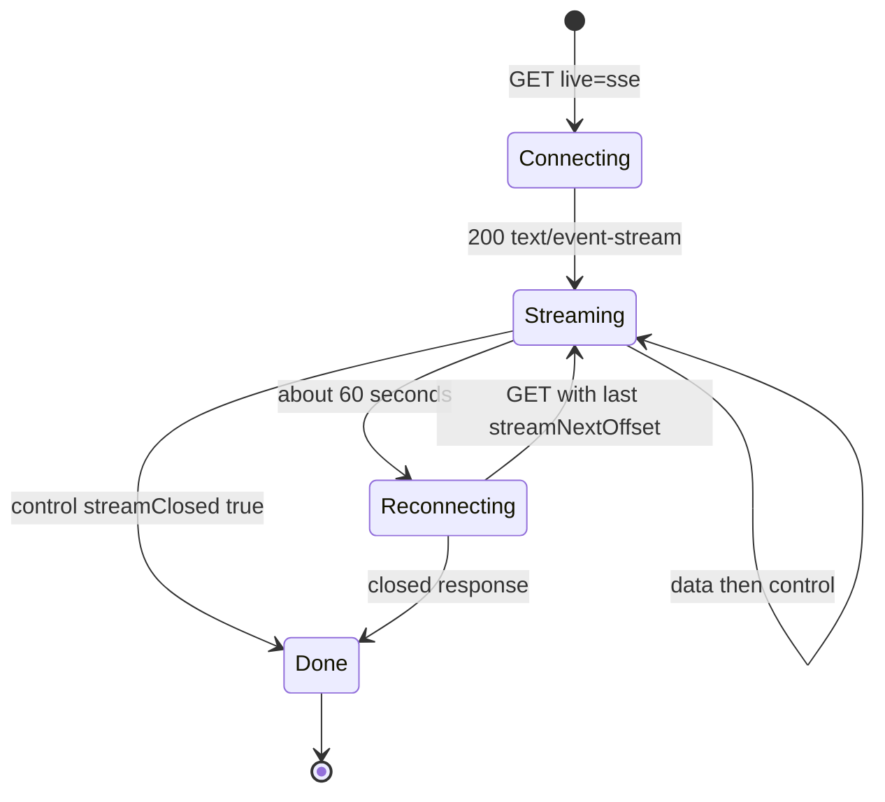
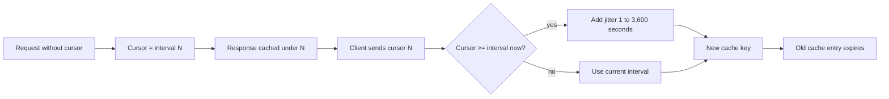
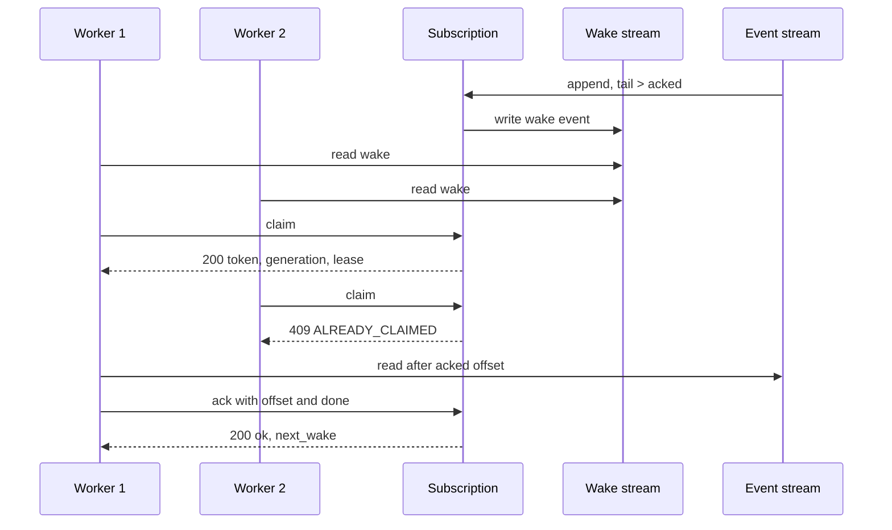

# Live Reads and Subscriptions

This document explains the live part of the protocol. It covers long-poll, Server-Sent Events (SSE), caching, and the subscription control plane under the `__ds` prefix. It also covers webhook delivery and the pull-wake claim, acknowledgement (ack), and release cycle. It also covers generation fencing. Generation fencing rejects a stale worker by comparing counters.

The live modes do not change the stream. A reader still sends an offset and still receives bytes. The difference is time. A catch-up read returns immediately. A live read waits for new data, or keeps a connection open.

## Long-poll

A long-poll request has three parts:

```http
GET {stream-url}?offset=<offset>&live=long-poll[&cursor=<cursor>]
```

The `offset` parameter is required. The server checks the stream at that offset. If data is present, the server returns it at once. If no data is present, the server waits up to a timeout. The reference server uses 30 seconds by default:

```ts
longPollTimeout: options.longPollTimeout ?? 30_000,
```

This line is from `packages/server/src/server.ts:194`.

The wait has one exception. If the stream is closed and the reader is at the tail, the server must not wait. It returns `204 No Content` immediately. The code below shows the inner check. An outer condition has already established that the reader is caught up and that no message is available.

```ts
if (stream.closed) {
  res.writeHead(204, {
    [STREAM_OFFSET_HEADER]: stream.currentOffset,
    [STREAM_UP_TO_DATE_HEADER]: `true`,
    [STREAM_CLOSED_HEADER]: `true`,
  })
  res.end()
  return
}
```

This block is from `packages/server/src/server.ts:971`. The `STREAM_OFFSET_HEADER`, `STREAM_UP_TO_DATE_HEADER`, and `STREAM_CLOSED_HEADER` symbols are the constants for the `Stream-Next-Offset`, `Stream-Up-To-Date`, and `Stream-Closed` header names.

### Long-poll responses

| Case | Status | Headers |
|------|--------|---------|
| Data available | 200 | Data headers and `Stream-Cursor` |
| Timeout | 204 | `Stream-Next-Offset`, `Stream-Up-To-Date`, `Stream-Cursor` |
| Closed at tail | 204 | Also `Stream-Closed: true` |

A `204` response must include the current tail offset. The client then knows where it is. The `Stream-Up-To-Date: true` header says that the client has all data that exists now. It does not say that no more data can arrive. Only `Stream-Closed: true` says that.

Aha: `Stream-Up-To-Date` and `Stream-Closed` look similar but have different meanings. Up-to-date is a statement about the present. Closed is a statement about the future. A client that treats up-to-date as end-of-stream stops one event too early.

### Long-poll on a fork

A fork is a new stream that copies the prefix of another stream, the source, up to a chosen fork offset. A fork has two ranges. The inherited range is before the fork offset. The fork range starts at the fork offset.

- A read in the inherited range returns data immediately.
- A read at the fork tail waits only for fork appends.
- An append to the source does not wake a fork reader.

The third rule is necessary. The fork does not inherit source data past its fork offset. A source append can never become visible through the fork.

## Server-Sent Events

SSE mode keeps one Hypertext Transfer Protocol (HTTP) response open and writes events to it. The request is:

```http
GET {stream-url}?offset=<offset>&live=sse
```

The response type must be `text/event-stream`. The server sends two event types.

| Event | Content |
|-------|---------|
| `data` | One batch of stream bytes |
| `control` | A JavaScript Object Notation (JSON) object with the next offset, the cursor, and the state flags |

Every `data` event is followed by one `control` event. The control fields use camel case:

- `streamNextOffset`
- `streamCursor`
- `upToDate`
- `streamClosed`

The control event is the checkpoint. A client must apply the data first, then read the control event, then send the `streamNextOffset` value on a reconnect.

### Binary streams

SSE is a text format. A binary stream cannot go into a `data:` line directly. The server must encode the payload with base64 and must send this response header:

```http
stream-sse-data-encoding: base64
```

The server decides this from the stream content type:

```ts
const isTextCompatible =
  ct.startsWith(`text/`) || ct === `application/json`
useBase64 = !isTextCompatible
```

This block is from `packages/server/src/server.ts:906-908`. Here `ct` is the stream content type and `useBase64` is the decision flag.

The control events stay JSON. They are never base64-encoded. A client must remove line breaks from a split base64 payload before it decodes the value.

### Connection lifetime

The protocol says that a server should close an SSE connection after about 60 seconds. The client reconnects with the last offset. This short lifetime is not a bug. It lets a Content Delivery Network (CDN) collapse many clients onto one origin request. Clients that ask within the same short window receive the same cached response. A short lifetime keeps that shared response fresh.

When the stream closes, the final control event has `streamClosed: true`. The server then closes the connection. The client must not reconnect.

### SSE state machine



## Caching and cursors

The protocol defines a cache policy for reads:

```http
Cache-Control: public, max-age=60, stale-while-revalidate=300
```

A server uses `private` instead of `public` when the stream holds user-specific data. The cache can serve a stale chunk for up to 300 seconds while it revalidates.

The entity tag (ETag) is the validator. A GET response must have an ETag, except for `offset=now`, the sentinel that asks for the current tail. The tag must change when the stream closes. The reference server adds `:c` for a closed stream.

A cached empty response is a danger. A client can receive the same empty long-poll response forever. The cursor prevents this. The server divides time into 20-second intervals from a fixed epoch and returns the interval number as the cursor.

```ts
export const DEFAULT_CURSOR_EPOCH: Date = new Date(`2024-10-09T00:00:00.000Z`)
export const DEFAULT_CURSOR_INTERVAL_SECONDS = 20
const MAX_JITTER_SECONDS = 3600
const MIN_JITTER_SECONDS = 1
```

This block is from `packages/server/src/cursor.ts:19`.

If a client sends a cursor that is equal to or greater than the current interval, the server must return a strictly greater cursor. It adds a random jitter of 1 to 3600 seconds. The server converts the jitter to a whole number of intervals: `ceil(jitter seconds / 20)`, and at least one interval. The new cursor creates a new cache key. The old entry then expires.



The client should echo the cursor on every long-poll request. The server sends a new cursor on every long-poll response, including a timeout. The one exception is a request at the tail of a stream that is already closed. The server answers at once with status 204 and no cursor (`packages/server/src/server.ts:969-978`). The cursor value is not an offset. A client must not mix the two.

## The subscription control plane

A subscription is a durable cursor over one or more streams. The cursor is a stored set of offset positions. It wakes a worker when a linked stream has data that the worker has not processed. A worker is an application process that reads the linked streams or receives the webhook. The protocol puts subscription routes under a reserved prefix:

```http
{stream-url}/__ds/subscriptions/:id
```

Here `{stream-url}` is the stream service base, for example `https://host/v1/stream`. The reserved prefix is `/v1/stream/__ds`, so the subscription routes sit beside the streams, not under one stream path. An application stream cannot start with `__ds` at the stream root. The reference server defines the constant:

```ts
const RESERVED_CONTROL_PREFIX = `/v1/stream/__ds`
const SUBSCRIPTION_PREFIX = `${RESERVED_CONTROL_PREFIX}/subscriptions/`
const JWKS_PATH = `${RESERVED_CONTROL_PREFIX}/jwks.json`
```

This block is from `packages/server/src/subscription-routes.ts:15`. The server routes this prefix before it routes normal streams. Document [04-node-server.md](04-node-server.md) shows the routing order.

### Subscription model

A subscription has one of two types:

1. `webhook` sends an HTTP POST to a Uniform Resource Locator (URL).
2. `pull-wake` appends a wake event to a durable stream. A worker then claims the subscription.

A subscription selects streams in two ways:

- `pattern` is a glob, a pattern with wildcard characters. `*` matches one path segment. `**` matches zero or more segments.
- `streams` is an explicit list. It adds to the pattern.

Each linked stream has an `acked_offset`. The offset is inclusive. Acknowledging offset `N` means the next read starts after `N`.

### Create or re-confirm

`PUT {stream-url}/__ds/subscriptions/:id` creates the subscription. The `id` is client-provided. The operation is idempotent through a configuration hash.

```ts
const configHash = stableConfigHash(input)
const existing = this.subscriptions.get(id)
if (existing) {
  if (existing.config_hash !== configHash) {
    return {
      error: {
        code: `SUBSCRIPTION_ALREADY_EXISTS`,
        message: `Subscription already exists with different configuration`,
      },
    }
  }
  return { subscription: existing, created: false }
}
```

This block is from `packages/server/src/subscription-manager.ts:167`.

The hash includes the type, the pattern, the sorted explicit streams, the delivery configuration, the lease duration, and the description. The delivery configuration is the type-specific part: the webhook URL, or the wake stream path and its settings. A match returns `200 OK`. A mismatch returns `409 Conflict`. A new subscription returns `201 Created`.

When the server creates a glob subscription, it must backfill existing matches. It links each stream at its current tail. This rule stops a new subscription from replaying history by accident.

### Lease

`lease_ttl_ms` controls how long a worker may hold a claim. The allowed range is 1 second to 10 minutes. The default is 30 seconds.

```ts
const DEFAULT_LEASE_TTL_MS = 30_000
const MIN_LEASE_TTL_MS = 1_000
const MAX_LEASE_TTL_MS: number = 10 * 60_000
```

This block is from `packages/server/src/subscription-manager.ts:22`.

A lease is a liveness signal. A worker that crashes stops sending heartbeats. The wake token is the secret value that the worker presents with a callback. When the lease expires, the server clears the holder and the wake token. If work remains, the server schedules a new wake.

## Webhook delivery

The server sends a webhook when three conditions hold:

1. A linked stream has new data.
2. The subscription is idle: no wake is waiting for a callback.
3. No wake is in flight. The server has not already sent a wake and is still waiting for `done` or a failed delivery.

The request body contains the subscription identifier, the wake identifier, the generation, the stream snapshots, and a callback URL with a token. A stream snapshot is the current tail offset of one linked stream at the time of the wake.

```ts
const body = JSON.stringify({
  subscription_id: subscription.id,
  wake_id: subscription.wake_id,
  generation: subscription.generation,
  streams: this.streamInfos(subscription),
  callback_url: this.subscriptionActionUrl(subscription, `callback`),
  callback_token: subscription.token,
})
const headers = {
  "content-type": `application/json`,
  "webhook-signature": signWebhookPayload(body),
}
```

This block is from `packages/server/src/subscription-manager.ts:576`.

### Signature

The `Webhook-Signature` header has three parts:

```http
Webhook-Signature: t=<timestamp>,kid=<key-id>,ed25519=<base64url-signature>
```

The signature covers `<timestamp>.<raw_body>`. The algorithm is Ed25519. The `kid` value selects a public key from a JSON Web Key Set (JWKS). The receiver must verify the raw bytes, not a parsed and re-serialized object. It must also reject an old timestamp, for example older than five minutes.

The public keys are at `{stream-url}/__ds/jwks.json`. The path is under the `__ds` prefix, not under `/.well-known/`, because a server can live under any sub-path.

### Synchronous completion

A webhook handler can finish at once. It returns:

```json
{ "done": true }
```

The server then acknowledges the tail offsets in the wake snapshot and releases the lease. If new data arrived after the snapshot, the subscription still has pending work. The server sends a new wake with a new `wake_id` and a higher generation.

### Asynchronous completion

For long work, the handler returns without `done`. It later posts to the callback URL with the callback token:

```json
{
  "wake_id": "w_abc123",
  "generation": 7,
  "acks": [{ "stream": "events/abc", "offset": "0000000000000002_0000000000000084" }],
  "done": true
}
```

A stale wake or generation returns `409 Conflict` with the error code `FENCED`.

### Retry

A failed delivery is retried with exponential backoff. The delay starts at 1 second and caps at 60 seconds. A random jitter of plus or minus 20 percent is added.

```ts
const baseDelay = Math.min(
  1000 * Math.pow(2, Math.max(0, subscription.retry_count - 1)),
  MAX_RETRY_DELAY_MS
)
const jitter = baseDelay * 0.2 * (Math.random() * 2 - 1)
const delay = Math.max(0, Math.round(baseDelay + jitter))
```

This block is from `packages/server/src/subscription-manager.ts:633`. The subscription status becomes `failed` while a retry is scheduled. The server must persist `next_attempt_at`, the time stamp of the next delivery attempt, across a restart.

### Webhook security

A webhook URL is an outbound request from the server. That makes it a Server-Side Request Forgery (SSRF) risk. The protocol requires these rules:

- A production URL must use `https://`.
- A development URL may use `localhost` or `127.0.0.x`.
- The server must reject private network ranges and link-local addresses. A link-local address is in the `169.254.0.0/16` range in Internet Protocol version 4 (IPv4). In Internet Protocol version 6 (IPv6), it is in the `fe80::/10` range.

The reference server enforces the rule in `validateWebhookUrl` during `createOrConfirm`. A rejection returns `400 Bad Request` with the code `WEBHOOK_URL_REJECTED`.

## Pull-wake claim, ack, and release

A pull-wake subscription does not call a URL. It appends a wake event to a durable stream. The application must create that stream first.

```json
{
  "type": "wake",
  "subscription_id": "sub-1",
  "stream": "events/abc",
  "generation": 7,
  "ts": 1778324210000
}
```

Workers read the wake stream and race for the claim.

### Claim

`POST {stream-url}/__ds/subscriptions/:id/claim` with a worker name returns a wake snapshot, a generation, a token, and the lease duration.

A second worker receives `409 Conflict` with `ALREADY_CLAIMED` and the current holder. A claim on a subscription with no pending work returns `409 Conflict` with `NO_PENDING_WORK`.

```ts
if (subscription.holder) {
  return {
    status: 409,
    body: {
      error: {
        code: `ALREADY_CLAIMED`,
        current_holder: subscription.holder,
        generation: subscription.generation,
      },
    },
  }
}
```

This block is from `packages/server/src/subscription-manager.ts:383`.

### Ack

`POST {stream-url}/__ds/subscriptions/:id/ack` applies offsets and extends the lease.

- Without `done: true`, the call is a heartbeat. The lease restarts.
- With `done: true`, the server applies the acks, releases the lease, and reports whether work remains.

The response is `{ "ok": true, "next_wake": true|false }`.

### Release

`POST {stream-url}/__ds/subscriptions/:id/release` gives up the claim without an ack. The server returns `204 No Content`. If work remains, the server writes a new wake event for a later worker.

### Pull-wake flow



## Generation fencing

Every wake has two identifiers. `wake_id` is unique for one wake. `generation` is a subscription counter that increases for every wake.

The server rejects a callback, an ack, or a release unless four checks pass:

1. The bearer token is valid for this subscription. This check runs before the block below.
2. The token generation is current.
3. The request generation is current.
4. The request `wake_id` is the current wake.

The token stores the generation in a field named `epoch`. `epoch` and `generation` are the same counter in this code.

```ts
if (
  tokenResult.epoch !== subscription.generation ||
  request.generation !== subscription.generation ||
  request.wake_id !== subscription.wake_id
) {
  return this.errorResponse(409, `FENCED`, `Wake generation is stale`)
}
```

This block is from `packages/server/src/subscription-manager.ts:743`.

Aha: generation fencing replaces a distributed lock with a monotonic counter. A stale worker cannot harm the subscription, even if its network message arrives late. The server compares numbers and rejects the old message. No coordination service is necessary.

The `wake_id` adds a second dimension. A message from the current generation but the wrong wake is also stale. This case occurs when a worker retries an old callback after the same subscription woke again.

## Subscription routes

The reference router recognises these actions:

| Route | Methods |
|-------|---------|
| `__ds/subscriptions/:id` | `PUT`, `GET`, `DELETE` |
| `__ds/subscriptions/:id/streams` | `POST` |
| `__ds/subscriptions/:id/streams/:path` | `DELETE` |
| `__ds/subscriptions/:id/callback` | `POST` |
| `__ds/subscriptions/:id/claim` | `POST` |
| `__ds/subscriptions/:id/ack` | `POST` |
| `__ds/subscriptions/:id/release` | `POST` |
| `__ds/jwks.json` | `GET` |

An unknown path under `__ds` returns `404 Not Found` with the code `SUBSCRIPTION_NOT_FOUND`. It is not treated as an application stream.

Document [08-server-implementations.md](08-server-implementations.md) shows how the Cloudflare server moves the same control plane into a Durable Object. Document [02-protocol-operations.md](02-protocol-operations.md) gives the base read operations that the live modes extend.

## Related documents

- [02-protocol-operations.md](02-protocol-operations.md) gives catch-up reads and the append path.
- [04-node-server.md](04-node-server.md) shows the routing, the long-poll loop, and the SSE loop.
- [06-typescript-client.md](06-typescript-client.md) shows the client state machine for live reads.
- [08-server-implementations.md](08-server-implementations.md) compares the subscription plane across servers.
- [README.md](README.md) is the package index.
