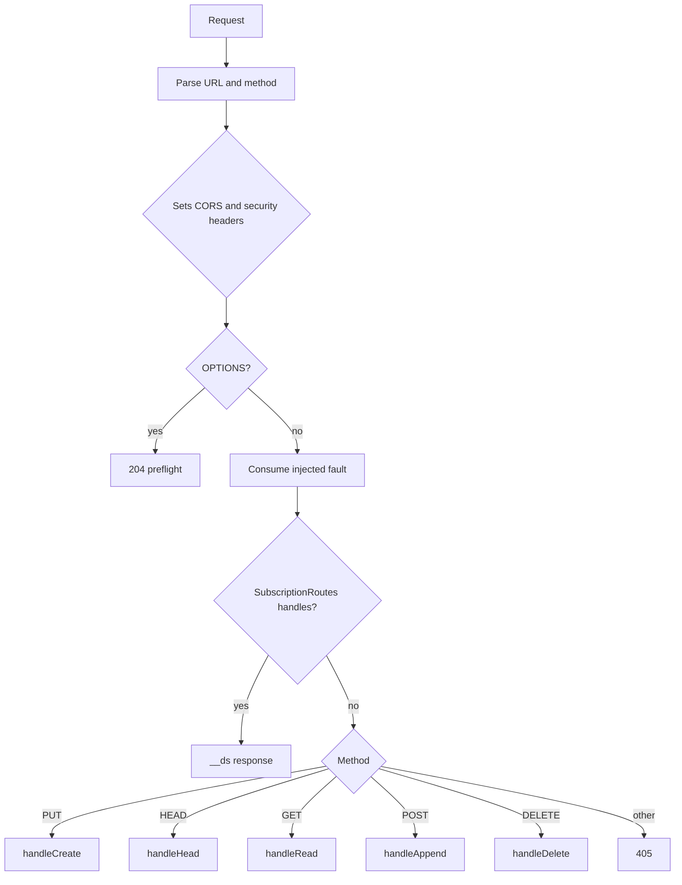
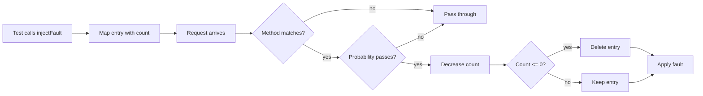

# Node.js Reference Server

This document studies `packages/server`. The package has three main files. `server.ts` is the Hypertext Transfer Protocol (HTTP) layer. `store.ts` is the in-memory data layer. `file-store.ts` replaces the data layer for durable storage and gets its own document.

The class is `DurableStreamTestServer`. The name says what the package is: a test server and a reference implementation. It is not a production server. It has no authentication and no access control.

## Files and sizes

| File | Purpose | Size |
|------|---------|------|
| `packages/server/src/server.ts` | HTTP routing, headers, compression, fault injection | 60,505 bytes |
| `packages/server/src/store.ts` | In-memory streams, long-poll waiting, producer state | 43,255 bytes |
| `packages/server/src/file-store.ts` | File and Lightning Memory-Mapped Database (LMDB) storage | 65,820 bytes |
| `packages/server/src/subscription-manager.ts` | Subscription state and delivery | 24,967 bytes |
| `packages/server/src/subscription-routes.ts` | `__ds` route parsing; `__ds` is the reserved subscription control prefix | 13,167 bytes |

## The server class

The constructor makes one important choice. It selects the store from the `dataDir` option.

```ts
if (options.dataDir) {
  this.store = new FileBackedStreamStore({
    dataDir: options.dataDir,
  })
} else {
  this.store = new StreamStore()
}
```

This block is from `packages/server/src/server.ts:182`.

The other defaults are:

```ts
this.options = {
  port: options.port ?? 4437,
  host: options.host ?? `127.0.0.1`,
  longPollTimeout: options.longPollTimeout ?? 30_000,
  dataDir: options.dataDir,
  onStreamCreated: options.onStreamCreated,
  onStreamDeleted: options.onStreamDeleted,
  compression: options.compression ?? true,
```

This block is from `packages/server/src/server.ts:191`.

| Option | Default | Meaning |
|--------|---------|---------|
| `port` | 4437 | Transmission Control Protocol (TCP) port |
| `host` | `127.0.0.1` | Loopback bind address |
| `longPollTimeout` | 30,000 milliseconds (ms) | Maximum wait for new data |
| `compression` | true | Compress large read responses |
| `webhooks` | false | Enable webhook subscriptions |

The `webhooks` default is at `packages/server/src/server.ts:203`, outside the short block above. Port 4437 was selected from the Internet Assigned Numbers Authority (IANA) unassigned range 4434-4440; it is not a registered port (`PROTOCOL.md:1493`). The default host keeps the test server off the network.

Aha: the in-memory store is the default, not the file-backed store. A caller must opt in to durability with `dataDir`. This default is correct for a test tool. It is wrong for a production deployment. The name `DurableStreamTestServer` warns the caller.

## Start and stop

`start()` creates a Node.js `http` server with `createServer`. It then calls `listen` on the host and port. The callback builds the Uniform Resource Locator (URL), then creates two subscription objects.

```ts
this.subscriptionManager = new SubscriptionManager({
  callbackBaseUrl: this._url!,
  streamStore: this.store,
  webhooksEnabled: this.options.webhooks,
})
this.subscriptionRoutes = new SubscriptionRoutes(this.subscriptionManager)
```

This block is from `packages/server/src/server.ts:236`.

`stop()` has four steps:

1. Set the shutdown flag.
2. Shut down the subscription manager.
3. Cancel all pending long-poll and Server-Sent Events (SSE) waits.
4. Close the file-backed store if one is in use.

The cancellation step calls `cancelAllWaits` when the store has that method. A shutdown must not leave a handler waiting for 30 seconds.

## Request routing

The handler parses the URL and the method. It sets Cross-Origin Resource Sharing (CORS) and security headers before it routes.

```ts
const url = new URL(req.url ?? `/`, `http://${req.headers.host}`)
const path = url.pathname
const method = req.method?.toUpperCase()
```

This block is from `packages/server/src/server.ts:441`.

The routing order is:

1. Answer an `OPTIONS` request with `204`.
2. Consume an injected fault for this path and method. A fault can also match a `__ds` request, because this step runs before subscription routing.
3. Send the request to `SubscriptionRoutes` when a subscription route matches.
4. Route the stream operation by method.



The subscription routes come before the stream routes. A path under `__ds` can never become an application stream.

The method switch is small:

```ts
switch (method) {
  case `PUT`:
    await this.handleCreate(path, req, res)
    break
  case `HEAD`:
    this.handleHead(path, res)
    break
  case `GET`:
    await this.handleRead(path, url, req, res)
    break
  case `POST`:
    await this.handleAppend(path, req, res)
    break
  case `DELETE`:
    await this.handleDelete(path, res)
    break
  default:
    res.writeHead(405, { "content-type": `text/plain` })
    res.end(`Method not allowed`)
}
```

This block is from `packages/server/src/server.ts:525`.

### Error mapping

The store throws an `Error` with a text message. The server maps the message to a status code. This design is simple and fragile. A message change can change a status code.

| Message contains | Status |
|------------------|--------|
| `active forks` | 409 |
| `soft-deleted` | 410 |
| `not found` | 404 |
| `already exists with different configuration` | 409 (a create of a stream or subscription that conflicts with the stored configuration) |
| `Sequence conflict` | 409 |
| `Content-type mismatch` | 409 |
| `Invalid JavaScript Object Notation (JSON)` | 400 |
| `Empty arrays are not allowed` | 400 |

The mapping is in the `catch` block at `packages/server/src/server.ts:545`.

## The in-memory store

`StreamStore` keeps one `Map` from path to `Stream`.

```ts
export class StreamStore {
  private streams = new Map<string, Stream>()
  private pendingLongPolls: Array<PendingLongPoll> = []
  /**
   * Per-producer locks for serializing validation+append operations.
   * Key: "{streamPath}:{producerId}"
   */
  private producerLocks = new Map<string, Promise<unknown>>()
```

This block is from `packages/server/src/store.ts:166`.

A `Stream` record has these fields:

| Field | Meaning |
|-------|---------|
| `path` | Stream key |
| `contentType` | Media type |
| `messages` | Array of stored messages |
| `currentOffset` | Tail offset |
| `lastSeq` | Last `Stream-Seq` value; `Stream-Seq` is the optional monotonically increasing sequence header |
| `ttlSeconds` | Sliding Time To Live |
| `expiresAt` | Absolute deadline |
| `createdAt` | Creation time |
| `lastAccessedAt` | Last read or write time |
| `producers` | Producer state map |
| `closed` | Closure flag |
| `closedBy` | Producer tuple that closed the stream; the tuple is the producer identifier, epoch, and sequence |
| `forkedFrom` | Source path for a fork |
| `forkOffset` | Divergence offset |
| `forkSubOffset` | Sub-offset at the divergence; a message count in JSON mode or a byte count in other modes |

The interface is at `packages/server/src/types.ts:29`.

### Messages and offsets

An in-memory message holds the processed bytes, the offset after the message, and a timestamp.

```ts
const FRAME_OVERHEAD = 5 // 4-byte length prefix + 1-byte newline
const newByteOffset = byteOffset + FRAME_OVERHEAD + processedData.length
const newOffset = `${String(readSeq).padStart(16, `0`)}_${String(newByteOffset).padStart(16, `0`)}`

const message: StreamMessage = {
  data: processedData,
  offset: newOffset,
  timestamp: Date.now(),
}
```

This block is from `packages/server/src/store.ts:1370`.

The store adds 5 bytes for each message even though it holds the message in memory. The reason is compatibility. The file-backed store uses a 4-byte length prefix and a 1-byte newline. Both stores must produce the same offsets for the same data. A shared test suite depends on this equality.

The reference server copies the read sequence part from the current offset and never increments it. It stays at zero. The part is reserved. Document [01-protocol-stream-model.md](01-protocol-stream-model.md) gives the source evidence.

### Long-poll waiting

`waitForMessages` is the core of the long-poll mode. It has four cases, in this order:

1. The offset is in the inherited fork range: read and return at once.
2. Messages already exist after the offset: return them at once.
3. The stream is closed and the offset is at the tail: return `streamClosed`.
4. None of the above: park the request with a timer.

```ts
if (stream.closed && offset === stream.currentOffset) {
  return { messages: [], timedOut: false, streamClosed: true }
}

return new Promise((resolve) => {
  const timeoutId = setTimeout(() => {
    this.removePendingLongPoll(pending)
    const currentStream = this.getIfNotExpired(path)
    const streamClosed = currentStream?.closed ?? false
    resolve({ messages: [], timedOut: true, streamClosed })
  }, timeoutMs)
```

This block is from `packages/server/src/store.ts:1210`.

The parked request is a `PendingLongPoll` record with the path, the offset to wait for, a resolve function, and a timer identifier (`packages/server/src/types.ts:271`). An append resolves every pending request for the same path. The timer removes the record if no append arrives.

The wait list is a flat array, not a map. Each append scans the array. This is acceptable for a test server. A production server would index the waiters by path.

### Producer serialization

A producer is a client that supplies the `Producer-Id`, `Producer-Epoch`, and `Producer-Seq` headers. The store protects the producer state with a promise lock. The key is `{path}:{producerId}`.

```ts
const lockKey = `${path}:${producerId}`
while (this.producerLocks.has(lockKey)) {
  await this.producerLocks.get(lockKey)
}
let releaseLock: () => void
const lockPromise = new Promise<void>((resolve) => {
  releaseLock = resolve
})
this.producerLocks.set(lockKey, lockPromise)
```

This block is from `packages/server/src/store.ts:686`.

This loop is a mutex. A second request waits on the first promise. When the first request releases the lock, the second request continues. The caller releases the lock in a `finally` block (`packages/server/src/store.ts:871-881`), so an error does not leave the lock set. The key includes the producer identifier, so two different producers do not block each other.

### Expiry checks

`isExpired` checks two conditions. An absolute deadline is one. A sliding window is the other. An invalid `expiresAt` value counts as expired. This is a fail-closed choice.

The `get` path removes an expired stream. An expired stream with forks becomes soft-deleted: it is marked hidden but retained while forks still reference it. Document [01-protocol-stream-model.md](01-protocol-stream-model.md) gives the lifecycle.

## Compression

The server compresses a read response only when it is at least 1024 bytes.

```ts
const COMPRESSION_THRESHOLD = 1024
```

This constant is at `packages/server/src/server.ts:69`.

The compression code checks three conditions:

1. The option is enabled.
2. The response is at least 1024 bytes.
3. The client accepts `gzip` or `deflate`.

```ts
if (
  this.options.compression &&
  responseData.length >= COMPRESSION_THRESHOLD
) {
  const acceptEncoding = req.headers[`accept-encoding`]
  const compressionEncoding = getCompressionEncoding(acceptEncoding)
  if (compressionEncoding) {
    finalData = compressData(responseData, compressionEncoding)
    headers[`content-encoding`] = compressionEncoding
    headers[`vary`] = `accept-encoding`
  }
}
```

This block is from `packages/server/src/server.ts:1084-1094`.

The helper `getCompressionEncoding` reads the `Accept-Encoding` request header. The server prefers `gzip`. It uses `deflate` only when the client does not accept `gzip`. The `vary` header is necessary. Without it, a cache can serve a compressed body to a client that did not ask for one.

The threshold is a size test, not a content test. A 1024-byte JSON array of small numbers can become larger after compression. The server still compresses it. The protocol does not require an optimal choice.

## Path encoding

The HTTP layer uses the URL path directly. The file layer needs a safe directory name. `path-encoding.ts` does that conversion.

```ts
const MAX_ENCODED_LENGTH = 200
```

This constant is at `packages/server/src/path-encoding.ts:7`.

The encoder converts the path to base64url. It replaces `+` with `-`, `/` with `_`, and removes the padding. A long result is cut and hashed.

```ts
if (base64.length > MAX_ENCODED_LENGTH) {
  const hash = createHash(`sha256`).update(path).digest(`hex`).slice(0, 16)
  return `${base64.slice(0, 180)}~${hash}`
}
```

This block is from `packages/server/src/path-encoding.ts:26`.

The `~` separator is safe because it is not in the base64url alphabet; the encoder adds it only before the hash in a truncated name. The decoder restores the padding and the base64 characters.

This function is not used by the in-memory store. The file store uses it, together with a timestamp and a random suffix. Document [05-storage-and-durability.md](05-storage-and-durability.md) gives the full name format.

## Cursor helpers

`generateResponseCursor` implements the cache-collapsing rule. It has three cases:

- No client cursor: return the current interval number.
- Client cursor is older than the current interval: return the current interval.
- Client cursor is current or ahead: add a random jitter.

```ts
if (isNaN(clientInterval) || clientInterval < currentInterval) {
  return currentCursor
}
const jitterIntervals = generateJitterIntervals(intervalSeconds)
return String(clientInterval + jitterIntervals)
```

This block is from `packages/server/src/cursor.ts:128`.

The epoch is `2024-10-09T00:00:00.000Z`. The interval is 20 seconds. The jitter range is 1 to 3600 seconds, which the helper converts to whole intervals with `ceil(jitter / 20)` and a minimum of one interval.

Document [03-live-reads-and-subscriptions.md](03-live-reads-and-subscriptions.md) explains why the cursor exists.

## SSE handling

`handleSSE` holds an open response. It reads a batch, writes a `data` event, writes a `control` event, and then waits for more data.

The handler tracks every open response in a set. `stop()` walks the set and ends each response. This prevents a shutdown from hanging on an open event stream.

The handler checks `isShuttingDown` after each wait. A wait can return because the server is stopping, not because data arrived. The flag prevents a write to a closed socket.

## Fault injection

The fault system exists for one purpose: to test a client retry path. A test calls `injectFault(path, fault)` before a request.

```ts
injectFault(
  path: string,
  fault: Omit<InjectedFault, `count`> & { count?: number }
): void {
  this.injectedFaults.set(path, { count: 1, ...fault })
}
```

This block is from `packages/server/src/server.ts:336`.

The `InjectedFault` type has these fields:

| Field | Effect |
|-------|--------|
| `status` | Return this HTTP status |
| `count` | Trigger for this many requests |
| `retryAfter` | Add a `Retry-After` header |
| `delayMs` | Wait before the response |
| `jitterMs` | Add 0 to this value to the delay |
| `dropConnection` | Close the socket after the headers |
| `truncateBodyBytes` | Cut the response body |
| `corruptBody` | Change bytes to break the JSON shape |
| `probability` | Trigger only this fraction of the time |
| `method` | Trigger only for this method |
| `injectSseEvent` | Add an event to an SSE response |

The type is at `packages/server/src/server.ts:121`.

A fault is consumed, not permanent. The `probability` check happens first. When the check fails, the count does not change. When the check passes, the `count` value decreases on that request. When it reaches zero, the entry is deleted.



The `corruptBody` fault writes `X` and `Y` over the first bytes, then writes `Z` at random positions (`packages/server/src/server.ts:414`). This makes the JSON invalid in a controlled way. It tests a client that must not accept a broken body.

The `injectSseEvent` fault adds an event with a custom name. A client must ignore an event name that it does not know.

## What the server does not do

The server has no authentication. Every request is anonymous. A caller that needs access control must use the proxy or the Cloudflare server.

The server has no rate limit. A client can send requests as fast as the network allows.

The server has no size limit on a request body. A caller must add one at the network edge.

The server has no multi-tenant isolation. One process holds one store.

These limits are deliberate. The package is a reference and a test tool. Document [08-server-implementations.md](08-server-implementations.md) shows the servers that add these features.

## Related documents

- [02-protocol-operations.md](02-protocol-operations.md) gives the protocol rules that these handlers implement.
- [03-live-reads-and-subscriptions.md](03-live-reads-and-subscriptions.md) covers long-poll, SSE, and the subscription objects.
- [05-storage-and-durability.md](05-storage-and-durability.md) replaces the in-memory store with a file store.
- [08-server-implementations.md](08-server-implementations.md) compares other server implementations.
- [README.md](README.md) is the package index.
