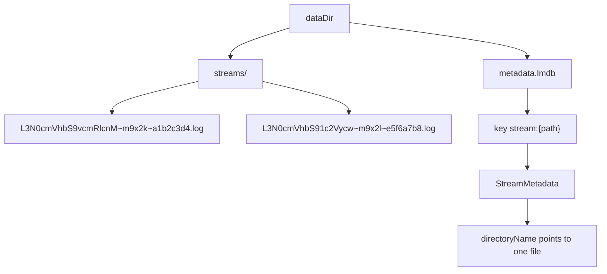
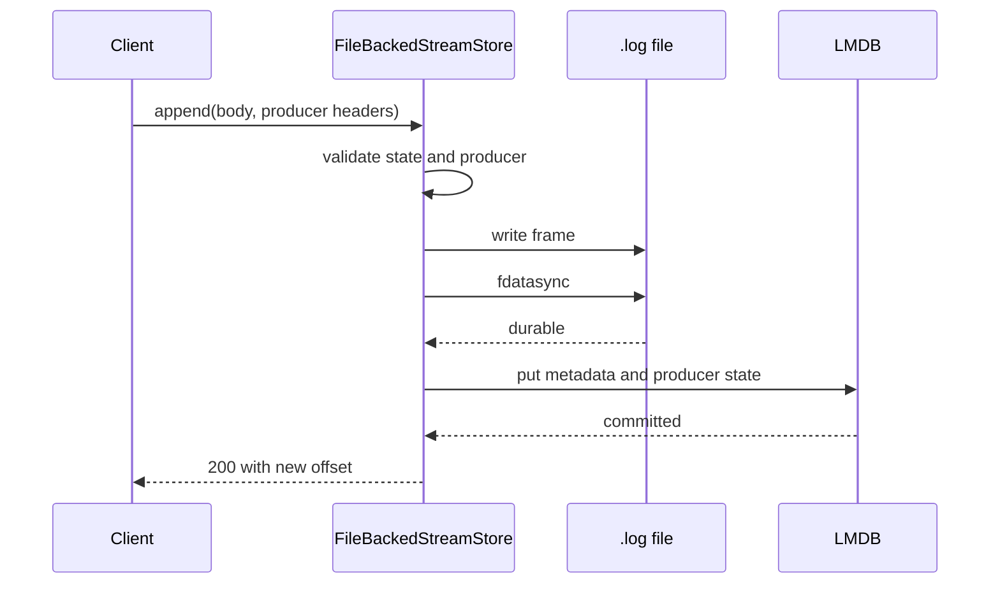
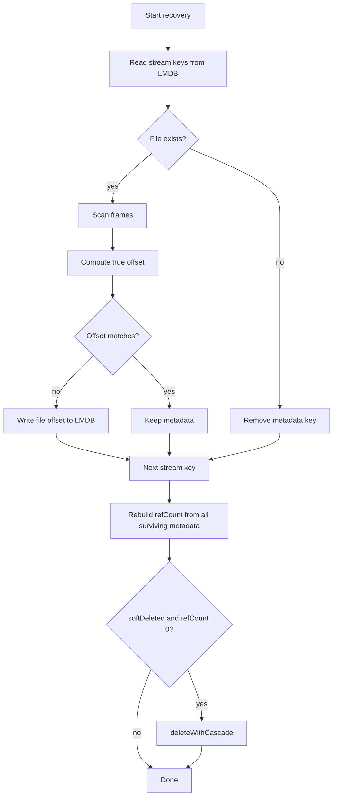
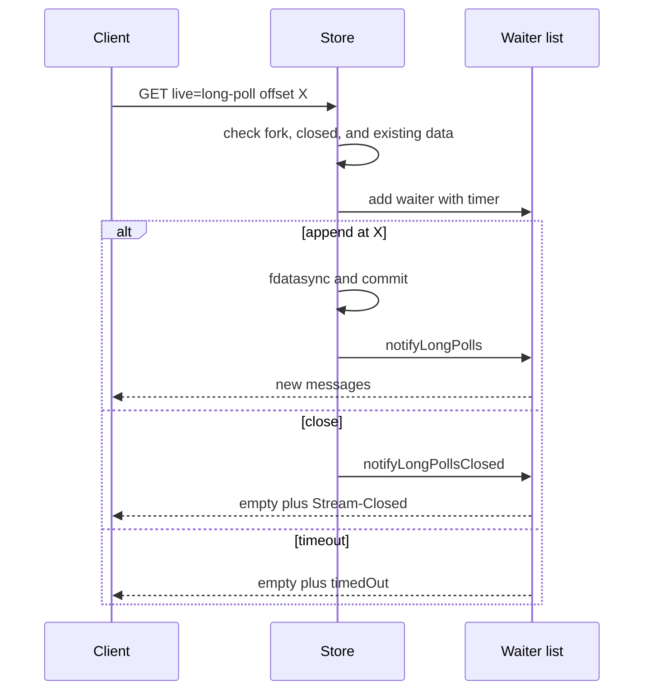

# Storage and Durability

This document studies `packages/server/src/file-store.ts`. That file implements `FileBackedStreamStore`. It keeps stream metadata in a Lightning Memory-Mapped Database (LMDB) and stream bytes in an append-only log file. All citations are to commit `461b4026`.

The store appears when the server receives a `dataDir` option. `dataDir` is a filesystem path that the caller supplies. It can be relative; the process working directory resolves it. Document [04-node-server.md](04-node-server.md) shows the selection code.

The design assumes one server process for one `dataDir`. The append locks and the long-poll waiter list are in process memory. LMDB permits more than one process to open a database, but the source has no cross-process lock for the offset read-modify-write. Two server processes on one `dataDir` can therefore make the same offset update. The source does not state this limit; this document derives it from the code.

The file is 65,820 bytes. It is the largest file in the server package. The size comes from four concerns that the in-memory store does not have:

1. Durability across a crash.
2. Recovery after a partial write.
3. File handle management.
4. Fork reference counts on disk.

## Directory layout

The store creates two paths under `dataDir`:

```text
{dataDir}/metadata.lmdb                  LMDB environment directory
{dataDir}/streams/{directoryName}.log    one log file per stream
```

`directoryName` is a unique file stem, not a directory. Section "Unique directory names" gives its parts. The metadata store is the `lmdb` package (`file-store.ts:9`), not a custom format.

The constructor uses these paths:

```ts
this.db = openLMDB({
  path: path.join(this.dataDir, `metadata.lmdb`),
  compression: true,
  noMemInit: true,
  cache: true,
  sharedStructuresKey: Symbol.for(`structures`),
})
fs.mkdirSync(path.join(this.dataDir, `streams`), { recursive: true })
```

This block is from `packages/server/src/file-store.ts:310`.

The `lmdb` package reads four options here. `compression` turns on the library's value compression. `noMemInit` tells the library not to zero a newly allocated memory page, which makes the first write faster. `cache` turns on the library's read cache. `sharedStructuresKey` names the record that holds the shared structures that the lmdb-js library keeps for the database. The process-wide `Symbol.for` value makes every open of this database use the same key, so two opens in one process share those structures instead of creating them twice. The store does not document a size limit for the cache or the database map.



### Unique directory names

A stream path can be deleted and created again. If the file name were only the encoded path, an old asynchronous delete could remove a new file. The store prevents this with a unique name.

```ts
function generateUniqueDirectoryName(streamPath: string): string {
  const encoded = encodeStreamPath(streamPath)
  const timestamp = Date.now().toString(36)
  const random = randomBytes(4).toString(`hex`)
  return `${encoded}~${timestamp}~${random}`
}
```

This block is from `packages/server/src/file-store.ts:259`.

The name has three parts:

| Part | Example | Purpose |
|------|---------|---------|
| Encoded path | `L3N0cmVhbS9vcmRlcnM` | Encoded path, not a human-readable name; reversible unless truncated |
| Timestamp in base 36 | `m9x2k` | Rough age; the example is shorter than a current value |
| 4 random bytes in hexadecimal | `a1b2c3d4` | Collision avoidance |

The encoding is base64url (Request for Comments 4648 section 5): `+` becomes `-`, `/` becomes `_`, and padding `=` is removed (`packages/server/src/path-encoding.ts:16`). For a path of normal length, the decoder restores the original path (`path-encoding.ts:41`). A path whose encoding is longer than 200 characters is cut to 180 characters and given a 16-hex-character Secure Hash Algorithm 256 (SHA-256) suffix. That case adds one more `~` inside the encoded part (`:25-29`). The truncation is not reversible: the hash is one way, so the decoder cannot rebuild the full path. The store does not need the path from the file name, because the metadata record holds both values.

The timestamp is base-36 text with no fixed width. Lexical sort agrees with age only while every name has the same number of characters. The store uses the metadata record to find the file; it does not scan the directory in name order.

The `~` character is the separator. It is not in the base64url alphabet, so it cannot occur in the base64url part. The output of `encodeStreamPath` has at most one `~`; the decoder takes the last one and keeps the suffix only if it is a 16-character hexadecimal hash (`packages/server/src/path-encoding.ts:41`). The full directory name adds more `~` separators after the encoded path (`file-store.ts:259-264`).

The metadata record stores this name. The LMDB key is `stream:{path}`, not the bare path.

### One file, not many segments

The metadata has a `segmentCount` field and the code file is named `file-store.ts`. The names suggest a segmented log. The current implementation writes one file per stream:

```ts
function segmentFile(dataDir: string, dirName: string): string {
  return path.join(dataDir, `streams`, `${dirName}.log`)
}
```

This block is from `packages/server/src/file-store.ts:266`.

The counter starts at 1 when the store creates the metadata record (`file-store.ts:958`) and does not increase. No code creates a second segment. The `segmentCount` field is effectively a constant. A future version can add rotation without a metadata change, but this version has no rotation.

## Metadata fields

The `StreamMetadata` interface is the durable form of the in-memory `Stream`. It must be a plain object, because LMDB serializes it.

| Field | Type | Purpose |
|-------|------|---------|
| `path` | string | Stream path |
| `contentType` | string, optional | Media type |
| `currentOffset` | string | Tail offset |
| `lastSeq` | string, optional | Last `Stream-Seq` value |
| `ttlSeconds` | number, optional | Sliding Time To Live |
| `expiresAt` | string, optional | Absolute deadline |
| `createdAt` | number | Creation time in milliseconds |
| `lastAccessedAt` | number, optional | Last read or write time |
| `segmentCount` | number | Always 1 in this version |
| `totalBytes` | number | Sum of payload bytes plus frame bytes |
| `directoryName` | string | Unique file stem |
| `producers` | object, optional | Producer state per identifier |
| `closed` | boolean, optional | Closure flag |
| `closedBy` | object, optional | Producer tuple that closed the stream |
| `forkedFrom` | string, optional | Source path |
| `forkOffset` | string, optional | Divergence offset |
| `forkSubOffset` | number, optional | Sub-offset as supplied by the client |
| `refCount` | number, optional | Number of active forks |
| `softDeleted` | boolean, optional | Logical delete flag |

The interface is at `packages/server/src/file-store.ts:40`.

Several of these fields need a definition. A producer tuple is the producer identifier and the producer epoch, plus the last accepted producer sequence. The epoch is a generation number; a new epoch fences an older writer. A fork offset is the two-part offset in the source where the fork starts. A fork sub-offset is a position inside the fork offset: a message count in JavaScript Object Notation (JSON) mode and a byte count in other modes. The reference count includes every fork record that still names the stream, including a fork that is soft-deleted but not yet removed.

`currentOffset` has the reference format `<readSeq>_<byteOffset>`. Both parts are 16 digits with leading zeros. The first part is a reserved read sequence. The reference server starts it at zero, preserves it on every append, and never increments it. The Caddy plugin documents it as reserved for future log rotation (`packages/caddy-plugin/store/offset.go:13`). The second part is the byte position.

`ttlSeconds` is a sliding window from `lastAccessedAt`. `expiresAt` is an absolute International Organization for Standardization (ISO) 8601 time string. `isExpired` checks both; either field can expire the stream (`file-store.ts:676`).

`totalBytes` includes the 5-byte frame overhead for each append (`file-store.ts:1389`). A fork starts with `totalBytes: 0`, even when its `currentOffset` includes inherited bytes (`file-store.ts:959`). The field counts only framed append bytes written after create. It omits inherited bytes and the sub-offset prefix. The sub-offset prefix is the inherited bytes that a fork with a sub-offset materializes as its first own message. The field is therefore not a count of readable bytes. Recovery does not rebuild the field, so after a crash it can disagree with the file size. No read path uses the field; the source only writes it and never reads it (`file-store.ts:1389`).

`producers` is a plain object, not a `Map`, because the store keeps serializable records (`file-store.ts:64`). The store converts the object to a `Map` when it builds the in-memory view. The producer state holds the epoch and the last accepted sequence number.

`closedBy` is critical for a restart. It records the producer tuple that closed the stream. A retry of that close must return success. If the field were not durable, a client retry after a server restart would receive an error for an operation that succeeded.

`forkSubOffset` stores the client value, not the encoded byte length. This choice lets an idempotent fork `PUT` compare the same value that the client sent.

A fork file holds only the fork's own bytes. Reads of inherited data come from the source file. Section "Recovery" shows how the logical offset adds the fork base.

## The frame format

Each append writes one frame:

```text
+----------------+----------------------------+--------+
| 4-byte length  | payload bytes              | 0x0A   |
| big-endian     | (the length in bytes)      | newline|
+----------------+----------------------------+--------+
```

The write path builds the frame in one buffer:

```ts
const lengthBuf = Buffer.allocUnsafe(4)
lengthBuf.writeUInt32BE(processedData.length, 0)
const frameBuf = Buffer.concat([
  lengthBuf,
  processedData,
  Buffer.from(`\n`),
])
await new Promise<void>((resolve, reject) => {
  stream.write(frameBuf, (err) => {
    if (err) reject(err)
    else resolve()
  })
})
```

This block is from `packages/server/src/file-store.ts:1339`.

The offset advances by the payload length plus 5. The 5 bytes are the length prefix and the newline.

```ts
const FRAME_OVERHEAD = 5 // 4-byte length prefix + 1-byte newline
const newByteOffset = byteOffset + FRAME_OVERHEAD + processedData.length
```

This block is from `packages/server/src/file-store.ts:1325`.

The in-memory store uses the same arithmetic. This equality is what lets one test suite run against both stores.

Key insight: the newline is a redundancy marker, not the parser's separator. The length prefix does that job. The current scan and read code use the length and do not verify the newline byte. A short frame or a length that runs past the end of the file marks a partial frame. A missing newline with a correct length is not detected.

## The write path and its durability order

The append path has a strict order:

1. Check the stream state.
2. Validate the producer tuple, without mutation.
3. Process JSON mode. JSON mode is the protocol rule for `application/json`: the server flattens exactly one array level, so one append can store several messages, and a read returns an array of messages. The processing here turns the append body into message text.
4. Compute the new offset.
5. Write the frame to the file.
6. Flush the file with `fdatasync`.
7. Commit the metadata to LMDB.
8. Notify long-poll waiters.

Steps 5 to 7 are the important part.

```ts
// 4. Update LMDB metadata atomically (only after flush, so metadata reflects durability)
await this.fileHandlePool.fsyncFile(segmentPath)
...
const key = `stream:${streamPath}`
await this.db.put(key, updatedMeta)
```

This block is from `packages/server/src/file-store.ts:1367`.

The method is named `fsyncFile`, but the system call is `fs.fdatasync` (`file-store.ts:199`). `fdatasync` flushes the file data and the metadata that is necessary to read that data. It does not flush unrelated metadata, such as the last modification time. This document uses "flush" for that call, and "`fsync`" only when it speaks about a directory.

The source comments state the rule directly: "Update LMDB metadata atomically (only after flush, so metadata reflects durability)" and "Producer state is committed HERE (not in validateProducer) for atomicity" (`file-store.ts:1367-1369`). Metadata must never acknowledge bytes that are not durable.

The code comments number their own steps 1 to 6. The eight-step list above gives the same order in more detail. The two numbering schemes do not match; this document uses the list numbers when it refers to a stage.



### Crash windows

The order gives these crash windows. The first two are failures during the write. The other rows depend on the difference between a process crash and a machine or power loss. A process crash keeps the kernel page cache and the open file. A machine or power loss does not.

| Crash point | File state | Metadata state | Recovery result |
|-------------|------------|----------------|-----------------|
| Before the write | No frame | Old offset | No data, no error |
| During the write, process crash | Partial frame | Old offset | Offset set to the last complete frame; partial bytes remain |
| During the write, power loss | Partial or complete frame | Old offset | Same rule; unwritten bytes are lost |
| After the write callback, before the flush, process crash | Complete frame in the kernel | Old offset | File wins; frame is counted |
| Same, power loss | Frame may be lost or partial | Old offset | File wins up to the last complete frame |
| After the flush, before LMDB | Complete frame | Old offset | File wins; offset repaired |
| After LMDB | Complete frame | New offset | Normal state |

The store chooses the file as the source of truth. A frame that survives in the file counts, even if the metadata did not record it. After a process crash, a complete frame survives in the kernel page cache. After a power loss, only a frame that reached stable storage survives. The client may have received no response. The next read sees the data. The result is at-least-once behaviour at the storage layer. The idempotent producer can suppress a retry within one epoch, but a crash that loses the producer state can defeat that suppression; document [02-protocol-operations.md](02-protocol-operations.md) gives the trade-off.

Recovery repairs the offset and the reference count. It does not rebuild `producers`, `totalBytes`, or `lastAccessedAt`. A producer retry after lost producer metadata can therefore look new to the server. The producer sequence prevents a duplicate only while the server keeps its record of the earlier sequence. When the record is lost, the server cannot compare, so a retry can append again. The client cannot detect this loss. A stream that was idle before the restart keeps its old `lastAccessedAt`, so a sliding Time To Live (TTL) can expire sooner than a read would suggest. The server-side producer state is only as durable as the last LMDB commit.

This choice is correct for a log. A lost acknowledged byte is a correctness failure. A byte that appears after a failed request is not.

## Recovery

`recover()` runs in the constructor, before the server accepts a request. It is synchronous, so it blocks startup until every stream is checked. It does three jobs.

### 1. Remove metadata records with no file

The method reads every key from `stream:`. For each key it checks that the file exists.

```ts
if (!fs.existsSync(segmentPath)) {
  serverLog.warn(
    `[FileBackedStreamStore] Recovery: Stream file missing for ${streamPath}, removing from LMDB`
  )
  this.db.removeSync(key)
  errors++
  continue
}
```

This block is from `packages/server/src/file-store.ts:360`.

A metadata record without a file is useless. The store removes it.

### 2. Reconcile the offset

The method scans the file from the start. It reads a 4-byte length, skips that many bytes, then skips one newline. It stops at the first partial frame.

```ts
while (filePos < fileContent.length) {
  if (filePos + 4 > fileContent.length) break
  const messageLength = fileContent.readUInt32BE(filePos)
  const frameEnd = filePos + 4 + messageLength + 1
  if (frameEnd > fileContent.length) break
  filePos = frameEnd
}
return `0000000000000000_${String(filePos).padStart(16, `0`)}`
```

This block is from `packages/server/src/file-store.ts:454`.

The result is the true byte offset of the last complete frame. If it differs from the metadata, the store writes the file value to LMDB.

A fork needs one correction. The fork file holds only the fork's own messages. The logical offset is the fork base plus the physical bytes.

```ts
const forkBaseByte = Number(streamMeta.forkOffset.split(`_`)[1] ?? 0)
const logicalBytes = forkBaseByte + physicalBytes
trueOffset = `${String(0).padStart(16, `0`)}_${String(logicalBytes).padStart(16, `0`)}`
```

This block is from `packages/server/src/file-store.ts:377`.

The recovery offset always has read sequence zero (`packages/server/src/file-store.ts:465`). If the stored `currentOffset` had a different read sequence, recovery replaces it with zero. The read sequence is reserved and does not describe the stored byte order, so the change does not move any message.

The fork branch has a small guard and a limit. The expression `streamMeta.forkOffset.split('_')[1] ?? 0` gives `0` when the second part is missing. It does not protect against a second part that is not a number: `Number("x")` gives `NaN`, and the logical offset then contains `NaN`. The metadata writer is expected to store a valid two-part offset.

### 3. Rebuild reference counts

A reference count is derived data. It can be wrong after a crash between two metadata writes. The store does not trust it. It rebuilds the count from the fork edges.

```ts
const expectedRefs = new Map<string, number>()
for (const { value } of surviving) {
  if (value.forkedFrom) {
    expectedRefs.set(
      value.forkedFrom,
      (expectedRefs.get(value.forkedFrom) ?? 0) + 1
    )
  }
}
```

This block is from `packages/server/src/file-store.ts:416`.

Here `surviving` is the set of metadata records still in LMDB after the missing-file removal. The rebuild writes the new counts in one LMDB transaction. A stream with a corrected count of zero and a soft-delete flag joins a collectible list. The store then calls `deleteWithCascade` for each entry, and each call opens its own transaction (`file-store.ts:437`).



The recovery is not a general repair tool. It handles a partial final frame and a stale offset. It does not validate the frame contents. The scan trusts the 4-byte length. If a length in the middle of the file is corrupt, the scan can move to a wrong position. It can also compute an end past the file end and stop. In the second case the stream appears to end at that frame. A corrupt payload with a correct length passes the scan without detection.

The scan stops at the first partial frame, but the store does not remove that frame from the file. It writes the true offset to LMDB and leaves the bytes in place. This has a second effect. The write pool opens every file in append mode (`flags: \`a\`` at `file-store.ts:142`). A later append therefore lands after the partial bytes, not at the true offset.

The store has no code that truncates the partial tail. The function `scanFileForTrueOffset` only reads (`file-store.ts:449`). This document states the code path; it does not claim that the path is safe. A stream that has a partial tail after a crash can hide later frames from a future scan. The repository does not state a repair step. A reader should treat this case as an open question.

The Caddy plugin makes the other choice. Its recovery truncates the segment at the true offset:

```go
if err := f.Truncate(int64(trueOffset.ByteOffset)); err != nil {
    return Offset{}, fmt.Errorf("failed to truncate segment for %s: %w", streamPath, err)
}
```

This block is from `packages/caddy-plugin/store/file_store.go:1431`.

| Store | Partial tail on start | File size after recovery |
|-------|-----------------------|--------------------------|
| Node.js file store | Left in place; later appends land after it | Unchanged |
| Caddy file store | Truncated at the last complete frame | Shrinks to the true offset |

In both stores, the recovered offset points at the first byte of the partial frame. The difference is what happens to the bytes after that point.

## The read path

The store does not keep messages in memory. A read opens the file and parses frames. The `subarray` call below makes a temporary view into the file buffer, but the returned message copies the payload into a new byte array, `new Uint8Array(messageData)` (`file-store.ts:1662`). The caller can therefore keep a message after the read returns.

```ts
const messageData = fileContent.subarray(
  filePos,
  filePos + messageLength
)
filePos += messageLength
filePos += 1
physicalDataOffset += messageLength + 5
const logicalOffset = baseByteOffset + physicalDataOffset
if (capByte !== undefined && logicalOffset > capByte) {
  break
}
```

This block is from `packages/server/src/file-store.ts:1639`.

Three variables control the loop. `baseByteOffset` is the fork base: zero for a normal stream, and the source byte position for a fork. `physicalDataOffset` counts bytes in this file, including frame overhead. `capByte` is the end of the requested logical range; `undefined` means read to the tail. A message is included when its end offset is greater than `startByte` and not greater than `capByte` (`file-store.ts:1655-1662`).

The method reads the whole file with `fs.readFileSync`. It then walks the frames. `subarray` returns a view, not a copy. The design is simple, but it has the partial-tail limit above. It also does not scale to a multi-gigabyte stream, because each read allocates the full file content. Reads use the synchronous call because they need the full file and a simple snapshot. Writes use the handle pool because they must append and flush one frame at a time.

The timestamp of a message is set to `0`. The file format does not store the append time. The in-memory store has a real timestamp. This is a behavioural difference between the two stores.

### File handle pool

Writes use a pool of open write streams. The pool is a SIEVE cache with a default capacity of 100.

```ts
const maxFileHandles = options.maxFileHandles ?? 100
this.fileHandlePool = new FileHandlePool(maxFileHandles)
```

This block is from `packages/server/src/file-store.ts:322`.

The policy is SIEVE, not plain least-recently-used. SIEVE is the name of an eviction policy; it is not an acronym. The policy keeps a moving hand over the cache entries and a visited bit on each entry. During eviction, a visited entry loses the bit and stays; an unvisited entry is removed. This gives a recently visited entry a second chance. The store uses the `@neophi/sieve-cache` library with the eviction hook at `file-store.ts:129`. An eviction closes the handle; the next write opens the file again in append mode (`file-store.ts:142`).

The `fsyncFile` method coalesces callers. The first caller becomes the leader. A caller that arrives while the leader has `scheduled: true` joins the leader and waits for the same result. The leader sets `scheduled: false` immediately before it calls `fdatasync` (`file-store.ts:197-199`). A caller that arrives after that point does not join: it makes a new leader and starts a second `fdatasync` call on the same file descriptor (`:183-195`).

The source comment says the later caller waits for the first call to finish. The code does not await the first promise; it starts the second call at once. This is a discrepancy between the comment and the code. Both calls flush the same file, so the second call does not weaken durability, but it can do redundant work.

## Long-poll waiters

A long-poll read does not poll the file. The store keeps a list of pending waiters in memory. Each waiter holds a stream path, an offset, a timer, and a resolve function. This machinery belongs in the storage document because the wake happens only after the metadata commit: durability order decides when a reader sees new data.

`waitForMessages` has four fast paths before it registers a waiter (`file-store.ts:1849`):

1. The stream is a fork and the offset is in the inherited range. Read and return at once.
2. The stream is closed and the offset is at the tail. Return at once with `streamClosed`.
3. New messages already exist after the offset. Return them.
4. The stream is closed and no new messages exist. Return an empty list with `streamClosed`.

The timeout comes from the caller. The server passes its `longPollTimeout` option, which defaults to 30,000 milliseconds.

If none applies, the method creates a timer and adds the waiter to `pendingLongPolls`. The resolve function clears the timer and removes the waiter from the list, so a resolved or timed-out waiter does not stay in memory (`file-store.ts:1905-1922`).

```ts
const toNotify = this.pendingLongPolls.filter((p) => p.path === streamPath)

for (const pending of toNotify) {
  const { messages } = this.read(streamPath, pending.offset)
  if (messages.length > 0) {
    pending.resolve(messages)
  }
}
```

This block is from `packages/server/src/file-store.ts:2030`.

An append calls `notifyLongPolls` after the metadata commit (`file-store.ts:1416`). The call reads from each waiter's own offset, so one wake can give different data to different waiters.

A close calls `notifyLongPollsClosed` (`file-store.ts:2045`). Every waiter resolves with an empty list. The caller then reads the stream state and sends `Stream-Closed: true`. A delete calls `cancelLongPollsForStream` (`file-store.ts:2053`). It clears each timer, resolves the waiter, and removes it from the list.

A timeout resolves with `timedOut: true` and the current closure state. The protocol layer turns that result into an empty response or into a closed response.



Key insight: the waiter list is keyed by stream path, not by offset. One append wakes every waiter on that stream. Each waiter then reads from its own offset. This is why one append is one wake signal. A slow network client does not hold up the others, because each waiter has its own promise. The wake loop is synchronous and reads the file once per waiter. The append call does not return until the loop ends, so many waiters on one stream add read work to the append that wakes them.

## Concurrency control

The store has two in-process lock scopes.

| Lock | Key | Protects |
|------|-----|----------|
| Stream append lock | stream path | Offset read-modify-write |
| Producer lock | path and producer identifier | Producer validation and commit |

Both locks are `Map` objects inside one process (`file-store.ts:283`, `:290`, `:595-616`, and `:627-644`). They do not coordinate two server processes that open the same `dataDir`. The producer lock key is `${streamPath}:${producerId}`. A producer append takes the producer lock first, then calls `append`, which takes the stream append lock (`:1454-1462`). The two locks have a fixed order, so they cannot deadlock.

The stream append lock is necessary because an append reads `currentOffset`, computes a new value, and writes the metadata. Two appends can read the same value without a lock. The second write would then lose the first increment.

```ts
async append(...) {
  const releaseLock = await this.acquireStreamAppendLock(streamPath)
  try {
    return await this.appendInner(streamPath, data, options)
  } finally {
    releaseLock()
  }
}
```

This block is from `packages/server/src/file-store.ts:1205`.

Fork create and fork delete do not share the stream append lock. A fork create takes the store mutation lock, which serializes it against other fork mutations (`file-store.ts:292-304`, `:784`). A fork delete has no such wrapper (`file-store.ts:1129`). Each one changes the child record and the parent count inside one LMDB `transactionSync` call (`:1018` and `:1173`). The transaction makes the pair of writes atomic. For a delete, the transaction is the only serialization. For a create, the mutation lock is already held when the transaction starts. LMDB serializes write transactions, so two fork creates cannot interleave their count updates.

## Fork reference counts and delete

A fork create increments the source count in the same transaction that writes the fork metadata.

```ts
this.db.putSync(sourceKey, {
  ...freshSource,
  refCount: (freshSource.refCount ?? 0) + 1,
})
```

This block is from `packages/server/src/file-store.ts:1027`.

A delete checks the count:

```ts
if ((streamMeta.refCount ?? 0) > 0) {
  const updatedMeta: StreamMetadata = { ...streamMeta, softDeleted: true }
  this.db.putSync(key, updatedMeta)
  this.cancelLongPollsForStream(streamPath)
  return true
}
this.deleteWithCascade(streamPath)
return true
```

This block is from `packages/server/src/file-store.ts:1143`.

A second delete of a soft-deleted stream returns success. The operation is idempotent.

`deleteWithCascade`, described next, removes the metadata key and decrements the parent count in one transaction. The transaction contains only those two metadata writes. It then closes the file handle and deletes the file, outside the transaction. The file delete is asynchronous. A crash between the metadata delete and the file delete leaves a file with no metadata record. Recovery does not remove it, because recovery scans metadata, not the directory. The file stays on disk and uses space until an operator removes it. This document uses "orphan file" for that case, and "orphan metadata" for the first recovery case, where a metadata record has no file.

The cascade is recursive. If the parent count reaches zero and the parent is soft-deleted, the method calls itself on the parent (`file-store.ts:1197`). The chain can be several forks deep, and the loop stops at the first parent that still has a count above zero or is not soft-deleted.

The delete can also start from a read. `getMetaIfNotExpired` calls `delete`, so a read request can remove a stream or start a cascade. The call is direct; it does not re-enter the append or producer lock. The in-memory store makes the same call from `get` (`store.ts:491`). Section "Expiry" below gives the full rule.

The same is true of an explicit `DELETE`. Neither path takes the stream append lock. An append reads the metadata, writes its frame, and later writes the metadata record. A `DELETE` that runs in that interval can remove the key, and the append can then put the old record back. The stream reappears. If the delete also removed the file, the restored metadata record names a missing file; if the file survived, the appended frame is present. The source does not serialize these two operations. This document states the race as a code observation; it does not claim that the Hypertext Transfer Protocol (HTTP) layer prevents it.

Document [01-protocol-stream-model.md](01-protocol-stream-model.md) gives the reader-visible rules for soft delete.

## Expiry

The store checks expiry on every metadata read.

```ts
if (this.isExpired(meta)) {
  if ((meta.refCount ?? 0) > 0) {
    if (!meta.softDeleted) {
      const updatedMeta: StreamMetadata = { ...meta, softDeleted: true }
      this.db.putSync(key, updatedMeta)
      return updatedMeta
    }
    return meta
  }
  this.delete(streamPath)
  return undefined
}
```

This block is from `packages/server/src/file-store.ts:711`.

An expired stream with forks becomes soft-deleted. An expired stream without forks is deleted. The expiry check is lazy. No timer removes an old stream. The store removes it on the next access.

Reads and appends call `touchAccess`, which updates `lastAccessedAt` (`file-store.ts:661`). A `HEAD` request does not renew the Time To Live. The in-memory `Stream` type states this rule in a comment. The file store follows the same access rule.

## `file-manager.ts` is unused

The server package contains `packages/server/src/file-manager.ts`. It defines a class named `StreamFileManager`. A search with `grep -rn "file-manager" packages/server/src` finds no reference outside the file itself.

```ts
export class StreamFileManager {
  constructor(private streamsDir: string) {}
  async createStreamDirectory(streamPath: string): Promise<string> {
    const encoded = encodeStreamPath(streamPath)
    const dir = path.join(this.streamsDir, encoded)
    await fs.mkdir(dir, { recursive: true })
    const segmentPath = path.join(dir, `segment_00000.log`)
```

This block is from `packages/server/src/file-manager.ts:10`.

The layout is different from the live store in four ways:

| Property | `StreamFileManager` | `FileBackedStreamStore` |
|----------|---------------------|--------------------------|
| Stream location | Directory per stream | One file per stream |
| Directory name | Encoded path only | Encoded path, timestamp, random value |
| Segment name | `segment_00000.log` | `{directoryName}.log` |
| In use | No | Yes |

A reader who finds `file-manager.ts` first can form a wrong model of the on-disk format. The live format is the one in `file-store.ts`.

The unused file is a real discrepancy in the repository. This document states it as an observation, not as a defect report.

## Other back ends

The same protocol rules appear in two other stores. Document [08-server-implementations.md](08-server-implementations.md) compares the servers; this section states the storage mechanics.

### Cloudflare Durable Object SQLite

A Durable Object is a Cloudflare compute unit with one event loop and its own SQLite database. The Cloudflare server maps one stream to one Durable Object. The object keeps every message in one SQLite table. It uses the same 5-byte frame overhead as the Node.js store, so an offset string has the same shape:

```ts
export function advanceOffset(
  currentOffset: string,
  payloadLength: number
): string {
  const parts = currentOffset.split(`_`)
  const readSeq = Number(parts[0])
  const byteOffset = Number(parts[1])
  const newByteOffset = byteOffset + FRAME_OVERHEAD + payloadLength
  return `${String(readSeq).padStart(16, `0`)}_${String(newByteOffset).padStart(16, `0`)}`
}
```

This block is from `packages/server-cloudflare/src/store.ts:116`.

The constant is documented as a copy of the reference frame:

```ts
export const FRAME_OVERHEAD = 5
```

This line is from `packages/server-cloudflare/src/constants.ts:43`. The comment states that the value keeps offsets identical to the reference server. The overhead is arithmetic only; no byte framing exists in SQLite.

The atomic unit is the Durable Object transaction. There is no separate data flush and metadata commit, because the storage application programming interface (API) commits both in one call.

### Caddy bbolt and segment files

The Caddy plugin keeps metadata in bbolt, a Bolt database fork, and bytes in one segment file per stream. The frame has a 4-byte length prefix and no newline (`packages/caddy-plugin/store/segment.go:25`). The offset advances by the payload length plus 4, not plus 5. A client cannot see the difference, because the offset is opaque.

The producer-state window is in document [08-server-implementations.md](08-server-implementations.md). In short, the plugin writes the segment first and the bbolt state second. If the bbolt update fails, the code logs the error and still returns success, because the segment is the source of truth (`packages/caddy-plugin/store/file_store.go:772-783`). Recovery reconciles the offset, but it does not rebuild the producer state (`:1397-1402`). After a restart, bbolt still holds the previous `lastSeq`. For example, bbolt holds `lastSeq = 0`, the client was told that sequence 1 succeeded, and its next request uses sequence 2. The server expects 1, so `validateProducer` sees a gap and returns `409 Conflict`. The data is present, but the server rejects the next valid write.

| Store | Metadata | Bytes | Frame overhead | Partial-tail repair |
|-------|----------|-------|----------------|---------------------|
| Node.js file store | LMDB | `.log` file | 5 bytes | None; see "Recovery" |
| Cloudflare | Durable Object SQLite | same SQLite database | 5 bytes in arithmetic only | Transaction rollback |
| Caddy plugin | bbolt | segment file | 4 bytes | Truncate |

## What durability means here

The store gives a strong local guarantee for a normal append. A response is sent only after the frame is flushed with `fdatasync` and the LMDB `put` call resolves. The source does not set an explicit LMDB durability option, so the exact LMDB commit guarantee is an open question.

The guarantee has limits. The source shows no directory `fsync` when it creates a file, so a power loss can lose the directory entry. The partial-tail case in "Recovery" can hide later frames from the scan and the read path.

It does not give a distributed guarantee. There is no replication. A disk failure loses the data. The Cloudflare server uses a different model. The Caddy plugin uses a Bolt database. Document [08-server-implementations.md](08-server-implementations.md) compares the three.

## Related documents

- [04-node-server.md](04-node-server.md) shows the server that selects this store.
- [01-protocol-stream-model.md](01-protocol-stream-model.md) gives the offset and fork rules that the store implements.
- [02-protocol-operations.md](02-protocol-operations.md) gives the append and producer rules.
- [08-server-implementations.md](08-server-implementations.md) compares other storage back ends.
- [README.md](README.md) is the package index.
