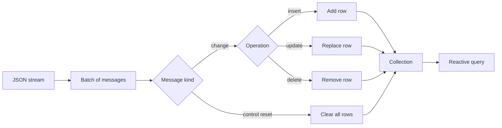
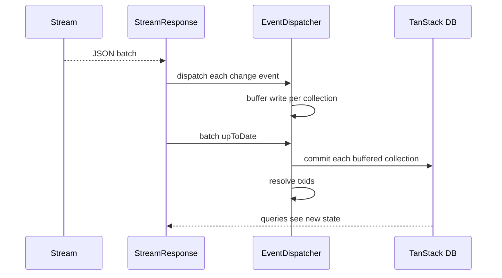

# State Protocol

This document studies `packages/state`. The package adds a typed state layer on a JavaScript Object Notation (JSON) stream. The stream still holds messages. The messages now describe changes to entities. A client applies the changes in order and gets the current state. The client tracks an offset, the opaque position string that the stream returns, to know where to resume.

The package has two specifications of its own:

- `packages/state/STATE-PROTOCOL.md` defines the message format.
- `packages/state/README.md` shows the application programming interface (API).

The package has two entry points:

| Entry point | Contents | Dependency |
|-------------|----------|------------|
| `@durable-streams/state` | Schema helpers, event types, `MaterializedState` | None |
| `@durable-streams/state/db` | `createStreamDB`, collections, actions | `@tanstack/db`, the TanStack DB package (a reactive client-side database) |

Aha: the stream protocol has no schema on purpose. The state protocol is an optional layer that adds one. A stream can hold any bytes. A state stream holds change events with a known shape. The base protocol does not change.

## The problem

A JSON stream is an event log. A new client reads it from the start, or from a snapshot offset, and rebuilds the current view. Every application writes the same rebuild logic:

1. Read a batch.
2. Route each item by type.
3. Insert, update, or delete a row.
4. Track the last processed offset.
5. Repeat.

The state protocol defines this loop once. It adds four parts:

1. A standard event shape.
2. Control events for snapshot boundaries and reset.
3. A transaction identifier for grouping.
4. A reactive collection layer.

## The message model

A change message has two required fields, one conditional value field, and one metadata object.

```json
{
  "type": "user",
  "key": "user:123",
  "value": {
    "name": "Alice",
    "email": "alice@example.com"
  },
  "headers": {
    "operation": "insert",
    "timestamp": "2025-01-15T10:30:00Z"
  }
}
```

The field rules are in section 4.1 of `STATE-PROTOCOL.md`:

| Field | Required | Meaning |
|-------|----------|---------|
| `type` | Yes | Entity type; routes the event to a collection |
| `key` | Yes | Entity identifier; non-empty string |
| `value` | For insert and update | New entity value |
| `old_value` | No | Previous value for audit or conflict detection |
| `headers.operation` | Yes | `insert`, `update`, or `delete` |
| `headers.txid` | No | Transaction identifier |
| `headers.timestamp` | No | Request for Comments 3339 (RFC 3339) time stamp, an Internet date and time format |

A delete may omit `value`, or set it to `null`. The event still carries the `key`.

### Control messages

A control message has only a `headers` object.

```json
{
  "headers": {
    "control": "snapshot-start",
    "offset": "123456_000"
  }
}
```

The protocol has three control values:

| Control | Meaning |
|---------|---------|
| `snapshot-start` | The next events form a complete snapshot |
| `snapshot-end` | The snapshot is complete |
| `reset` | Clear the materialized state and restart |

A `snapshot-start` and `snapshot-end` pair is a hint. The state implementation ignores both. A `reset` is an instruction. The implementation clears every collection.

### Materialization

Materialization applies events in stream order.

| Operation | Effect |
|-----------|--------|
| `insert` | Store the value at `type` and `key` |
| `update` | Replace the value at `type` and `key` |
| `delete` | Remove the value at `type` and `key` |
| `reset` | Remove all values |

The protocol does not define the storage. It names in-memory maps, IndexedDB, SQLite, and the TanStack database (TanStack DB) as valid choices.



## Schema and event helpers

`createStateSchema` turns a collection definition into a typed schema with helper methods.

```ts
const schema = createStateSchema({
  users: {
    schema: userSchema,
    type: "user",
    primaryKey: "id",
  },
})
```

A definition has three parts:

| Field | Meaning |
|-------|---------|
| `schema` | A Standard Schema validator; Standard Schema is a common validator interface that several libraries implement |
| `type` | The `type` value that routes events to this collection |
| `primaryKey` | The value field that supplies the key |

The interface is at `packages/state/src/schema.ts:16`.

The helper for each operation validates the value and derives the key. The key comes from the caller, or from the primary key field.

```ts
const derived = (value as any)[primaryKey]
const finalKey =
  key ?? (derived != null && derived !== `` ? String(derived) : undefined)
if (finalKey == null || finalKey === ``) {
  throw new Error(
    `Cannot create ${eventType} insert event: must provide either 'key' or a value with a non-empty '${primaryKey}' field`
  )
}
```

This block is from `packages/state/src/schema.ts:115`.

Validation uses the Standard Schema interface. The helper calls `schema["~standard"].validate(value)`. A failure throws before the event reaches the stream. This is a producer-side check. A consumer must still validate, because a different producer can write bad data.

### Upsert

The helper set has four operations: `insert`, `update`, `delete`, and `upsert`.

`STATE-PROTOCOL.md` defines only three. `upsert` is a package extension. The consumer converts it to `insert` or `update` by a key lookup.

```ts
if (operation === `upsert`) {
  const keys = this.existingKeys.get(event.type)
  const existing = keys?.has(event.key)
  operation = existing ? `update` : `insert`
}
```

This block is from `packages/state/src/stream-db.ts:308`.

This is a real difference between the specification and the implementation. A producer that sends `upsert` to a consumer that follows only `STATE-PROTOCOL.md` can fail. The repository does not state which behaviour is normative. A new implementation should accept `upsert`, or the specification should add it.

### Reserved collection names

A collection name cannot be one of five internal names:

- `collections`
- `preload`
- `close`
- `utils`
- `actions`

The set is at `packages/state/src/schema.ts:88`. A collision would make `db.collections.users` ambiguous with a method on the database object.

## `MaterializedState`

`MaterializedState` is the simple store. It has no TanStack dependency and no reactivity.

```ts
const state = new MaterializedState()
state.apply({
  type: "token",
  key: "stream-1",
  value: { content: "Hello", model: "claude-3" },
  headers: { operation: "insert" },
})
const token = state.get("token", "stream-1")
```

The class stores a map of type to a map of key to value. `get(type, key)` returns one value. `getType(type)` returns one map.

This class is useful for a server-side consumer, a test, or a small tool. It does not notify a user interface when a value changes.

## `createStreamDB`

`createStreamDB` builds a reactive layer on TanStack DB collections.

```ts
export function createStreamDB<
  TDef extends StreamStateDefinition,
  TActions extends Record<string, ActionDefinition<any>> = Record<
    string,
    never
  >,
>(
  options: CreateStreamDBOptions<TDef, TActions>
): TActions extends Record<string, never>
  ? StreamDB<TDef>
  : StreamDBWithActions<TDef, TActions> {
```

This block is from `packages/state/src/stream-db.ts:592`.

The options are:

| Option | Meaning |
|--------|---------|
| `streamOptions` | Durable Stream client options |
| `stream` | An existing stream handle, instead of options |
| `state` | The schema from `createStateSchema` |
| `live` | `true` (catch-up, then auto-select), `"long-poll"`, `"sse"` (Server-Sent Events), or `false` |
| `actions` | A factory for optimistic actions |
| `onEvent` | A callback for each change event |
| `onBeforeBatch` | A callback before a batch is applied |
| `onBatch` | A callback after a batch is applied |

The function creates one TanStack collection per definition.

```ts
let collection: Collection<object, string> = createCollection({
  id: getStreamDBCollectionId(streamIdentity, name),
  schema: definition.schema as StandardSchemaV1<object>,
  getKey: (item: any) => String(item[definition.primaryKey]),
  sync: createStreamSyncConfig(
    definition.type,
    dispatcher,
    definition.primaryKey,
    (key) => collection.get(key) as object | undefined
  ),
  startSync: true,
  gcTime: 0,
})
```

This block is from `packages/state/src/stream-db.ts:633`.

The collection identifier includes the stream Uniform Resource Locator (URL) and the collection name. Two streams with the same schema do not collide.

`gcTime: 0` disables garbage collection. The comment gives the reason: the collections share one log. A collection cannot be removed and rebuilt from the log alone while the others stay live. The database object owns the lifecycle.

### The sync loop

The database creates one stream response and subscribes to it.

```ts
streamResponse.subscribeJson((batch) => {
  try {
    lastConsumedOffset = batch.offset
    onBeforeBatch?.(batch)
    for (const event of batch.items) {
      if (isChangeEvent(event)) {
        dispatcher.dispatchChange(event, batch.offset)
        onEvent?.(event)
      } else if (isControlEvent(event)) {
        dispatcher.dispatchControl(event)
      }
    }
    onBatch?.(batch)
    if (batch.upToDate || dispatcher.ready) {
      dispatcher.markUpToDate()
    }
```

This block is from `packages/state/src/stream-db.ts:701`.

A collection is the transaction boundary, not a batch. The dispatcher opens one transaction for each collection the first time that collection receives a write in the current catch-up. It buffers further writes to that collection. When the stream reports up to date, the dispatcher commits each buffered collection in its own TanStack transaction. Because the up-to-date signal can arrive in a later batch than the first catch-up data, the buffered writes can span several batches. This gives a user interface one update per collection per catch-up, not one update per event. Two collections do not commit together, so an observer can see one collection change before another.



### The transaction identifier

A producer can put a `txid` string in each event header. The consumer collects every `txid` in a batch and resolves waiters when the batch commits.

```ts
for (const txid of this.pendingTxids) {
  this.seenTxids.add(txid)
  const resolvers = this.txidResolvers.get(txid)
  if (resolvers) {
    for (const { resolve, timeoutId } of resolvers) {
      clearTimeout(timeoutId)
      resolve()
    }
    this.txidResolvers.delete(txid)
  }
}
```

This block is from `packages/state/src/stream-db.ts:413`.

The public method is `db.utils.awaitTxId(txid, timeout)`. The default timeout is 5,000 milliseconds (ms). The method returns at once if the identifier was already seen. It rejects on timeout.

```ts
awaitTxId(txid: string, timeout: number = 5000): Promise<void> {
  if (this.seenTxids.has(txid)) {
    return Promise.resolve()
  }
```

This block is from `packages/state/src/stream-db.ts:485`.

Aha: the transaction identifier turns "write, then read your own write" into one await. A writer sends an event with a `txid`, then waits. When the local database has applied that batch, the wait resolves. The writer does not poll the stream and does not guess a delay.

The identifier is not a global transaction. It is a marker. Two events with the same `txid` resolve the same waiters. The protocol does not require atomic visibility across events with one identifier. A consumer can apply a batch in parts.

### Preload and close

`preload()` starts the consumer and waits for the first up-to-date signal.

```ts
preload: async () => {
  await startConsumer()
  await dispatcher.waitForUpToDate()
},
close: () => {
  dispatcher.rejectAll(new Error(`StreamDB closed`))
  abortController.abort()
},
```

This block is from `packages/state/src/stream-db.ts:735`.

`close()` rejects every pending wait. A caller must not use a closed database.

### Actions

The `actions` factory returns named action definitions. Each definition has an `onMutate` handler and a `mutationFn`. The package wraps each one with `createOptimisticAction`.

- `onMutate` applies the local change at once.
- `mutationFn` sends the change to the stream.

The application generates the `txid` and puts the same value in the event header and in its call to `awaitTxId`. The package does not create the identifier. When the stream echoes the change, the optimistic state matches the confirmed state. This pattern gives an immediate user interface with a confirmed result.

## Reset

A `reset` control event clears every collection.

```ts
case `reset`:
  for (const handler of this.handlers.values()) {
    handler.truncate()
  }
  for (const keys of this.existingKeys.values()) {
    keys.clear()
  }
  this.pendingHandlers.clear()
  this.isUpToDate = false
  break
```

This block is from `packages/state/src/stream-db.ts:360`.

The reset also clears the key tracking and the pending writes. A reset that arrives in the middle of a batch discards the buffered writes that have not yet committed. The `onEvent` callbacks for events already seen in that batch have already run. The producer must send the new snapshot after the reset event; the document gives this as an implementation expectation, not a protocol rule.

A `snapshot-start` or `snapshot-end` event does nothing in this implementation. The protocol defines them as hints, so this is allowed.

## Idempotent replay

A live stream can reconnect and replay a batch. The dispatcher normalizes an insert for a key that already exists into an update.

```ts
if (operation === `insert` && keys?.has(event.key)) {
  operation = `update`
} else if (operation === `insert` && typeof event.key === `string`) {
  const existingValue = handler.read(event.key)
  if (
    existingValue &&
    deepEquals(this.comparableRow(existingValue), this.comparableRow(value))
  ) {
    operation = `update`
  }
}
```

This block is from `packages/state/src/stream-db.ts:320`.

Without this rule, TanStack DB would reject a duplicate key. The rule makes an observation replay safe.

The second branch covers a key that the collection still holds but the key-tracking map does not list, for example after a preload. If the stored row and the incoming value are equal, the dispatcher treats the event as an update. If they differ, it keeps the insert operation, so the collection can report the conflict.

A delete for a missing key is also safe. The collection removes nothing and continues.

## Limits

The state package has these limits:

1. The value must be an object. A scalar value cannot become a collection row.
2. The primary key must be a field in the value. A key outside the value is possible in the protocol but not in this helper.
3. The database is in memory. A browser refresh rebuilds it from the stream.
4. The database needs the full history from its start offset. The protocol defines snapshot events that could let a consumer start later. However, this package ignores them and does not store or create a snapshot. A caller that wants a later start must choose the offset itself.
5. The `/db` entry needs `@tanstack/db` as a peer dependency.

The package also depends on the stream for ordering. It applies events in the order that the stream returns them. The stream offset is the only clock.

## Related documents

- [01-protocol-stream-model.md](01-protocol-stream-model.md) gives the JSON mode that the state events use.
- [06-typescript-client.md](06-typescript-client.md) gives the client that the database wraps.
- [10-integrations-and-conformance.md](10-integrations-and-conformance.md) shows other higher layers on the same protocol.
- [README.md](README.md) is the package index.
