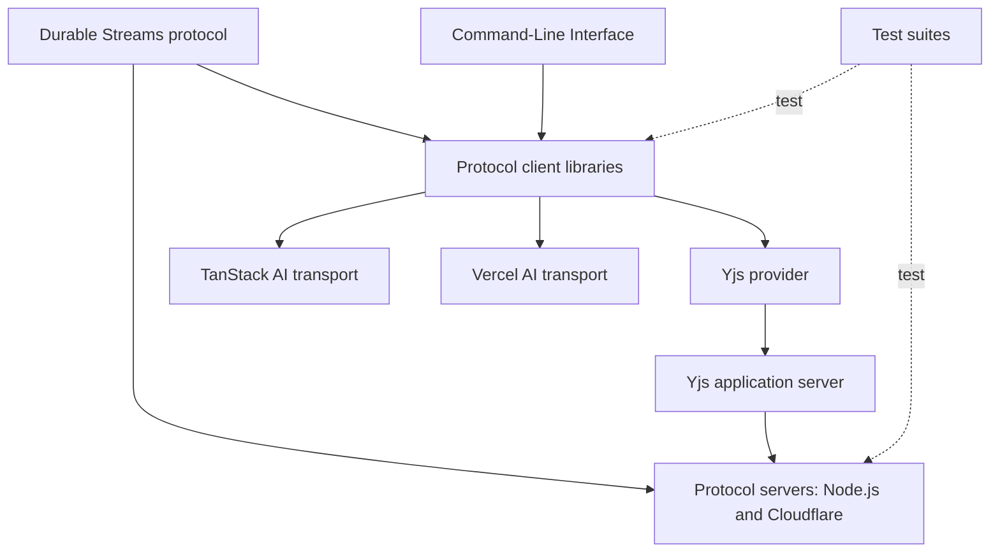
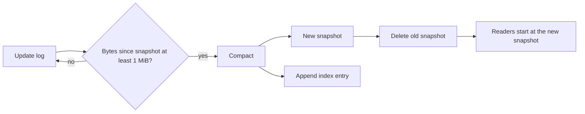
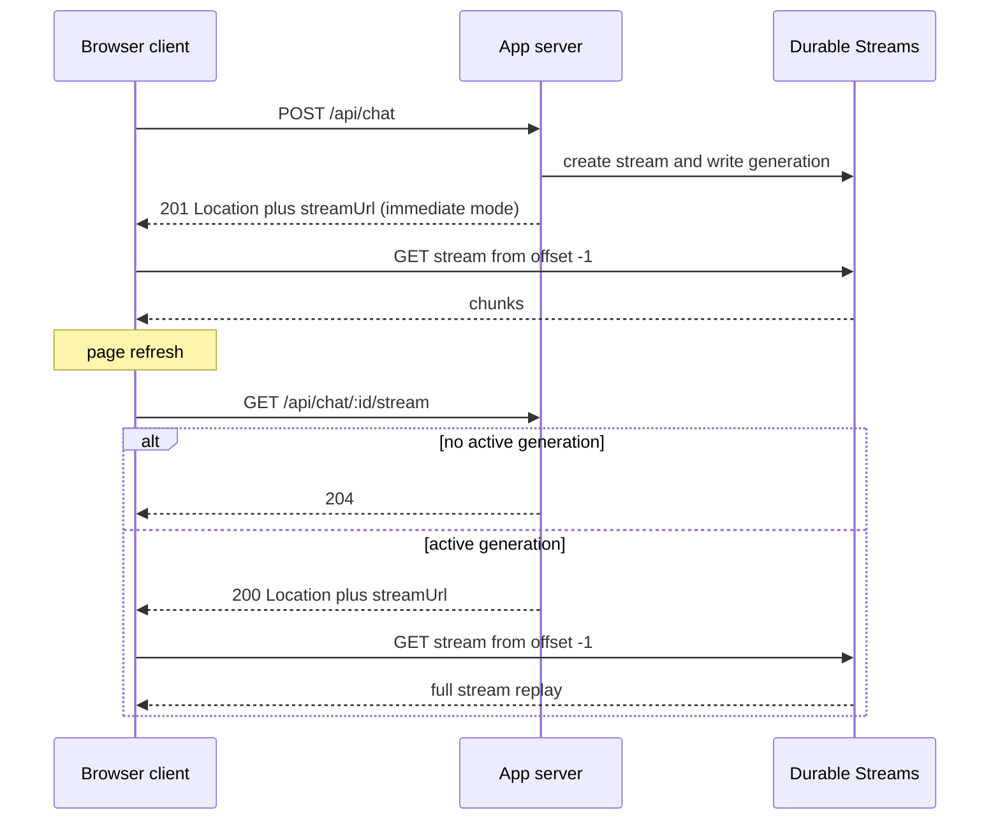
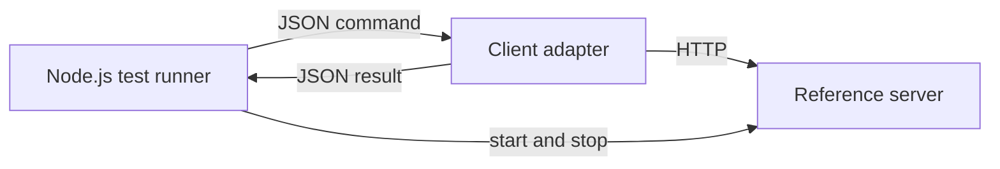

# Integrations and Conformance

This document covers the packages that sit above the base protocol, plus the test suites that check an implementation. The base protocol is in [01-protocol-stream-model.md](01-protocol-stream-model.md) and [02-protocol-operations.md](02-protocol-operations.md).

Two groups are in scope:

| Group | Package directory names | Job |
|-------|-------------------------|-----|
| Integrations | `y-durable-streams`, `tanstack-ai-transport`, `aisdk-transport` | Map a domain model to stream messages |
| Tools and test suites | `cli`, `server-conformance-tests`, `client-conformance-tests` | Give a local command-line client, or check a server or client against the protocol |

The full package names use the `@durable-streams/` scope, for example `@durable-streams/y-durable-streams`.

A **protocol server** answers the protocol operations on a stream path: create, append, read, head, close, and delete. The Node.js server and the Cloudflare server are protocol servers. The Yjs server is not; it is an application server that calls a protocol server. Yjs is a Conflict-free Replicated Data Type (CRDT) library for shared documents, and `__ds` is the reserved subscription control prefix, `/v1/stream/__ds`, that holds webhook and pull-based subscriptions.

The Command-Line Interface (CLI) is both a tool and a client. It is a thin command wrapper around the TypeScript client. The conformance suites do not test it.

The repository also has `docs/stream-fs.md`. That file describes a package that does not exist in the package tree. Section "StreamFS" below states the facts. The diagram includes the artificial intelligence (AI) transports that this document studies.



The Yjs server is not a protocol server. It is an application server that reads and writes Durable Streams through a protocol server. The two test suites check protocol servers and protocol client libraries; they do not test the CLI or the integration packages.

Key insight: the integration packages do not change the base protocol. Each one maps a domain model to stream messages: Yjs maps document updates, and the AI transports map chat chunks. The test suites are not integrations at all. They observe a server or a client from the outside and turn protocol rules into assertions. The stream stays a byte log in every case.

## Yjs over Durable Streams

A normal Yjs deployment uses a WebSocket provider. The `@durable-streams/y-durable-streams` package uses Hypertext Transfer Protocol (HTTP) as the transport. The live read uses Server-Sent Events (SSE) by default, and the `liveMode` option can select long-poll instead.

### Why HTTP

A WebSocket needs a stateful connection and a special load balancer. An HTTP stream works with a standard load balancer and a Content Delivery Network (CDN). The package README gives five benefits:

1. No WebSocket infrastructure.
2. Automatic server-side compaction.
3. Snapshot webhooks for external workers.
4. A stateless server design.
5. Optional presence support through awareness.

The word "stateless" needs care. The `YjsServer` process holds compaction state in memory, but the document itself lives in Durable Streams. A restarted server rebuilds its state from the streams. The server process is therefore disposable, not free of memory.

### The provider

```ts
const provider = new YjsProvider({
  doc,
  baseUrl: "http://localhost:4438/v1/yjs/my-service",
  docId: "my-document",
  awareness,
})
```

This example is from `packages/y-durable-streams/README.md:33`. The options are at `packages/y-durable-streams/src/yjs-provider.ts:69`:

| Option | Type | Default | Meaning |
|--------|------|---------|---------|
| `doc` | `Y.Doc` | required | The document to synchronize |
| `baseUrl` | string | required | Yjs server base, ending at the service name |
| `docId` | string | required | Provider-side name for the route `:docPath`; slashes are allowed |
| `awareness` | `Awareness` | none | Presence instance from `y-protocols/awareness` |
| `headers` | record | `{}` | Extra request headers, for example authorization |
| `liveMode` | `"sse"` or `"long-poll"` | `"sse"` | Live transport |
| `connect` | boolean | `true` | Connect during construction |

The provider class is at `packages/y-durable-streams/src/yjs-provider.ts:136`. It extends `ObservableV2` from the `lib0` library. That base class gives `on()` and `emit()`; it is an event emitter, not a network object.

The provider has three public methods (`yjs-provider.ts:248`, `:290`, `:328`):

| Member | Result |
|--------|--------|
| `connect()` | Start the connection; safe to call when `connect: false` was used |
| `disconnect()` | Stop the connection and set `synced` to `false` |
| `destroy()` | Release listeners and internal state |

Three getters report state: `synced`, `connected`, and `connecting` (`yjs-provider.ts:183-202`).

The provider emits three events:

| Event | Payload | When |
|-------|---------|------|
| `synced` | boolean | `true` after the first full sync and after a reconnect sync; `false` on disconnect or destroy |
| `status` | `"disconnected"`, `"connecting"`, or `"connected"` | The connection state changes |
| `error` | `Error` | A request or stream fails |

The status values are at `packages/y-durable-streams/src/yjs-provider.ts:64`.

The provider exchanges Yjs document updates, not WebSocket messages. It listens to `doc.on("update")`. It encodes each update as a binary `Y.Doc` update and writes it to the document update stream. On the read side, it applies remote updates with `Y.applyUpdate` (`yjs-provider.ts:467`). A reconnect starts a new read from the last seen offset.

The `awareness` object is optional. It carries presence data: cursor position, selection, and user status. The provider republishes its local awareness state every 15 seconds (`AWARENESS_HEARTBEAT_INTERVAL = 15000` at `yjs-provider.ts:131`). The package does not set a stale timeout; the `Awareness` object from `y-protocols` keeps its own clock, and its default removes a client after 30,000 milliseconds (ms) without an update.

### The Yjs server

The package includes an HTTP server. It speaks the Yjs protocol to clients and the Durable Streams protocol to a separate Durable Streams server.

```ts
export class YjsServer {
  private readonly dsServerUrl: string
  private readonly dsServerHeaders: Record<string, string>
  private readonly compactionThreshold: number
```

This block is from `packages/y-durable-streams/src/server/yjs-server.ts:82`.

The constructor options are:

| Option | Type | Default | Meaning |
|--------|------|---------|---------|
| `dsServerUrl` | string | required | Base Uniform Resource Locator (URL) of the Durable Streams server that holds the documents |
| `dsServerHeaders` | record | `{}` | Headers for calls to that server |
| `compactionThreshold` | number | 1,048,576 | Bytes of updates between snapshots |
| `port` | number | `0` | Listen port; `0` asks the operating system for a free port |
| `host` | string | `127.0.0.1` | Listen address |

The option reads are at `packages/y-durable-streams/src/server/yjs-server.ts:100-106`. The README examples pass `port: 4438` explicitly.

The server has two methods and one getter:

| Member | Result |
|--------|--------|
| `start()` | Opens the listener and returns the base URL, for example `http://127.0.0.1:4438` |
| `stop()` | Closes all connections and the listener |
| `url` | The base URL; throws before `start()` |

The members are at `packages/y-durable-streams/src/server/yjs-server.ts:115`, `:149`, and `:167`. The returned URL has no `/v1/yjs/{service}` path; the caller adds that part.

The routes are:

| Route | Methods and behavior |
|-------|----------------------|
| `/v1/yjs/:service/docs/:docPath` | `GET` reads updates; `HEAD` returns metadata; `POST` appends a client update; `PUT` creates the document streams; `DELETE` cascades |
| Same route with `?awareness={name}` | `GET` and `POST` for presence |
| Same route with `?offset=snapshot` | `GET` returns a `307` redirect |
| Same route with `?offset={N}_snapshot` | `GET` returns a snapshot body |
| Same route with `?offset=-1` | `GET` reads the update stream from the start, used when no snapshot exists |
| `/v1/yjs/:service/__ds/subscriptions/{id}` | `PUT`, `GET`, `DELETE` for snapshot subscriptions |
| Any other path | Proxied to `dsServerUrl` |

The request shapes are small:

| Method | Request | Response |
|--------|---------|----------|
| `POST` | Body is one or more lib0-framed Yjs updates; producer headers are forwarded | The update stream response, usually `204` |
| `GET` | Optional `offset` and `live` query values | Update bytes, or an SSE stream |
| `HEAD` | No body | Stream metadata headers |
| `PUT` | Optional initial update body | `201` when created, `200` when the same configuration exists |
| `DELETE` | No body | `204`; `404` when the document is missing |

The `POST` body is the Yjs synchronization protocol framed by the `lib0` library, a utility library for Yjs, and sent over HTTP rather than WebSocket. On the append path, the server passes the frames through unchanged; it does not parse the Yjs document. Compaction does parse the updates, because it must apply them to build a new snapshot.

`PUT` creates the `.updates` stream and the default `.awareness/default` stream. It does not create the `.index` or `.snapshots` streams; compaction creates those later. `PUT` is idempotent because it proxies the stream create rule: a matching create returns `200`, and a different configuration returns `409`.

`DELETE` removes the `.updates` stream first. It then makes a best-effort cascade delete of the snapshot streams named in the index, the `.index` stream, the awareness streams, and the awareness registry stream (`yjs-server.ts:930`). The registry stream is `/v1/stream/yjs/{service}/docs/{docPath}/.awareness-index` (`types.ts:175`). New awareness names are recorded there so that they cannot match a snapshot subscription glob or collide with a named awareness stream. A failure in the cascade is logged but does not change the `204` response.

The `{id}` in the subscription route is chosen by the caller. It must be 1 to 256 characters and must not contain a slash (`snapshot-subscriptions.ts:38`). The server maps it to the delivery identifier `yjs:<base64url service>:<base64url id>` (`snapshot-subscriptions.ts:229`). `base64url` is the URL-safe base64 alphabet. The delivery identifier is the subscription name in the Durable Streams control plane: the Yjs server forwards the request to `/v1/stream/__ds/subscriptions/{deliveryId}` on the Durable Streams server (`snapshot-subscriptions.ts:226`). The Durable Streams server owns the stored subscription, not the Yjs server.

`PUT` is idempotent by the configuration hash. The server hashes the normalized configuration. That configuration includes the type, the pattern, the explicit streams, the delivery settings, the lease Time To Live, and the description. The server compares the hash on a repeated `PUT`. A different hash is a conflict (`PROTOCOL.md:885`). `GET` returns the stored subscription, and `DELETE` removes it.

The route parser is at `yjs-server.ts:66`; the method checks are at `:286` to `:294`. The `:service` part cannot contain a slash. The `:docPath` part can: `project/chapter-1` is valid. The parser normalizes the path and rejects traversal.

The public URL space starts with `/v1/yjs/...`. The internal Durable Streams space starts with `/v1/stream/yjs/...`. The server translates one to the other, and the proxy path passes other Durable Streams requests through.

### Document layout

A document uses four main kinds of stream. The path helpers are defined at `packages/y-durable-streams/src/server/types.ts:112`:

| Stream | Path | Content |
|--------|------|---------|
| Updates | `/v1/stream/yjs/{service}/docs/{docPath}/.updates` | Incremental Yjs updates |
| Index | `/v1/stream/yjs/{service}/docs/{docPath}/.index` | One JavaScript Object Notation (JSON) entry per snapshot |
| Snapshot | `/v1/stream/yjs/{service}/docs/{docPath}/.snapshots/{offset}_snapshot` | Binary Yjs state |
| Awareness | `/v1/stream/yjs/{service}/docs/{docPath}/.awareness/{name}` | Presence updates |

An index entry is `{ "snapshotOffset": "<update-stream offset>", "createdAt": <unix milliseconds> }` (`packages/y-durable-streams/src/server/types.ts:69`). Snapshot discovery reads the whole index stream from `-1` and takes the last entry (`yjs-server.ts:556`).

The snapshot key is the update-stream offset plus the suffix `_snapshot` (`types.ts:181`). The offset names the update-stream position that the snapshot covers. The server creates the key during compaction. A client never invents it. For example, update offset `0000000000000000_0000000000004096` gives the key `0000000000000000_0000000000004096_snapshot`.

Snapshot discovery is a four-step process:

1. The client sends `GET {baseUrl}/docs/{docPath}?offset=snapshot`.
2. The server returns `307 Temporary Redirect`.
3. The `Location` value is the same path with `?offset={N}_snapshot` or `?offset=-1` when no snapshot exists.
4. The client follows the redirect.

The redirect code and the two possible locations are at `packages/y-durable-streams/src/server/yjs-server.ts:521`. When the target is `?offset=-1`, no snapshot exists and the client reads the update stream from its start.

A snapshot read returns the binary body with a `stream-next-offset` header. The value is an opaque offset string of the form `<readSeq>_<byteOffset>`, for example `0000000000000000_0000000000004096`. The `readSeq` part is reserved. The reference server starts it at zero, preserves it on every append, and does not increment it. The `byteOffset` part is the 16-digit byte position in the log. The value points to the update stream position after the snapshot, not to the snapshot stream (`yjs-server.ts:659`). The client sends that value as the offset of its next update read.

### Compaction

Compaction starts when the bytes written to the update stream since the last snapshot reach the threshold:

```ts
shouldTriggerCompaction(state: YjsDocumentState): boolean {
  return (
    !state.compacting && state.updatesSizeBytes >= this.compactionThreshold
  )
}
```

This block is from `packages/y-durable-streams/src/server/yjs-server.ts:1353`.

`updatesSizeBytes` grows by the body length of each update write (`yjs-server.ts:862`) and resets to zero after a compaction (`:1389`). The default threshold is 1 mebibyte, or 1,048,576 bytes:

```ts
const DEFAULT_COMPACTION_THRESHOLD = 1024 * 1024 // 1MB
```

This constant is at `packages/y-durable-streams/src/server/yjs-server.ts:30`. The comment says "1MB"; the value is a mebibyte. This document uses 1,048,576 bytes and the diagram uses 1 MiB.

The steps are:

1. Read the current state: the last snapshot plus the updates after it.
2. Create a new snapshot at the current update offset.
3. Append a new entry to the index stream.
4. Delete the old snapshot.

A new reader starts at the new snapshot and needs less data. The update stream continues; compaction does not create a second update log.



Compaction is asynchronous. The server sets `state.compacting` before it starts and clears the flag in a `finally` block after it finishes (`packages/y-durable-streams/src/server/compaction.ts:80`). A failure before the index write leaves the old snapshot in place, because the index still names it. The failure can also leave a new snapshot stream that the index does not reference. The cleared flag lets the next trigger retry, and the retry writes a new snapshot key.

The index is append-only. The server adds an entry for each snapshot and does not remove the old entry; discovery reads the last entry (`yjs-server.ts:556`). The old snapshot stream is deleted with no grace period. A reader that has already resolved to the old key can get `404` if it reads after the delete.

### Snapshot webhooks

A worker can subscribe to snapshot events. It sends a `PUT` to `{serverUrl}/v1/yjs/{service}/__ds/subscriptions/{id}` with an `application/json` body. Here `{serverUrl}` is the Yjs server base URL, not the Durable Streams server URL. The complete body is:

```json
{
  "type": "webhook",
  "events": ["snapshot.available"],
  "document_pattern": "projects/**",
  "webhook": { "url": "https://archive.example/hooks/yjs" },
  "lease_ttl_ms": 30000,
  "description": "archive"
}
```

All six fields are top-level. The fields `type`, `webhook.url`, and `lease_ttl_ms` come from the base Durable Streams webhook payload. `lease_ttl_ms` is the lease Time To Live (TTL) in milliseconds. The Yjs layer adds the two fields `events` and `document_pattern`. The field `description` is optional. `events` must contain only `snapshot.available`, and `document_pattern` is a glob relative to `{service}/docs/`.

`*` matches one path segment and `**` matches recursively. For example, `projects/**` matches `projects/a` and `projects/a/b`, but not `other/a`. The payload example is at `packages/y-durable-streams/README.md:191`.

`lease_ttl_ms` bounds worker liveness. It is optional, must be an integer from 1,000 to 600,000 ms, and defaults to 30,000 ms (`PROTOCOL.md:872`). A wake is the notification that new work exists. The holder is the worker that owns the lease. The lease starts when the server issues a wake and is extended by valid callback responses (`PROTOCOL.md:1182`). If the lease expires, the server clears the holder and schedules another wake when work remains.

The notification does not carry the snapshot bytes. It says that one or more newer snapshots exist, and it may combine several compactions into one wake. The worker reads the document with `?offset=snapshot` and stores the result.

The worker returns a `2xx` response with body `{ "done": true }` only after it stores the snapshot. That exact body is the acknowledgement; a `2xx` response with a different body leaves the wake open. The server then acks the tail offsets in the wake snapshot and releases the lease (`PROTOCOL.md:1045`). To ack a tail offset is to record that the worker has processed the wake up to the stream position that the wake snapshot held. If new events arrived after the snapshot, the subscription has pending work and gets a new wake. A failure response leaves the wake open for a retry; the protocol does not prescribe the exact failure status.

This feature needs a Durable Streams server with webhook subscriptions. The Cloudflare server returns `404` for the control prefix `__ds` (`packages/server-cloudflare/src/handler.ts:117`), so it cannot deliver this event. The Node.js reference server can. The `__ds` prefix is the subscription control plane described in [03-live-reads-and-subscriptions.md](03-live-reads-and-subscriptions.md).

## TanStack AI transport

The `@durable-streams/tanstack-ai-transport` package connects a TanStack AI chat to a durable stream. It has four jobs:

1. Give the client a `connection` object for `useChat`.
2. Write model chunks to a stream on the server.
3. Echo the user message and return an empty response.
4. Rebuild a chat snapshot for server-side rendering.

`useChat` is the TanStack chat hook. It calls `connection.subscribe()` to read chunks and `connection.send()` to post a user message. `TanStackChunk` is a type alias for `any` (`packages/tanstack-ai-transport/src/types.ts:3`); the chat protocol defines the actual chunk fields.

`resolveUrl` turns a relative path into an absolute URL against a base URL. Here it resolves `readUrl` against `sendUrl`, or `sendUrl` against itself when no read URL is given.

### Client connection

```ts
export function durableStreamConnection(
  options: DurableStreamConnectionOptions
): DurableStreamConnection {
  const sendUrl = options.sendUrl
  const state = {
    streamUrl: options.readUrl
      ? resolveUrl(options.readUrl, sendUrl)
      : resolveUrl(sendUrl, sendUrl),
    offset: options.initialOffset,
  }
```

This block is from `packages/tanstack-ai-transport/src/client.ts:58`.

The two URLs can differ because the write and read paths have different jobs. `sendUrl` accepts a `POST` with `{ messages, data }` and returns any `2xx` response; the client does not read a body from it. `readUrl` is the Durable Streams read URL that carries the model output. A common setup uses a write route at `/api/chat` and a read proxy at `/api/chat-stream`. `resolveUrl` turns a relative path into an absolute URL against the other URL.

The returned connection has two methods:

| Method | Signature | Behavior |
|--------|-----------|----------|
| `subscribe` | `(abortSignal?) => AsyncIterable<TanStackChunk>` | Reads JavaScript Object Notation (JSON) batches with `live: "sse"` and yields each chunk |
| `send` | `(messages, data?, abortSignal?) => Promise<void>` | Posts `{ messages, data }` to `sendUrl` |

The read call is at `client.ts:70`; the send call is at `client.ts:117`.

The connection always uses SSE on the read path. It does not expose long-poll. The `live: "sse"` value is at `client.ts:73`.

`initialOffset` is an opaque Durable Streams offset. It is a string, not a message index. The connection stores it in `state.offset` (`client.ts:66`) and updates that value after each batch (`client.ts:89`). When the caller omits it, `state.offset` is `undefined`, and the Durable Streams client starts the read at its default `-1`, the beginning of the stream. The offset lives in memory for the life of the connection. A page refresh discards it; the server-side loader that renders the chat route must supply a new value.

The read uses JSON mode. Each SSE data event carries a JSON array of chunks, and `readJsonBatchesFromStream` groups the array with the offset after the batch. `subscribe` yields each element as one chunk. Catch-up is the read of stored messages up to the current tail. The batch that reaches the tail carries `upToDate`, which the server marks with the `Stream-Up-To-Date` header. On a first subscribe with no offset, the connection collects the catch-up chunks and yields one `MESSAGES_SNAPSHOT` object when it sees that signal (`client.ts:81` to `:105`). `MESSAGES_SNAPSHOT` is a marker type that carries the catch-up messages as one snapshot.

### Snapshot helper

`materializeSnapshotFromDurableStream` reads a stream with `live: false` and returns:

| Value | Meaning |
|-------|---------|
| `messages` | The chat messages in order |
| `offset` | Optional; the next offset reported by the read response |

The function takes an options object with `readUrl`, optional `headers`, optional `offset`, and optional `fetchClient` (`client.ts:340`). The return type is at `packages/tanstack-ai-transport/src/client.ts:346`. The loader sends both values to the client. The client uses `offset` as `initialOffset`, so the first subscribe continues after the snapshot.

### Server helper

`toDurableChatSessionResponse` does three steps in one call:

1. Echo the new user message into the stream.
2. Pipe the model response chunks into the stream.
3. Return an empty HTTP response.

The response status is `202` in `immediate` mode and `200` in `await` mode. The option `mode` selects the mode and defaults to `immediate` (`server.ts:286`). In `await` mode the body is empty and the call returns after the writer finishes. In `immediate` mode the call returns `202`. When the platform supplies one, a `waitUntil` hook (a platform function that keeps the runtime alive until a promise settles) keeps the background write alive. The stream is now the source of truth for the chat, not the HTTP response body. The helper is at `packages/tanstack-ai-transport/src/server.ts:283`.

## Vercel AI Software Development Kit (SDK) transport

The `@durable-streams/aisdk-transport` package does the same job for that kit. The client swaps the default transport for `createDurableChatTransport` (`packages/aisdk-transport/src/client.ts:93`). The server wraps the user interface (UI) message stream with `toDurableStreamResponse`.

```ts
export async function toDurableStreamResponse(
  options: ToDurableStreamResponseOptions
): Promise<Response> {
  const mode = options.mode ?? `immediate`
  const contentType = options.stream.contentType ?? DEFAULT_CONTENT_TYPE
  const writeUrl = resolveUrl(options.stream.writeUrl)
  const readUrl = resolveUrl(options.stream.readUrl ?? options.stream.writeUrl)
```

This block is from `packages/aisdk-transport/src/server.ts:95`.

The content type default is `application/json` (`server.ts:5`). The function has two modes:

| Mode | Status | Body |
|------|--------|------|
| `immediate` | `201` | `{ streamUrl }` plus a `Location` header |
| `await` | `200` | `{ streamUrl, finalOffset }` plus a `Location` header |

`finalOffset` is an offset string for the position after the last written chunk. Do not parse it. It is an opaque value like every protocol offset; the reference server uses the `<readSeq>_<byteOffset>` form, but a client must not depend on that form. It is not the sentinel `-1` (the start of the stream) or `now` (the tail), and it is not the snapshot key `{N}_snapshot`.

The immediate path starts a background writer and returns at once (`server.ts:138`). A background write failure is written to the console and, when the platform supplies `waitUntil`, passed to that hook (`server.ts:122` and `:125`). `waitUntil` is available on platforms such as Cloudflare Workers. It does not change the response. The client does not receive an error after the `201`. The await path waits for the writer and returns after the stream is complete (`server.ts:114`).

The AI SDK package uses a local `resolveUrl` with one argument (`server.ts:7`). That helper only turns a `URL` object into a string. It does not resolve a relative path against a base, unlike the TanStack `resolveUrl` with two arguments.

`Location` points to the read URL, not to a redirect endpoint. A cross-origin browser can read `Location` only when the server exposes it; the transport sets `Access-Control-Expose-Headers: Location` (`server.ts:133`). The JSON body is the fallback when the header is not visible. The client tries `Location` first and falls back to `streamUrl` in the body (`client.ts:137` and `:183`).

### Resume after refresh

A generation is one model response run. The recommended flow stores the stream path with the chat record:

1. At generation start, save `activeStreamId = streamPath`. The field name says "id"; the value is the stream path.
2. At generation end, save the final messages and clear `activeStreamId`.
3. Add a reconnect endpoint at `GET /api/chat/:id/stream`. Here `:id` is the chat identifier, not the stream path.
4. The endpoint returns `204` when no generation is active.
5. Otherwise it returns `200` with a `Location` header and `{ streamUrl }`.

This flow is a recommendation in `packages/aisdk-transport/README.md:68-95`. The reconnect endpoint is application code, not a library route. The method is `GET`; authentication is whatever the application uses.

The AI SDK transport provides `reconnectToStream` (`packages/aisdk-transport/src/client.ts:159`). It calls the reconnect endpoint and gets the URL. The endpoint is `reconnectApi` when the caller sets it, or `${api}/${chatId}/stream` by default (`client.ts:161`). The transport does not pass a stored offset to the reader. `readUiMessageChunksFromDurableStream` calls the client `stream()` with no `offset` value (`client.ts:84`). So the Durable Streams client applies its own default `-1`, the sentinel that means "beginning of the stream", and replays the whole stream (`client.ts:79`).

The stream path is stored per chat and replaced at the start of each generation. The README does not say whether an application gives each generation a new stream path or reuses one path for the chat. The stored value decides the replay scope: a path for one generation replays that generation, and a reused path also replays earlier turns.



The diagram shows an `immediate` response and a direct read URL. If `readUrl` points at an application proxy, the browser leg to Durable Streams becomes a leg to that proxy and then to Durable Streams. The client behaviour is the same.

Key insight: the AI SDK transport resumes by replaying the whole stream, not by resuming an offset. The durable stream is the log; the client rebuilds the UI from the start. The TanStack transport is different: it carries `initialOffset` and reads only the new part, but that offset comes from the server-side snapshot loader and is lost on a page refresh. Both are valid, but they put the resume cost in different places.

## The command-line interface

The command-line interface (CLI) is a small client for local testing. It installs as `@durable-streams/cli`. The package declares three executable names (`packages/cli/package.json:6`):

| Executable | Entry point | Purpose |
|------------|-------------|---------|
| `cli` | `dist/index.js` | Installed command |
| `durable-stream` | `dist/index.js` | Second name for the same command |
| `durable-stream-dev` | `bin/durable-stream-dev.mjs` | Runs the TypeScript source through `tsx` |

The names `cli` and `durable-stream` start the same built file. The name `durable-stream-dev` is a development wrapper. It starts `tsx` on `src/index.ts`, so a global link shows source changes without a build step (`packages/cli/bin/durable-stream-dev.mjs:18` and `:21`). `tsx` is a TypeScript execution tool that runs a `.ts` file directly through Node.js. The wrapper passes the remaining command-line arguments to that process (`bin/durable-stream-dev.mjs:21-23`).

The default base URL is:

```ts
const STREAM_URL = process.env.STREAM_URL || `http://localhost:4437/v1/stream`
```

This line is from `packages/cli/src/index.ts:32`.

| Command | Action | Options |
|---------|--------|---------|
| `create <id>` | Create a stream | `--content-type`, `--json` |
| `write <id> <data>` | Append data, from the argument or standard input | `--content-type`, `--json`, `--batch-json` |
| `read <id>` | Read the stream from the start and follow it live | None |
| `delete <id>` | Delete the stream | None |

The `--content-type` option defaults to `application/octet-stream` (`packages/cli/src/index.ts:207`). The `--json` option is a short form of `--content-type application/json` (`packages/cli/README.md:84`). The `read` command has no offset option and no live-mode option. It always reads from `-1`, the sentinel for the start of the stream, and follows the stream: `stream.stream({ live: true })` (`index.ts:422-423`). The CLI writes each chunk to standard output.

The command dispatch is a switch:

```ts
switch (command) {
  case `create`: {
    const { streamId, commandArgs } = getStreamIdAndArgs()
```

This block is from `packages/cli/src/index.ts:555`.

`STREAM_AUTH` is an environment variable, like `STREAM_URL`. The global `--auth` option overrides `STREAM_AUTH`; the help text states this directly (`packages/cli/src/index.ts:187`). The CLI sends the value as the `Authorization` header exactly as given, for example `Bearer my-token`. The CLI does not add a prefix. The fallback is used only when `--auth` is absent (`index.ts:139-150`).

For non-empty input, the two JSON flags differ in both the number of append requests and the stored messages:

- `--json` parses the input and sends one `stream.append(JSON.stringify(parsed))` call (`index.ts:388`). The client wraps that body in one array, so an input array of `n` items reaches the server as one nested array. The server stores one message with that array value.
- `--batch-json` calls `flattenJsonForAppend` on the parsed value and sends one `stream.append` for each item (`index.ts:287-296`). An input array of `n` items causes `n` requests, and each request stores one message.

The difference comes from the client wrapper. The client wraps every JSON append body in an array, and the server flattens exactly one level (`packages/client/src/stream.ts:511-516` and `:643`). For example, `--json` with `[{"a":1},{"b":2}]` sends one request with body `[[{"a":1},{"b":2}]]`. The server flattens the outer array: it sees one element, the inner array, and stores that element as one message. `--batch-json` sends two requests, each with body `[{"a":1}]` or `[{"b":2}]`, and stores two messages. An empty array has the same split: `--batch-json` sends no request and writes zero messages, while `--json` sends one request that stores one message with the value `[]`.

## StreamFS

`docs/stream-fs.md` describes a package named `@durable-streams/stream-fs`. The package does not exist in `packages/`. There is no source file for `StreamFilesystem`, `streamFsTools`, or `PreconditionFailedError` outside that document. The documented install command is:

```bash
pnpm add @durable-streams/stream-fs
```

That command is at `docs/stream-fs.md:17`. The package is not published from this repository, so the command would fail. The document also shows `import { StreamFilesystem } from "@durable-streams/stream-fs"` at `:23`. That import has no source behind it.

The document describes a shared filesystem for AI agents:

| Feature | Documented behavior |
|---------|---------------------|
| Base path | `baseUrl` plus `streamPrefix`, for example `http://localhost:4437` and `/fs/myproject` (`docs/stream-fs.md:25-28`) |
| Metadata | One stream at `/_metadata` (`:35`) |
| Content | One stream per file at `/_content/{id}` (`:36`) |
| File operations | `createFile`, `readFile`, `readTextFile`, `writeFile`, `move`, `deleteFile` |
| Directory operations | `mkdir`, `rmdir`, `list`, `exists`, `stat`, `isDirectory` |
| Watch | Change events in the style of Chokidar, a file-watching library: `add`, `change`, `unlink`, `addDir`, `unlinkDir` |
| Stale writes | `PreconditionFailedError` when a write loses a race |
| Text edits | Text patch support for efficient changes |
| Tools | `streamFsTools` for agent tool definitions |

The constructor requires `await fs.initialize()` before the first file operation (`docs/stream-fs.md:30`). The `watch` method takes a `path` and a `recursive` flag. The watcher emits an `all` event and a `ready` event (`:64-71`). The document does not state how `streamPrefix` joins the two paths above; it gives the prefix and the two paths but no join example.

The design maps filesystem state to Durable Streams and refers to the repository's `docs/concepts.md` and `docs/json-mode.md`. This document does not treat StreamFS as an implemented package. It records the design and the missing source.

## Server conformance tests

`packages/server-conformance-tests` tests a server over HTTP. It does not import the server code. It sends requests and checks responses.

The suite has many `describe` blocks. The exact group names show the scope. In these names, Time To Live is written as `TTL`, and Entity Tag is written as `ETag`. A fork is a new stream that inherits the messages of a source stream up to a chosen offset.

| Group | Starts at |
|-------|-----------|
| `Basic Stream Operations` | `src/index.ts:298` |
| `Append Operations` | `:425` |
| `Read Operations` | `:475` |
| `Long-Poll Operations` | `:528` |
| `HTTP Protocol` | `:593` |
| `Browser Security Headers` | `:978` |
| `TTL and Expiry Validation` | `:1190` |
| `Case-Insensitivity` | `:1267` |
| `Content-Type Validation` | `:1332` |
| `HEAD Metadata` | `:1395` |
| `Offset Validation and Resumability` | `:1467` |
| `Protocol Edge Cases` | `:1990` |
| `Long-Poll Edge Cases` | `:2278` |
| `TTL and Expiry Edge Cases` | `:2454` |
| `HEAD Metadata Edge Cases` | `:2612` |
| `TTL Expiration Behavior` | `:2665` |
| `Caching and ETag` | `:3176` |
| `Chunking and Large Payloads` | `:3315` |
| `Read-Your-Writes Consistency` | `:3418` |
| `SSE Mode` | `:3521` |
| `JSON Mode` | `:4573` |
| `Property-Based Tests (fast-check)` | `:4943` |
| `Idempotent Producer Operations` | `:5921` |
| `Stream Closure` | `:7057` |
| `Fork - Creation` | `:8179` |
| `Fork - Reading` | `:9250` |
| `Fork - Appending` | `:9481` |
| `Fork - Recursive` | `:9705` |
| `Fork - Live Modes` | `:9994` |
| `Fork - Deletion and Lifecycle` | `:10194` |
| `Fork - TTL and Expiry` | `:10684` |
| `Fork - JSON Mode` | `:11070` |
| `Fork - Edge Cases` | `:11149` |
| `Reserved subscription APIs` | `:11354` |

The property group has seven sub-groups. They are `Byte-Exactness Property` (`:4944`), `Operation Sequence Properties` (`:5118`), `Immutability Properties` (`:5340`), `Offset Validation Properties` (`:5400`), `Sequence Ordering Properties` (`:5446`), `Concurrent Writer Stress Tests` (`:5534`), and `State Hash Verification` (`:5743`). Each uses `fc.assert` and `fc.asyncProperty` from `fast-check`, a property-based testing library. In this style, a test generates many inputs and checks that one rule holds for all of them. The alias `fc` is the library import. The state hash group hashes content with the Fowler-Noll-Vo (FNV-1a) hash (`:5746-5748`) and checks that a replay produces the same hash (`:5758`).

### Use

The command-line form is:

```bash
npx @durable-streams/server-conformance-tests --run http://localhost:4437
```

The flag `--run` means "run the tests once and exit". It is the form for continuous integration. The other mode is `--watch <path>`, which reruns the tests when a source path changes (`packages/server-conformance-tests/README.md:45`).

The programmatic form takes a config object:

```ts
runConformanceTests(config)
```

The function returns `void` (`src/index.ts:287`). It does not run tests by itself. It calls `describe` and `test`, so it registers the tests in the test runner that calls it. The caller must be inside a test file, for example a `vitest` file. The reference pattern calls `runConformanceTests(config)` at file top level, and registers two hooks around that call. A `beforeAll` hook starts the server and assigns `config.baseUrl`, and an `afterAll` hook stops the server (`packages/server-conformance-tests/README.md:63-71`). The top-level call registers the tests during file load. The hooks run later, when the test runner starts the file. The suite reads `options.baseUrl` through a getter on each call, so the later assignment works (`src/index.ts:290`).

`ConformanceTestOptions` has three fields (`src/index.ts:20`):

| Field | Type | Default | Meaning |
|-------|------|---------|---------|
| `baseUrl` | string | required | Server under test |
| `longPollTimeoutMs` | number | 20,000 | Long-poll timeout in milliseconds; the test timeout is this value plus 1,000 |
| `subscriptions` | boolean | false | Enable the `Reserved subscription APIs` group |

The suite starts no server. The caller starts the server and passes its base URL. This design lets one suite test the Node.js server and the Cloudflare server.

The `subscriptions` flag is a gate, not a filter. The suite uses `describe.runIf(options.subscriptions)` for the `Reserved subscription APIs` group (`src/index.ts:11354`). When the flag is false, the runner does not register that group, so its tests appear as skips or not at all.

The Cloudflare README reports **326 passed, 0 failed**, with six skips (`packages/server-cloudflare/README.md:66`). It says the six skips are the `subscriptions`-gated tests. This result does not contradict the missing `__ds` plane: the skipped tests are the ones that would exercise it. A server that sets `subscriptions: true` without that plane fails those tests.

## Client conformance tests

`packages/client-conformance-tests` tests a client in any language. The design has three processes:

1. A Node.js test runner.
2. A client adapter in the target language.
3. A reference server in TypeScript.



The runner starts the adapter as a subprocess from the executable path that the caller supplies, for example `--run ./my-python-adapter.py` (`packages/client-conformance-tests/README.md:56`). The runner and the adapter talk through standard input and standard output, one JSON message per line. The runner owns the reference server lifecycle: it starts the TypeScript server, gives the URL to the adapter, runs the cases, and stops the server. A client adapter never starts a server.

### Adapter protocol

The first command is always `init`:

```json
{"type":"init","serverUrl":"http://localhost:3000"}
```

The adapter replies with its name and version:

```json
{"type":"init","success":true,"clientName":"my-client","clientVersion":"1.0.0","features":{"batching":true,"sse":true,"longPoll":true}}
```

Both examples are at `packages/client-conformance-tests/README.md:128` and `:131`.

The command set is below. A producer epoch is the generation number that fences an older writer. A producer sequence number is the per-batch counter. The `append` command names the epoch field `producerEpoch`; the idempotent commands name it `epoch`. The two names carry the same value.

| Command | Required and optional fields | Meaning |
|---------|------------------------------|---------|
| `init` | `serverUrl`, `timeoutMs?` | Handshake; gives the reference server URL |
| `create` | `path`, `contentType?`, `ttlSeconds?`, `expiresAt?`, `closed?`, `data?` | Create a stream |
| `connect` | `path` | Attach to an existing stream without creating it |
| `append` | `path`, `data`, `binary?`, `seq?`, `producerId?`, `producerEpoch?`, `producerSeq?` | Append data |
| `idempotent-append` | `path`, `data`, `producerId`, `epoch`, `autoClaim` | Append through the client producer |
| `idempotent-append-batch` | above plus `items`, `maxInFlight?` | Batch append through the client producer |
| `idempotent-close` | `path`, `producerId`, `epoch`, `data?`, `autoClaim` | Close through the client producer |
| `idempotent-detach` | `path`, `producerId`, `epoch`, `headers?` | Detach the client producer without closing the stream |
| `close` | `path`, `data?`, `contentType?` | Close a stream |
| `server-close` | `path`, `streamClosed: true`, `data?`, `contentType?`, `headers?` | Close a stream by a direct server request; the runner, not the adapter, performs it |
| `read` | `path`, `offset?`, `live?`, `timeoutMs?`, `maxChunks?`, `waitForUpToDate?` | Read in catch-up or live mode |
| `head` | `path` | Read stream metadata |
| `delete` | `path` | Delete a stream |
| `set-dynamic-header`, `set-dynamic-param`, `clear-dynamic` | command-specific fields | Change the test header or query parameter between requests |
| `benchmark` | `iterationId`, `operation` | Time one operation and report the duration |
| `validate` | `target` | Test client-side validation of retry options or producer options |
| `shutdown` | none | End the adapter process |

The union `TestCommand` lists every command (`packages/client-conformance-tests/src/protocol.ts:395-414`). The `live` field has four values: `false` for catch-up only, `true` for catch-up then automatic selection, `"long-poll"`, or `"sse"` (`:159`). The `data` field is a string for text and a base64 string for binary data, with `binary: true` (`:65-68`). The `autoClaim` field tells the adapter to claim a new producer epoch after a `403` response (`:93-94`).

The `features` object in the `init` reply controls which tests run. Each test case and each suite can have a `requires` list, such as `["sse"]`. When the client reports `"sse": false`, the runner marks the test as skipped, not failed (`packages/client-conformance-tests/src/runner.ts:1311`). The result keeps a `skipReason` such as `missing features: sse` (`runner.ts:1319`). The full feature list is `batching`, `sse`, `longPoll`, `auto`, `streaming`, `dynamicHeaders`, `retryOptions`, `batchItems`, and `strictZeroValidation` (`protocol.ts:431`). Three names need a definition. `auto` means the client can catch up and then select SSE or long-poll itself (`:438-439`). `streaming` means the client can return a read as a stream of chunks (`:440-441`). `strictZeroValidation` means the client rejects a zero option value, where a client such as Go treats zero as "use the default" (`:448-449`). A test's `requires` list may use a hyphen form. The function `featureToProperty` maps `dynamic-headers` to the camelCase property `dynamicHeaders` before the runner reads the `init` reply (`runner.ts:1255` and `:1264`). The adapter should report the camelCase names in that reply.

An error result carries an error code. The HTTP status is optional:

```ts
export interface ErrorResult {
  type: `error`
  success: false
  commandType: TestCommand[`type`]
  status?: number
  errorCode: string
  message: string
  details?: Record<string, unknown>
}
```

This block is from `packages/client-conformance-tests/src/protocol.ts:693`. The field `status` is optional because a fault such as `NETWORK_ERROR` or `TIMEOUT` has no HTTP response. The field `errorCode` is required.

The code list is:

| Code | Meaning |
|------|---------|
| `NETWORK_ERROR` | Network failure |
| `TIMEOUT` | Operation timeout |
| `CONFLICT` | Stream already exists |
| `NOT_FOUND` | Stream missing |
| `SEQUENCE_CONFLICT` | Sequence number conflict |
| `STREAM_CLOSED` | Stream is closed |
| `INVALID_OFFSET` | Bad offset |
| `UNEXPECTED_STATUS` | Unexpected HTTP status |
| `PARSE_ERROR` | Bad response body |
| `INTERNAL_ERROR` | Adapter failure |
| `NOT_SUPPORTED` | Feature not supported |
| `INVALID_ARGUMENT` | Bad client argument |

The code list is at `packages/client-conformance-tests/src/protocol.ts:789`.

A new language client adds one executable adapter. It does not copy the test cases.

## Coverage and counts

The repository reports different numbers in different places:

| Source | Count | What the count means |
|--------|-------|----------------------|
| `CLIENT_MATURITY.md` | 110/110 | TypeScript, Python, and Go each pass 110 of 110 tests |
| .NET client README | 177 | 177 tests pass |
| Swift client README | 179/179 | 179 of 179 tests pass |
| Cloudflare server README | 326 passed | 326 server tests pass; 0 fail; 6 skip |
| `CLIENT_MATURITY.md:90` | To Be Determined (TBD) | No conformance run is published for Java |

These numbers are copied from the named source files at commit `461b4026`. The files give no run date, no test-suite version, and no server commit for the run. They also cover different suites: the client suites test a client, and the server suite tests an HTTP server. The repository does not state one current count. The client counts are not directly comparable with the server count.

Two mechanisms explain a lower client count. First, the suite grows over time, so an older run has fewer cases. Second, a client that declares fewer features skips the tests with a matching `requires` entry, and a skipped test is not in the pass count (`runner.ts:1311-1319`). The README files do not record the suite commit or the declared features, so this document cannot attribute a specific difference to one mechanism. Document [09-language-clients.md](09-language-clients.md) gives the client comparison.

## Related documents

- [06-typescript-client.md](06-typescript-client.md) gives the client that the integrations call.
- [07-state-protocol.md](07-state-protocol.md) gives another higher layer on the same protocol.
- [09-language-clients.md](09-language-clients.md) gives the clients that the adapter protocol tests.
- [08-server-implementations.md](08-server-implementations.md) gives the servers that the conformance suite tests.
- [03-live-reads-and-subscriptions.md](03-live-reads-and-subscriptions.md) gives the `__ds` webhook plane.
- [README.md](README.md) is the package index.
