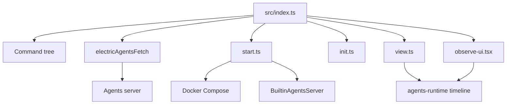
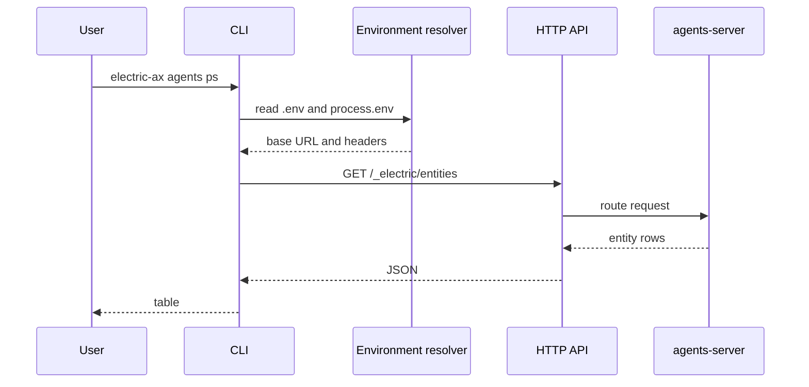

# Overview of the electric-ax package

This document describes the module map, the environment variables, and the Hypertext Transfer Protocol (HTTP) endpoints that the command-line interface (CLI) uses.

## Module map

| Module | Responsibility |
|--------|----------------|
| `src/index.ts` | Command definition, handlers, environment resolution, help text |
| `src/start.ts` | Docker Compose control and built-in runtime startup |
| `src/init.ts` | Project scaffolding |
| `src/view.ts` | One-shot conversation rendering |
| `src/observe-ui.tsx` | Live terminal user interface |
| `src/completions.ts` | Shell completion |
| `src/env.ts` | `.env` file parser and key resolution |
| `src/entity-api.ts` | Entity address (Uniform Resource Locator, URL) construction |
| `src/entity-stream-db.ts` | Stream database for local reads of entity event streams |
| `src/shape-fetch.ts` | One-time fetch of an Electric shape |
| `src/api-types.ts` | Response shapes |
| `src/types-table.tsx` | Renderer for the entity type table |
| `src/prompt-api-key.ts` | Interactive key prompt |
| `src/version.ts` | Build-time version constants |

The `agents-runtime` package supplies the entity registry, the handlers, and the timeline builders. The `BuiltinAgentsServer` class is the built-in runtime. It serves the Horton entity type, so this document treats "built-in runtime" and `BuiltinAgentsServer` as the same component.

An entity event stream is an append-only ordered log. An Electric shape is a filtered view of a PostgreSQL table that the Electric sync service sends to clients.



## The HTTP surface

Every command sends a request through one wrapper.

```ts
async function electricAgentsFetch(
  env: ElectricCliEnv,
  path: string,
  opts: RequestInit = {}
): Promise<Response> {
  try {
    return await fetch(appendPathToUrl(env.electricAgentsUrl, path), {
      ...opts,
      headers: {
        'content-type': `application/json`,
        ...env.electricAgentsHeaders,
        ...opts.headers,
      },
    })
  } catch (error) {
    fail(
      `Could not connect to ${env.electricAgentsUrl} — is the Electric Agents server running?\n` +
        `  Set ELECTRIC_AGENTS_URL to point to a different server.\n` +
        `  Original error: ${getErrorMessage(error)}`
    )
  }
}
```

Source: `packages/electric-ax/src/index.ts:389-410`.

The wrapper adds the principal header and any extra headers. It also turns a connection failure into a clear message with a remedy.

The endpoints are:

| Operation | Method | Path |
|-----------|--------|------|
| List entity types | GET | `/_electric/entity-types` |
| Inspect entity type | GET | `/_electric/entity-types/<name>` |
| Delete entity type | DELETE | `/_electric/entity-types/<name>` |
| List entities | GET | `/_electric/entities` |
| Spawn entity | PUT | `/_electric/entities/<url>` |
| Send message | POST | `/_electric/entities/<url>/send` |
| Send signal | POST | `/_electric/entities/<url>/signal` |
| Read shape rows | GET | `/_electric/electric/v1/shape` |
| Health check | GET | `/_electric/health` |

Source: `packages/electric-ax/src/index.ts:462`, `500`, `512-515`, `525-529`, `552-555`, `587-590`, `686-692`, `715-718`; `packages/electric-ax/src/start.ts:294`; `packages/electric-ax/src/shape-fetch.ts:15`.

The table groups the endpoints. [01-cli-commands.md](01-cli-commands.md) lists each command that calls an endpoint, with its own source line.

## Programmatic exports

The package main entry is `src/index.ts`. It exports a programmatic surface in addition to the CLI. The `./entity-stream-db` subpath exports the stream database helper.

| Symbol | Kind | Source |
|--------|------|--------|
| `DEFAULT_ELECTRIC_AGENTS_URL` | Constant | `src/index.ts:21` |
| `StartedDevEnvironment`, `StoppedDevEnvironment`, `StartedBuiltinAgentsEnvironment` | Types | `src/index.ts:22-24` |
| `ElectricCliEnv` | Interface | `src/index.ts:31-35` |
| `SpawnCommandOptions` | Interface | `src/index.ts:37-39` |
| `SendCommandOptions` | Interface | `src/index.ts:41-44` |
| `EntitySignal` | Type | `src/index.ts:46-53` |
| `SignalCommandOptions` | Interface | `src/index.ts:65-68` |
| `ObserveCommandOptions` | Interface | `src/index.ts:70-72` |
| `PsCommandOptions` | Interface | `src/index.ts:74-78` |
| `StartCommandOptions` | Interface | `src/index.ts:80` |
| `StartBuiltinCommandOptions` | Interface | `src/index.ts:82-84` |
| `StopCommandOptions` | Interface | `src/index.ts:86-88` |
| `ElectricCliHandlers` | Interface | `src/index.ts:90` |
| `getElectricCliEnv` | Function | `src/index.ts:170` |
| `formatQuickstartBackendStartedMessage` | Function | `src/index.ts:346` |
| `resolveCommandPrefix` | Function | `src/index.ts:372` |
| `createElectricCliHandlers` | Function | `src/index.ts:758` |
| `createElectricProgram` | Function | `src/index.ts:850` |
| `run` | Function | `src/index.ts:1071` |
| `EntityStreamDB` | Type | `src/entity-stream-db.ts:17` |
| `createEntityStreamDB` | Function | `src/entity-stream-db.ts:30` |

The other modules are build entries, but the package does not list them as subpaths. Their functions are internal. The three start environment types in the table come from `src/start.ts`, through the re-export at `src/index.ts:22-24`.

## Entity URL construction

```ts
export function entityApiPath(entityUrl: string, suffix = ``): string {
  return `/_electric/entities${withLeadingSlash(entityUrl)}${suffix}`
}
```

Source: `packages/electric-ax/src/entity-api.ts:7-9`.

The function adds a leading slash to the entity URL when it is absent. A user can type `horton/abc` or `/horton/abc`. The `horton` segment is the entity type of the built-in agent. The `abc` segment is the instance identifier.

## Environment variables

| Variable | Default | Purpose |
|----------|---------|---------|
| `ELECTRIC_AGENTS_URL` | `http://localhost:4437` | Server base address |
| `ELECTRIC_AGENTS_IDENTITY` | `<username>@<hostname>` | Sender identity |
| `ELECTRIC_AGENTS_PRINCIPAL` | `user:<identity>` | Principal key |
| `ELECTRIC_AGENTS_SERVER_HEADERS` | none | Extra headers as JavaScript Object Notation (JSON) |
| `ELECTRIC_AGENTS_PORT` | `4437` | Dev environment port |
| `ELECTRIC_AGENTS_COMPOSE_PROJECT` | `electric-agents` | Docker project name |
| `ELECTRIC_AGENTS_PULL_WAKE_RUNNER_ID` | `builtin-<identity-slug>`, or `builtin-agents` when the identity is absent | Runner identifier |
| `PULL_WAKE_RUNNER_ID` | none | Alternate runner identifier |
| `ANTHROPIC_API_KEY` | none | Model key for the built-in runtime |
| `ELECTRIC_IMAGE_TAG` | `latest` | Electric image tag |
| `ELECTRIC_AGENTS_SERVER_IMAGE_TAG` | build value or `latest` | Agents server image tag |

The CLI reads the `.env` file from the current directory. The process environment has higher priority. A value from the process environment wins. The CLI uses the file value only when the process environment has no value for the variable.

The build writes the `agents-server` package version into `ELECTRIC_AGENTS_SERVER_IMAGE_TAG`. The canary pipeline can overwrite that value. See [03-package-and-publish.md](03-package-and-publish.md) for the build plugin.

A pull-wake runner is the process that claims pending wake work from the server and runs the entity handlers. `ELECTRIC_AGENTS_PULL_WAKE_RUNNER_ID` is the primary name for the runner identifier. `PULL_WAKE_RUNNER_ID` is the alternate name. The default identifier appends an identity slug. To make the slug, the code replaces each character that is not valid in an identifier in the identity.

## The principal fallback

```ts
function defaultPullWakeOwnerPrincipal(): string {
  return principalUrlFromConfig(
    principalKeyFromIdentity(`${userInfo().username}@${hostname()}`)
  )
}
```

Source: `packages/electric-ax/src/start.ts:133-137`.

The principal key accepts four prefixes: `user`, `agent`, `service`, and `system`. A value without one of these prefixes gets `user:` in front. The function returns the principal that owns the pull-wake runner. The CLI sends a principal in the `Electric-Principal` header. The runner and the CLI therefore identify the same caller.

## Data flow for one command



In the diagram, the HTTP application programming interface (API) is the request router inside the agents server. The two participants show two roles, not two network hops.

## Aha: the CLI reuses runtime code for rendering

The `view` command does not parse event streams by itself. It calls `buildEntityTimelineData` and `buildSections` from `agents-runtime`. The same functions power the server user interface.

Key insight: this keeps the CLI view consistent with the browser view. A change to the timeline model changes both surfaces. The CLI carries no second implementation of conversation formatting.

## Related documents

- [README.md](README.md) for the command tree.
- [01-cli-commands.md](01-cli-commands.md) for the full command reference.
- [02-project-templates-and-dev-workflow.md](02-project-templates-and-dev-workflow.md) for local setup.
- [../README.md](../README.md) for the full exploration index.
