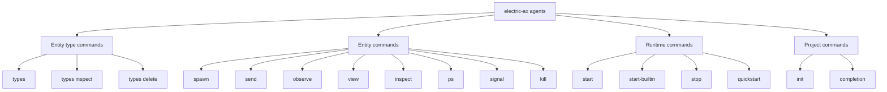
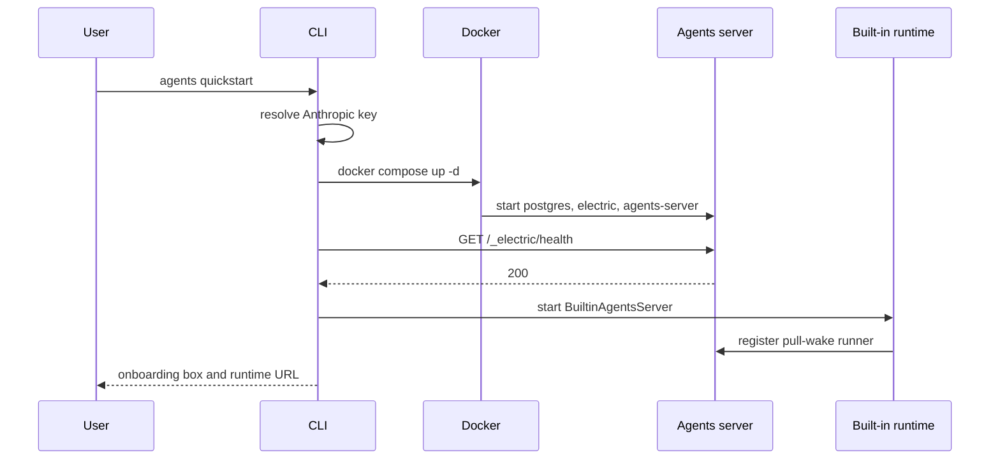

# Command-line commands

Every command starts with the `agents` subcommand of the electric-ax command-line interface (CLI). This document lists each command, its flags, its server call, and its output. A command can start with the binary name `electric-ax` or `electric`. The binary name and the subcommand are not interchangeable. `electric-ax kill` is not a command.

A stream is an append-only ordered log of events for one entity. An offset is a position in that stream. The main stream holds the conversation.

## Command groups



## Entity type commands

### `agents types`

Lists all entity types. It calls `GET /_electric/entity-types` and renders a table grouped by the `serve_endpoint` field. The `serve_endpoint` field holds the address that the server calls to fetch the type definition.

Source: `packages/electric-ax/src/index.ts:462`, `packages/electric-ax/src/index.ts:875-879`.

### `agents types inspect <name>`

Shows one entity type as formatted JavaScript Object Notation (JSON). It calls `GET /_electric/entity-types/<name>`.

Source: `packages/electric-ax/src/index.ts:512-515`.

### `agents types delete <name>`

Deletes one entity type. It calls `DELETE /_electric/entity-types/<name>` and prints `Deleted entity type <name>`.

Source: `packages/electric-ax/src/index.ts:525-529`.

## Entity commands

### `agents spawn <url-path>`

Creates an entity from a typed Uniform Resource Locator (URL) path. The path must contain the type name and an instance identifier. The type name is the first segment, such as `horton`. `horton` is the entity type of the built-in agent. The instance identifier is the second segment. The caller chooses it.

```bash
electric-ax agents spawn /horton/my-agent
electric-ax agents spawn /horton/my-agent --args '{"model":"claude-sonnet-4-6"}'
```

| Flag | Value | Default |
|------|-------|---------|
| `--args <json>` | Spawn arguments as JSON | `{}` |

The command sends a `PUT` request to `/_electric/entities/<url-path>` with the body `{ "args": { ... } }`.

```ts
const res = await electricAgentsFetch(env, entityApiPath(urlPath), {
  method: `PUT`,
  body: JSON.stringify({ args: spawnArgs }),
})
```

Source: `packages/electric-ax/src/index.ts:552-555`.

On success it prints `Spawned <url> (type: <type>, status: <status>)`.

### `agents send <url> <message...>`

Sends a message to an entity. The message is one or more arguments, joined with spaces.

```bash
electric-ax agents send /horton/my-agent "list the files"
electric-ax agents send /horton/my-agent --type custom --json '{"value":1}'
```

| Flag | Value | Default |
|------|-------|---------|
| `--type <msg-type>` | Message type | Server default |
| `--json` | Parse the message as JSON | Off |

Without `--json`, the payload is `{ "text": "<message>" }`. With `--json`, the payload is the parsed value.

Source: `packages/electric-ax/src/index.ts:213-222`, `572-598`.

### `agents observe <url>`

Opens a live terminal user interface for one entity conversation.

| Flag | Value | Default |
|------|-------|---------|
| `--from <offset>` | Initial stream offset | Stream start |

The command requires an interactive terminal. A non-interactive shell gets the error `observe requires an interactive terminal`.

Source: `packages/electric-ax/src/index.ts:600-617`.

### `agents view <url>`

Prints the conversation once and exits.

| Flag | Value | Default |
|------|-------|---------|
| `--from <offset>` | Initial stream offset | Stream start |

```ts
const { db, close } = await createEntityStreamDB({
  entityUrl: url,
  baseUrl: env.electricAgentsUrl,
  headers: env.electricAgentsHeaders,
  initialOffset: options.from,
})
try {
  console.log(formatEntityConversationViewFromDB(db, { entityUrl: url }))
} finally {
  close()
}
```

Source: `packages/electric-ax/src/index.ts:619-635`.

`formatEntityConversationViewFromDB` reads the stream database and uses the runtime timeline model. That model comes from `buildEntityTimelineData` and `buildSections`, as described in [00-overview.md](00-overview.md).

### `agents inspect <url>`

Shows the entity record as formatted JSON. It calls `GET /_electric/entities/<url>`.

Source: `packages/electric-ax/src/index.ts:637-645`.

### `agents ps`

Lists entities. The list is sorted by `updated_at`, newest first.

| Flag | Value | Filter |
|------|-------|--------|
| `--type <type>` | Entity type | `type` |
| `--status <status>` | Entity status | `status` |
| `--parent <url>` | Parent entity URL | `parent` |

The columns are `URL`, `STATUS`, `CREATED`, and `LAST ACTIVE`. The time columns use relative text, such as `3m ago`.

Source: `packages/electric-ax/src/index.ts:647-683`.

### `agents signal <url> <signal>`

Sends a lifecycle signal.

| Signal | Meaning |
|--------|---------|
| `SIGINT` | Interrupt |
| `SIGHUP` | Hang up |
| `SIGTERM` | Terminate |
| `SIGKILL` | Kill |
| `SIGSTOP` | Stop |
| `SIGCONT` | Continue |
| `SIGUSR` | User-defined |

| Flag | Value | Default |
|------|-------|---------|
| `--reason <text>` | Human-readable reason | None |
| `--payload <json>` | JSON payload | None |

Source: `packages/electric-ax/src/index.ts:55-63`, `702-726`.

The server defines this lifecycle signal vocabulary. The CLI sends a signal name in a Hypertext Transfer Protocol (HTTP) request. These names are therefore not operating-system signals that the CLI forwards to a child process. The server accepts `SIGUSR` as written. Operating systems usually use the names `SIGUSR1` and `SIGUSR2`.

An invalid signal name fails with the list of expected values.

### `agents kill <url>`

Sends `SIGKILL` with the reason `Killed from CLI`.

```ts
body: JSON.stringify({
  signal: `SIGKILL`,
  reason: `Killed from CLI`,
}),
```

Source: `packages/electric-ax/src/index.ts:686-692`.

The command has no flags. Use `signal` when you need a different signal or a reason.

## Runtime commands

### `agents start`

Starts the Docker Compose development environment in detached mode. It waits for the health endpoint and prints the user interface address.

Source: `packages/electric-ax/src/index.ts:977-981`, `packages/electric-ax/src/start.ts:319-345`.

### `agents start-builtin`

Starts the built-in Horton runtime in the current terminal. It registers a pull-wake runner and waits for Control-C.

| Flag | Value | Default |
|------|-------|---------|
| `--anthropic-api-key <key>` | Anthropic key | `.env` or environment |

Source: `packages/electric-ax/src/index.ts:984-994`, `packages/electric-ax/src/start.ts:411-469`.

The runtime registers with `loadProjectMcpConfig: true` and `durableStreamsFetchCache: false`. `MCP` is the Model Context Protocol. The first setting loads the project `mcp.json` file, so the built-in runtime can use configured tool servers. The second setting disables the durable stream fetch cache for this runtime.

### `agents stop`

Stops the Docker Compose environment.

| Flag | Value | Default |
|------|-------|---------|
| `--remove-volumes` | Remove Docker volumes | Off |

Source: `packages/electric-ax/src/index.ts:996-1003`.

### `agents quickstart`

Starts the development environment, prints an onboarding box, and starts the built-in runtime.

| Flag | Value | Default |
|------|-------|---------|
| `--anthropic-api-key <key>` | Anthropic key | `.env` or environment |

Source: `packages/electric-ax/src/index.ts:1006-1017`.

## Project commands

### `agents init [project-name]`

Scaffolds a project from the starter template.

| Argument | Default |
|----------|---------|
| `project-name` | `my-agents-app` |

The command refuses to write into an existing directory. It runs `npx gitpick` with the template path `electric-sql/electric/tree/main/examples/agents-chat-starter`.

```ts
execSync(`npx gitpick ${TEMPLATE_REPO} ${name}`, {
  stdio: `inherit`,
  cwd: process.cwd(),
})
```

Source: `packages/electric-ax/src/init.ts:20-23`.

### `agents completion [action]`

Prints shell setup instructions or installs completion.

| Action | Effect |
|--------|--------|
| No action | Print manual setup instructions |
| `install` | Detect the shell and update the init file |

The alias `completions` also works.

Source: `packages/electric-ax/src/index.ts:1029-1071`.

## The interactive quickstart flow



The address in the onboarding box is the agents server user interface address at port 4437.

## Aha: `kill` is not a delete

The `kill` command sends a signal. It does not remove the entity record or the stream. The entity status becomes `killed`, and the stream remains readable.

Key insight: this split matters for debugging. You can kill a misbehaving entity and then read its full history with `view`. A delete operation would remove that evidence.

## Related documents

- [00-overview.md](00-overview.md) for the endpoints and environment variables.
- [02-project-templates-and-dev-workflow.md](02-project-templates-and-dev-workflow.md) for the Docker environment.
- [README.md](README.md) for the command tree.
- [../README.md](../README.md) for the full exploration index.
